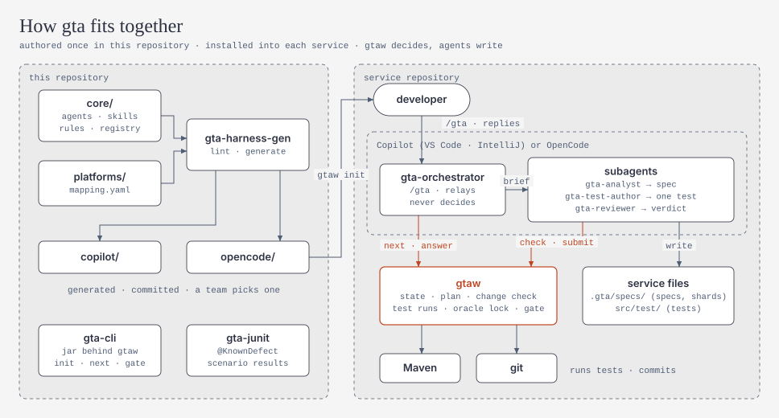
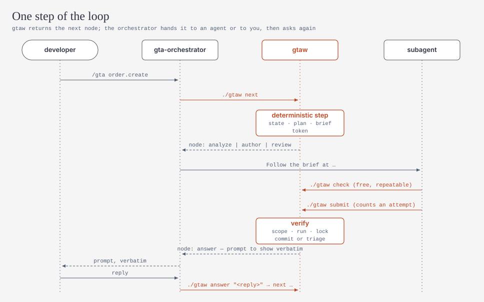

# gta — Generic Testing Agent

**English** | [简体中文](README.zh-CN.md)

gta is a spec-first testing harness for Java/Spring services. It runs inside **GitHub Copilot** (VS Code, IntelliJ) or **OpenCode**.

You type `/gta` and it runs this loop:

1. It reads the code of one flow (a REST endpoint, a scheduled job and so on).
2. It writes a reviewable behaviour spec.
3. It asks you about anything uncertain or suspicious.
4. After you approve the spec, it writes regression and integration tests whose expected values come from the spec, not from what the code happens to do today.

Coverage is not the goal. Tests should check what the service is *supposed* to do, catch regressions, and expose defects instead of locking them in.

<picture>
  <source media="(prefers-color-scheme: dark)" srcset="docs/diagrams/architecture-dark.svg">
  
</picture>

```
/gta order.create
  → analyst writes .gta/specs/order/create.spec.md (EARS requirements, scenarios, Mermaid diagram, questions)
  → each question shows a recommended answer: you reply "OK" (or "OK, 2B"), then "OK" again to approve R2
  → test author writes OrderCreateIT; gtaw runs it, locks the expected values and commits it
  → a test that fails against a confirmed expectation is triaged; a confirmed defect is pinned with @KnownDefect
  → session end: stability runs, the quality gate against the base branch, and a report
```

## How it is built

| Part | What it does |
|---|---|
| `gtaw` (Java CLI, `toolkit/gta-cli`) | Does every deterministic step: state, planning, test runs, failure triage, oracle lock, change check, commits, gate, report. Only `gtaw` decides that a test passed. |
| 4 agents (`core/agents`) | `gta-orchestrator` (entry point), `gta-analyst` (specs), `gta-test-author` (one test per brief), `gta-reviewer` (read-only oracle review and triage). |
| 17 skills (`core/skills`) | Testing know-how loaded by path from `.gta/skills/`: Spring APIs, WireMock, embedded dependencies without containers (Oracle, BigQuery, Pub/Sub, Kafka, JMS/MQ), Batch, schedulers, Beam and more. |
| `gta-junit` (`toolkit/gta-junit`) | `@KnownDefect` (strict expected-failure) and a listener that maps test results to scenarios. |
| `copilot/`, `opencode/` | Ready-to-install harness folders, generated from `core/` + `platforms/` by `gta-harness-gen`. |

<picture>
  <source media="(prefers-color-scheme: dark)" srcset="docs/diagrams/loop-dark.svg">
  
</picture>

[`docs/design/plan.md`](docs/design/plan.md) has the full design ([简体中文](docs/design/plan.zh-CN.md)).

## Quick start

See [docs/guides/quickstart.md](docs/guides/quickstart.md). In short:

```bash
mvn -B install                      # in this repo: builds and tests the toolkit
java -jar toolkit/gta-cli/target/gta-cli.jar --root <service> init --platform copilot   # or opencode
cd <service> && ./gtaw doctor       # Windows: .\gtaw.cmd doctor
```

Then open the service in VS Code, IntelliJ or OpenCode and type `/gta`.

## Supported now (P0)

- **Supported:** Maven and Gradle services on Spring Boot 4.1 and 3.5 (2.2 to 2.7 too), Java 17+ (a few on Java 8 or 11 too), on Windows, macOS and Linux. gtaw itself needs JDK 17+.
- **Writes tests for:** REST APIs (with security rules and caches), message listeners (Kafka, Pub/Sub, JMS/MQ, RabbitMQ, SQS), scheduled jobs (`@Scheduled`, Quartz), Spring Batch jobs, Flyway/Liquibase migrations, WebFlux endpoints, gRPC services, GraphQL handlers, workflows (Temporal, Spring Statemachine, BPMN) and Beam transforms. WebSocket, STOMP and SSE endpoints are detected and specified now, and get tests once their eval passes (P4). gta only runs tests locally: it never tests deployed environments (SIT, UAT, production), and `safety.protectedHosts` makes sure no test it writes names one (plan §7.7, §15).
- **No containers needed:**
  - Oracle runs against a shared test schema or H2 in Oracle mode;
  - BigQuery and GCS use fakes;
  - Kafka and JMS run embedded;
  - Pub/Sub uses an emulator downloaded from Nexus (P3).

## Repository layout

```
core/        source of truth for harness content: agents, command, rules, skills, templates, schemas, registry
platforms/   copilot/ and opencode/ mappings (only platform differences live here)
copilot/     GENERATED from core/ + platforms/copilot (committed so teams can pick it): never edit by hand
opencode/    GENERATED from core/ + platforms/opencode (committed so teams can pick it): never edit by hand
toolkit/     Java sources: gta-core, gta-cli, gta-junit, gta-harness-gen (Maven reactor; pom.xml holds the version)
wrapper/     files installed into services: gtaw, gtaw.cmd, gtaw-download.ps1 (pinned jar from Nexus, sha256-verified)
scripts/     maintainer scripts: generate.sh (platform folders), diagrams/render.py (docs/diagrams)
evals/       order-service fixture with seeded defects and a scripted end-to-end run
docs/        guides/ (quickstart, CI integration, test naming, diagram style, adding a capability), design/ (the design), reviews/ (review records), diagrams/
```

## Development

```bash
mvn -B install                       # build + unit tests (also checks that copilot/ and opencode/ are in sync)
scripts/generate.sh                  # regenerate copilot/ and opencode/ after editing core/ or platforms/
scripts/diagrams/render.py           # regenerate docs/diagrams after editing a diagram (--check in CI)
evals/e2e/run.sh                     # scripted end-to-end run against evals/fixtures/order-service
```

[AGENTS.md](AGENTS.md) has the contributor rules.
