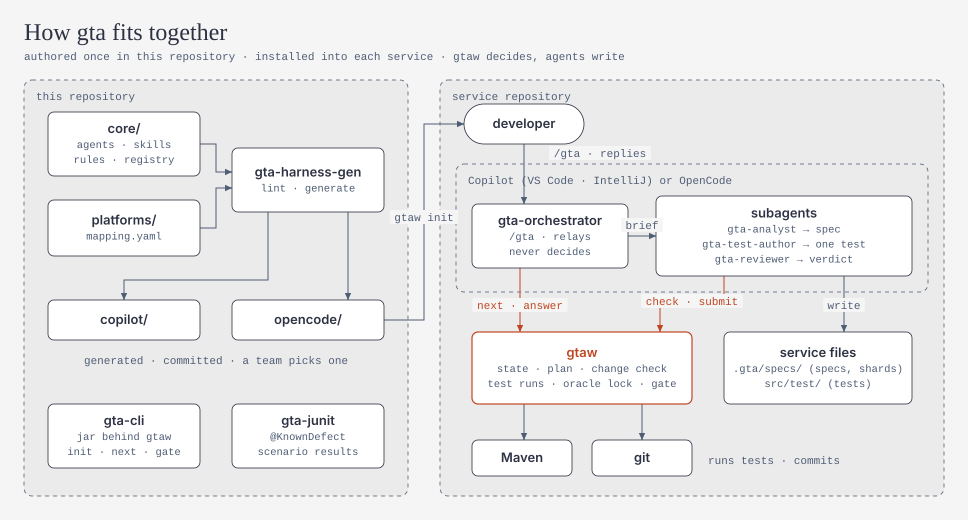
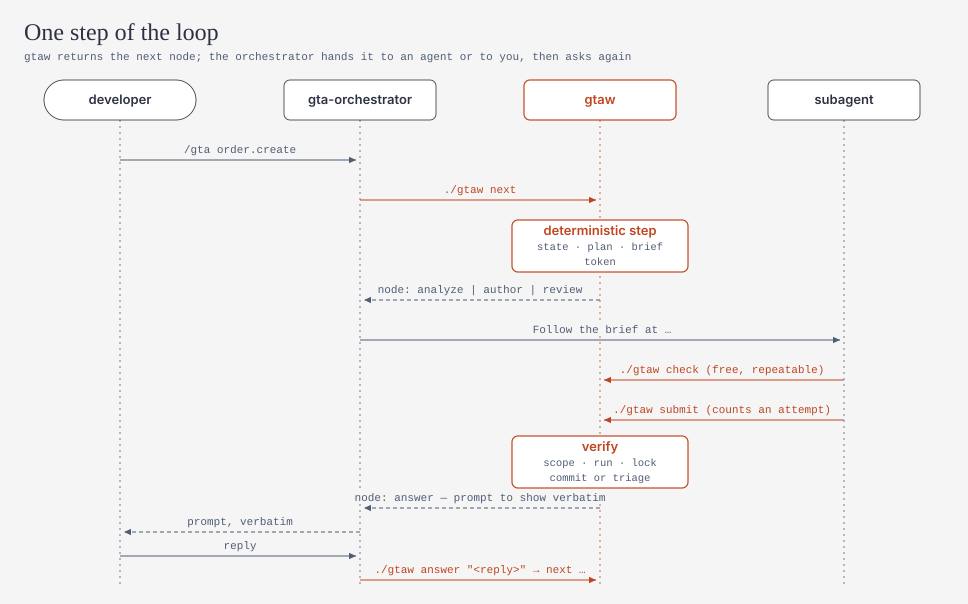

# gta — 通用测试 Agent（Generic Testing Agent）

[English](README.md) | **简体中文**

gta 是一个面向 Java/Spring 服务、"先写规格再写测试"的测试 harness，运行在 **GitHub Copilot**（VS Code、IntelliJ）或 **OpenCode** 中。

输入 `/gta` 后，它按以下循环工作：

1. 读取一个 flow（一个 REST 接口、一个定时任务等）的代码。
2. 写出一份可评审的行为规格（spec）。
3. 对不确定或可疑的地方向你提问。
4. 你批准规格后，它编写回归测试和集成测试，期望值来自规格，而不是代码当前的输出。

覆盖率不是目标。测试应当检查服务*应该*做什么，发现回归，并把缺陷暴露出来，而不是把缺陷锁定成"正确"。

<picture>
  <source media="(prefers-color-scheme: dark)" srcset="docs/diagrams/architecture-dark.svg">
  
</picture>

```
/gta order.create
  → analyst 写出 .gta/specs/order/create.spec.md（EARS 需求、场景、Mermaid 图、问题）
  → 你回答 "R1: 1B 其余默认"，然后回复 "批准 order.create@R2"（英文 "rest default"、"approve …" 同样有效）
  → test author 编写 OrderCreateIT；gtaw 运行它、锁定期望值并提交
  → 与已确认期望不符的失败测试进入分流；确认的缺陷用 @KnownDefect 标注
  → 会话结束：稳定性运行、基于目标分支的质量门禁和报告
```

## 组成

| 部分 | 作用 |
|---|---|
| `gtaw`（Java CLI，`toolkit/gta-cli`） | 完成所有确定性步骤：状态、计划、测试运行、失败分流、期望值锁定、改动检查、提交、门禁、报告。只有 `gtaw` 能判定测试通过。 |
| 4 个 agent（`core/agents`） | `gta-orchestrator`（入口）、`gta-analyst`（写规格）、`gta-test-author`（每份 brief 写一个测试）、`gta-reviewer`（只读：期望值评审与分流）。 |
| 17 个 skill（`core/skills`） | 测试知识，按路径从 `.gta/skills/` 加载：Spring API、WireMock、不用容器的依赖替身（Oracle、BigQuery、Pub/Sub、Kafka、JMS/MQ）、Batch、定时任务、Beam 等。 |
| `gta-junit`（`toolkit/gta-junit`） | `@KnownDefect`（严格的预期失败）和把测试结果对应到场景的 listener。 |
| `copilot/`、`opencode/` | 可直接安装的 harness 文件夹，由 `gta-harness-gen` 从 `core/` + `platforms/` 生成。 |

<picture>
  <source media="(prefers-color-scheme: dark)" srcset="docs/diagrams/loop-dark.svg">
  
</picture>

完整设计见 [`docs/design/plan.zh-CN.md`](docs/design/plan.zh-CN.md)（[English](docs/design/plan.md)）。

## 快速开始

详见 [docs/guides/quickstart.md](docs/guides/quickstart.md)（英文）。简要步骤：

```bash
mvn -B install                      # 在本仓库：构建并测试 toolkit
java -jar toolkit/gta-cli/target/gta-cli.jar --root <service> init --platform copilot   # 或 opencode
cd <service> && ./gtaw doctor       # Windows: .\gtaw.cmd doctor
```

然后在 VS Code、IntelliJ 或 OpenCode 中打开服务，输入 `/gta`。

## 当前支持（P0）

- **环境：** Maven 服务，Spring Boot 4.1（及 3.5），Java 17+，Windows、macOS、Linux。
- **会写测试的能力：** REST API。其他能力（定时任务、Batch、消息、工作流、Beam、已部署系统）已能识别并编写规格，测试编写在后续阶段开放（见 `core/registry/capabilities.yaml` 和设计文档 §15）。
- **不需要容器：**
  - Oracle 使用共享测试 schema，或 Oracle 模式的 H2；
  - BigQuery 和 GCS 使用替身；
  - Kafka 和 JMS 嵌入式运行；
  - Pub/Sub 使用从 Nexus 下载的模拟器（P3）。

## 仓库结构

```
core/        harness 内容的唯一来源：agent、命令、规则、skill、模板、schema、能力注册表
platforms/   copilot/ 与 opencode/ 的映射（平台差异只在这里）
copilot/     由 core/ + platforms/copilot 生成（已提交，供团队选用），不要手改
opencode/    由 core/ + platforms/opencode 生成（已提交，供团队选用），不要手改
toolkit/     Java 源码：gta-core、gta-cli、gta-junit、gta-harness-gen（Maven 多模块；版本号以 pom.xml 为准）
wrapper/     安装到服务中的文件：gtaw、gtaw.cmd、gtaw-download.ps1（从 Nexus 下载锁定版本的 jar 并校验 sha256）
scripts/     维护脚本：generate.sh（平台文件夹）、diagrams/render.py（docs/diagrams）
evals/       带预埋缺陷的 order-service 样例和脚本化端到端测试
docs/        guides/（快速开始、CI 接入、测试命名、图表风格、新增能力）、design/（设计）、reviews/（评审记录）、diagrams/
```

## 开发

```bash
mvn -B install                       # 构建 + 单元测试（同时检查 copilot/ 与 opencode/ 是否同步）
scripts/generate.sh                  # 修改 core/ 或 platforms/ 后重新生成 copilot/ 与 opencode/
scripts/diagrams/render.py           # 修改示意图后重新生成 docs/diagrams（CI 中用 --check）
evals/e2e/run.sh                     # 针对 evals/fixtures/order-service 的脚本化端到端测试
```

贡献规则见 [AGENTS.md](AGENTS.md)（英文）。
