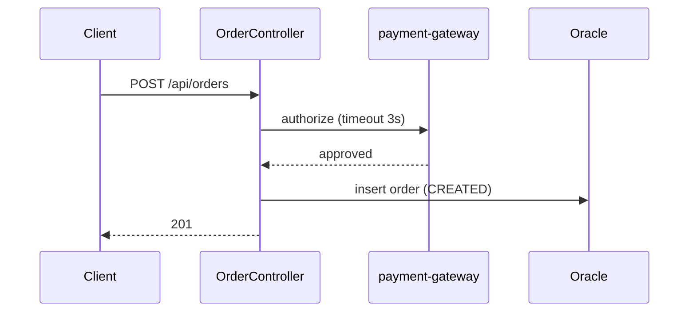
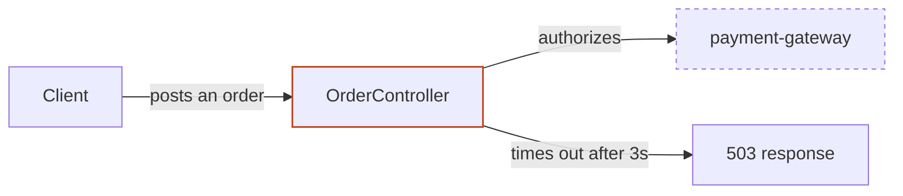

# Diagrams (Mermaid only)

One diagram per flow, at most 40 lines, only what the tests need.

| Flow | Diagram |
|---|---|
| API, events | `sequenceDiagram` (async messages use `-)`) |
| Scheduler, batch | `flowchart TD` for steps; `stateDiagram-v2` for job/entity status |
| Workflow, state machine | `stateDiagram-v2` with every transition and error branch |
| Pipeline | `flowchart LR` of transforms, windows and the DLQ |
| Data | `erDiagram` with the entities this flow touches only |

Style (the linter enforces it):

- No `%%{init}%%` theme: the viewer's light or dark theme must stay readable.
- One accent: `classDef focus stroke:#bf4520,stroke-width:1.5px` on the entry point under test, and
  `classDef external stroke-dasharray:4 4` on downstream systems. No other `classDef`, `style` or `linkStyle`.
- About 9 nodes at most, sentence-case labels, verbs on edges, error branches drawn.

State names in `stateDiagram-v2` cannot contain hyphens: write `in_review`, not `in-review`. Gliffy and images are not used: they cannot be diffed or reviewed in a PR.
