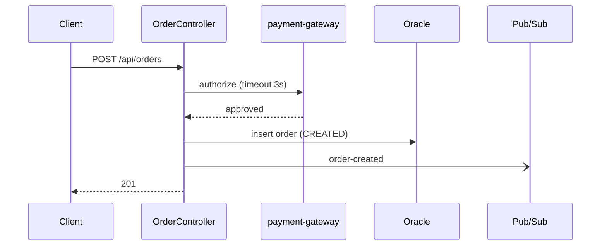
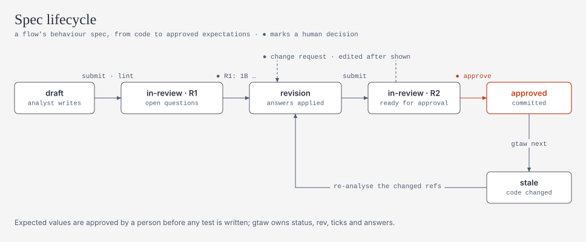
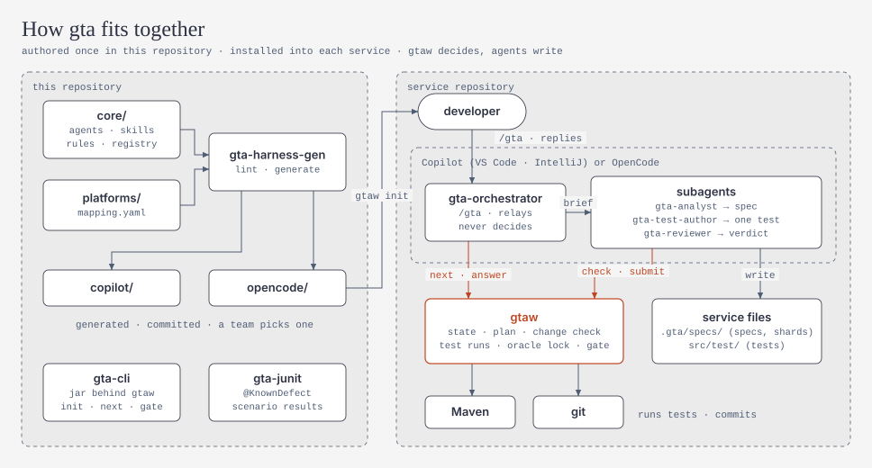
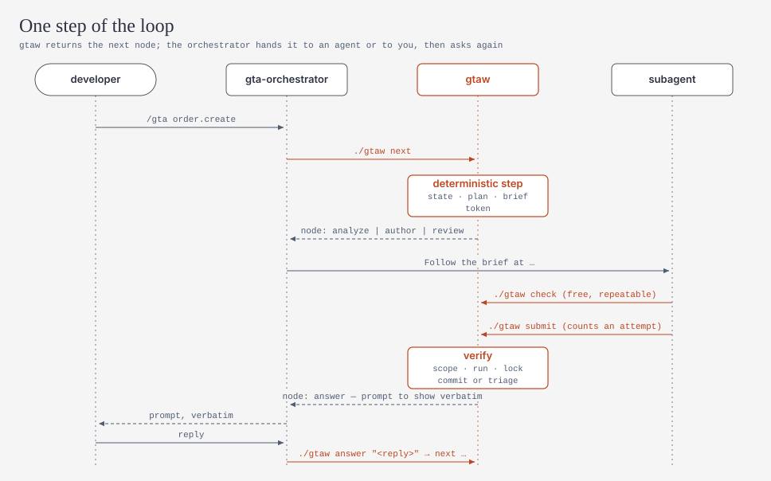
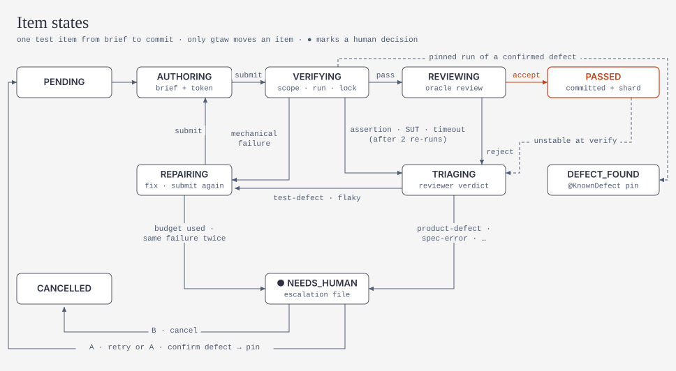
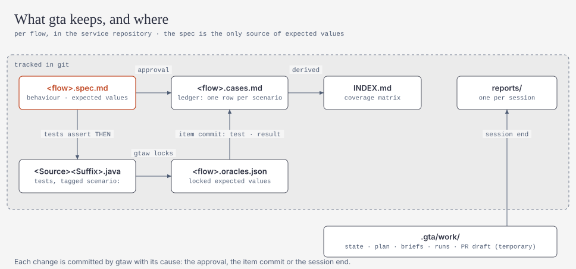

# Generic Testing Agent (GTA) — Design

**English** | [简体中文](plan.zh-CN.md)

> Status: **P0 implemented** (REST APIs; other capabilities open phase by phase, see the §15 roadmap) · Version: plan v9 · Date: 2026-11 · Code review and remediation record: [round-2-remediation.md](../reviews/round-2-remediation.md) · [round-3-plan.md](../reviews/round-3-plan.md)
> Scope: a generic testing harness for Java services (mostly Spring)
> Surfaces: **VS Code Copilot, IntelliJ IDEA Copilot** (primary), OpenCode (secondary)
> Target environment: Maven; Spring Boot 4.1 mostly, a few 3.5; JUnit follows the Spring Boot parent; Java 17+; Windows developer machines; Oracle and BigQuery for data; Pub/Sub, Kafka and MQ for messaging; no containers locally; every dependency goes through the company Nexus proxy and the platform team can upload packages to Nexus; CI (alm-github) can be connected; most services have code but no specification documents. CODEOWNERS and branch protection are not enabled, and the Copilot preview policy is off
> Namespace: every external asset uses the prefix `gta`. The revision history is in Appendix B

---

## 0. TL;DR

1. **Goal**: tests must find errors, not just cover code. The gate looks at three things: whether scenarios are verified, how strong the tests are, and whether they are stable. Coverage is for reference only (§1).
2. **Spec-first: write the behaviour spec, then the tests**
   - The agent first turns the code into a behaviour spec: the format is OpenSpec-compatible, requirements use EARS sentences, a Mermaid diagram is attached, and every scenario states its source.
   - Only conclusions a person explicitly answered count as `confirmed` and may become expected values. Conclusions accepted by default, or only read from the code, produce characterization tests (they lock the current behaviour without judging it).
   - Answering questions and approving the spec are two steps: after the answers gtaw creates a new spec revision, and the approval must name that revision (§3).
3. **Protecting expected values**
   - A failed assertion does not go to repair. gtaw first triages it deterministically, then the reviewer judges it against the spec.
   - The oracle lock is monotonic over the expected values derived from THEN: locked assertions can only be kept, never changed or removed; changes to inputs and fixtures go to the reviewer.
   - Every run checks deterministically that the expected values in the spec's THEN clauses really appear in assertions.
   - Only gtaw can set the `passed` status.
   - Confirmed defects are pinned with `@KnownDefect` (strict xfail).
   - The gate decides against the approved specs and oracles of the base branch. It runs locally at the end of every session; connecting it to CI is optional (§5.3, §10.5).
4. **Architecture**
   - A deterministic Java CLI, `gtaw`, owns state, scheduling, execution, triage and the gate. The LLM only analyses, writes specs, writes tests and reviews.
   - The protocol is `next` → dispatch → `check` (any number of times) → `submit`.
   - Briefs are self-contained: they can be handed to a subagent, or run inline by the orchestrator when the platform has no subagents (§4).
5. **Primitives on demand (§4.0)**: only custom agents, subagents, one prompt file and one AGENTS.md block are used; skills are used only as a format. v1 uses no hooks, MCP, handoffs or plugins.
6. **Few agents, many skills**
   - There are only 4 agents; deployed systems do not get an agent of their own. Skills are chosen from the registry by service type and loaded by path from the brief, without relying on platform auto-triggering.
   - Something becomes an agent only when it needs its own context, its own judgement or different permissions; everything else is a skill or gtaw (criteria in §4.0).
7. **Derivable state**
   - Long-lived truth lives in git: specs, oracle files sharded per flow, escalation records and the tests themselves.
   - Working state lives in the gitignored `.gta/work/` and can be rebuilt; handing over to someone else only needs a push (§5.2).
8. **The trust anchors are gtaw and CI, not the IDE**
   - Authoritative decisions come from two places: gtaw's change check for every node, and the gate anchored on the base branch. The gate runs locally; CI is optional.
   - Human confirmations carry the original words and channel and are listed in the PR comment, so normal PR review keeps watch (§5.5).
9. **Onboarding**: the tech lead runs `./gtaw init` once per repository; developers need a single command, `/gta` (§12).

---

## 1. Problem and quality signals

**Today**: services are mostly Java, deployed on GCP (GKE, Dataflow, Cloud Run) and in some non-GCP environments. Flow types include APIs, schedulers, batch, workflows and event-driven flows. The goal is automated regression and integration testing.

**Why coverage alone is not enough**
- A test without assertions still contributes coverage.
- Coverage knows nothing about business semantics such as boundary values, idempotency, time, concurrency, permissions or eventual consistency.
- Coverage knows nothing about cross-service contracts.
- Of the 571 tests Meta ACH had accepted, 277 would have been discarded by a line-coverage criterion, yet they catch real faults.

| Signal | Definition | How it is computed |
|---|---|---|
| Scenario verification rate (per source) | Share of approved scenarios with a verified test; `confirmed`/`documented` and `observed`/`defaulted` are counted separately | spec ↔ JUnit/Karate tags |
| Spec findings | Disagreements between sources: `behavior-suspect` (the code looks wrong) and `doc-drift` (the documentation is outdated) | found by the analyst, confirmed by a person |
| Test strength (changed code) | How many of the covered mutants are killed (killed / covered) | `gtaw mutate` (PIT, only lines touched by the diff) |
| Can-fail evidence (P2) | A unit/slice test kills at least one mutant of the method it tests | `gtaw verify` |
| Catching hits | Tests generated in a PR to catch bugs whose failure is confirmed as a real defect | PR mode (P3) |
| Oracle strength | Whether assertions verify the business outcome, not just "not null" | anti-pattern checks in `gtaw submit` + reviewer |
| Contract coverage | OpenAPI operation × status code, message schemas | Schemathesis / Pact / SCC |
| Stability | A new test passes k times in a row under random order, a non-UTC timezone and a non-English locale (pass^k) | `gtaw verify` |
| Coverage | Reference only | JaCoCo |

---

## 2. Industry practice and design principles

### 2.1 What large companies do

| Source | Practice | What this design adopts |
|---|---|---|
| **Meta ACH** (FSE'25) | Generates a few mutants for specific risks, then has an LLM write tests that kill them | can-fail check; mutation-driven test additions |
| **Meta JiTTests** (2026) | Infers intent and risk from a diff and generates catching tests; failing tests are filtered by rules and an LLM assessor before a person sees them | catching tests in PR mode; the reviewer as assessor; defects confirmed by a person |
| **Uber AutoCover** (ICSE-SEIP'26) | Four stages: prepare / generate / execute / validate-repair; mutation as a gate; repeated runs against flakiness | node boundaries; pass^k |
| **Stripe Minions** | Deterministic and agentic nodes alternate; CI fixes are limited to about 2 rounds, then a person takes over | deterministic steps live in gtaw; repair attempts are bounded |
| **Spotify Honk** | An independent verifier runs before a PR is opened; an LLM judge checks against the original intent | verification separated from authoring; the reviewer as judge |
| **Airbnb test migration** | Every step is validated, errors are fed back for a retry, sibling tests are given as context | structured errors; sibling tests in the brief |
| **Microsoft code-testing-generator** | A dedicated agent plus skills; production code is never changed; about 13 points better than plain Copilot | dedicated agents + skills; production code untouched |
| **Diffblue Testing Agent** | Delivers only verified tests that compile and pass | only deterministically verified tests are committed |

### 2.2 What open-source repositories do

| Repo | Practice | Borrowed | Not borrowed |
|---|---|---|---|
| [Playwright Test Agents](https://playwright.dev/docs/test-agents) | planner → generator → healer; if the feature itself is broken, the healer marks the test `test.fixme` | repair only fixes mechanical problems; a seed test as baseline | a healer that repairs until green |
| [github/spec-kit](https://github.com/github/spec-kit) | specify → clarify (answers are written back into the spec) → plan → tasks → analyze | answers written back into the spec; traceability matrix | the full development process |
| [Fission-AI/OpenSpec](https://github.com/Fission-AI/OpenSpec) | Requirement + Scenario format; changes described as deltas | the spec format; behaviour change summaries | depending on its CLI (needs Node, telemetry on by default) |
| [Kiro](https://kiro.dev/docs/specs/correctness/) | EARS requirements; properties extracted from requirements, then counterexamples searched | EARS; invariants → property tests | — |
| [BMAD TEA](https://github.com/bmad-code-org/bmad-method-test-architecture-enterprise) | risk = probability × impact; gate PASS/CONCERNS/FAIL/WAIVED; implementers cannot approve their own work | risk scoring; four-valued gate; waivers | anthropomorphic personas |
| [obra/superpowers](https://github.com/obra/superpowers) | no claim of done without evidence; a new subagent per task | only gtaw sets `passed`; a fresh context per item | — |
| [ChatUniTest](https://github.com/ZJU-ACES-ISE/ChatUniTest) / [TestART](https://github.com/sikygu/TestART) | generate → validate → repair; rule-based repair first | rules before the LLM (P2) | coverage as the goal |
| [Probity](https://github.com/nizos/probity) | a declarative policy engine across agents | the way hook rules are designed | depending on it directly |
| [Specmatic](https://specmatic.io/) | OpenAPI as an executable contract | an option for the contract layer | — |
| [EvoMaster](https://github.com/WebFuzzing/EvoMaster) | search-based generation of JVM REST tests | — | its oracle reflects actual, not expected behaviour |
| [Keploy](https://github.com/keploy/keploy) | records traffic and replays it | characterization baseline in P5 | — |

**Research evidence**: [Konstantinou et al. (2024)](https://arxiv.org/abs/2410.21136) found that LLM-generated oracles mostly reflect the **actual** behaviour of the code, not the **expected** behaviour.

### 2.3 Guides and platforms

| Source | Key points |
|---|---|
| [Building effective agents](https://www.anthropic.com/engineering/building-effective-agents) | prefer workflows to agents; orchestrator-workers; evaluator-optimizer |
| [Effective harnesses](https://www.anthropic.com/engineering/effective-harnesses-for-long-running-agents) | keep state in JSON and change only state fields; one item at a time; a fixed start-up routine |
| [Multi-agent research](https://www.anthropic.com/engineering/multi-agent-research-system) | about 15× the tokens of a chat; delegate with a clear goal, format and boundaries |
| [Context engineering](https://www.anthropic.com/engineering/effective-context-engineering-for-ai-agents) | load context on demand; subagents return summaries only |
| [Writing tools for agents](https://www.anthropic.com/engineering/writing-tools-for-agents) | few, useful tools; error messages that can be acted on directly |
| [Skill best practices](https://platform.claude.com/docs/en/agents-and-tools/agent-skills/best-practices) | gerund names; third-person descriptions; bodies under 500 lines; references one level deep |
| [Demystifying evals](https://www.anthropic.com/engineering/demystifying-evals-for-ai-agents) | task / trial / grader; pass@k vs pass^k; capability vs regression evals |
| Copilot: [hooks](https://docs.github.com/en/copilot/reference/hooks-reference), [VS Code hooks](https://code.visualstudio.com/docs/copilot/customization/hooks), [VS Code approvals](https://code.visualstudio.com/docs/agents/run/approvals.md), [JetBrains 2026-03](https://github.blog/changelog/2026-03-11-major-agentic-capabilities-improvements-in-github-copilot-for-jetbrains-ides/) / [2026-04](https://github.blog/changelog/2026-04-24-inline-agent-mode-in-preview-and-more-in-github-copilot-for-jetbrains-ides) / [2026-06](https://github.blog/changelog/2026-06-02-introducing-copilot-cli-and-agentic-capabilities-enhancements-in-jetbrains-ides/) | see §11.4 |

### 2.4 Design principles

| # | Principle |
|---|---|
| P1 | **Determinism first**: every step that can be written as code is done inside gtaw |
| P2 | **Oracles independent of the implementation**: expected values come from a spec a person confirmed and cannot change during repair |
| P3 | **Verification independent of the author**: the agent that writes a test cannot declare it passed |
| P4 | **Quality is not coverage** |
| P5 | **Agents split by permissions, specialisation through skills** |
| P6 | **Context isolation**: every node runs in a fresh context and returns one line |
| P7 | **Long-lived truth in git, rebuildable working state**; only gtaw writes state |
| P8 | **Bounded loops with circuit breakers** |
| P9 | **Auditable human confirmations**: with original words, channel and revision, visible in the PR |
| P10 | **Authoritative decisions in gtaw and CI** (anchored on the base branch), not in IDE-side mechanisms |
| P13 | **Primitives on demand**: every agent/skill/prompt/instruction/hook/MCP needs a clear responsibility, or it is not introduced |
| P11 | **CI does not depend on an LLM** |
| P12 | **Eval-driven** |

### 2.5 Explicitly out of scope for v1

- No home-grown orchestration runtime and no MCP server: Copilot in the IDE is the runtime.
- Production code is never changed, not even in incident mode. Where the code lacks a test seam, gta only reports "refactoring suggested".
- No test agent users can call directly; no reliance on platform auto-triggering of skills.
- One driving session per worktree at a time; tests are not written in parallel.
- No Gliffy (proprietary format, cannot be diffed, hard for LLMs to produce reliably); Mermaid throughout.
- No dependency on the OpenSpec CLI; no EvoMaster; jqwik is not a default (§7.9).
- v1 uses no hooks, MCP, handoffs or plugins, and does not let the platform load skills automatically (see §4.0).
- No plugin distribution, SARIF, vector store or dashboard. Postponed: reading OpenSpec/Spec Kit specs (P2), Cucumber, record-replay, performance tests.

---

## 3. Spec-first: confirm the behaviour spec, then write tests

### 3.1 Assessment: analyse the code, produce a spec and diagrams, confirm, then write tests

**Conclusion: the direction is right and it should be the entry point of the system.** The original idea needs these adjustments:

| Aspect | Assessment |
|---|---|
| ✅ Solves the oracle problem | Tests derived only from code are tautologies: if the code has a bug, the test takes the bug as the expected value. Only expectations a person confirmed can really verify correctness |
| ✅ Early clarification | Asking before writing tests is cheaper than reworking afterwards |
| ✅ Diagrams for quick review | One sequence or state diagram lets a person confirm the boundaries faster than hundreds of lines of code |
| ✅ The spec is a long-lived asset | The spec is the regression baseline; the spec diff in a PR is the behaviour change of that PR |
| ⚠️ Adjustment 1 | Write a **behaviour spec**, not a full design document: only boundaries, access, behaviour, states, invariants and questions |
| ⚠️ Adjustment 2 | Use **Mermaid**, not Gliffy; limit diagram kinds and size per flow type (§3.4) |
| ⚠️ Adjustment 3 | **Every scenario states its source** and refers to a method, config key or bean; disagreements between sources are recorded as findings |
| ⚠️ Adjustment 4 | **Structured questions**: at most 5 per round; every option says what the THEN becomes; high-impact questions need an explicit answer; the default of a non-high-impact question must be "= current code" |
| ⚠️ Adjustment 5 | **Answering and approving are two steps, and approval is per flow (in fact per Requirement)** |
| ⚠️ Adjustment 6 | **Effort scales with the mode**: explain mode produces a draft only; flow mode a full spec; PR mode only updates the affected parts |

**One step further**: use the idea of Example Mapping (rules → examples → questions). A Requirement is a rule; a Scenario is an example and at the same time the test contract. Scenarios and tests map one to one.

### 3.2 Sources, intents and rules

| Source (`source`) | Meaning | Test intent produced |
|---|---|---|
| `observed` | behaviour seen in the code, with a `ref` | `characterization` |
| `documented` | from OpenAPI, README, ADRs, existing human-written tests, PR descriptions or ticket acceptance criteria; written as `doc:<path>#<anchor>` with a verbatim quote that gtaw checks word for word, otherwise downgraded to `observed` | `hardening` |
| `confirmed` | a person answered explicitly (§3.5) | `hardening` |
| `defaulted` | accepted with "rest default"; by rule the value is the current code | `characterization` |
| `assumed` | the agent's inference without evidence | must be asked as a question; no test before it is answered |

- `source` is set on the Scenario; a THEN clause with a different source can be marked on its own.
- `confirmed` and `defaulted` **can only be written by gtaw** and need a matching gtaw answer record, otherwise lint rejects them. The analyst can only write `observed`, `documented` and `assumed`.
- A Scenario inherits the source of its Requirement by default.

**Reality: most services have code but no specification documents**
- Most conclusions start as `observed`, so characterization tests come first as the regression baseline. The gate protects them as well (§10.5 ①).
- Real expected values mostly come from people's answers, so questions should cover high-risk behaviour first.
- OpenAPI generated from code (springdoc and similar) counts as `observed`, not `documented`.
- A by-product: the spec becomes the first maintainable behaviour documentation of these services.

**Rules** (enforced by gtaw)
1. When an `observed` or `defaulted` oracle fails, the reviewer triages it first. If `test-defect` is ruled out and the verdict is `spec-error`, the observation was wrong. gtaw then:
   - corrects the THEN in the spec with the actual value and bumps the revision;
   - relocks on the new value; the item stays valid and is not cancelled by the revision (the exception to the rule);
   - lists the change under "to re-confirm" in the report for a person to review in bulk.
2. When a `confirmed` or `documented` oracle fails and is judged a `product-defect`, **a person must confirm it** (§5.5) before it is pinned with `@KnownDefect`.
3. When `documented` and `observed` disagree, the disagreement becomes a question marked `doc-drift` or `behavior-suspect`, because the documentation is often the outdated side.
4. Suspicious current behaviour becomes a question instead of going straight into the spec. Examples: swallowed exceptions, inconsistent status codes, missing ownership or tenant checks.
5. Scenario completeness does not rely on the LLM's free hand: equivalence classes, boundary values, decision tables and state transitions are applied systematically, then risk-based guessing of what can go wrong.

### 3.3 Spec file format (OpenSpec-compatible)

**Location**: the spec is `.gta/specs/<domain>/<flow-name>.spec.md`, with the oracle shard `<flow-name>.oracles.json` next to it (§5.2).

**Metadata** lives in HTML comments. `ref` has three forms:
- method: `Class#method`
- config key: `config:<key>`
- bean definition method: `bean:Class#method`

Every `ref` carries a hash: the method body for methods and beans, the value for config keys.

````markdown
# order.create — Create an order
<!-- gta: flowId=order.create capability=rest-api risk=6 status=in-review rev=R3
     sources=method:com.acme.order.api.OrderController#create,config:payment.gateway.timeout -->

## Boundary
- In scope: POST /api/orders → persist the order → publish order-created
- Out of scope: payment callback (see `payment.callback`)
- External: payment-gateway (HTTP, not GCP), Oracle, Pub/Sub `order-created`



## Access
| Role | Operation | Ownership constraint | Source |
|---|---|---|---|
| customer | create | only for themselves | observed |
| customer | read | see q02 | assumed |

## Requirements

### Requirement: Payment gateway timeout
<!-- gta: id=order.create/r02 ref=method:com.acme.order.OrderService#authorize refHash=7c1a… ref=config:payment.gateway.timeout refHash=19be… -->
IF the payment gateway does not respond within 3s, THEN THE order service SHALL respond 503 and keep the order in PENDING_PAYMENT.

#### Scenario: gateway silent for 3 seconds
<!-- gta: id=order.create/s03 source=observed hint.layer=component hint.oracle=state -->
- **WHEN** the gateway does not respond within 3s
- **THEN** the response status is `503` with a ProblemDetail body
- **AND** orders.status is `PENDING_PAYMENT`
- **AND** no message is published to `order-created`

## Invariants
- For any two submissions with the same `Idempotency-Key`, THE order service SHALL create only one order <!-- gta: id=order.create/i01 source=assumed hint.oracle=property → see q03 -->

## Open questions
<!-- gta: round=R3 -->
<!-- gta: id=order.create/q01 impact=high affects=order.create/s03 -->
1. [high impact] Should a gateway timeout be retried automatically?
   - [ ] A) No retry (= current code) → s03 unchanged
   - [ ] B) Retry once → s03 THEN adds "gateway is called twice"
<!-- gta: id=order.create/q02 impact=high affects=order.create/r05 -->
2. [high impact] Can someone who does not own an order read it? The code has no ownership check.
   - [ ] A) No → r05 THEN "the response is 404"
   - [ ] B) No → r05 THEN "the response is 403"
   - [ ] C) Yes (= current code)
<!-- gta: id=order.create/q03 impact=normal affects=order.create/i01 -->
3. What happens when the same `Idempotency-Key` is submitted twice?
   - [ ] A) The first result is returned (= current code)
   - [ ] B) 409 is returned

## Findings
<!-- gta: id=order.create/f01 kind=doc-drift -->
- The README says "a timeout returns 504"; the code returns 503.
````

**Spec status** `status`: `draft` → `in-review` → `approved`; plus `stale` (the hash of a `ref` changed) and `withdrawn`. `status`, `rev`, answers and approval records **can only be written by gtaw**.

**Spec lint** (run inside next/submit):
- A Requirement must use an EARS sentence (ubiquitous / WHEN / IF…THEN / WHILE / WHERE) and have at least one Scenario.
- Every THEN must be observable and contain at least one expected value in backticks; where a literal is really impossible, mark `check=reviewer` and the reviewer checks it instead.
- `confirmed` and `defaulted` need a matching answer record; `documented` needs a `doc:` reference whose quote checks out word for word.
- Every `ref` resolves and its hash matches.
- A flow with an external entry point needs an `## Access` section.
- `risk` = probability (1–3) × impact (1–3). 9 → p0, 6 → p1, 3–4 → p2, 1–2 → p3.
- Every option states its effect on THEN; a non-high-impact question needs a "= current code" option.
- Every `assumed` conclusion has a question.
- Mermaid diagrams follow the basic syntax and size limits.

The Chinese marker `= 代码现状` is accepted as an alias of `= current code`.

### 3.4 Choosing diagrams

| Situation | Diagram | Constraint |
|---|---|---|
| Service overview (`service-overview.md`) | `flowchart LR`: service, external dependencies, triggers | one per service |
| API / event | `sequenceDiagram`, `-)` for async messages | one per flow, at most 15 messages |
| Scheduler / batch | `flowchart TD` for steps plus `stateDiagram-v2` for states | only what the tests need |
| Workflow / state machine | `stateDiagram-v2` | every transition and error branch |
| Pipeline | `flowchart LR`, including windows and DLQ | — |
| Data | `erDiagram` | only the entities of this flow |

Rendering: GitHub supports Mermaid natively; IntelliJ needs Mermaid enabled in the Markdown settings; for VS Code, `gtaw init` recommends the extension in `.vscode/extensions.json`.

The diagrams of this document and the README are not Mermaid: they are rendered by `scripts/diagrams/render.py` into `docs/diagrams/` (light and dark SVG, in the style of cathrynlavery/diagram-design). Spec diagrams stay Mermaid because gtaw parses and lints them and PR diffs must stay textual.

### 3.5 Answers and approval

<picture>
  <source media="(prefers-color-scheme: dark)" srcset="../diagrams/spec-lifecycle-dark.svg">
  
</picture>

1. **gtaw renders the question block** with a round number, e.g. `R3`. The orchestrator must show it verbatim.
2. **Answers** come through two channels; both record the original words, round and channel in the spec:
   - `chat`: the user replies in chat, e.g. "R3: 1A 2A rest default". The orchestrator calls `./gtaw answer "<original words>"` to hand the words to gtaw.
   - `editor`: the person ticks the options in the editor and then runs `/gta`.

   v1 does not use a hook to prove an answer came from a person, for the reasons in §4.0. Credibility comes from auditing: the original words are written into the spec and listed in the PR comment.
3. **Defaults**: high-impact questions cannot be defaulted. "rest default" always picks "= current code", and the conclusion is recorded as `defaulted`.
4. **Approval**:
   - After applying the answers, gtaw creates a new revision (e.g. `R4`) and shows how the spec changed.
   - The user must reply in **a separate message** with exactly "approve `order.create@R4`". Any other reply, including "don't approve …", is a change request.
   - The spec must still be exactly what gtaw showed; if it was edited afterwards, it goes back to the analyst and comes back as a new revision.
   - Approval records a content hash per Requirement. Later, only a Requirement whose content changed goes back to `in-review`.
5. **Authoritative approval**: normal PR review keeps watch. The PR comment gtaw generates lists every new `confirmed`, approval, `relock` and waiver of the change with original words and channel, so **any forgery is in front of the reviewer**. Questions can also be answered asynchronously by the product owner through the PR. If CODEOWNERS is enabled later, spec approval can be tightened to require CODEOWNERS without changing the design.

Users may reply in Chinese: gtaw accepts `批准` for approve and `其余默认`/`其他默认` for rest default.

### 3.6 Coexisting with OpenSpec / Spec Kit (P2; implemented except the delta-format summary)

- A configuration key `spec.source` (added in P2; v1 rejects it as unknown) can be `gta`, `openspec` or `speckit`.
- With the latter two, the specs already in the repository are read as a `documented` source and GTA does not rewrite them.
- The behaviour change summary of the PR report uses OpenSpec's delta format (not yet: the PR report has no behaviour change summary in any format; it arrives with it).

---

## 4. Harness architecture

### 4.0 Choosing primitives: each one needs a clear responsibility, none is added for completeness

| Primitive | Used in v1 | Responsibility / reason for not using it |
|---|---|---|
| **Custom agents** (`.github/agents`, `.opencode/agents`) | ✅ 4 | Criteria below. Split by "needs its own context, its own judgement or different permissions", not by service type |
| **Subagents** | ✅ by default | Every item runs in a fresh context, which keeps long sessions from bloating; `dispatch: inline` when the platform has none |
| **Prompt files / commands** | ✅ one, `/gta` | The only entry point; it selects the orchestrator automatically; not split into one command per mode |
| **Instructions** (AGENTS.md) | ✅ one 3-line block | A single job: telling ordinary chats "use `/gta` for anything about tests and do not edit files under `.gta/` by hand". Each agent's rules live in its own body, not in global instructions, and are not repeated in `copilot-instructions.md` or `.instructions.md` |
| **Skills (Agent Skills format)** | ⚠️ format only | Knowledge is organised as `SKILL.md` plus `references/` and loaded by path from the brief. **They are not put into the platform's skills folder**, so ordinary chats never trigger them |
| **Hooks** | ❌ not in v1 | VS Code hooks are a preview feature and the preview policy is off, so they cannot be relied on in VS Code. The jobs a hook would do are covered elsewhere:<br>- out-of-scope edits: the change check of §5.8 reverts them;<br>- privileged commands: not on the terminal auto-approve list, so a person must click;<br>- tampering with expected values: the oracle lock plus the gate.<br>P5 may add them as an optional enhancement for earlier interception and for capturing human input |
| **MCP** | ❌ not in v1 | Calling gtaw from the terminal is enough. An MCP server adds process, configuration and authentication handling, configured separately in each IDE. Only if terminal approval prompts become a real pain would P5 wrap gtaw as MCP tools to use IntelliJ's per-tool auto-approval |
| **Handoffs** | ❌ | VS Code only; human steps all happen in chat |
| **Plugins / marketplace** | ❌ (P5) | Installation is `gtaw init`, identical in both IDEs |
| **Anthropic's methodology** | ✅ as design basis | Adopted: workflows first, monotonic state, one context per item, eval-driven. Not adopted: mechanisms that exist only in Claude Code |

#### Criteria (based on Anthropic's definitions of each primitive)

| Primitive | Anthropic's definition | Rule in this design |
|---|---|---|
| Workflow (deterministic code) | Predefined code paths; a step code can do is not given to an LLM | Advancing the flow, planning, execution, triage and the gate all live in gtaw |
| Agent / subagent | The LLM decides the process and tool use. A subagent has its own context window, system prompt and tool permissions, which suits context isolation, independent judgement and separate permissions; simple sequential steps should not become subagents | Something becomes an agent only if it meets at least one of:<br>① it needs its own context (reads a lot of code);<br>② it needs judgement independent of the author;<br>③ it needs different tool permissions |
| Skill | Reusable expertise (procedures, conventions, references), loaded progressively on demand rather than always in context, reusable across agents | Knowledge that depends on the stack or service type, is needed per item and is long becomes a skill. An agent's role, workflow and output contract live in the agent body |
| Prompt / command | A reusable prompt the user triggers | only `/gta` |
| Instructions (CLAUDE.md / AGENTS.md) | Always in context, loaded every time | only the one sentence every chat must know |
| Hook | A deterministic command on a lifecycle event that guarantees something happens | such guarantees live inside gtaw |
| MCP | Connects external systems and data | this design has no external system to connect |

**Audit result**

| Candidate | Decision | Reason |
|---|---|---|
| orchestrator | **agent** | user-facing; needs different permissions (dispatching subagents); does no domain work itself |
| analyst | **agent** | reads a lot of code, needs its own context; may only write specs |
| test-author | **agent** | a fresh context per item; may write tests |
| reviewer | **agent** | must be independent of the test-author (P3); read-only. A different model family than the test-author is recommended, so the two are less likely to make the same mistake |
| planner | ~~agent~~ → **gtaw** | planning is a rule mapping, a workflow |
| system-tester | ~~agent~~ → **test-author + skill** | differs from the test-author only in knowledge. The permission difference for cloud operations is handled by "`gtaw env` must be approved by a person"; Copilot cannot restrict the shell per agent anyway |
| api/job/event/pipeline testers per service type | ~~agent~~ → **skills** | they differ only in knowledge; context and permissions are the same |
| triage | **gtaw** (deterministic part) + **reviewer** (judgement part) | — |
| explain / pr / incident | **mode parameter of `gtaw next`** | the same agents, only the deterministic flow differs |
| how to write specs, how to test each stack | **skills** | large content that needs progressive loading. Even when only one agent uses it, it stays out of the agent body, otherwise every call loads all of it |
| spec format, id rules | **skill references + gtaw lint** | lint enforces the format; the skill only explains it |

> Where this deviates from Anthropic: skills are normally discovered and loaded by the model from their description. Here the registry selects them deterministically and the brief loads them by path. That is more reliable and keeps skills from triggering outside the gta flow.

### 4.1 Layers

<picture>
  <source media="(prefers-color-scheme: dark)" srcset="../diagrams/architecture-dark.svg">
  
</picture>

| Layer | Content |
|---|---|
| Entry | `/gta [explain\|pr\|incident\|status] …` |
| Agents | `gta-orchestrator` · `gta-analyst` · `gta-test-author` · `gta-reviewer` |
| Skills | `.gta/skills/gta-*` (SKILL.md format, loaded by path from the brief) |
| Toolkit | `gtaw` → `gta-cli.jar`: scheduling, specs, planning, execution, triage, oracle lock, change check, gate, report · `gta-junit` (test-time dependency) |
| State | git: specs + oracle shards + case ledgers + reports + escalations + tests \| `.gta/work/` (temporary) |
| Gate | `gtaw gate --base` locally at the end of every session (CI optional) |

### 4.2 Protocol: `next` → dispatch → `check` (any number of times) → `submit`

<picture>
  <source media="(prefers-color-scheme: dark)" srcset="../diagrams/loop-dark.svg">
  
</picture>

1. The orchestrator calls `./gtaw next`. gtaw does every deterministic step internally: taking over a session, recovering state, profiling, spec lint, planning, impact analysis, the end-of-session verify, commits. It returns only the nodes that need an agent or a person:

   ```json
   { "node": "author", "itemId": "order.create/s03#component-01", "agent": "gta-test-author",
     "brief": ".gta/work/briefs/0007.md", "token": "s20261103120000-k3f9:0007", "dispatch": "subagent" }
   ```

   `node` is one of `analyze` · `answer` · `author` · `review` · `escalate` · `done`. Every brief, including review briefs, has its own token; a verdict or submission with an older token is refused.
2. **Briefs are self-contained.** A brief contains:
   - role rules and the goal;
   - spec excerpts: Requirement, Scenario, Access;
   - the oracle: the expected values of the THEN clauses;
   - the files that may change (`ownsFiles`);
   - the skill paths to load;
   - a code slice: entry point, called methods, injected beans and related configuration, collected with JavaParser;
   - sibling tests;
   - the return contract.
3. There are two kinds of executor:
   - **subagent mode** (default): the node goes to the matching subagent.
   - **inline mode**: when the platform has no subagents or they are unreliable, the orchestrator follows the brief itself (`config.dispatch`, echoed as `dispatch` in every agent node).
     - The generator also produces an orchestrator configuration with edit permission.
     - The change check is scoped per **node**, not per agent.
     - In inline mode the oracle review is a self-review and is reported as a concern.
4. The test-author may run `./gtaw check --item <id> --token <t>` any number of times; each compiles and runs once and **does not use a repair attempt**. When done it runs `./gtaw submit --item <id> --token <t>`, which prints one line.
5. At the end of the session gtaw runs `verify` inside `next` on the tests written in that session: stability, expected-value check, and from P2 the can-fail check.

### 4.3 Agents

| Agent | Responsibility | Callable by users | Model tier | Permission profile |
|---|---|---|---|---|
| `gta-orchestrator` | Entry point; loops over next/dispatch; shows question blocks and results verbatim; passes the user's words to `gtaw answer`; passes the reviewer's verdict to gtaw | yes | reasoning | `orchestrator` |
| `gta-analyst` | One flow at a time: writes the spec, draws the diagram, lists questions; in PR mode updates the affected specs | no | reasoning | `spec-writer` |
| `gta-test-author` | One item at a time: writes the test from the brief, fixes mechanical problems | no | standard | `test-writer` |
| `gta-reviewer` | Read-only: oracle review, failure triage, catching assessment; **no shell access**, the orchestrator passes its verdict on | no | reasoning | `read-only` |

- The **test plan** is produced deterministically by gtaw from the approved spec: scenario hints plus the registry give the items, layers, tools and `ownsFiles`. No planner agent is needed.
- **A forged reviewer verdict cannot put a bug into a test.** Every risky verdict goes through a person: `expected-change`, `oracle-defect`, `product-defect`, `spec-error`. `test-defect` and `flaky` only lead to repair, and the oracle stays locked during repair.

### 4.4 Capability registry

The file is `core/registry/capabilities.yaml`, compiled into the jar at build time. `since` is the phase from which an entry is active; lint only checks active entries.

```yaml
schemaVersion: "1.0"
capabilities:
  - id: rest-api
    since: P0
    detect:
      buildDeps: [spring-boot-starter-web, spring-boot-starter-webmvc]
      annotations: ["@RestController", "@RequestMapping"]
    layers: [unit, slice, component, contract, system]
    diagrams: [sequence]
    skills: [gta-testing-spring-apis, gta-stubbing-with-wiremock, gta-testing-api-contracts]
  - id: webflux
    since: P3
    detect: { buildDeps: [spring-boot-starter-webflux] }
    layers: [unit, slice, component, contract]
    diagrams: [sequence]
    skills: [gta-testing-reactive-apis, gta-stubbing-with-wiremock, gta-testing-api-contracts]
  - id: grpc-api
    since: P3
    detect:
      buildDeps: [grpc-stub, spring-grpc-spring-boot-starter, spring-boot-starter-grpc-server,
                  spring-boot-starter-grpc-client]
      files: ["**/*.proto"]
    layers: [unit, component, contract]
    diagrams: [sequence]
    skills: [gta-testing-spring-apis, gta-testing-api-contracts]
  - id: graphql-api
    since: P3
    detect: { buildDeps: [spring-boot-starter-graphql] }
    layers: [unit, slice, component]
    diagrams: [sequence]
    skills: [gta-testing-spring-apis]
  - id: scheduler
    since: P1
    detect:
      annotations: ["@Scheduled", "@EnableScheduling", "@SchedulerLock"]
      buildDeps: [spring-boot-starter-quartz, shedlock-spring]
    layers: [unit, component, system]
    diagrams: [flowchart, state]
    skills: [gta-testing-scheduled-jobs, gta-using-embedded-dependencies]
  - id: spring-batch
    since: P2
    detect: { buildDeps: [spring-boot-starter-batch, spring-boot-starter-batch-jdbc, spring-batch-core] }
    layers: [unit, component]
    diagrams: [flowchart, state]
    skills: [gta-testing-spring-batch-jobs, gta-using-embedded-dependencies]
  - id: db-migration
    since: P2
    detect:
      buildDeps: [flyway-core, flyway-database-oracle, liquibase-core, spring-boot-starter-flyway,
                  spring-boot-starter-liquibase]
      files: ["**/db/migration/**", "**/db/changelog/**"]
    layers: [component]
    diagrams: [er]
    skills: [gta-testing-db-migrations, gta-using-embedded-dependencies]
  - id: messaging
    since: P1
    detect:
      buildDeps: [spring-kafka, spring-cloud-gcp-starter-pubsub, spring-cloud-stream, spring-jms,
                  spring-boot-starter-artemis, mq-jms-spring-boot-starter, spring-boot-starter-amqp,
                  spring-cloud-aws-starter-sqs]
      annotations: ["@KafkaListener", "@JmsListener", "@RabbitListener", "@SqsListener", "@ApplicationModuleListener",
                    "@TransactionalEventListener"]
    layers: [unit, component, contract]
    diagrams: [sequence]
    skills: [gta-testing-event-flows, gta-using-embedded-dependencies]
  - id: workflow
    since: P3
    detect:
      files: ["**/workflows/*.y*ml"]
      buildDeps: [spring-statemachine-core, temporal-sdk, camunda-bpm-spring-boot-starter]
    layers: [unit, component, system]
    diagrams: [state]
    skills: [gta-testing-workflows]
  - id: beam-pipeline
    since: P3
    detect: { buildDeps: [beam-sdks-java-core, beam-runners-google-cloud-dataflow-java] }
    layers: [unit, component, system]
    diagrams: [flowchart]
    skills: [gta-testing-beam-pipelines, gta-using-embedded-dependencies]
  - id: deployed-runtime
    since: P4
    detect: { files: ["**/service.yaml", "**/helm/**/Chart.yaml", "**/k8s/**/*.yaml", "**/*.tf"] }
    layers: [system]
    skills: [gta-testing-deployed-systems]
  - id: security              # never produces flows; adds the security skill to the flows of a secured service
    since: P2
    dispatch: false
    detect:
      buildDeps: [spring-boot-starter-security, spring-boot-starter-oauth2-resource-server,
                  spring-boot-starter-oauth2-client, spring-boot-starter-security-oauth2-resource-server,
                  spring-boot-starter-security-oauth2-client]
      annotations: ["@EnableWebSecurity", "@PreAuthorize", "@Secured", "@EnableMethodSecurity"]
    skills: [gta-testing-spring-security]
  - id: caching               # never produces flows; adds the caching skill to the flows of a service with caches
    since: P2
    dispatch: false
    detect:
      buildDeps: [spring-boot-starter-cache, caffeine, spring-boot-starter-data-redis]
      annotations: ["@Cacheable", "@CacheEvict", "@CachePut", "@EnableCaching"]
    skills: [gta-testing-caches]
  - id: data-dependencies     # never produces flows; adds the embedded-dependency skill to detected items
    since: P0
    dispatch: false
    detect:
      buildDeps: [google-cloud-bigquery, spring-cloud-gcp-starter-bigquery, google-cloud-storage, ojdbc11, ojdbc17, ojdbc8,
                  spring-boot-starter-data-jpa, spring-boot-starter-jdbc, spring-kafka, spring-jms, spring-cloud-gcp-starter-pubsub]
    skills: [gta-using-embedded-dependencies]

always:
  skills: [gta-designing-test-oracles, gta-writing-tests]
# every item goes to gta-test-author; system-layer items (P4) also load gta-testing-deployed-systems
```

In the **profile step**, gtaw produces a deterministic list of entry points with their `ref`: controllers, `@Scheduled` methods, listeners, jobs, pipelines.

**Capabilities not yet supported** (`since` later than the current phase) are explain-only, and the report says so.

### 4.5 Guardrails (without hooks)

| Risk | How v1 handles it |
|---|---|
| An agent changes files it must not, e.g. `src/main`, protected paths or gtaw-owned fields of a spec | the change check of §5.8: out-of-scope files are backed up and restored to the baseline, with `POLICY_OUT_OF_SCOPE_CHANGE` |
| An agent commits itself (`git commit`), possibly with a forged `Gta-*` trailer | the change check trusts only commits recorded in gtaw's commit ledger; any other commit goes to a person, because gtaw never rewrites history |
| An agent runs privileged commands: `gate waive`, `relock`, `env`, `abort`, `next --takeover` | they are not on the terminal auto-approve list, so the IDE asks a person; their results are committed and listed in the PR comment |
| An agent runs `mvn` directly to bypass gtaw | `mvn` is not on the auto-approve list either, and even if it runs it never produces `passed`, because only gtaw sets state |
| Tampering with expected values | the oracle lock plus the gate anchored on the base branch (§10.5) |
| Reading secrets, `git push --force` | not on the auto-approve list; credential isolation in §13 |

Optional enhancement for P5: in IntelliJ (hooks are GA) or in VS Code with the preview enabled, `preToolUse` can intercept earlier and `userPromptSubmitted` can capture human input, adding a `verified` channel for answers.

---

## 5. Harness mechanics

### 5.1 Overview

| Concern | Mechanism | Section |
|---|---|---|
| State management | flow phase and the item transition table; illegal transitions are refused | §5.4 |
| Persistence | long-lived truth in git; working state in `.gta/work/`; a single writer, atomic writes, a file lock | §5.2 |
| Recovery and handover | session tokens; takeover after idle time; backups of changed files; rebuildable state; escalation records committed to git | §5.2 |
| Error handling | one error object, error-code prefixes, exit codes | §5.6 |
| Exception handling | classification by cause chain, re-runs, timeouts, return-contract checks | §5.3, §5.6 |
| Agent loops | check limit, repair limit, error fingerprints, circuit breaker, session budget | §5.7 |
| Human in the loop | questions, approvals, defect confirmations, escalations; all auditable | §5.5 |
| Protecting expected values | triage, expected-value check, oracle review, can-fail check, oracle lock, `@KnownDefect`, base-anchored gate | §5.3, §10.5 |
| Permissions and scope | the change check per node (authoritative); serial execution only | §5.8 |

### 5.2 State, persistence and handover

| Location | Content | Committed |
|---|---|---|
| `.gta/specs/<domain>/<flow-name>.spec.md` | spec, answers (original words / round / channel), approval records | yes |
| `.gta/specs/<domain>/<flow-name>.oracles.json` | oracle fingerprints and scenario revision hashes of the flow's items | yes |
| `.gta/specs/<domain>/<flow-name>.cases.md` · `.gta/specs/INDEX.md` | test case ledger of the flow and the overview (§10.6) | yes |
| `.gta/reports/<yyyy-MM-dd>-<sessionId>.md` | session reports, the audit trail (§10.6) | yes |
| `.gta/escalations/<itemKey>.md` | escalation package: attempts, errors, assumptions, suggestions | yes |
| `.gta/skills/gta-*/` | managed skills | yes (managed) |
| `.gta/config.json` · `.gta/waivers.json` · `.gta/wrapper/` · `.gta/managed-files.json` | configuration, waivers, wrapper, checksums of managed files | yes |
| `.gta/lessons.md` (P2) | conventions learned from past runs | yes |
| `.gta/work/` | `state.json`, `plan.json`, `flow-catalog.json`, `briefs/`, `runs/<runId>/`, `snapshots/`, `recover/`, `gtaw-commits.txt`, `.lock` | **no** |

**Commits**: every commit is made by gtaw; agents may not write to git. Each commit's SHA is recorded in the commit ledger (`.gta/work/gtaw-commits.txt`), and the change check trusts only those SHAs.
- Spec answers and approval: `docs(spec): <flowId> R4 approved`.
- Items: `test(<domain>): …`. The commit holds the test file and the matching oracle shard together. A lock record in a shard without a committed test is invalid. Files that also contain the developer's own uncommitted edits (such as `pom.xml`) are left for the developer to commit.

**Derivable**: when `.gta/work/` is lost, gtaw rebuilds it:
- flow phases from the specs;
- items regenerated from the approved specs;
- tests that already exist go to `verifying`, run once inside next and move on from there.

A working-state file that cannot be read is moved aside as `*.corrupt-<time>` and reported (`STATE_CORRUPT`); the next command rebuilds. It is never silently reset or overwritten.

**Single writer**: gtaw alone writes `.gta/work/**`, the oracle shards and the gtaw-owned fields of specs. Every write is atomic (temp file then rename) under `.gta/work/.lock`. Every gtaw write to a spec refreshes its snapshot, the baseline of the owned-field check; without a snapshot the committed version is the baseline.

**Sessions**:
- One driving session per worktree.
- Every brief carries a session token; check/submit/review with an old token is refused with `STATE_STALE_SESSION`.
- A session counts as active until its last command saved state. `next` takes over automatically only after more than 10 minutes of idle time; otherwise it tells the user, who decides about `--takeover`. A session that ended cleanly simply starts a new one.

**Recovery**:
- On takeover, the `ownsFiles` of items an agent was editing (`authoring`, `repairing`), including untracked files, are first copied to `.gta/work/recover/<seq>/`.
- Those items are then reset to `pending`. Items waiting for triage or review keep their state.
- **git stash is not used.**

**Handover**: someone else takes over by pushing the branch. Specs, oracles, escalation records and tests are all in git. Repair attempts start counting again; escalation records are not lost.

**Abort**: `gtaw abort [--flow <flowId>]`. Backups in `.gta/work/recover/` are kept.

### 5.3 Protecting expected values

1. **Failures are classified by cause chain**, using the **first non-framework frame** of the chain:

   | Error code | Condition | Next |
   |---|---|---|
   | `BUILD_COMPILE_ERROR` | compilation failed | check: not counted; submit: `repairing` |
   | `TEST_CODE_ERROR` | the test code threw the exception itself | `repairing` |
   | `TEST_SETUP_ERROR` | the code under test was never reached (JaCoCo probes tell whether the `ref` methods ran) and the root cause is not in `src/main` | `repairing` |
   | `TEST_SUT_ERROR` | the root cause is in `src/main`, including a context start-up failure caused by it | `triaging` after 2 re-runs |
   | `TEST_ASSERTION_FAILED` | an assertion failed, including a wrapped `AssertionError` | `triaging` after 2 re-runs |
   | `TEST_TIMEOUT` | Awaitility or `@Timeout` timed out | `triaging` after 2 re-runs |
   | `TEST_TIMEOUT` (run killed) | the whole run exceeded `budgets.nodeTimeoutMinutes` | `repairing` (counted; the same timeout twice → `needs-human`) |

   - When unclear, `triaging` (the safe default).
   - Inconsistent re-run results are pre-classified as `flaky`.
   - Skipped or aborted tests do not count as passed.
2. **Expected-value check**: every check and submit verifies deterministically that the expected values of the THEN clauses (e.g. `503`, `PENDING_PAYMENT`) appear in the expected position of parsed assertions. Literals inside the request (the stimulus) do not count. Missing values give `POLICY_ORACLE_MISMATCH`.
3. **Oracle lock (monotonic)**
   - **What is locked**: only the expected-value literals derived from THEN and the assertions that carry them.
   - **Monotonic**: locked assertions cannot be changed or removed; new assertions can be added. So normal repairs (setup, imports, waiting, extra assertions) are not affected.
   - **When**: the lock is taken the first time a run reaches the code under test (by JaCoCo probes; if unknown, treated as reached). Until the commit, the lock lives in `state.json`. `abort` and `--takeover` are for people only, so an agent cannot drop a lock.
   - **Watched but not hard-locked**:
     - test inputs, setup, fields, constants found by symbol resolution, one level of helpers;
     - hashes of fixtures, golden files, stubs, `@Sql` and test properties files.

     If these change after an assertion failure, the reviewer judges whether the input was bent to make the test pass.
   - **Not part of the fingerprint**: duration literals of Awaitility and timeouts, the `@KnownDefect` annotation.
   - **Shared files**: submit re-checks every locked item of the same file.
   - **Spec revisions**: only scenarios whose content changed are relocked on the new THEN.
   - **Unlocking**: an `oracle-defect` must be confirmed by a person. If the new expected value equals the last actual value, the risk is stated explicitly. After confirmation a person runs `gtaw relock --item <id> --reason` (people only). It re-derives the locked values from the spec's current THEN clauses, refuses if the test does not assert them, and writes `relockedBy`, `reason` and `relockedAt` to the oracle shard.
   - **Unreadable shards fail closed**: a shard with merge-conflict markers or invalid JSON is reported (`CONFIG_ORACLE_SHARD_INVALID`, and `GATE_SHARD_UNREADABLE` in the gate), never treated as empty.
4. **Oracle review**: once submit passes, the item goes to `reviewing`. The reviewer checks the test against the spec and answers `accept` or `reject`. The review is an organisation floor (`qualityGates.oracleReview` cannot be switched off).
5. **Can-fail check (P2, shares the PIT integration with `mutate`)**: runs in verify, only for unit/slice tests. 1–3 PIT mutants are injected into the scenario's `ref` methods; if none is killed, the item goes back to `repairing`. `n/a` when there is no usable mutant, for foundation items, contract consumer tests and system-layer tests.
6. **Only gtaw sets `passed`**, and only with a runId as evidence.
7. **Confirmed defects**
   - After a person confirms, the test gets `@KnownDefect(id = "<findingId>", failure = "<failure fingerprint>")` from `gta-junit` and is committed. The fingerprint is the exception type plus the message with volatile parts (UUIDs, timestamps, long ids) normalised.
   - Outcomes:
     - fails with the same fingerprint: aborted, the build stays green;
     - passes: the build fails with "the defect is fixed, remove the annotation";
     - fails for another reason: the build fails.
   - An `@KnownDefect` that no person confirmed is refused (`POLICY_UNCONFIRMED_KNOWN_DEFECT`).
   - Karate applies the same rules with the `@known-defect` tag in P4.
8. **Language adapters**: v1 supports tests written in Java only. Other languages plug in through a `LanguageAdapter` (entry-point detection, build and run, assertion fingerprint). Tests in a language without an adapter are never marked `passed`.

### 5.4 State machine

**Flow phase** is derived from the spec `status` (the spec lifecycle in §3.5) and the item states: a flow is `testing` while it has non-terminal items and `done` when all are terminal; any `ref` hash change makes it `stale`, and a withdrawn spec ends it.

**Item states**

<picture>
  <source media="(prefers-color-scheme: dark)" srcset="../diagrams/item-states-dark.svg">
  
</picture>

**Item transition table** (authoritative; `ItemStatus` in code). There are three terminal states: `passed`, `defect-found` and `cancelled`. `N` is `maxAttemptsPerItem`.

| Current state | Event | Next state |
|---|---|---|
| `pending` | `next` dispatches | `authoring` |
| `pending` | (rebuild) the test already exists | `verifying` |
| `authoring` / `repairing` | `check` (compile and run; not counted; at most `maxChecksPerItem`) | unchanged |
| `authoring` / `repairing` | `submit` | `verifying` |
| `verifying` | `BUILD_` / `TEST_CODE_ERROR` / `TEST_SETUP_ERROR`, attempts < N | `repairing` |
| `verifying` | `POLICY_*` (scope, lock, expected values, unconfirmed known defect) | `repairing` (counts an attempt) |
| `verifying` | commits made outside gtaw since the brief | `needs-human` |
| `verifying` | the run was killed by the node timeout | `repairing` (counts an attempt) |
| `verifying` | `TEST_SUT_ERROR` / `TEST_ASSERTION_FAILED` / `TEST_TIMEOUT` (after 2 re-runs) | `triaging` |
| `verifying` | passes (intent ≠ `reproducing`) | `reviewing` |
| `verifying` | the pinned run of a confirmed defect | `defect-found` |
| `verifying` | intent=`reproducing` and fails for the right reason | `needs-human` (waiting for a person to confirm the defect) |
| `verifying` | intent=`reproducing` but passes | `repairing` (the reproducing test did not reproduce the defect) |
| `reviewing` | `accept` / `reject` | `passed` / `repairing` (`reject` counts an attempt) |
| `triaging` | `test-defect` / `flaky` | `repairing` (the oracle stays locked; `flaky` may only change synchronisation and waiting) |
| `triaging` | `spec-error` with an `observed` or `defaulted` oracle | `repairing` (gtaw corrects the THEN from the actual value, bumps the revision and relocks on the new value; the change is listed for re-confirmation, see §3.2) |
| `triaging` | `product-defect` / `oracle-defect` / `spec-error` (source `confirmed` or `documented`) / `spec-gap` / `environment` / `expected-change` | `needs-human` (each case in §5.5) |
| `needs-human` | a person confirms the defect | `pending`, then the pinned run → `defect-found` |
| `needs-human` | a person says the spec is wrong or must change | `cancelled`; the spec goes back to `in-review` |
| `needs-human` | a person retries after handling it | `pending` (attempts and checks reset) |
| any state → `repairing` | attempts reached N, or the same error fingerprint twice in a row | `needs-human` |
| `passed` | verify fails (stability, can-fail check) | `triaging` / `repairing` |
| `defect-found` | the defect is fixed and the test passes | `passed` (intent becomes `hardening`) |
| any non-terminal state | spec withdrawn, or scenario revised | `cancelled` |
| `authoring` / `repairing` | the session is taken over (or went idle) | `pending` (files backed up first) |

An illegal transition returns `STATE_ILLEGAL_TRANSITION`.

### 5.5 Human in the loop

| Kind | When | How it is shown | If unanswered |
|---|---|---|---|
| Questions | the spec has open questions | gtaw renders the question block (with a round number); the orchestrator shows it verbatim | only this flow waits |
| Approval | applying answers produced a new revision | the spec changes, diagram and findings are shown; the reply must be exactly "approve `<flowId>@<rev>`"; any other reply is a change request | only this flow waits |
| Defect confirmation | a `product-defect` verdict, or a `reproducing` test that fails as expected | expected vs actual value, with the options: confirm the defect / the spec is wrong / retry | the test is not committed |
| Escalation | `needs-human` (other reasons) or the circuit breaker | an escalation package committed to `.gta/escalations/` | can be handed to someone else |

**Auditable**
- Every `confirmed`, approval and defect confirmation leaves the original words, round and channel (`chat` / `editor`) in the spec or escalation record, committed by gtaw.
- The PR comment lists every new confirmation of the change.
- PR review has the final word.

**Non-interactive mode**: CI only runs deterministic commands.

### 5.6 Error handling

One error object:

```json
{ "error": { "code": "ENV_EMULATOR_UNAVAILABLE", "category": "environment",
  "message": "Pub/Sub emulator not installed",
  "hint": "Run gcloud components install pubsub-emulator, or accept the fallback to a fake (fidelity low)", "retryable": false } }
```

| Exit code | Category | Prefix | Examples | Policy |
|---|---|---|---|---|
| 0 | ok, gate concern | — / `GATE_` | `GATE_UNMAPPED_CHANGE`, `GATE_NEW_CONFIRMATION`, `GATE_SCENARIOS_UNLOCKED` | reported in the PR comment, never fail the build |
| 10 | test-failure | `TEST_` | `TEST_ASSERTION_FAILED`, `TEST_SUT_ERROR`, `TEST_TIMEOUT`, `TEST_SETUP_ERROR`, `TEST_CODE_ERROR` | triaged per §5.3 |
| 11 | gate-failed | `GATE_` | `GATE_SCENARIO_UNVERIFIED`, `GATE_ORACLE_CHANGED_WITHOUT_SPEC`, `GATE_SHARD_UNREADABLE` | blocks the merge |
| 20 | usage | `USAGE_` | `USAGE_UNKNOWN_ITEM` | not retried |
| 21 | config | `CONFIG_` | `CONFIG_INVALID`, `CONFIG_ORACLE_SHARD_INVALID` | follow the hint |
| 30 | environment | `ENV_` | `ENV_EMULATOR_UNAVAILABLE`, `ENV_WRAPPER_CHECKSUM_MISMATCH`, `ENV_TOOL_UNAVAILABLE` | pause with a hint |
| 31 | transient | `TRANSIENT_` | `TRANSIENT_REGISTRY_TIMEOUT` | retried internally 3 times with exponential back-off, then paused (downloads and network only) |
| 40 | build | `BUILD_` | `BUILD_COMPILE_ERROR` | see §5.4 |
| 50 | policy | `POLICY_` | `POLICY_OUT_OF_SCOPE_CHANGE`, `POLICY_ORACLE_MODIFIED`, `POLICY_ORACLE_MISMATCH`, `POLICY_UNCONFIRMED_KNOWN_DEFECT` | repair (counts an attempt) |
| 60 | state | `STATE_` | `STATE_ILLEGAL_TRANSITION`, `STATE_LOCKED`, `STATE_STALE_SESSION`, `STATE_CORRUPT`, `STATE_BUDGET_EXHAUSTED` | run `next` again (a used-up budget is not retryable) |
| 70 | internal | `INTERNAL_` | `INTERNAL_ERROR` | stop and keep the evidence |

- The category sets the exit code; a code may override whether it is `retryable`. Every error is thrown with a hint.
- picocli's default exit codes are overridden.
- When a subagent's reply does not meet its contract, it is asked once more; if it still does not, the item goes to `needs-human`.

### 5.7 Loop control

| Control | Default | Behaviour |
|---|---|---|
| `maxChecksPerItem` | 8 | check limit per item (reset when a person retries the item) |
| `maxAttemptsPerItem` | 2 | repair attempts after failed submits |
| error fingerprint | — | the same error fingerprint twice in a row stops the item |
| `maxConsecutiveFailures` | 3 | 3 items in a row reaching `needs-human` pause the run and escalate; a suspected product defect does not count |
| `maxItemsPerSession` | 5 | when reached, verify runs and a summary is printed; the next `/gta` continues |
| `spec.maxQuestionsPerRound` | 5 | more open questions in one round fail spec lint |
| `spec.maxClarifyRounds` | 2 | once used up, no new questions: the remaining doubts stay `observed` and go under Findings |
| `spec.maxSubmitAttempts` | 3 | rejected spec submissions in a row before the flow escalates to a person |
| `nodeTimeoutMinutes` | 15 | a test run longer than this is killed and counted as `TEST_TIMEOUT` |

In OpenCode, subagents get a `steps` limit and `doom_loop` is set to `ask`.

### 5.8 Permissions and scope (the authoritative check)

- **Change check**: runs on every check/submit and every time a node returns to `next`. gtaw compares the workspace changes since dispatch with the baseline (HEAD plus content hashes of files that were already dirty), including both sides of a rename and commits made since the brief, and allows changes per node:

  | Node | May change |
  |---|---|
  | `analyze` | only the spec file of the flow, without gtaw-owned fields (`status`, `rev`, answers, approvals, `confirmed`/`defaulted`) |
  | `author` | only the item's `ownsFiles` |
  | `answer` | only ticking options under Open questions, recorded as the `editor` channel |
  | `review` / others | nothing |

  - Out of scope: `POLICY_OUT_OF_SCOPE_CHANGE`. gtaw first backs up the out-of-scope files to `.gta/work/recover/`, then restores them to the baseline.
  - Commits not in gtaw's commit ledger go to a person; gtaw never rewrites history.
  - The check is per node, not per agent, so it also applies in inline mode.
  - **It does not depend on IDE permission settings.**
- **Serial**: runs and commits happen one at a time under `.lock`.
- **Foundation items**
  - The first item of each domain is the **seed test** (the baseline of `gtaw run --smoke`); it only verifies that the context and embedded dependencies start.
  - The foundation item owns the test infrastructure and is **the only item allowed to change the build file**: in `pom.xml`, only test-scope dependencies or allow-listed plugins (Failsafe, PIT, JaCoCo). Dependencies whose versions the Spring Boot parent manages get no version.
- **When production code lacks a test seam** (e.g. no injected `Clock`, logic inside a `DoFn`): use the seams that exist, such as `@MockitoBean` for an existing bean, or test one level higher; and report "refactoring suggested".
- **Recommendation**: run gta in a separate git worktree.

### 5.9 Configuration

- **Precedence**: built-in defaults (including organisation floors) < `.gta/config.json` < command-line arguments.
- Thresholds cannot be overridden through environment variables.
- The CI gate reads configuration and waivers from the **base branch**.
- `config.json` is optional. Unknown keys are errors (`CONFIG_INVALID`), so a typo never silently falls back to a default; `"$schema"` is allowed for editor validation.

---

## 6. Modes

Usage: `/gta [explain|pr|incident|status] [notes]`. Without arguments it continues the work in progress, or lists the riskiest flows to choose from.

| Mode | Flow (D = gtaw, A = agent, H = human) | Output |
|---|---|---|
| `explain <flowId\|path>` | D profile → A analyst | overview diagram, sequence diagram, draft spec, questions; read-only. After answers and approval it turns into flow mode |
| default (flow) | D → A analyst → H answers → H approves → D plan → loop (A test-author ⇄ D check → D submit → A reviewer) → D verify → D report | tests, oracle shards, report |
| `pr` | D impact: diff → affected methods, config keys and beans (following injection) → flows, marked `stale`<br>→ A analyst: the PR description is a `documented` intent; questions only where the intent is unclear<br>→ H approves (also possible in the PR) → then as above | tests, PR comment (behaviour change summary, findings, new confirmations, unmapped changes) |
| `regression` (CI) | the existing `mvn verify` → D `verify --new` → D `gate --base <ref> --reports <dir>` → D `report` | report |
| `incident <description>` | A analyst writes a minimal spec → H confirms the expectation → A test-author writes a `reproducing` test → D verifies it fails for the right reason → H confirms the defect | reproducing test; the fix is the developers' |
| `status` | D | phase of each flow, open questions, pending work |

- Changes that map to no flow are reported as `GATE_UNMAPPED_CHANGE` (concern) with the files involved.
- **Triage verdicts** (`triageVerdict`): `test-defect` | `oracle-defect` | `product-defect` | `spec-error` | `spec-gap` | `flaky` | `environment` | `expected-change`.

---

## 7. How each kind of service is tested

> Test layers: `unit` → `slice` → `component` (one service + embedded dependencies or emulators, **no containers**) → `contract` → `system` (black box against a deployment).
> Version baseline: Maven; Java 17+.
> - **Spring Boot 4.1 (main)**: JUnit 6, Spring Batch 6, versions managed by the parent.
> - **Spring Boot 3.5 (a few)**: JUnit 5, Spring Batch 5.
>
> The differences live in `boot3-vs-boot4.md` and `batch5-vs-batch6.md`. gtaw reads the parent version and picks the matching style.

### 7.0 Dependencies without containers (Windows developer machines + Nexus)

No containers run locally and every dependency comes through the company Nexus proxy. Component-layer dependencies are chosen from the highest fidelity down:

| Dependency | First choice (no container) | Fallback | Fidelity |
|---|---|---|---|
| **Oracle** | **shared test database**: the JDBC URL of the test database in `config.environments.oracle`, credentials from environment variables. Each run creates its own schema `GTA_<shortRunId>` and drops it afterwards; `gtaw env gc` cleans up leftovers | H2 in `MODE=Oracle`; Oracle-specific SQL (PL/SQL, `MERGE`, sequences, pagination) stays in the repository layer and is tested on the shared database or in the system layer | shared database high; H2 low |
| **BigQuery** | the data access layer behind an interface, with a fake in tests; the SQL itself is tested in the system layer (P4, temporary datasets) | — | low (the SQL waits for P4) |
| **Pub/Sub** | the official Pub/Sub emulator (a Java program): the platform team uploads it to a Nexus raw repository, gtaw downloads it, checks the sha256 and starts it with the local JDK | in-process fake | emulator medium; fake low |
| **Kafka** | `@EmbeddedKafka` from `spring-kafka-test` (KRaft), with a separate temporary directory per run (avoids file-lock conflicts on Windows) | — | high |
| **MQ** (JMS) | embedded ActiveMQ Artemis as the JMS broker, testing JMS semantics: transactions, redelivery, DLQ, selectors | in-process fake (when the JMS API is not used) | JMS semantics medium; vendor-specific features (e.g. IBM MQ channels and queue manager configuration) stay in the system layer |
| **GCS** | `LocalStorageHelper` from `google-cloud-nio` (in memory) | — | medium |
| **Downstream HTTP** (including non-GCP services) | WireMock (in process) | — | high |

- Every test records its `fidelity` in the report. If a p0/p1 scenario only has low-fidelity tests, the gate raises a concern and suggests a shared-database or system-layer test.
- Connection details are always injected with `@DynamicPropertySource`.
- **Windows**:
  - developers use `gtaw.cmd`;
  - gtaw handles path separators and long paths;
  - the terminal auto-approve rules cover both `./gtaw` and `.\gtaw.cmd`.
- **Distribution**:
  - test dependencies (WireMock, spring-kafka-test, Artemis, H2 and so on) come through the Nexus proxy;
  - non-Maven artefacts such as emulators live in a Nexus raw repository configured as `config.distribution.toolsUrl`;
  - `gtaw doctor` detects which dependencies are available; unavailable ones fall back without an error.

### 7.1 APIs (Spring MVC / WebFlux / gRPC / GraphQL)

| Layer | Tools | Focus |
|---|---|---|
| unit | JUnit + AssertJ + Mockito | business rules, boundary values, money and time calculations |
| slice | `@WebMvcTest` + `MockMvcTester` / `@WebFluxTest`; `@JsonTest` | validation, ProblemDetail, serialisation; **access matrix** (role × operation × ownership, including privilege escalation and cross-tenant negatives) |
| component | `@SpringBootTest(RANDOM_PORT)` + embedded dependencies (§7.0) + WireMock + REST Assured | real dependencies; downstream timeouts, 5xx, retries, circuit breakers. **Do not use test-managed `@Transactional`**: it hides AFTER_COMMIT, outbox, flush constraints and lazy-loading problems |
| contract | Pact (consumers in several languages) or Spring Cloud Contract (Spring only); oasdiff; Schemathesis | every operation × status code |
| system | Karate (P4) | business journeys, authentication, idempotency; at least one cross-tenant test |

- **Changes in Boot 4**:
  - `@MockBean` is removed in favour of `@MockitoBean`;
  - `@SpringBootTest` needs an explicit `@AutoConfigureMockMvc` or `@AutoConfigureTestRestTemplate`;
  - test slices are split into separate modules per technology.
- **Karate**: pick Karate's JUnit module by JUnit version, `karate-junit6` for Boot 4.1. From 2.1, Java interop is off by default in mocks.

### 7.2 Schedulers

**Principle: test the trigger and the logic separately; tests never wait for a cron.**

| What | How |
|---|---|
| business logic | call the job bean or the service below it directly |
| cron expression | table-driven tests with `CronExpression.parse(expr).next(t)` covering time zones, DST, month ends and leap years |
| scheduling wiring | `@MockitoSpyBean` + Awaitility; other tests switch scheduling off with a property |
| time | inject a `Clock`; when the code has no injection point, follow the seam strategy of §5.8 |
| ShedLock | assert **no overlapping runs** (ShedLock does not guarantee exactly one run per period); unit tests use `LockAssert.TestHelper` |
| idempotency and re-runs | two runs give the same result; a re-run after a failure midway neither duplicates nor skips |
| Cloud Scheduler | delivery is at-least-once: deduplicate by job name + `X-CloudScheduler-ScheduleTime`; verify OIDC |

### 7.3 Spring Batch

| What | How |
|---|---|
| reader / processor / writer | unit tests each; step-scoped beans with `StepScopeTestUtils` |
| step | `JobOperatorTestUtils.startStep(...)` in Batch 6; `launchStep(...)` in Batch 5 |
| job | `@SpringBatchTest` + the shared Oracle test database (or H2 `MODE=Oracle`) + fixtures; assert `ExitStatus`, counts and golden output |
| restart | Batch 6 uses `ResourcelessJobRepository` by default, so restart tests need the JDBC job repository (`@EnableJdbcJobRepository`; `spring-boot-starter-batch-jdbc` in Boot 4). Test: item N fails → FAILED → restart → COMPLETED, without duplicate writes |
| skip / retry | `ref` points at the step's bean definition (`bean:…#importStep`), the `SkipPolicy` bean and the related config keys, so impact analysis sees PR changes |
| reconciliation | read = written + skipped + filtered; checksums |

### 7.4 Dataflow / Beam

| What | How |
|---|---|
| business logic | unit tests directly when the logic already lives outside the DoFn; otherwise test the DoFn and report "refactoring suggested" |
| transforms | `TestPipeline` + `PAssert` (`TestPipelineExtension` for JUnit 5+) |
| streaming | `TestStream`: watermarks, late data, windows, triggers |
| retry semantics | bundle retries repeat the DoFn's side effects, so test idempotency |
| IO | Pub/Sub / BigQuery emulator (goccy), fake-gcs-server |
| system (P4) | 1–2 real Dataflow runs per pipeline |
| data quality | row counts, schema, deduplication, DLQ; differential comparison with an independent computation |

### 7.5 Event-driven flows

- `@EmbeddedKafka` for Kafka, the official emulator for Pub/Sub, embedded Artemis (JMS) for MQ; wait only with Awaitility, **never `Thread.sleep`**.
- Must-test scenarios: duplicate delivery, out-of-order delivery, poison messages to the DLQ, retry back-off, ack/offset after a restart.
- The Pub/Sub emulator supports dead-lettering, filtering and ordered delivery; it **does not support** IAM, protobuf schemas or SMTs, and does not deliver to BigQuery subscriptions. Those cases go to the system layer.
- MQ (JMS) also needs: redelivery after a local transaction rolls back, the backout/DLQ queue after the redelivery limit, message selectors, persistent and non-persistent messages.
- Schema compatibility checks; Microcks for AsyncAPI; verify the outbox.

### 7.6 Workflows / orchestration

| Kind | How |
|---|---|
| GCP Workflows | there is no local emulator. WireMock must run where Google can reach it; assert the execution result and step history through the Executions API |
| Spring State Machine | `StateMachineTestPlan` |
| Temporal / Camunda | their official test environments |
| general | cover every edge, error branch and compensation path of the spec's state diagram |

### 7.7 Deployed systems (P4)

- **Cloud Run tags**: reachable only through the tag URL; Pub/Sub push, Eventarc and Scheduler still hit the main revision, and they share the same database. Testing those needs a separately deployed `gta-<shortRunId>-<purpose>` service or temporary subscriptions.
- **Cloud Run Jobs**: tasks are retried and sharded by `CLOUD_RUN_TASK_INDEX`, so test idempotency.
- **GKE**: a separate namespace per run.
- **External services**: WireMock records stubs from the sandbox and detects drift, plus contract tests.
- **Resource naming and cleanup**: resource names carry the runId; resources are cleaned up after the run, with `gtaw env gc` as the backstop; production PII is never used.

### 7.8 Database migrations

- Migrate from **the last released schema with representative data**. Oracle migration scripts must run on the shared test database; H2's compatibility mode cannot verify Oracle DDL.
- Verify **N-1 compatibility**: during a rolling release the old application must run on the new schema (expand/contract).
- Test rollback scripts if there are any.

### 7.9 Selection matrix

| Scenario trait | Layer | Tools | Oracle |
|---|---|---|---|
| synchronous HTTP, one service | slice + component | MockMvcTester / REST Assured + embedded dependencies + WireMock | response + DB state |
| access / ownership | slice (matrix) + system (cross-tenant) | MockMvcTester + security test support | refusal code and no side effect |
| external, many consumers | contract | Pact / SCC + Schemathesis | the contract |
| time-triggered | unit + component | direct call + Clock + Awaitility + ShedLock | side effect + idempotency + no overlap |
| batch | component | `@SpringBatchTest` + JDBC job repository | reconciliation + golden + restart |
| data pipeline | unit + component | TestPipeline + PAssert + TestStream | expected data / differential |
| asynchronous messages | component | EmbeddedKafka / Pub/Sub emulator / embedded Artemis + Awaitility | final state + DLQ + duplicate delivery |
| orchestration | component + system | state-machine path tests | execution history + final state |
| database migration | component | Flyway / Liquibase + the shared Oracle test database | N-1 compatibility + data preserved |
| invariants | unit | `@ParameterizedTest` + inputs generated with Instancio + recorded seed | the invariant holds |
| cross-service journeys | system (P4) | Karate | business end state |

**jqwik is not a default**: since 1.10, jqwik attaches restrictive terms to use by coding agents (see the [release notes](https://jqwik.net/release-notes.html)). Where a repository already uses jqwik, pin a version before 1.10; gtaw only reads Surefire XML.

---

## 8. Skills

**Location and loading**
- Skills use the Agent Skills `SKILL.md` format but live under `.gta/skills/`, **not in `.github/skills/` or `.opencode/skills/`**:
  - ordinary chats must not trigger them automatically, which would bypass the spec and the oracle lock;
  - both platforms share one copy;
  - nothing depends on IntelliJ's skills support.
- The brief names the path and the agent loads it with its file-reading tool.

**Writing rules**
- No executable scripts.
- The body describes "the default path + the exits for exceptions".
- Details go into `references/`, one level deep.

| Skill | Used by | references/ |
|---|---|---|
| `gta-mapping-flows` | analyst | `entrypoints.md`, `risk-scoring.md` |
| `gta-writing-behavior-specs` | analyst | `ears.md`, `test-design-techniques.md`, `access-matrix.md`, `diagrams.md`, `suspicious-behavior.md`, `refs.md`, `openspec-compat.md` |
| `gta-analyzing-change-impact` | analyst | `intent-and-risk.md`, `bean-graph.md` |
| `gta-designing-test-oracles` | test-author, reviewer | `golden-files.md`, `property-inputs.md`, `anti-patterns.md` |
| `gta-writing-tests` | test-author | `junit.md`, `test-data.md`, `gta-junit.md`, `boot3-vs-boot4.md`, `build-files.md`, `seams.md` |
| `gta-testing-spring-apis` | test-author | `slices.md`, `components.md`, `authz.md`, `grpc.md`, `graphql.md` |
| `gta-stubbing-with-wiremock` | test-author | `fault-injection.md`, `external-services.md` |
| `gta-testing-api-contracts` | test-author | `pact.md`, `spring-cloud-contract.md`, `oasdiff.md`, `schemathesis.md`, `specmatic.md` |
| `gta-using-embedded-dependencies` | test-author | `oracle.md` (shared test database and H2 Oracle mode), `bigquery-fakes.md`, `pubsub-emulator.md`, `embedded-kafka.md`, `jms-artemis.md`, `in-memory-fakes.md`, `fidelity.md`, `windows.md` |
| `gta-testing-scheduled-jobs` | test-author | `cron.md`, `shedlock.md`, `cloud-scheduler.md` |
| `gta-testing-spring-batch-jobs` | test-author | `batch5-vs-batch6.md`, `restart.md` |
| `gta-testing-beam-pipelines` | test-author | `test-stream.md`, `dataflow-runs.md` |
| `gta-testing-event-flows` | test-author | `awaitility.md`, `pubsub-emulator-limits.md`, `kafka.md`, `jms.md`, `modulith-scenario.md` |
| `gta-testing-workflows` | test-author | `gcp-workflows.md`, `state-machines.md` |
| `gta-testing-db-migrations` | test-author | `flyway.md`, `liquibase.md`, `oracle-ddl.md`, `n-minus-1.md` |
| `gta-testing-deployed-systems` (P4) | test-author | `karate.md`, `cloud-run.md`, `gke.md`, `cost-control.md` |
| `gta-reviewing-test-quality` | reviewer | `oracle-review.md`, `triage.md`, `catching-assessment.md`, `mutation.md` |

---

## 9. Naming and engineering conventions

### 9.1 General

| Object | Convention | Example |
|---|---|---|
| directory names, Markdown file names, agent / skill names | kebab-case | `gta-testing-spring-batch-jobs` |
| Java | standard Java conventions; packages `com.gta.<module>` (to be moved under the company domain later) | `com.gta.core.state` |
| JSON / YAML fields | camelCase | `ownsFiles` |
| enum values | kebab-case | `needs-human` |
| error codes | `<PREFIX>_<DETAIL>`, prefixes in §5.6 | `ENV_EMULATOR_UNAVAILABLE` |
| CLI subcommands and options | kebab-case | `gtaw verify --new` |
| time | UTC, ISO 8601 | `2026-11-03T12:00:00Z` |
| path separator | always `/` | — |
| documentation language | English; README and this design also have a `*.zh-CN.md` copy. Users may talk to the agents in any language | — |

### 9.2 Harness asset names

| Asset | Rule | Example |
|---|---|---|
| artefacts | `gta-cli` (fat jar), `gta-junit` (test-time dependency); wrappers `gtaw` / `gtaw.cmd` | `gta-cli-1.0.0.jar` |
| agent | `gta-<role>`, role is a noun; regex `^gta-[a-z]+(-[a-z]+)*$` | `gta-test-author` |
| skill | `gta-<gerund>-<object>`; regex `^gta-[a-z0-9]+(-[a-z0-9]+)*$`; at most 64 characters; equal to the directory name | `gta-writing-behavior-specs` |
| command | only `gta` | `/gta pr` |
| capability id | noun, kebab-case | `db-migration` |
| permission profiles | `orchestrator`, `spec-writer`, `test-writer`, `read-only` | — |
| schema | `<artifact>.v<major>.schema.json`; `$id` is `urn:gta:schema:<artifact>:v<major>` | `oracles.v1.schema.json` |
| template | `<artifact type>.<extension>.tmpl` | `spec.md.tmpl`, `gta-guardrails.json.tmpl` |
| ADR | `docs/adr/NNNN-<slug>.md` | `0002-spec-first.md` |

**Frontmatter**
- Skills have only `name` and `description` (third person: "what it does + Use when …").
- Agents use a neutral format: `name`, `description`, `permissionProfile`, `modelTier`, `userInvocable`.
- The meaning of each permission profile is defined in `core/agents`; `mapping.yaml` only translates it into each platform's fields.

**Body structure**
- Skill: `Quick start` → `Workflow` → `Rules` → `References`, at most 500 lines.
- Agent: `Role` → `Inputs` → `Workflow` → `Output contract` → `Rules`, at most 30,000 characters.

### 9.3 Conventions in the repository under test

| Object | Rule |
|---|---|
| spec / oracle shard | `.gta/specs/<domain>/<flow-name>.spec.md` / `.oracles.json`; the service overview is `.gta/specs/service-overview.md`. In a monorepo each service module has its own `.gta/` |
| test classes | `<SourceClass><Suffix>` in the source class's package, one per source class and suffix: `Test` unit, `SliceTest` Spring slice, `IT` component, `ContractIT` contract, `Karate` system (in `src/test/karate/java`), `E2ETest` end-to-end (in `src/test/e2e/java`). The source class is the flow's entry point (`api/OrderController` → `api/OrderControllerIT`); flows of one source share its test class. The seed test is `<@SpringBootApplication class>IT`. Full rules, support-code suffixes and exceptions: [test-naming.md](../guides/test-naming.md) |
| test selection | explicit, never a plugin default: gtaw passes `-Dtest` from the suffix table; the service's Surefire runs `*Test`, Failsafe `*IT`; `Karate` and `E2ETest` run only in their profiles |
| name conflicts | when the test class gta would write exists and is not a gta test, gtaw asks the developer (share the file, skip, or check again) and never decides itself |
| test methods | `should<Outcome>When<Condition>()`, with `@DisplayName("[<scenarioId>] …")` |
| JUnit tags | class: layer + `gta`; method: `flow:<flowId>` + `scenario:<scenarioId>`; characterization tests also `characterization` |
| known defects | `@KnownDefect(id = "<findingId>", failure = "<fingerprint>")` |
| Karate (P4) | runner `src/test/karate/java/<package>/<SourceClass>Karate.java`, features `src/test/karate/resources/<package>/<SourceClass>Karate/<flow-name>.feature`; tags `@gta @system @flow=<flowId> @scenario=<scenarioId>`, run by `gtaw run --layer system` |
| fixtures / golden files | `src/test/resources/<package path>/<TestClass>/<sNN>.<role>.json`; golden output `<sNN>.approved.json` in the same folder |
| test case ledger | `.gta/specs/<domain>/<flow-name>.cases.md` next to the spec, overview `.gta/specs/INDEX.md` (§10.6) |
| session reports | `.gta/reports/<yyyy-MM-dd>-<sessionId>.md` (tracked); `.gta/work/` holds temporary files only |

### 9.4 Ids, git and cloud resources

| Object | Format | Example |
|---|---|---|
| flowId | `<domain>.<flow-name>`, exactly two parts; `foundation` is reserved | `order.create` |
| requirement / scenario / invariant / question / finding id | `<flowId>/r<nn>`, `/s<nn>`, `/i<nn>`, `/q<nn>`, `/f<nn>` | `order.create/s03` |
| spec revision / question round | `R<n>` (increasing per flow) | `order.create@R4` |
| itemId | `<ref>#<slot>-<nn>`, where `<slot>` is a layer name or `foundation` | `order.create/s03#component-01`, `order#foundation-01` |
| itemKey (for file names) | the itemId with `/` and `#` replaced by `__` | `order.create__s03__component-01` |
| sessionId / runId | `s<yyyymmddhhmmss>-<rand4>` / `r<yyyymmddhhmmss>-<sha7>-<rand4>` (UTC) | `r20261103120000-a1b2c3d-k3f9` |
| shortRunId | `<mmddhhmmss>-<rand4>` | `1103120000-k3f9` |
| commit | `test(<domain>): …` or `docs(spec): …`; trailers `Gta-Item`, `Gta-Run` (documentation for people; the scope check trusts the commit ledger, not trailers) | `test(order): cover gateway timeout` |
| cloud resources | `gta-<shortRunId>-<purpose>`, converted per resource type (e.g. `gta_<shortRunId>_<purpose>` for BigQuery, upper-case `GTA_<shortRunId>` for Oracle schemas, hyphens replaced by underscores); labels `gta-run-id`, `gta-ttl-hours` | `gta-1103120000-k3f9-orders` |

---

## 10. File contracts and schemas

### 10.1 Files in the repository under test

```
<repo>/
├── gtaw · gtaw.cmd                          # wrapper
├── AGENTS.md                                # gta block: 3 lines of guidance (source: core/rules/gta-guardrails.md)
├── .github/
│   ├── agents/gta-*.agent.md
│   ├── prompts/gta.prompt.md                # agent: gta-orchestrator
├── .vscode/settings.json · extensions.json  # merged: auto-approve only for named gtaw subcommands; Mermaid preview
├── .opencode/agents|commands/…              # only when OpenCode is chosen
└── .gta/                                    # layout in §5.2
```

**Common envelope**: JSON written by gtaw carries `$schema`, `schemaVersion` and `generatedBy: {tool: "gta-cli", version}`. Files committed to git contain no volatile fields.

### 10.2 Items (generated by gtaw from the approved spec)

```json
{
  "id": "order.create/s03#component-01",
  "kind": "test",
  "ref": "order.create/s03",
  "capability": "rest-api",
  "layer": "component",
  "intent": "characterization",
  "agent": "gta-test-author",
  "skills": [".gta/skills/gta-testing-spring-apis", ".gta/skills/gta-stubbing-with-wiremock"],
  "oracle": { "type": "state", "source": "observed", "then": ["503", "PENDING_PAYMENT", "order-created"] },
  "ownsFiles": ["src/test/java/com/acme/order/api/OrderControllerIT.java"],
  "dependsOn": ["order#foundation-01"],
  "priority": "p1",
  "scenarioRevision": "3f9c…"
}
```

### 10.3 State and enums

The state of each item in `.gta/work/state.json`:

```json
{ "id": "order.create/s03#component-01", "status": "verifying", "attempts": 1, "checks": 3,
  "token": "s20261103120000-k3f9:0007",
  "baseline": { "head": "a1b2c3d", "dirty": { "README.md": "b77e…" } },
  "lock": { "fingerprint": "5be2…", "reachedAt": "r20261103121000-a1b2c3d-q7m2" },
  "lastError": { "code": "TEST_ASSERTION_FAILED", "fingerprint": "9c1e…" },
  "evidence": { "runId": "r20261103121500-a1b2c3d-x2p8" } }
```

`<flow-name>.oracles.json` (committed; schema `core/schemas/oracles.v1.schema.json`):

```json
{ "order.create/s03#component-01": { "scenarioRevision": "3f9c…", "fingerprint": "5be2…",
    "tokens": ["503", "PENDING_PAYMENT"], "testClass": "com.acme.order.api.OrderControllerIT" } }
```

| Enum | Values |
|---|---|
| `source` | `observed` · `documented` · `confirmed` · `defaulted` · `assumed` |
| answer `channel` | `chat` · `editor` |
| spec `status` | `draft` · `in-review` · `approved` · `stale` · `withdrawn` |
| flow `phase` | `discovered` · `drafted` · `in-review` · `approved` · `testing` · `done` · `stale` · `withdrawn` |
| question `impact` | `high` · `normal` |
| `priority` | `p0` · `p1` · `p2` · `p3` |
| item `kind` | `foundation` · `test` |
| item `intent` | `hardening` · `characterization` · `catching` · `reproducing` |
| item `status` | `pending` · `authoring` · `verifying` · `repairing` · `triaging` · `reviewing` · `passed` · `defect-found` · `needs-human` · `cancelled` |
| `layer` | `unit` · `slice` · `component` · `contract` · `system` |
| `oracle.type` / `hint.oracle` | `state` · `response` · `message` · `property` · `golden` · `contract` |
| `node` | `analyze` · `answer` · `author` · `review` · `escalate` · `done` |
| `reviewVerdict` | `accept` · `reject` |
| `triageVerdict` | see §6 |
| `finding.kind` | `behavior-suspect` · `doc-drift` |
| `gateDecision` | `pass` · `concerns` · `fail` · `waived` |
| `canFail` | `killed` · `survived` · `n/a` |
| `fidelity` | `high` · `medium` · `low` |
| `dispatch` | `subagent` · `inline` |
| `spec.source` (P2) | `gta` · `openspec` · `speckit` |
| `mutation.mode` | `advisory` · `enforced` |
| `modelTier` | `reasoning` · `standard` |

### 10.4 `config.json` (every field optional; schema `core/schemas/config.v1.schema.json`)

```json
{
  "$schema": "./schemas/config.v1.schema.json", "schemaVersion": "1.0",
  "phase": null,
  "build": { "tool": "maven", "basePackage": "auto", "maven": "auto", "javaHomeEnv": null, "module": "" },
  "dispatch": "subagent",
  "spec": { "maxQuestionsPerRound": 5, "maxClarifyRounds": 2, "maxSubmitAttempts": 3, "source": "gta" },
  "environments": { "oracle": { "testUrl": null, "userEnv": "GTA_ORACLE_USER", "passwordEnv": "GTA_ORACLE_PASSWORD" } },
  "distribution": { "toolsUrl": "https://nexus.example.com/repository/gta-tools/" },
  "budgets": { "maxChecksPerItem": 8, "maxAttemptsPerItem": 2, "maxConsecutiveFailures": 3,
               "maxItemsPerSession": 5, "nodeTimeoutMinutes": 15, "sessionIdleMinutes": 10 },
  "qualityGates": { "stabilityRepeat": 3, "oracleReview": true,
                    "mutation": { "mode": "advisory", "minStrength": 0.7 },
                    "concernsCharacterizationRatio": 0.5 }
}
```

Unknown keys are rejected. Organisation floors cannot be loosened by a repository: `oracleReview` stays on, `stabilityRepeat` ≥ 2, and the attempt, check, session, question and round limits are capped.

### 10.5 Quality gate (`gtaw gate --base <ref> --reports <dir>`)

**Inputs**
- Surefire/Failsafe XML from a local `gtaw run` (or, optionally, the CI build), plus the scenario results of `gta-junit`.
- The results of `verify --new` (new tests only).

**Anchor**: the specs and oracle shards of the base branch. The affected flows are determined by the base branch's `ref`s together with the PR's diff. The `stale` status does **not** exempt anything.

| Result | Condition |
|---|---|
| `fail` | any of the following without a valid waiver:<br>① a scenario that is verified **in any oracle shard of the base** (any source, including characterization) now fails, is missing or is disabled. Scenarios this PR's spec diff changed or withdrew are excluded. When a characterization test meets an intended behaviour change, `pr` mode updates the THEN with the actual value and the PR comment lists it as a "behaviour change" for the reviewer;<br>② a scenario this PR changed in an affected flow has no verified test;<br>③ the fingerprint of a gta test differs from the base while the scenario's spec did not change in this PR and the shard has no new `relock` record (`GATE_ORACLE_CHANGED_WITHOUT_SPEC`);<br>④ a new test is unstable under pass^k;<br>⑤ a `@KnownDefect` fails for another reason, or the test now passes;<br>⑥ `mutation.mode=enforced` and test strength is below the threshold;<br>⑦ a shard of the base or the PR cannot be read (`GATE_SHARD_UNREADABLE`) |
| `waived` | every unmet hard condition has a valid waiver: read from the base, not expired, and merged into the base through PR review |
| `concerns` | every hard condition is met, but there is at least one of:<br>- `assumed` or `defaulted` conclusions in the changed flows;<br>- a high share of characterization tests in the changed flows;<br>- mutation in advisory mode with strength below the threshold;<br>- approved scenarios of the base without tests;<br>- `GATE_UNMAPPED_CHANGE`;<br>- new confirmations or `relock` records in this PR (also listed in the PR comment);<br>- a spec with locked scenarios was deleted or is not approved (`GATE_SCENARIOS_UNLOCKED`);<br>- inline self-review |
| `pass` | everything else |

- Precedence: `fail` > `waived` > `concerns` > `pass`.
- **Where it runs**: `next` runs the gate locally at the end of every session. When the result is `fail`, `/gta` does not report done and marks it in red in the PR comment draft (`.gta/work/runs/<runId>/pr-comment.md`).
- **CI (connected in P1; confirmed feasible)**: people can skip the local gate, for example by changing code and opening a PR without `/gta`, or by editing tests by hand. P1 therefore provides an alm-github workflow template `gta-gate.yml` (see `docs/guides/ci-integration.md`) that runs `mvn verify` → `gtaw verify --new` → `gtaw gate --base` → posts the PR comment. Without branch protection it is a status check plus a comment; making it a required check later blocks merges without changing the design.
- Mutation is advisory by default; after calibrating thresholds on pilot repositories it switches to enforced repository by repository.

### 10.6 Test case ledger (`<flow>.cases.md`) and session reports


<picture>
  <source media="(prefers-color-scheme: dark)" srcset="../diagrams/artifacts-dark.svg">
  
</picture>

The spec is the only source of behaviour and expected values. The **ledger** is the test asset index next to it: one row
per scenario, a one-sentence summary, the link to the spec, the test that automates it, its priority, its latest result
and its status. It never copies the spec's steps or expected values. Manual or exploratory cases without a spec are the
only rows written in full, in its `## Manual cases` table (ids `<flowId>/mNN`).

| Column | Content |
|---|---|
| Test Case ID | the scenario id (`order.create/s01`); no second, QA-style id |
| Test Title · Test Content · Expect Result | the scenario title; the first WHEN and the first THEN, shortened, with "(+n more)" |
| Linked Spec | `<flow>.spec.md#sNN` |
| Automation | `<test class>#<method>` once a test is committed, `Manual` for manual cases, `–` before |
| Priority | `P0` core path (run every time) · `P1` important branch · `P2` edge case; the scenario's `priority=`, default P1 |
| Test Result | the latest result only: `Pass` / `Fail` / `Known defect` + date + short SHA, or `Not run`; history is in the reports |
| Status | `Active` · `Needs Review` · `Retired` |

**Maintained by gtaw, row by row** (never rewritten whole, so a human's Status edit and the manual cases stay):

| When | Change | Committed with |
|---|---|---|
| a spec is approved | new scenario → new row; a scenario whose locked test is for another revision → Needs Review; a scenario that left the spec → Retired | the approval commit |
| an item is committed | Automation and a passing (or known-defect) result; Active | the item commit |
| the session ends | the result of every automated case from the gate's full run; a failing or unstable case → Needs Review | the session-report commit |
| `gtaw impact --base <ref>` | cases whose referenced code changed → Needs Review; prints the regression scope (those cases plus every P0 case) | – (the next commit) |

Results map to rows through the `scenario:` tags that gta-junit's listener records; no other mechanism is needed.
`.gta/specs/INDEX.md` is derived from all ledgers: one line per flow with its counts (the coverage matrix).

**Retiring.** A case is retired when its scenario leaves the approved spec or a human sets its Status to `Retired`. Its
test keeps running, and every session report lists the retired cases. Only a human's batch confirmation,
`gtaw cases confirm-retired <ids>` or `--all`, deletes the tests (the methods tagged with the scenario; a class left
without tests is deleted), their fixtures, lock entries and rows, in one gtaw commit. Nothing is deleted automatically.

**First ledger for an existing service**: `gtaw cases --rebuild` builds the ledgers from the approved specs and the
committed locks; results follow with the next session or `gtaw run`.

**Session reports** are the audit trail: `.gta/reports/<yyyy-MM-dd>-<sessionId>.md`, committed by gtaw at the end of
the session together with the ledger changes they list. `.gta/work/` keeps only temporary files (state, briefs, run
evidence, the PR comment draft).

---

## 11. Toolkit and distribution

### 11.1 Language: Java 17+ (picocli)

| Candidate | Decision |
|---|---|
| **Java 17+** | **chosen**. Users are Java developers with a local JDK; the Maven model (including parent and BOM resolution) reads build information, and v1 supports Maven only; JavaParser handles slices, fingerprints and the expected-value check; JaCoCo provides reach probes; artefacts can be published to the internal Maven repository; the team can maintain it. v1 does not call gtaw from hooks, so JVM start-up time does not matter |
| Go / Python / Node | not chosen |

**Distribution**
- `gta-cli` and `gta-junit` are published to the internal Maven repository.
- The wrapper downloads according to `distributionUrl` (the company Nexus) and `distributionSha256Sum` in `gta-wrapper.properties`, and **verifies before running**. Without a pinned checksum it refuses to run.
- Where: `gta-cli` and `gta-junit` go to a Nexus Maven hosted repository; tools such as emulators go to a Nexus raw repository.
- Harness files are packaged as resources inside `gta-cli`, so there is a single version number.

### 11.2 Commands

| Command | Called by | Purpose |
|---|---|---|
| `gtaw init [--platform copilot\|opencode]` · `gtaw upgrade` | person | writes the harness, `.gta/skills`, the AGENTS.md block, `.vscode` settings, `.gitignore` and `managed-files.json`; files with comments are not rewritten (the keys to add are printed); `upgrade` removes managed files a new version no longer ships, or reports them if they were edited |
| `gtaw doctor` | person | checks the JDK, available emulators, Maven and the parent version, the pinned wrapper jar, managed files and IDE settings (with auto-approve steps for IntelliJ) |
| `gtaw next [--mode explain\|flow\|pr\|incident] [--target <flowId\|path>] [--base <ref>]` · `gtaw next --takeover` | orchestrator · `--takeover` **people only** | runs the deterministic steps and returns the next node |
| `gtaw check --item <id> --token <t>` | test-author | compiles and runs once; does not use a repair attempt |
| `gtaw submit --item <id> --token <t>` · `--spec <flowId> --token <t>` · `--review <id> --token <t> --verdict <v> --reason "<text>"` | the matching agent / orchestrator | formally submits an item, a spec or a review verdict |
| `gtaw answer "<original words>"` · `gtaw answer --file <utf-8 file>` | orchestrator | records the user's answer or approval (§3.5) |
| `gtaw status` | anyone | phase of each flow, open questions, pending work (read-only) |
| `gtaw abort [--flow <flowId>]` | **people only** | discards working state (keeps `.gta/work/recover/`) |
| `gtaw run --smoke \| --layer <layer>` | gtaw internally / CI | runs the selected tests |
| `gtaw verify [--new]` | gtaw internally / CI | stability and expected-value check; from P2 also the can-fail check |
| `gtaw mutate --changed [--base]` (P2, implemented) | CI / person | PIT on changed classes, filtered to the diff lines, using unit and slice tests only; advisory (exit 0). PIT runs from its command line with the service's test classpath, so the service's pom needs no plugin |
| `gtaw gate --base <ref> --reports <dir>` · `gtaw gate waive <GATE_CODE> …` | CI / person | the gate; registering a waiver (**people only**) |
| `gtaw relock --item <id> --reason "<text>"` | **people only** | relocks an oracle on the spec's current expected values |
| `gtaw report [--kind md\|pr-comment]` | gtaw internally / CI | traceability matrix, orphan check, new confirmations |
| `gtaw cases [--rebuild]` · `gtaw cases confirm-retired <ids>\|--all` | people / gtaw | ledger overview or rebuild; deleting the tests of retired cases is a person's batch confirmation (§10.6) |
| `gtaw impact [--base <ref>]` | people / CI | cases whose code changed → Needs Review; prints the regression scope (+ all P0) |
| `gtaw env up\|down\|gc` (P4) | **people only** / system items | temporary environments |

### 11.3 Layout of this repository

```
generic-testing-agent/
├── README.md · README.zh-CN.md · AGENTS.md · CHANGELOG.md · LICENSE
├── pom.xml                              # the single source of the version
├── core/                                # ★ the single source of content
│   ├── agents/      gta-orchestrator.md · gta-analyst.md · gta-test-author.md · gta-reviewer.md
│   ├── commands/    gta.md
│   ├── rules/       gta-guardrails.md           # the AGENTS.md block and the rules shared by agents
│   ├── skills/      gta-<gerund>-<object>/{SKILL.md, references/}
│   ├── templates/   spec.md.tmpl (briefs, reports and PR comments are rendered by gta-core; a service-overview template comes in P1)
│   ├── registry/    capabilities.yaml
│   └── schemas/     <artifact>.v1.schema.json
├── platforms/
│   ├── copilot/     mapping.yaml · gta.prompt.md.tmpl · settings.json.tmpl · extensions.json.tmpl
│   └── opencode/    mapping.yaml · opencode.json.tmpl · gta.md.tmpl
├── toolkit/
│   ├── gta-core/            # state, specs, planning, triage, fingerprints, change check, gate, errors
│   ├── gta-cli/             # picocli; packages the harness resources
│   ├── gta-junit/           # @KnownDefect, scenario results listener
│   └── gta-harness-gen/     # core + platforms → copilot/, opencode/; lint
├── wrapper/                 # gtaw · gtaw.cmd · gtaw-download.ps1 (download the pinned jar from Nexus and check its sha256; refuse an unpinned one)
├── copilot/                 # ★ the complete folder for teams on Copilot (generated, committed): .github/… · .vscode/… · .gta/skills/…
├── opencode/                # ★ the complete folder for teams on OpenCode (generated, committed): .opencode/… · opencode.json · .gta/skills/…
├── evals/   fixtures/ (sample service with seeded defects) · e2e/ (scripted end-to-end run; model eval tasks come with P0a)
├── scripts/ generate.sh · diagrams/render.py   # maintainer scripts
├── docs/    guides/ (quickstart, ci-integration, test-naming, diagram-style, adding-a-capability) · design/ (plan.md, plan.zh-CN.md) · reviews/ · diagrams/
└── .github/workflows/ci.yml
```

### 11.4 Platform capability matrix and mapping

| Capability | VS Code Copilot | IntelliJ Copilot | OpenCode | How GTA uses it |
|---|---|---|---|---|
| Custom agents | `.github/agents/*.agent.md` | GA (2026-03) | `.opencode/agents/*.md` | 4 agents |
| Subagents | supported, with an `agents` allow-list | GA | `permission.task` | used by default; `dispatch: inline` otherwise |
| Prompt / commands | `.github/prompts/*.prompt.md`, `agent:` selects the agent | GA (2026-06) | `.opencode/commands/*.md` | only `/gta`, which selects the orchestrator |
| Hooks | preview (off) | GA | plugin | **not used in v1** (§4.0, §4.5) |
| MCP | supported | supported | supported | **not used in v1** (§4.0) |
| Terminal auto-approve | `chat.tools.terminal.autoApprove` (workspace setting) | Settings > GitHub Copilot > Chat > Auto Approve (user level) | `permission.bash` | only `./gtaw next\|check\|submit\|answer\|status` |
| Request limit per turn | `chat.agent.maxRequests` | yes | `steps` | `maxItemsPerSession` = 5 |
| Skills | `.github/skills/` | GA | `.opencode/skills/` | **not used** (`.gta/skills/` loaded by path instead) |
| Handoffs / plugins | supported | unconfirmed | — | not used |
| Enterprise policy | preview off | same | — | v1 relies only on GA features |

| Neutral field | Copilot (`.agent.md`) | OpenCode (`.md`) |
|---|---|---|
| `orchestrator` | `tools: [read, search, execute, agent]`; VS Code adds `agents: [gta-analyst, gta-test-author, gta-reviewer]` | `mode: primary`; `edit: deny`; `bash`: `"*": deny`, `"./gtaw *": allow`; `task`: `"*": deny`, `"gta-*": allow` |
| `spec-writer` | `tools: [read, search, edit, execute]` | `mode: subagent`, `hidden: true`; `edit`: `"*": deny`, `".gta/specs/**": allow`; `bash` only `./gtaw *`; `task: deny` |
| `test-writer` | `tools: [read, search, edit, execute]` | `mode: subagent`, `hidden: true`; `edit: allow`; `bash` only `./gtaw *`; `task: deny`; `steps: 40` |
| `read-only` | `tools: [read, search]` (**no execute**) | `edit: deny`; `bash: deny` |
| `userInvocable: false` | `user-invocable: false` (the VS Code docs write `user-invokable`; output per version and verified by evals) | `hidden: true` |
| `modelTier` | `model` | `model: provider/model-id` |

**Model mapping**:
- Available models include the GPT family (e.g. 6.1 sol, 6 Astra), Gemini 4 and the CLI's Fusion standard/high.
- The `reasoning` tier (orchestrator, analyst, reviewer) uses the strongest reasoning model, e.g. Fusion high or the latest GPT/Gemini reasoning model.
- The `standard` tier (test-author) uses a faster model, e.g. Fusion standard.
- The concrete models **are chosen by the P0a evals** and written into `mapping.yaml`, not hard-coded.
- The reviewer should use a different model family than the test-author where possible.

> Copilot cannot restrict shell commands by path, so the tools in the table only reduce risk; **the real constraint is the change check of §5.8**. Platform field differences live only in `mapping.yaml`, pinned per platform version and verified by evals.

### 11.5 Lint, versions and upgrades

- **Lint**:
  - names follow §9;
  - skill frontmatter and length meet the rules;
  - the skills and agents named by active registry entries (`since` ≤ current phase) exist;
  - schemas are valid;
  - `copilot/` and `opencode/` are in sync with `core/`;
  - documentation is English except the `*.zh-CN.md` copies and the accepted Chinese reply aliases.
- **Versions**: SemVer with `pom.xml` as the single source; the wrapper configuration pins the version and `managed-files.json` records the checksum of each managed file.
- **Upgrades**: `gtaw upgrade`. Managed files edited locally are reported as conflicts, never overwritten; files a new version no longer ships are removed when untouched. Schema migrations wait until a v2 schema exists.

---

## 12. Onboarding

| Role | One-off | Day to day |
|---|---|---|
| Platform team | maintains this repository, publishes `gta-cli` and `gta-junit` | handles feedback, runs evals, releases |
| Tech lead (about 5 minutes per repository) | copy `gtaw` → `./gtaw init --platform copilot` (or `opencode`) → commit; optionally add `gtaw gate` to CI | reviews specs in PRs |
| Developer | **nothing** | types `/gta …` in Copilot Chat |
| Code reviewer | nothing | reads the behaviour change summary, findings and new confirmations in the PR comment |

**A developer's first run**

```
you:  /gta explain order.create
GTA:  draft spec: .gta/specs/order/create.spec.md (with sequence diagram and access table)
      ── R3 questions (rendered by gtaw, shown verbatim) ──
      1.[high] Should a gateway timeout be retried?  A) No (= current code)  B) Retry once
      2.[high] Can someone who does not own an order read it? The code has no ownership check.
             A) No, 404   B) No, 403   C) Yes (= current code)
      3. Same Idempotency-Key submitted twice?  A) the first result (= current code)  B) 409
      doc-drift: the README says "a timeout returns 504"; the code returns 503.
you:  R3: 1A 2A rest default
GTA:  answers applied; the spec is now R4 (q1, q2 confirmed; q3 defaulted).
      Change: r05 adds THEN "the response is 404". Reply "approve order.create@R4" to continue.
you:  approve order.create@R4
GTA:  6 items planned, 5 in this session …
      ⚠ order.create/s07 (non-owner read) expects 404, got 200. Is this a product defect?
        A) Confirm the defect (pin with @KnownDefect and draft an issue)  B) The spec is wrong  C) Retry
```

The same conversation works in Chinese: `R3: 1A 2A 其余默认` and `批准 order.create@R4` are accepted aliases.

**Ease of use**
- One command. The first run is read-only. After an interruption, typing `/gta` again continues.
- `gtaw init` writes VS Code auto-approve rules only for a few named gtaw subcommands; for IntelliJ, `gtaw doctor` gives the steps.
- No containers are needed. `gtaw doctor` detects optional gcloud emulators; without them gta still runs and uses fakes for those dependencies.
- Every error carries a hint. `docs/guides/quickstart.md` is a single page.

**Prerequisites**: JDK 17+, Maven, Copilot agent mode (or OpenCode), a Mermaid preview; gcloud emulators optional.

---

## 13. Security and governance

**Protected paths (the single list; other sections refer to it)**:
- `gtaw`, `gtaw.cmd`
- `**/.gta/wrapper/**`, `**/.gta/config.json`, `**/.gta/waivers.json`, `**/.gta/managed-files.json`
- `**/.gta/specs/**/*.oracles.json`, `**/.gta/work/**`, `**/.gta/skills/**`
- `.github/agents/gta-*`, `.github/prompts/gta*`
- `.vscode/settings.json`, `.opencode/**`

When an agent writes to these paths, the change check of §5.8 restores them. Apart from `.gta/work/**`, changes to these paths in a PR are listed separately in the PR comment. The `**/` prefix covers every module of a monorepo. When CODEOWNERS is enabled later, this list is used as is.

| Topic | Measures |
|---|---|
| Authoritative decisions | the change check of §5.8, the base-anchored gate (§10.5) and PR review. **Without branch protection the gate is only a red status check and cannot block a merge**, so making it a required check is recommended |
| Privileged commands | `gate waive`, `relock`, `env`, `abort` and `next --takeover` are not on the terminal auto-approve list, so a person must confirm them; auto-approve covers only next/check/submit/answer/status |
| Production code | no mode of v1 changes it |
| Human confirmations | auditable (§5.5); PR review has the final word |
| Test integrity | weakening assertions, deleting tests, adding `@Disabled` and changing expected values to actual values are forbidden; triage, the expected-value check, the oracle lock and the gate enforce this together |
| Supply chain | the wrapper checks the sha256 and refuses an unpinned jar; `doctor` checks the checksums of managed files |
| Commits | gtaw records the SHAs of its own commits; commit-message trailers are never trusted |
| Cloud and credentials | for every non-system run:<br>- `CLOUDSDK_CONFIG` points to an empty temporary directory (deleted after the run), and `GOOGLE_APPLICATION_CREDENTIALS` and `KUBECONFIG` are unset;<br>- `NO_GCE_CHECK=true` and `GCE_METADATA_HOST` pointing to an unreachable address keep ADC and Workload Identity from falling back to real credentials;<br>- secrets in results are masked.<br>`gtaw env` (P4) is only for system items and needs an explicit opt-in configuration added in P4 |
| Prompt injection | repository content, test output and external responses are always data, never instructions |
| Audit | specs in git (original words, channel, revision), oracle shards, escalation records, commits with trailers, PR approvals; CI artefacts |

---

## 14. Evals and observability

| Kind | Content |
|---|---|
| **Revert-the-fix replay (the most effective)** | pick fix commits from internal repositories made after the model's training cut-off, revert the fix and see whether gta catches the bug |
| GitBug-Java | 199 reproducible Java bugs from 2023 for fail-to-pass evaluation of incident mode |
| Defects4J | smoke testing only (probably in training data, and mostly libraries) |
| Semantic seeding | seed bugs in access control, time zones, idempotency and transaction boundaries, plus decoys where "the documentation is outdated but the code is right" |
| Platform evals | in both IDEs: agent visibility, subagent dispatch, inline mode, terminal auto-approve |
| Adversarial evals | the agent tries to forge confirmations, tamper with expected values, change out-of-scope files, call privileged subcommands and commit by itself |

**Metrics** (in priority order)
1. Confirmed fail-to-pass rate
2. `product-defect` false-positive rate
3. Oracle protections bypassed without the gate noticing (must be 0)
4. Share of forged confirmations or out-of-scope changes visible in the PR or the gate (must be 100%)
5. Accuracy of `observed` conclusions
6. Human time per flow, and the default acceptance rate
7. Tool calls per item, and loops abandoned midway
8. Tokens and time per item

**Practice**
- k=3 trials per task, reporting both pass@3 and pass^3.
- Capability evals and regression evals are kept apart.
- Fault injection (killing the process mid-run).
- Learning loop (P2): `defect-found` items become eval tasks; reviewer verdicts and human edits are distilled into `.gta/lessons.md`.
- Run information goes to `.gta/work/runs/<runId>/run.json`.
- The scripted end-to-end run `evals/e2e/run.sh` plays correct agent outputs against the order-service fixture and checks every deterministic decision, including regression detection, the known-defect lifecycle, reviewer rejects and rebuild/repair.

---

## 15. Roadmap

| Phase | Scope | Exit criteria |
|---|---|---|
| **P0a platform validation (1 week)** | choose the models per tier with evals; verify on Windows that the Pub/Sub emulator, EmbeddedKafka, Artemis and the shared Oracle test database work; verify in both IDEs and OpenCode: agent visibility, subagent dispatch and inline mode, the prompt file's `agent:` field, terminal auto-approve (including Windows), that privileged commands really ask for confirmation, request limits, long-running terminal commands (duration of check/submit) | a measured version of §11.4 |
| **P0 core** (implemented) | gtaw: `init`/`doctor`/`next`/`check`/`submit`/`answer`/`status`/`abort`/`run`/`verify` (stability + expected-value check)/`gate`/`relock`/`report`; `gta-junit`; schemas; generator and lint; 4 agents; skills: mapping-flows, writing-behavior-specs, designing-test-oracles, writing-tests, testing-spring-apis, stubbing-with-wiremock, testing-api-contracts, using-embedded-dependencies, reviewing-test-quality; `/gta explain` and flow mode; 1 REST fixture, 20 eval tasks | on 1 real REST service: explain → answers → approval → at least 5 verified tests; seeded bugs are judged defects instead of being repaired to green; adversarial metrics 3 and 4 met; recovery after fault injection |
| **P1 adoption: multi-module, events, schedules, PR mode** | multi-module Maven services (one module at a time, Maven with `-pl <module> -am`; implemented); `messaging` (Kafka, Pub/Sub, JMS/MQ, RabbitMQ, SQS; implemented); `scheduler` (`@Scheduled`, ShedLock, Quartz; implemented); PR mode: impact (methods, config, bean graph; implemented), the alm-github CI template `gta-gate.yml` (`gtaw init --ci`; implemented), PR comments, analyzing-change-impact; OpenCode end to end | one pilot service per new capability, and one multi-module service, run end to end; behaviour change summaries on real PRs, the gate live (mutation advisory) |
| **P2 data, security and quality** | `db-migration` (Flyway, Liquibase; implemented); `security` (Spring Security, OAuth2 resource servers, JWT: authenticated and forbidden paths, method security; implemented); `caching` (Spring Cache, Redis, Caffeine: hits, eviction, stale reads; implemented); `spring-batch` (implemented); `mutate` and the can-fail check (shared PIT integration; both implemented); learning loop (implemented); rules-before-LLM repair; `spec.source=openspec\|speckit` (implemented) | one pilot service per new capability; mutation switched to enforced after calibration on pilot repositories |
| **P3 reactive, Gradle, other protocols, catching** | `webflux` (reactive endpoints and clients with `WebTestClient` and `StepVerifier`); Gradle builds (a second `TestRunner` and build-file reader next to Maven); `grpc-api` and `graphql-api`; `workflow` (Temporal, Camunda, Spring Statemachine); `beam-pipeline`; incident mode; catching tests and the assessor | one pilot service per kind |
| **P4 deployed systems and streaming endpoints** | the `gta-testing-deployed-systems` skill, `gtaw env`, Karate, cloud isolation; BigQuery SQL against temporary datasets; `websocket` (WebSocket, STOMP, SSE) | nightly regression |
| **P5** | optional hooks (early interception, a `verified` answer channel), MCP wrapping, plugin distribution, SARIF, record-replay, performance tests, native-image, parallel authoring, adapters for other languages | on demand |

### Capability order

Every mainstream Spring service type is in scope. The phases follow how common each type is in Spring services, with
one exception: multi-module support comes first, because it decides whether gta can be installed in a repository at
all. A capability is active from its phase (`since` in `core/registry/capabilities.yaml`); before that it is
explain-only.

Multi-module repositories (implemented): git and `.gta/` stay at the repository root; `build.module` names the module
that holds the service. Its sources, tests, fixtures and reports resolve under that module, the Spring Boot version and
Java level are inherited from the root pom when the module does not set them, and Maven runs from the root with
`-pl <module> -am`, so sibling modules are built from the working tree. One module per configuration: a repository with
several service modules changes `build.module` between sessions. An aggregator pom without `build.module` is refused
with a hint instead of being profiled as a service with no flows. The scripted e2e runs both layouts.

Gradle builds (implemented): with `build.tool` `auto` (the default) a module with `build.gradle(.kts)` and no `pom.xml`
builds with Gradle (`./gradlew` when present). gtaw reads the Boot plugin version, dependencies, Java level and
`include`d subprojects from the script text without running Gradle, and runs tests with an init script it writes to
`.gta/work/gradle/`, which selects the scenario's tag and passes gta-junit its results directory; the service's build
script is never changed by gtaw. `build.module` names a subproject (`:a:b:test`). The Test task's JUnit XML is read like
Surefire's (its testcases are named by display name and its messages carry the exception type, both normalised).
Mutation testing needs the Maven test classpath, so `gtaw mutate` and the can-fail check report Gradle builds as `n/a`.

A repository can opt into a later phase early with `"phase": "P3"` in `.gta/config.json` (never an earlier one): its
capabilities then write tests before they are on for everyone. Pilot services, which each phase's exit criteria need,
use it, and so do the evals that must pass before a phase is switched on.

Capabilities marked *new* have no registry entry or skill yet: each arrives with its skill, its
registry entry, an eval fixture and one pilot service.

| # | Type | Phase | Status today |
|---|---|---|---|
| 1 | REST APIs (WebMVC) | P0 | tests written |
| 2 | Database access (JPA, JDBC, Oracle) | P0 | a dependency of REST flows (embedded or fake) |
| 3 | Calls to downstream HTTP services (RestClient, WebClient, Feign) | P0 | stubbed with WireMock inside REST flows |
| 4 | Multi-module Maven services | P1 | supported: `build.module` names the service module |
| 5 | Messaging (Kafka, Pub/Sub, JMS/MQ, RabbitMQ, SQS, application events) | P1 | tests written |
| 6 | Scheduled jobs (`@Scheduled`, ShedLock, Quartz) | P1 | tests written |
| 7 | Database migrations (Flyway, Liquibase) | P2 | tests written; each migration file is a flow, cited with `ref=file:` |
| 8 | Security (Spring Security, OAuth2, JWT) | P2 | tests written; the skill attaches to the flows of a secured service |
| 9 | Caching (Spring Cache, Redis, Caffeine) | P2 | tests written; the skill attaches to the flows of a service with caches |
| 10 | Spring Batch | P2 | tests written; each `@Bean Job` is a flow |
| 11 | Reactive WebFlux | P3 | tests written with the `phase: "P3"` preview; a handler returning `Mono`/`Flux` is a `webflux` flow |
| 12 | Gradle builds | P3 | supported: Groovy and Kotlin DSL builds are read, tests run through Gradle; `gtaw mutate` and the can-fail check stay Maven-only |
| 13 | GCP data (BigQuery, GCS) | P0 / P4 | a dependency with fakes; SQL in the system layer from P4 |
| 14 | gRPC | P3 | tests written with the `phase: "P3"` preview; each RPC of a generated `*ImplBase` subclass is a flow |
| 15 | Workflows and state machines (Temporal, Camunda, Spring Statemachine) | P3 | detected, spec only |
| 16 | GraphQL | P3 | tests written with the `phase: "P3"` preview; `@QueryMapping`/`@MutationMapping` handlers are flows |
| 17 | Beam / Dataflow pipelines | P3 | detected, spec only |
| 18 | System tests on deployed environments (Karate, Kubernetes) | P4 | skill only |
| 19 | WebSocket, STOMP, SSE | P4 | *new* |

Java: designed for services on Java 17 or newer, and a few on Java 8 or 11 are supported too. Tests are written at the
service's own language level, with `javax.*` imports for Spring Boot 2.2 to 2.7. `gta-junit` is Java 8 bytecode, so an old
service can load it; gtaw itself runs on JDK 17+. When an old build needs its own JDK, `build.javaHomeEnv` names the
variable that holds it, and Maven runs with that `JAVA_HOME`. CI builds gta on JDK 17, 21 and 25, and each new LTS joins
the matrix. `gtaw doctor` warns for Java 8 to 16 and fails anything older.

---

## 16. Open questions

**Confirmed**
- Build and versions: Maven everywhere; Spring Boot 4.1 mostly, a few 3.5; JUnit follows the parent; Java 17+.
- CODEOWNERS and branch protection are not enabled; the preview policy is off.
- Containers cannot be used locally and are not needed.
- There is an internal Nexus for publishing `gta-cli` and `gta-junit`. The service's pom must resolve `gta-junit` and the wrapper downloads `gta-cli` from Nexus.
- CI (alm-github) is optional; v1 does not depend on CI (§10.5).
- Copilot and OpenCode are both supported; this repository provides the `copilot/` and `opencode/` folders to choose from.
- Most services have code but no specification documents (§3.2).
- Available models: the GPT family, Gemini 4, Fusion standard/high (§11.4).
- Windows developer machines; Oracle and BigQuery for data; Pub/Sub, Kafka and MQ for messaging.
- Every dependency goes through the Nexus proxy, packages can be uploaded to Nexus, and CI (alm-github) can be connected.
- Documentation is English, with Chinese copies of README and this design; users may write to the agents in Chinese.
- The Java package and Maven groupId stay `com.gta` for now; they move under the company domain later.

**No open questions remain.** Two assumptions are verified in P0a:
- MQ is accessed through the JMS API (e.g. the IBM MQ JMS client). If it is a native API, an in-process fake is used and vendor-specific behaviour stays in the system layer.
- The team can provide a shared Oracle test database for component tests. Until then, Oracle tests fall back to H2's compatibility mode (fidelity low) and the report says so.

---

## Appendix A: References

| Kind | Links |
|---|---|
| Industry | [Meta ACH](https://arxiv.org/abs/2501.12862) · [Meta JiTTests](https://engineering.fb.com/2026/10/29/security/catching-bugs-before-they-land-jittestings-human-on-the-loop-approach-at-full-scale/) · [Uber AutoCover](https://homes.cs.washington.edu/~rjust/publ/auto_cover_icse_2026.pdf) · [Spotify Honk](https://engineering.atspotify.com/2025/12/feedback-loops-background-coding-agents-part-3) · [Stripe Minions (write-up)](https://blog.bytebytego.com/p/how-stripes-minions-ship-1300-prs) · [Airbnb](https://www.infoq.com/news/2025/03/airbnb-llm-test-migration/) · [Microsoft](https://devblogs.microsoft.com/dotnet/polyglot-unit-testing-agent/) · [Diffblue](https://diffblue.com) |
| Open source | [Playwright Test Agents](https://playwright.dev/docs/test-agents) · [Spec Kit](https://github.com/github/spec-kit) · [OpenSpec](https://github.com/Fission-AI/OpenSpec) · [Kiro](https://kiro.dev/docs/specs/correctness/) · [BMAD TEA](https://github.com/bmad-code-org/bmad-method-test-architecture-enterprise) · [superpowers](https://github.com/obra/superpowers) · [ChatUniTest](https://github.com/ZJU-ACES-ISE/ChatUniTest) · [TestART](https://github.com/sikygu/TestART) · [Probity](https://github.com/nizos/probity) · [Specmatic](https://specmatic.io/) · [EvoMaster](https://github.com/WebFuzzing/EvoMaster) · [Keploy](https://github.com/keploy/keploy) |
| Research and evals | [Konstantinou et al. 2024](https://arxiv.org/abs/2410.21136) · [GitBug-Java](https://github.com/gitbugactions/gitbug-java) · [Defects4J](https://github.com/rjust/defects4j) |
| Platforms | [Agent Skills specification](https://agentskills.io/specification) · [Copilot custom agents](https://docs.github.com/en/copilot/reference/custom-agents-configuration) · [Copilot hooks](https://docs.github.com/en/copilot/reference/hooks-reference) · [VS Code hooks](https://code.visualstudio.com/docs/copilot/customization/hooks) · [VS Code subagents](https://code.visualstudio.com/docs/copilot/agents/subagents) · [VS Code approvals](https://code.visualstudio.com/docs/agents/run/approvals.md) · [OpenCode agents](https://opencode.ai/docs/agents) · [OpenCode plugins](https://opencode.ai/docs/plugins) |
| Test tools | [Karate](https://github.com/karatelabs/karate) · [ActiveMQ Artemis](https://activemq.apache.org/components/artemis/) · [Pub/Sub emulator](https://cloud.google.com/pubsub/docs/emulator) · [WireMock](https://wiremock.org/) · [Pact vs SCC](https://docs.pact.io/getting_started/comparisons) · [Schemathesis](https://schemathesis.readthedocs.io/) · [Microcks](https://microcks.io/) · [oasdiff](https://github.com/oasdiff/oasdiff) · [PIT](https://pitest.org/) · [JaCoCo](https://www.jacoco.org/) · [Awaitility](https://github.com/awaitility/awaitility) · [ShedLock](https://github.com/lukas-krecan/ShedLock) · [Instancio](https://github.com/instancio/instancio) · [ApprovalTests.Java](https://github.com/approvals/ApprovalTests.Java) · [fake-gcs-server](https://github.com/fsouza/fake-gcs-server) · [picocli](https://picocli.info/) · [JavaParser](https://javaparser.org/) |
| Spring / Beam | [Boot 4 migration guide](https://github.com/spring-projects/spring-boot/wiki/Spring-Boot-4.0-Migration-Guide) · [Spring Batch what's new](https://docs.spring.io/spring-batch/reference/whatsnew.html) · [Spring Batch testing](https://docs.spring.io/spring-batch/reference/testing.html) · [Pub/Sub emulator](https://docs.cloud.google.com/pubsub/docs/emulator) · [Beam PAssert](https://beam.apache.org/releases/javadoc/current/org/apache/beam/sdk/testing/PAssert.html) · [jqwik release notes](https://jqwik.net/release-notes.html) |
| Diagrams | [cathrynlavery/diagram-design](https://github.com/cathrynlavery/diagram-design) (style of `docs/diagrams`) · [Agents365-ai/drawio-skill](https://github.com/Agents365-ai/drawio-skill) (reference only) |

## Appendix B: Revision history

| Version | Main changes |
|---|---|
| v1 | first version: analysis by service type, multi-agent design |
| v2 | based on industry practice and official guides: blueprint, naming conventions, two platforms |
| v3 | spec-first, harness mechanics, Java toolkit, VS Code and IntelliJ first |
| v4 | failure triage, oracle lock, lessons from open-source repositories |
| v5 | after the first four-way review (architecture / robustness / testing domain / devil's advocate): agents cut from 9 to 4, deterministic planning, next/submit protocol, derivable state, the `defaulted` source, triage by cause chain, `gta-junit`, PR-scoped gate, corrected technical facts, explain mode, PR mode brought forward |
| v6 | after the second review (item-by-item check + fresh red team):<br>- trust anchors moved to gtaw and CI: a change check per node, a base-anchored gate, `stale` no longer exempts;<br>- auditable human confirmations: original words, round, channel and revision; answering and approving are two steps; defects need a person;<br>- agents may not call privileged subcommands; the shell uses an allow-list;<br>- check/submit/verify layering, JaCoCo reach probes, expected-value check, wider fingerprints;<br>- oracle shards written in the item's commit; escalation records committed; session tokens;<br>- `ref` supports config keys and beans; skills moved to `.gta/skills/`;<br>- corrected credential isolation; about 20 consistency fixes |
| v6.1 | after the third, converging review (conclusion: the architecture has converged), local corrections:<br>- the oracle lock is monotonic over THEN expected values, input changes go to the reviewer;<br>- `abort` and `--takeover` are for people only;<br>- gate ①③ cover every shard of the base, and `relock` has a path to merge;<br>- `confirmed` and `defaulted` can only be written by gtaw, `documented` needs a quote;<br>- THEN must contain literals;<br>- the change check is per node, which makes inline mode work;<br>- the IDE-side shell allow-list and reviewer gap-filling dropped; the can-fail check postponed to P2 |
| v7 | adjusted to the confirmed environment:<br>- Maven only, Boot 4.1 and 3.5 baselines, Java 17+;<br>- new §4.0 on primitives: no hooks or MCP in v1, guardrails are the gtaw change check plus terminal approval;<br>- answer channels simplified to `chat` and `editor`;<br>- without CODEOWNERS, PR review plus the PR comment list has the final word;<br>- open questions updated |
| v8 | re-audited against Anthropic's primitive definitions:<br>- criteria for agent / skill / workflow;<br>- system-tester dropped (test-author + skill), 4 agents in the end;<br>- no containers: new §7.0 dependency fidelity strategy;<br>- the gate runs locally, CI optional; characterization tests protected by the gate too;<br>- `copilot/` and `opencode/` folders at the root;<br>- model mapping;<br>- adjusted to services that have code but no documentation |
| v9 (final design) | finalised for the confirmed environment:<br>- Windows developer machines;<br>- Oracle (shared test database / H2 compatibility mode), BigQuery (fakes, SQL tested in P4);<br>- Pub/Sub emulator distributed through Nexus, EmbeddedKafka, embedded Artemis (MQ/JMS);<br>- every dependency through the Nexus proxy, tools in a Nexus raw repository;<br>- alm-github CI template in P1;<br>- no open questions left |
| v9.1 | P0 implemented, two code reviews applied (see [round-2-remediation.md](../reviews/round-2-remediation.md)):<br>- exact approvals only, change requests, approval refused after edits;<br>- commit ledger instead of trailers, fail-closed shards and state, bounded spec loop, review tokens, counted timeouts;<br>- English documentation with Chinese copies of README and this design; diagrams rendered by `scripts/diagrams/render.py` in the style of diagram-design |
