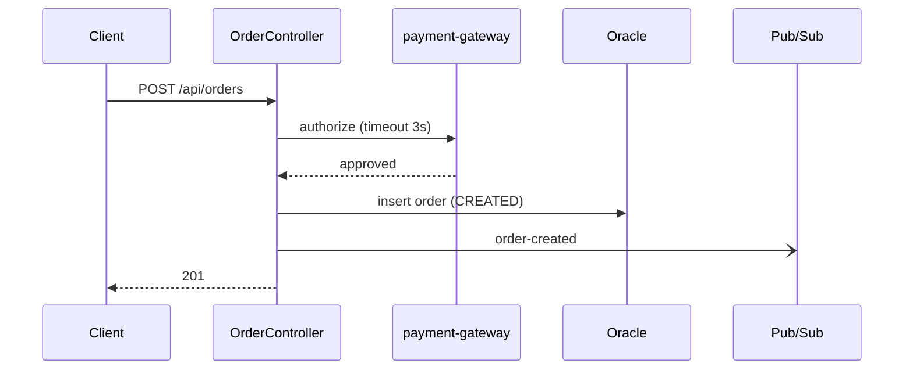
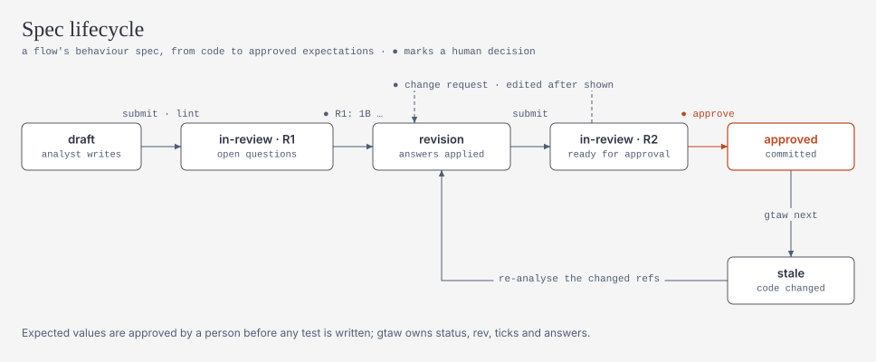
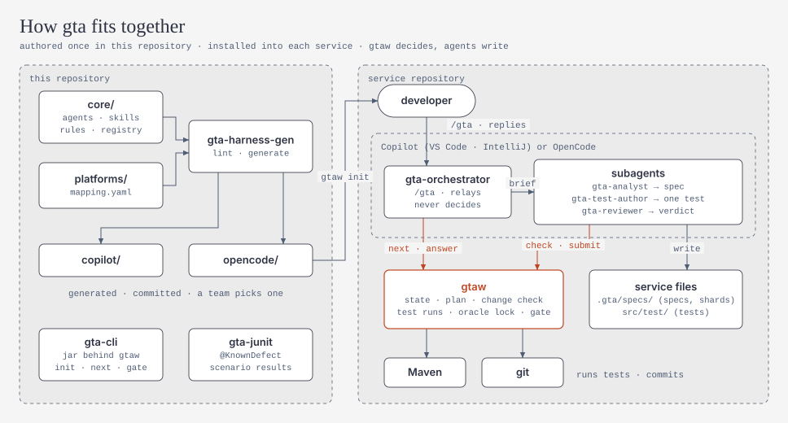
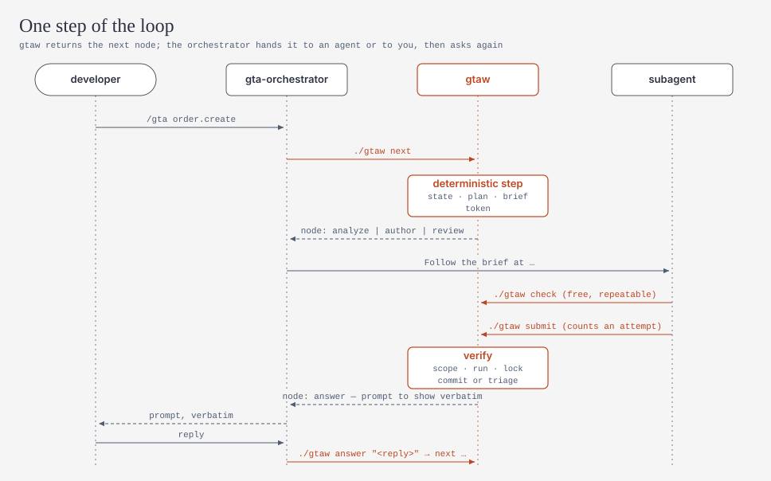
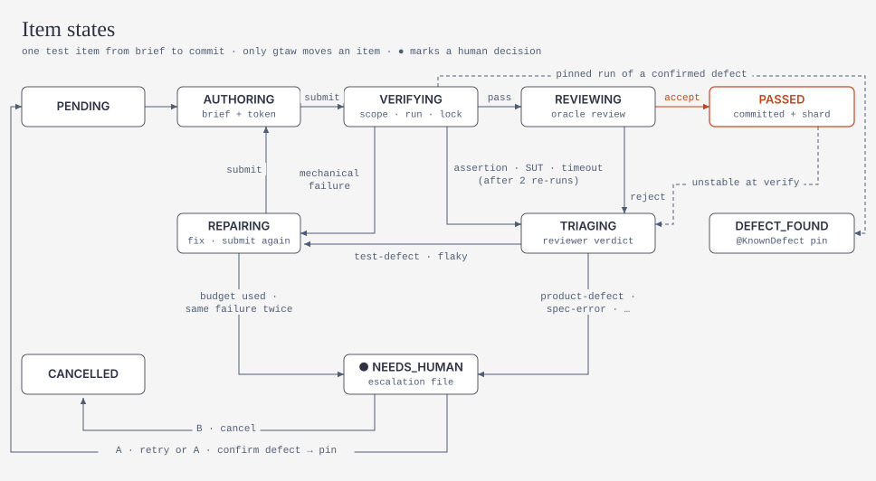
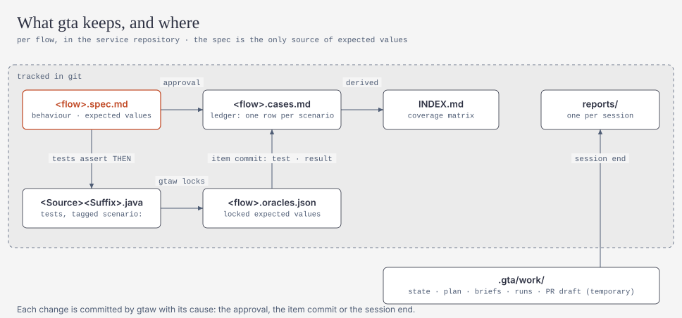

# Generic Testing Agent (GTA) — 设计方案

[English](plan.md) | **简体中文**

> 状态：**P0 到 P4 已实现**，当前阶段为 P4（见 §15 路线图）· 版本：plan v11 · 日期：2026-11 · 代码审查与修复记录见 [round-2-remediation.md](../reviews/round-2-remediation.md) · [round-3-plan.md](../reviews/round-3-plan.md)
> 范围：面向 Java（以 Spring 为主）服务的通用测试 harness
> 使用面：**GitHub Copilot（VS Code、IntelliJ IDEA）和 OpenCode**，两者同等支持：相同的 agent、命令、护栏和测试
> 目标环境：Maven；Spring Boot 4.1 为主，少量 3.5；JUnit 跟随 Spring Boot parent；Java 17+；开发机为 Windows；数据存储为 Oracle 和 BigQuery；消息为 Pub/Sub、Kafka、MQ；本地不能使用任何容器；所有依赖都经过公司 Nexus 代理，平台团队可以向 Nexus 上传包；CI（alm-github）可以接入；多数服务只有代码，没有规范文档。不启用 CODEOWNERS 和分支保护，不开启 Copilot preview policy
> 命名空间：所有对外资产统一使用前缀 `gta`。修订记录见附录 B

---

## 0. TL;DR

1. **目标**：测试要能发现错误，而不只是覆盖代码。门禁看三样东西：scenario 是否被验证、测试强度、测试稳定性；coverage 只作参考（§1）。
2. **Spec-first：先写行为规格，再写测试**
   - agent 先把代码整理成行为规格：格式兼容 OpenSpec，需求用 EARS 句式，附 Mermaid 图，每个 scenario 都标注来源。
   - 只有人明确回答过的结论才算 `confirmed`，才能当作期望值。用默认值答复的、或只是从代码里看出来的结论，只能生成 characterization 测试（锁定现状，不判断对错）。
   - 回答问题和批准规格分两步：回答后 gtaw 生成新的规格修订号，批准时必须引用这个修订号（§3）。
3. **期望值保护**
   - 断言失败不进入修复流程，先由 gtaw 确定性分流，再由 reviewer 对照规格判定。
   - oracle lock 单调锁定 THEN 推出的期望值：已锁定的断言只能保留，不能修改或删除；输入和 fixture 的变动交给 reviewer。
   - 每次运行都确定性地检查：规格 THEN 里的期望值是否真的出现在断言中。
   - `passed` 状态只能由 gtaw 设置。
   - 已确认的缺陷用 `@KnownDefect`（strict xfail）固定。
   - 门禁以 base 分支已批准的规格和 oracle 为基准判定。它在每次会话结束时于本地运行，接入 CI 是可选的（§5.3、§10.5）。
4. **架构**
   - 确定性的 Java CLI `gtaw` 负责状态、调度、执行、分流和门禁；LLM 只做分析、写规格、写测试、评审。
   - 协议是：`next` → 派发 → `check`（可多次）→ `submit`。
   - brief 自包含：可以派给子 agent 执行，平台不支持子 agent 时也可以由 orchestrator 内联执行（§4）。
5. **原语按需选用（§4.0）**：只用 custom agents、subagents、一个 prompt 文件、一段 AGENTS.md；skills 只借用格式。v1 不用 hooks、MCP、handoffs 和 plugins。
6. **Agent 少、Skill 多**
   - 只有 4 个 agent，不再为部署态单独设 agent。skills 按服务类型由 registry 选出，由 brief 按路径加载，不依赖平台自动触发。
   - 只有当需要独立上下文、独立判断或不同权限时，才定义成 agent；其余都是 skill 或 gtaw（判定准则见 §4.0）。
7. **状态可推导**
   - 长期真相保存在 git 中：规格、按 flow 分片的 oracle 文件、升级记录、测试本身。
   - 工作状态放在 gitignored 的 `.gta/work/`，可以重建；换人接手只需 push（§5.2）。
8. **信任锚点在 gtaw 和 CI，不在 IDE**
   - 权威裁决来自两处：gtaw 对每个节点的改动检查，以及以 base 为基准的门禁。门禁在本地运行，CI 可选。
   - 人工确认附带原话和来源渠道，并列在 PR 评论里，由正常的 PR review 把关（§5.5）。
9. **上手**：tech lead 在每个仓库执行一次 `./gtaw init`；开发者只需要一个命令 `/gta`（§12）。
10. **新手也能用（P4）**
    - 在没有进行中工作的服务上执行 `/gta`，会覆盖整个服务，风险最高的 flow 先做；某个 flow 在等人时，不会挡住其他 flow。
    - 人看到的所有内容都是一个固定格式的状态块（状态、刚才发生了什么、已确认、需要你、下一步），可选英文或中文。
    - 每个问题都带推荐答案，很多时候回一个 `OK` 就够了；agent 不知道的信息，人用 `/gta note` 补充一次即可（§5.10）。

---

## 1. 问题定义与质量信号

**现状**：服务以 Java 为主，部署在 GCP（GKE、Dataflow、Cloud Run）以及若干非 GCP 环境。flow 类型包括 API、Scheduler、Batch、Workflow、事件驱动等。目标是自动化 regression test 和 integration test。

**为什么不能只看 coverage**
- 没有断言的测试也能贡献 coverage。
- coverage 不感知业务语义，例如边界值、幂等、时间、并发、权限、最终一致性。
- coverage 不感知跨服务契约。
- Meta ACH 被采纳的 571 个测试中，有 277 个按 line coverage 标准会被丢弃，但它们能抓到真实故障。

| 信号 | 定义 | 计算方式 |
|---|---|---|
| Scenario 验证率（按来源分开统计） | 已批准 scenario 中有 verified 测试的比例；`confirmed`/`documented` 与 `observed`/`defaulted` 分开统计 | 规格 ↔ JUnit tag |
| Spec findings | 不同来源之间的不一致，分为 `behavior-suspect`（代码可疑）和 `doc-drift`（文档过时） | analyst 发现，人工确认 |
| 测试强度（变更代码） | 被覆盖的 mutant 中有多少被杀死（killed / covered） | `gtaw mutate`（PIT，只统计 diff 涉及的行） |
| 能失败证据（P2） | unit/slice 测试至少杀死 1 个针对其实现方法的 mutant | `gtaw verify` |
| Catching 命中 | PR 中为抓 bug 而生成的测试，失败后被确认为真实缺陷的数量 | PR 模式（P3） |
| Oracle 强度 | 断言是否验证了业务结果，而不只是"不为空" | `gtaw submit` 的反模式检查 + reviewer |
| 契约覆盖 | OpenAPI operation × status code、消息 schema 的覆盖情况 | Schemathesis / Pact / SCC |
| 稳定性 | 新测试在随机顺序、非 UTC 时区、非英文 locale 下连续 k 次通过（pass^k） | `gtaw verify` |
| Coverage | 只作参考 | JaCoCo |

---

## 2. 业界做法与设计原则

### 2.1 大公司的做法

| 来源 | 做法 | 本设计采纳的点 |
|---|---|---|
| **Meta ACH**（FSE'25） | 针对具体风险生成少量 mutant，再让 LLM 写能杀死它的测试 | 能失败检查；mutation 驱动补测 |
| **Meta JiTTests**（2026） | 按 diff 推断意图和风险，生成 catching test；测试失败后先经过规则和 LLM assessor 过滤，再交给人 | PR 模式的 catching 测试；reviewer 作为 assessor；缺陷由人确认 |
| **Uber AutoCover**（ICSE-SEIP'26） | prepare / generate / execute / validate-repair 四个阶段；用 mutation 做门禁；多次运行防 flaky | 节点划分；pass^k |
| **Stripe Minions** | 流程中确定性节点与 agentic 节点交替；修 CI 最多约 2 轮，之后转人工 | 确定性步骤在 gtaw 内部完成；修复次数有上限 |
| **Spotify Honk** | 独立的 verifier 在开 PR 前强制运行；LLM judge 对照原始意图检查 | 验证与编写分离；reviewer 作为 judge |
| **Airbnb 测试迁移** | 每一步都校验，把错误回传后重试，提供同级测试作为上下文 | 结构化错误；brief 中附带同级测试 |
| **Microsoft code-testing-generator** | 专用 agent + skills；不修改生产代码；效果比原生 Copilot 高约 13 个百分点 | 专用 agent + skills；不改生产代码 |
| **Diffblue Testing Agent** | 只交付编译通过、运行通过的 verified 测试 | 只提交经过确定性验证的测试 |

### 2.2 开源 repo 的做法

| Repo | 做法 | 借鉴 | 不借鉴 |
|---|---|---|---|
| [Playwright Test Agents](https://playwright.dev/docs/test-agents) | planner → generator → healer；如果是功能本身坏了，healer 把测试标成 `test.fixme` | 修复只处理机械问题；用 seed 测试作为基线 | healer 自动修到通过 |
| [github/spec-kit](https://github.com/github/spec-kit) | specify → clarify（答案回写进规格）→ plan → tasks → analyze | 答案回写进规格；追踪矩阵 | 完整的开发流程 |
| [Fission-AI/OpenSpec](https://github.com/Fission-AI/OpenSpec) | Requirement + Scenario 格式；变更用 delta 描述 | 规格格式；行为变更摘要 | 依赖它的 CLI（需要 Node，遥测默认开启） |
| [Kiro](https://kiro.dev/docs/specs/correctness/) | 需求用 EARS 句式；从需求中抽取性质，寻找反例 | EARS；不变量 → 性质测试 | — |
| [BMAD TEA](https://github.com/bmad-code-org/bmad-method-test-architecture-enterprise) | 风险 = 概率 × 影响；gate 分 PASS/CONCERNS/FAIL/WAIVED；实现者不能批准自己的工作 | 风险评分；四值 gate；waiver | 拟人化的 persona |
| [obra/superpowers](https://github.com/obra/superpowers) | 没有证据不得宣称完成；每个任务派一个新的子 agent | `passed` 只能由 gtaw 设置；每个条目一个新上下文 | — |
| [ChatUniTest](https://github.com/ZJU-ACES-ISE/ChatUniTest) / [TestART](https://github.com/sikygu/TestART) | 生成 → 验证 → 修复；先用规则修复 | 先规则后 LLM（P2） | 以 coverage 为目标 |
| [Probity](https://github.com/nizos/probity) | 跨 agent 的声明式策略引擎 | hook 规则的设计方式 | 直接依赖它 |
| [Specmatic](https://specmatic.io/) | 把 OpenAPI 当作可执行契约 | contract 层的备选 | — |
| [EvoMaster](https://github.com/WebFuzzing/EvoMaster) | 基于搜索生成 JVM REST 测试 | — | 它的 oracle 反映的是实际行为，不是期望行为 |

**研究佐证**：[Konstantinou 等（2024）](https://arxiv.org/abs/2410.21136) 发现，LLM 生成的 oracle 主要反映代码的**实际**行为，而不是**期望**行为。

### 2.3 指南与平台

| 来源 | 要点 |
|---|---|
| [Building effective agents](https://www.anthropic.com/engineering/building-effective-agents) | 能用 workflow 就不用 agent；orchestrator-workers；evaluator-optimizer |
| [Effective harnesses](https://www.anthropic.com/engineering/effective-harnesses-for-long-running-agents) | 用 JSON 保存状态，只改状态字段；一次只处理一个条目；固定的启动流程 |
| [Multi-agent research](https://www.anthropic.com/engineering/multi-agent-research-system) | token 消耗约为普通对话的 15 倍；委派任务时要写清目标、格式和边界 |
| [Context engineering](https://www.anthropic.com/engineering/effective-context-engineering-for-ai-agents) | 按需加载上下文；子 agent 只返回摘要 |
| [Writing tools for agents](https://www.anthropic.com/engineering/writing-tools-for-agents) | 工具少而有用；错误信息要能直接照着做 |
| [Skill best practices](https://platform.claude.com/docs/en/agents-and-tools/agent-skills/best-practices) | 动名词命名；第三人称写 description；正文少于 500 行；引用只深一层 |
| [Demystifying evals](https://www.anthropic.com/engineering/demystifying-evals-for-ai-agents) | task / trial / grader；区分 pass@k 与 pass^k；区分 capability eval 与 regression eval |
| Copilot：[hooks](https://docs.github.com/en/copilot/reference/hooks-reference)、[VS Code hooks](https://code.visualstudio.com/docs/copilot/customization/hooks)、[VS Code approvals](https://code.visualstudio.com/docs/agents/run/approvals.md)、[JetBrains 2026-03](https://github.blog/changelog/2026-03-11-major-agentic-capabilities-improvements-in-github-copilot-for-jetbrains-ides/) / [2026-04](https://github.blog/changelog/2026-04-24-inline-agent-mode-in-preview-and-more-in-github-copilot-for-jetbrains-ides) / [2026-06](https://github.blog/changelog/2026-06-02-introducing-copilot-cli-and-agentic-capabilities-enhancements-in-jetbrains-ides/) | 见 §11.4 |

### 2.4 设计原则

| # | 原则 |
|---|---|
| P1 | **确定性优先**：凡是能写成代码的步骤，都在 gtaw 内部完成 |
| P2 | **Oracle 独立于实现**：期望值来自人确认过的规格，修复时不能改 |
| P3 | **验证独立于作者**：编写测试的 agent 不能判定自己的测试通过 |
| P4 | **质量不等于覆盖率** |
| P5 | **按权限划分 agent，靠 skills 实现专业化** |
| P6 | **上下文隔离**：每个节点都在新的上下文中执行，只返回一行结果 |
| P7 | **长期真相保存在 git，工作状态可以重建**；所有状态只由 gtaw 写入 |
| P8 | **循环有界，并且有熔断** |
| P9 | **人工确认可审计**：带原话、渠道和修订号，在 PR 中可见 |
| P10 | **权威裁决在 gtaw 和 CI**（以 base 分支为准），不依赖 IDE 侧机制 |
| P13 | **原语按需选用**：每个 agent/skill/prompt/instruction/hook/MCP 都要有明确的职责，否则不引入 |
| P11 | **CI 不依赖 LLM** |
| P12 | **Eval 驱动** |
| P14 | **不猜，问得省力**：不确定的事一律变成问题，每个问题都带推荐答案 |
| P15 | **对人只有一种输出**：人看到的都是 gtaw 的状态块，使用他们的语言 |

### 2.5 v1 明确不做的事

- 不自建编排运行时，也不做 MCP server：IDE 中的 Copilot 本身就是运行时。
- 不修改生产代码，incident 模式也一样。代码缺少测试接缝时，只报告"建议重构"。
- 不提供用户可以直接调用的测试 agent；不依赖平台自动触发 skills。
- 一个 worktree 同一时间只允许一个驱动会话，不并行编写测试。
- 不使用 Gliffy（格式私有、无法 diff、LLM 难以可靠生成），统一用 Mermaid。
- 不依赖 OpenSpec CLI；不使用 EvoMaster；jqwik 不作为默认（§7.9）。
- v1 不使用 hooks、MCP、handoffs、plugins，也不让平台自动加载 skills（见 §4.0）。
- 不做插件分发、SARIF、向量库、dashboard。以下内容推迟：读取 OpenSpec/Spec Kit 规格（P2）、Cucumber、性能测试。

---

## 3. Spec-first：先确认行为规格，再写测试

### 3.1 评判：先分析代码，生成规格和图，确认后再写测试

**结论：方向正确，而且应该作为系统的入口。** 原始想法需要以下调整：

| 维度 | 评价 |
|---|---|
| ✅ 解决 oracle 问题 | 只从代码推出来的测试是同义反复：代码有 bug，测试就把 bug 当成期望值。只有人确认过的期望，才能真正验证正确性 |
| ✅ 前置澄清 | 写测试前就问清楚，比事后返工便宜 |
| ✅ 用图快速 review | 一张时序图或状态图，比几百行代码更快让人确认边界 |
| ✅ 规格是长期资产 | 规格就是 regression 的基线；PR 中规格的 diff，就是这次改动的行为变化 |
| ⚠️ 调整 1 | 写**行为规格**，不写完整的设计文档：只写边界、权限、行为、状态、不变量和问题 |
| ⚠️ 调整 2 | 用 **Mermaid**，不用 Gliffy；按 flow 类型限定图的种类和规模（§3.4） |
| ⚠️ 调整 3 | **每个 scenario 都标注来源**，并引用到方法、配置项或 bean；来源之间不一致的地方记为 finding |
| ⚠️ 调整 4 | **问题要结构化**：每轮最多 5 个；每个选项都写明它会让 THEN 变成什么；高影响问题必须明确回答；非高影响问题的默认值必须是"= 代码现状" |
| ⚠️ 调整 5 | **回答和批准分两步，并且按 flow（实际是按 Requirement）逐个批准** |
| ⚠️ 调整 6 | **工作量随模式伸缩**：explain 模式只出草稿；flow 模式出完整规格；PR 模式只更新受影响的部分 |

**更进一步**：采用 Example Mapping 的思路（规则 → 例子 → 问题）。Requirement 是规则，Scenario 是例子，同时也是测试契约。scenario 与测试一一对应。

### 3.2 来源、意图与判定规则

| 来源（`source`） | 含义 | 生成的测试意图 |
|---|---|---|
| `observed` | 从代码中看到的行为，附 `ref` | `characterization` |
| `documented` | 来自 OpenAPI、README、ADR、人写的已有测试、PR 描述、工单验收标准；必须写成 `doc:<path>#<anchor>` 并附原文引用，gtaw 逐字核对，核对不上就降级为 `observed` | `hardening` |
| `confirmed` | 人明确回答过（§3.5） | `hardening` |
| `defaulted` | 用"其余默认"接受的值，按规则这个值就是代码现状 | `characterization` |
| `assumed` | agent 的推断，没有依据 | 必须作为问题提出；回答之前不生成测试 |

- `source` 标在 Scenario 上；THEN 中的某个子句来源不同时，可以单独标注。
- `confirmed` 和 `defaulted` **只能由 gtaw 写入**，而且必须有对应的 gtaw 答案记录，否则 lint 拒绝。analyst 能写的来源只有 `observed`、`documented`、`assumed`。
- 每个 Scenario 默认继承它所属 Requirement 的来源。

**现实情况：多数服务只有代码，没有规范文档**
- 大多数结论一开始都是 `observed`，所以先生成 characterization 测试，作为回归基线。这些测试在门禁中同样受到保护（§10.5 ①）。
- 真正的期望值主要来自人的回答，所以问题要优先问高风险的行为。
- 由 springdoc 等工具从代码生成的 OpenAPI 只算 `observed`，不算 `documented`。
- 一个副产品：规格本身会成为这些服务第一份可维护的行为文档。

**判定规则**（由 gtaw 强制执行）
1. `observed` 或 `defaulted` 的 oracle 失败时，先经过 reviewer 分流。如果排除了 `test-defect`、判定为 `spec-error`，就说明观察有误。gtaw 会做以下几件事：
   - 用实际值修正规格中的 THEN，并提升修订号；
   - 按新值重新上锁，条目保持有效，不会因为修订而取消（这是例外）；
   - 把这项变更列入报告的"待复核"清单，等人批量复核。
2. `confirmed` 或 `documented` 的 oracle 失败，并且被判定为 `product-defect` 时，**必须由人确认**（§5.5），之后才会用 `@KnownDefect` 固定。
3. `documented` 与 `observed` 冲突时，转成问题，并标注是 `doc-drift` 还是 `behavior-suspect`，因为文档也常常是过时的一方。
4. 可疑的现状要转成问题，而不是直接写进规格。例如：异常被吞掉、状态码不一致、缺少所有权或租户检查。
5. Scenario 的完整性不靠 LLM 自由发挥：系统地使用等价类、边界值、决策表、状态迁移等方法，再按风险推测可能出错的地方。

### 3.3 规格文件格式（兼容 OpenSpec）

**位置**：规格文件是 `.gta/specs/<domain>/<flow-name>.spec.md`，旁边放 oracle 分片 `<flow-name>.oracles.json`（§5.2）。

**元数据**：写在 HTML 注释中。`ref` 支持三种形式：
- 方法：`Class#method`
- 配置项：`config:<key>`
- Bean 定义方法：`bean:Class#method`

每个 `ref` 都带一个哈希：方法和 bean 引用取方法体的哈希，配置项取值的哈希。

````markdown
# order.create — 创建订单
<!-- gta: flowId=order.create capability=rest-api risk=6 status=in-review rev=R3
     sources=method:com.acme.order.api.OrderController#create,config:payment.gateway.timeout -->

## Boundary
- In scope：POST /api/orders → 持久化订单 → 发布 order-created
- Out of scope：支付回调（见 `payment.callback`）
- External：payment-gateway（HTTP，非 GCP）、Oracle、Pub/Sub `order-created`



## Access
| 角色 | 操作 | 所有权约束 | 来源 |
|---|---|---|---|
| customer | create | 只能为自己下单 | observed |
| customer | read | 见 q02 | assumed |

## Requirements

### Requirement: 支付网关超时
<!-- gta: id=order.create/r02 ref=method:com.acme.order.OrderService#authorize refHash=7c1a… ref=config:payment.gateway.timeout refHash=19be… -->
IF the payment gateway does not respond within 3s, THEN THE order service SHALL respond 503 and keep the order in PENDING_PAYMENT.

#### Scenario: 网关 3 秒未响应
<!-- gta: id=order.create/s03 source=observed hint.layer=component hint.oracle=state -->
- **WHEN** the gateway does not respond within 3s
- **THEN** the response status is `503` with a ProblemDetail body
- **AND** orders.status is `PENDING_PAYMENT`
- **AND** no message is published to `order-created`

## Invariants
- For any 两次使用相同 `Idempotency-Key` 的提交，THE order service SHALL 只创建一个订单 <!-- gta: id=order.create/i01 source=assumed hint.oracle=property → 见 q03 -->

## Open questions
<!-- gta: round=R3 -->
<!-- gta: id=order.create/q01 impact=high affects=order.create/s03 -->
1. [高影响] 网关超时后是否自动重试？
   - [ ] A) 不重试（= 代码现状）→ s03 不变
   - [ ] B) 重试 1 次 → s03 THEN 增加 "gateway is called twice"
<!-- gta: id=order.create/q02 impact=high affects=order.create/r05 -->
2. [高影响] 非订单所有者能否读取订单？代码中没有看到所有权检查。
   - [ ] A) 不能 → r05 THEN "the response is 404"
   - [ ] B) 不能 → r05 THEN "the response is 403"
   - [ ] C) 可以（= 代码现状）
<!-- gta: id=order.create/q03 impact=normal affects=order.create/i01 -->
3. 相同 `Idempotency-Key` 重复提交时如何处理？
   - [ ] A) 返回第一次的结果（= 代码现状）
   - [ ] B) 返回 409

## Findings
<!-- gta: id=order.create/f01 kind=doc-drift -->
- README 写的是"超时返回 504"，代码返回 503。
````

**规格状态** `status`：`draft` → `in-review` → `approved`；另外还有 `stale`（某个 `ref` 的哈希变了）和 `withdrawn`。`status`、`rev`、答案、批准记录**只能由 gtaw 写入**。

**规格 lint**（由 next/submit 在内部执行）：
- Requirement 必须使用 EARS 句式（ubiquitous / WHEN / IF…THEN / WHILE / WHERE），并且至少有一个 Scenario。
- 每个 THEN 都必须可观察，并且至少包含一个用反引号标出的期望值字面量；确实无法写成字面量的，标注 `check=reviewer`，改由 reviewer 检查。
- `confirmed` 和 `defaulted` 必须有对应的答案记录；`documented` 必须带 `doc:` 引用，并且原文能逐字核对。
- 每个 `ref` 都能解析，并且哈希一致。
- 有外部入口的 flow 必须有 `## Access` 段。
- `risk` = 概率（1–3）× 影响（1–3）。9 → p0，6 → p1，3–4 → p2，1–2 → p3。
- 每个选项都要写明对 THEN 的影响；非高影响问题必须有"= 代码现状"选项。
- `assumed` 的结论必须对应一个问题。
- Mermaid 图要符合基础语法和规模限制。

选项标记的标准写法是 `= current code`，中文 `= 代码现状` 作为别名同样接受。

### 3.4 图的选择规则

| 场景 | 图 | 约束 |
|---|---|---|
| 服务全景（`service-overview.md`） | `flowchart LR`：服务、外部依赖、触发源 | 每个服务 1 张 |
| API / 事件 | `sequenceDiagram`，异步消息用 `-)` | 每个 flow 1 张，不超过 15 条消息 |
| Scheduler / Batch | `flowchart TD` 画步骤，加 `stateDiagram-v2` 画状态 | 只画与测试相关的部分 |
| Workflow / 状态机 | `stateDiagram-v2` | 画全所有迁移和错误分支 |
| Pipeline | `flowchart LR`，包括窗口和 DLQ | — |
| 数据 | `erDiagram` | 只画本 flow 涉及的实体 |

渲染支持：GitHub 原生支持；IntelliJ 需要在 Markdown 设置中开启 Mermaid；VS Code 由 `gtaw init` 在 `.vscode/extensions.json` 中推荐安装扩展。

本文档和 README 中的示意图不是 Mermaid，而是由 `scripts/diagrams/render.py` 生成到 `docs/diagrams/` 的 SVG（明暗两套，采用 cathrynlavery/diagram-design 的风格）。规格里的图仍然是 Mermaid：gtaw 会解析和 lint 它们，PR diff 也需要保持文本。

### 3.5 回答与批准

<picture>
  <source media="(prefers-color-scheme: dark)" srcset="../diagrams/spec-lifecycle-dark.svg">
  
</picture>

1. **gtaw 生成问题块**，带轮次号，例如 `R3`。orchestrator 必须原样展示这个问题块。
2. **回答**有两种渠道，都会在规格中记录原话、轮次和渠道：
   - `chat`：用户在 Chat 中回复，例如 "R3: 1A 2A 其余默认"。orchestrator 调用 `./gtaw answer "<原话>"`，把原话交给 gtaw。
   - `editor`：人直接在编辑器中勾选选项，然后再执行 `/gta`。

   v1 不靠 hook 来证明回答出自人，理由见 §4.0。可信度来自审计：原话会写进规格，并列在 PR 评论里。
3. **默认值**：高影响问题不能用默认值。"其余默认"一律选"= 代码现状"，对应的结论记为 `defaulted`。
4. **批准**：
   - gtaw 应用答案后，会生成新的修订号（例如 `R4`），并展示规格的变化。
   - 用户必须**另外发一条消息**，并且只回复"approve `order.create@R4`"（中文"批准 `order.create@R4`"同样接受）。其他任何回复，包括"不批准 …"，都作为修改意见。
   - 规格必须与 gtaw 展示时完全一致；展示之后被改动的，退回 analyst，并以新修订号重新提交。
   - 批准按 Requirement 记录内容哈希。之后哪个 Requirement 的内容变了，只有它会退回 `in-review`。
5. **权威审批**：由团队正常的 PR review 把关。gtaw 生成的 PR 评论会单独列出本次新增的所有 `confirmed`、批准、`relock` 和豁免，包括原话和渠道，**任何伪造都在 reviewer 眼前**。问题也可以通过 PR 异步交给产品负责人回答。以后如果启用 CODEOWNERS，规格的审批可以收紧为必须由 CODEOWNERS 批准，不需要改动设计。

从 P4 起回复更简短（§5.10）：`OK` 表示接受所有推荐答案；在批准提示上回复 `OK`，只批准该提示展示的那个修订号。上面的写法继续有效。

### 3.6 与 OpenSpec / Spec Kit 共存（P2；除 delta 格式摘要外已实现）

- 配置项 `spec.source`（P2 加入；v1 会把它当作未知字段拒绝）可以设为 `gta`、`openspec` 或 `speckit`。
- 设为后两者时，仓库中已有的规格作为 `documented` 来源读取，GTA 不会改写它们。
- PR 报告的行为变更摘要使用 OpenSpec 的 delta 格式（尚未实现：PR 报告目前还没有任何格式的行为变更摘要，会随它一起加入）。

---

## 4. Harness 架构

### 4.0 原语选型：每样都要有明确职责，不为凑齐而引入

| 原语 | v1 是否使用 | 职责 / 不用的理由 |
|---|---|---|
| **Custom agents**（`.github/agents`、`.opencode/agents`） | ✅ 4 个 | 判定准则见下文。按"是否需要独立上下文、独立判断或不同权限"划分，不按服务类型划分 |
| **Subagents** | ✅ 默认使用 | 每个条目在新的上下文中执行，避免长会话的上下文膨胀；平台不支持时改为 `dispatch: inline` |
| **Prompt files / commands** | ✅ 1 个 `/gta` | 唯一入口，并自动选中 orchestrator；不按模式拆成多个命令 |
| **Instructions**（AGENTS.md） | ✅ 一段 3 行 | 职责单一：告诉普通对话"测试相关请用 `/gta`，不要手改 `.gta/` 下的文件"。各 agent 的规则写在 agent 正文里，不写进全局 instructions，也不用 `copilot-instructions.md` 或 `.instructions.md` 重复一遍 |
| **Skills（Agent Skills 格式）** | ⚠️ 只借用格式 | 用 `SKILL.md` 和 `references/` 组织知识，由 brief 按路径加载。**不放进平台的 skills 目录**，以免在普通对话中被自动触发 |
| **Hooks** | ❌ v1 不用 | VS Code 的 hooks 是 preview，而你们不开启 preview policy，所以在 VS Code 中无法依赖。hook 原本承担的职责已经由其他机制完成：<br>- 越界改动：§5.8 的改动检查，越界文件会被还原；<br>- 特权命令：不在终端自动批准列表中，需要人点击确认；<br>- 期望值篡改：oracle lock 加上 CI 门禁。<br>P5 可以作为可选增强，用来更早拦截问题，以及捕获人类输入 |
| **MCP** | ❌ v1 不用 | gtaw 通过终端调用就够了。引入 MCP server 要额外处理进程、配置、鉴权，而且各 IDE 都要单独配置。只有终端批准弹窗确实成为痛点时，才考虑在 P5 把 gtaw 包装成 MCP 工具，利用 IntelliJ 按工具设置的自动批准 |
| **Handoffs** | ❌ | 只有 VS Code 支持；人工节点统一在 Chat 中完成 |
| **Plugins / marketplace** | ❌ 不计划 | 安装统一用 `gtaw init`，两个 IDE 的行为一致 |
| **Anthropic 的方法论** | ✅ 作为设计依据 | 采用的部分：workflow 优先、单调状态、一个条目一个上下文、eval 驱动。不采用的部分：只在 Claude Code 中可用的机制 |

#### 判定准则（依据 Anthropic 对各原语的定义）

| 原语 | Anthropic 的定义要点 | 本设计的判定规则 |
|---|---|---|
| Workflow（确定性代码） | 预定义的代码路径；能用代码完成的步骤，就不交给 LLM | 流程推进、计划生成、执行、分流、门禁，都在 gtaw 中实现 |
| Agent / Subagent | LLM 自主决定过程和工具使用。subagent 有独立的上下文窗口、system prompt 和工具权限，适合用来隔离上下文、做独立判断、区分权限；简单的顺序步骤不应拆成 subagent | 至少满足下面一条，才定义成 agent：<br>① 需要独立上下文（要读大量代码）；<br>② 需要独立于作者的判断；<br>③ 需要不同的工具权限 |
| Skill | 可复用的专业知识（流程、规范、参考资料），按需渐进加载，不常驻在上下文中，可以被多个 agent 复用 | 与技术栈或服务类型相关、按条目才需要、篇幅较大的知识，写成 skill。agent 的角色、流程和输出契约，写在 agent 正文中 |
| Prompt / command | 用户主动触发的可复用提示 | 只有 `/gta` 一个 |
| Instructions（CLAUDE.md / AGENTS.md） | 常驻上下文，每次都会加载 | 只放所有对话都必须知道的一句话 |
| Hook | 在生命周期事件上执行的确定性命令，用来保证某件事一定发生 | 这类保证放在 gtaw 内部实现 |
| MCP | 连接外部系统和数据 | 本设计没有需要连接的外部系统 |

**审计结果**

| 候选 | 结论 | 理由 |
|---|---|---|
| orchestrator | **agent** | 面向用户；需要不同的权限（派发子 agent）；本身不做领域工作 |
| analyst | **agent** | 要读大量代码，需要独立上下文；只能写规格 |
| test-author | **agent** | 每个条目使用一个新的上下文；可以写测试 |
| reviewer | **agent** | 必须独立于 test-author（P3）；只读。建议使用与 test-author 不同的模型家族，以减少两者犯同样错误的概率 |
| planner | ~~agent~~ → **gtaw** | 计划生成是规则映射，属于 workflow |
| system-tester | ~~agent~~ → **test-author + skill** | 与 test-author 只差知识；部署环境上的测试不在范围内（§15），所以不需要系统测试 agent |
| 按服务类型划分的 api/job/event/pipeline tester | ~~agent~~ → **skills** | 只差知识，上下文和权限都一样 |
| 分流 | **gtaw**（确定性部分）+ **reviewer**（判断部分） | — |
| explain / pr / incident | **`gtaw next` 的模式参数** | agent 相同，只是确定性流程不同 |
| 规格写法、各技术栈的测试方法 | **skill** | 内容多，需要渐进加载。即使只有一个 agent 使用，也不放进 agent 正文，否则每次调用都要加载全部内容 |
| 规格格式、ID 规则 | **skill 的 references + gtaw lint** | 格式由 lint 强制执行，skill 只负责讲解 |

> 偏离 Anthropic 的地方：skill 通常由模型根据 description 自行发现并加载，本设计改为由 registry 确定性选择、brief 按路径加载。这样更可靠，也能避免 skill 在 gta 流程之外被触发。

### 4.1 分层

<picture>
  <source media="(prefers-color-scheme: dark)" srcset="../diagrams/architecture-dark.svg">
  
</picture>

| 层 | 内容 |
|---|---|
| Entry | `/gta [explain\|pr\|incident\|status] …` |
| Agents | `gta-orchestrator` · `gta-analyst` · `gta-test-author` · `gta-reviewer` |
| Skills | `.gta/skills/gta-*`（SKILL.md 格式，由 brief 按路径加载） |
| Toolkit | `gtaw` → `gta-cli.jar`：调度、规格、计划、执行、分流、oracle lock、改动检查、门禁、报告 · `gta-junit`（测试期依赖） |
| State | git：specs + oracle 分片 + 用例台账 + 报告 + escalations + tests \| `.gta/work/`（临时） |
| Gate | 会话结束时本地运行 `gtaw gate --base`（CI 可选） |

### 4.2 协议：`next` → 派发 → `check`（可多次）→ `submit`

<picture>
  <source media="(prefers-color-scheme: dark)" srcset="../diagrams/loop-dark.svg">
  
</picture>

1. orchestrator 调用 `./gtaw next`。gtaw 在内部完成所有确定性步骤：接管会话、恢复状态、profile、规格 lint、生成计划、影响分析、会话结束时的 verify、提交。然后只返回需要 agent 或人处理的节点：

   ```json
   { "node": "author", "itemId": "order.create/s03#component-01", "agent": "gta-test-author",
     "brief": ".gta/work/briefs/0007.md", "token": "s20261103120000-k3f9:0007", "dispatch": "subagent" }
   ```

   `node` 的取值：`analyze` · `answer` · `author` · `review` · `escalate` · `done`。每份 brief（包括 review brief）都有自己的 token，带旧 token 的提交或裁决会被拒绝。
2. **brief 自包含**。它包含：
   - 角色规则、目标；
   - 规格摘录：Requirement、Scenario、Access；
   - oracle：THEN 中的期望值；
   - 允许改动的文件（`ownsFiles`）；
   - 要加载的 skill 路径；
   - 代码切片：用 JavaParser 收集入口、被调用方法、注入的 bean、相关配置；
   - 同级测试；
   - 返回契约。
3. 执行者有两种：
   - **subagent 模式**（默认）：派给对应的子 agent。
   - **inline 模式**：平台不支持子 agent，或子 agent 不稳定时，由 orchestrator 自己按 brief 执行（`config.dispatch`）。
     - 生成器会为 orchestrator 额外生成带 edit 权限的配置。
     - 改动检查按**节点**来限定范围，而不是按 agent。
     - inline 模式下的 oracle review 属于自审，在报告中记为 concerns。
4. test-author 可以多次运行 `./gtaw check --item <id> --token <t>`，每次编译并运行一遍，**不消耗修复次数**。完成后运行 `./gtaw submit --item <id> --token <t>`，只输出一行结果。
5. 会话结束时，gtaw 在 `next` 内部对本会话新写的测试批量执行 `verify`：稳定性、期望值复核，从 P2 起还有能失败检查。

### 4.3 Agent 清单

| Agent | 职责 | 用户可直接调用 | 模型档位 | 权限档案 |
|---|---|---|---|---|
| `gta-orchestrator` | 入口；循环执行 next/派发；原样展示问题块和结果；把用户原话交给 `gtaw answer`；把 reviewer 的结论交给 gtaw | 是 | reasoning | `orchestrator` |
| `gta-analyst` | 每次处理一个 flow：写规格、画图、列问题；PR 模式下更新受影响的规格 | 否 | reasoning | `spec-writer` |
| `gta-test-author` | 每次处理一个条目：按 brief 写测试、修复机械问题 | 否 | standard | `test-writer` |
| `gta-reviewer` | 只读：oracle review、失败分流、catching 判定；**没有 shell 权限**，结论由 orchestrator 转交 | 否 | reasoning | `read-only` |

- **测试计划**由 gtaw 根据已批准的规格确定性生成：scenario 的 hint 加上 registry，就能得到条目、层级、工具和 `ownsFiles`。不需要 planner agent。
- **reviewer 结论被伪造也不会把 bug 写进测试**。几类有风险的结论都必须经过人：`expected-change`、`oracle-defect`、`product-defect`、`spec-error`。`test-defect` 和 `flaky` 只会进入修复，而修复时 oracle 仍然锁定。

### 4.4 Capability registry

文件位于 `core/registry/capabilities.yaml`，构建时编译进 jar。字段 `since` 表示该条目从哪个阶段开始生效；lint 只检查已经生效的条目。

```yaml
schemaVersion: "1.0"
capabilities:
  - id: rest-api
    since: P0
    detect:
      buildDeps: [spring-boot-starter-web, spring-boot-starter-webmvc]
      annotations: ["@RestController", "@RequestMapping"]
    layers: [unit, slice, component, contract, system]
    diagrams: [sequence]
    skills: [gta-testing-spring-apis, gta-stubbing-with-wiremock, gta-testing-api-contracts]
  - id: webflux
    since: P3
    detect: { buildDeps: [spring-boot-starter-webflux] }
    layers: [unit, slice, component, contract]
    diagrams: [sequence]
    skills: [gta-testing-reactive-apis, gta-stubbing-with-wiremock, gta-testing-api-contracts]
  - id: grpc-api
    since: P3
    detect:
      buildDeps: [grpc-stub, spring-grpc-spring-boot-starter, spring-boot-starter-grpc-server,
                  spring-boot-starter-grpc-client]
      files: ["**/*.proto"]
    layers: [unit, component, contract]
    diagrams: [sequence]
    skills: [gta-testing-spring-apis, gta-testing-api-contracts]
  - id: graphql-api
    since: P3
    detect: { buildDeps: [spring-boot-starter-graphql] }
    layers: [unit, slice, component]
    diagrams: [sequence]
    skills: [gta-testing-spring-apis]
  - id: scheduler
    since: P1
    detect:
      annotations: ["@Scheduled", "@EnableScheduling", "@SchedulerLock"]
      buildDeps: [spring-boot-starter-quartz, shedlock-spring]
    layers: [unit, component, system]
    diagrams: [flowchart, state]
    skills: [gta-testing-scheduled-jobs, gta-using-embedded-dependencies]
  - id: spring-batch
    since: P2
    detect: { buildDeps: [spring-boot-starter-batch, spring-boot-starter-batch-jdbc, spring-batch-core] }
    layers: [unit, component]
    diagrams: [flowchart, state]
    skills: [gta-testing-spring-batch-jobs, gta-using-embedded-dependencies]
  - id: db-migration
    since: P2
    detect:
      buildDeps: [flyway-core, flyway-database-oracle, liquibase-core, spring-boot-starter-flyway,
                  spring-boot-starter-liquibase]
      files: ["**/db/migration/**", "**/db/changelog/**"]
    layers: [component]
    diagrams: [er]
    skills: [gta-testing-db-migrations, gta-using-embedded-dependencies]
  - id: messaging
    since: P1
    detect:
      buildDeps: [spring-kafka, spring-cloud-gcp-starter-pubsub, spring-cloud-stream, spring-jms,
                  spring-boot-starter-artemis, mq-jms-spring-boot-starter, spring-boot-starter-amqp,
                  spring-cloud-aws-starter-sqs]
      annotations: ["@KafkaListener", "@JmsListener", "@RabbitListener", "@SqsListener", "@ApplicationModuleListener",
                    "@TransactionalEventListener"]
    layers: [unit, component, contract]
    diagrams: [sequence]
    skills: [gta-testing-event-flows, gta-using-embedded-dependencies]
  - id: workflow
    since: P3
    detect:
      files: ["**/workflows/*.y*ml", "**/*.bpmn"]
      buildDeps: [spring-statemachine-core, temporal-sdk, temporal-spring-boot-starter, camunda-bpm-spring-boot-starter,
                  camunda-spring-boot-starter, spring-boot-starter-camunda]
    layers: [unit, component, system]
    diagrams: [state]
    skills: [gta-testing-workflows]
  - id: beam-pipeline
    since: P3
    detect: { buildDeps: [beam-sdks-java-core, beam-runners-google-cloud-dataflow-java] }
    layers: [unit, component, system]
    diagrams: [flowchart]
    skills: [gta-testing-beam-pipelines, gta-using-embedded-dependencies]
  - id: websocket
    since: P4
    detect:
      buildDeps: [spring-boot-starter-websocket]
      annotations: ["@MessageMapping", "@SubscribeMapping", "@EnableWebSocket", "@EnableWebSocketMessageBroker"]
    layers: [unit, component]
    diagrams: [sequence]
    skills: [gta-testing-streaming-endpoints]
  - id: security              # never produces flows; adds the security skill to the flows of a secured service
    since: P2
    dispatch: false
    detect:
      buildDeps: [spring-boot-starter-security, spring-boot-starter-oauth2-resource-server,
                  spring-boot-starter-oauth2-client, spring-boot-starter-security-oauth2-resource-server,
                  spring-boot-starter-security-oauth2-client]
      annotations: ["@EnableWebSecurity", "@PreAuthorize", "@Secured", "@EnableMethodSecurity"]
    skills: [gta-testing-spring-security]
  - id: caching               # never produces flows; adds the caching skill to the flows of a service with caches
    since: P2
    dispatch: false
    detect:
      buildDeps: [spring-boot-starter-cache, caffeine, spring-boot-starter-data-redis]
      annotations: ["@Cacheable", "@CacheEvict", "@CachePut", "@EnableCaching"]
    skills: [gta-testing-caches]
  - id: data-dependencies     # 不产生 flow，只为命中的条目追加 skill
    since: P0
    dispatch: false
    detect:
      buildDeps: [google-cloud-bigquery, spring-cloud-gcp-starter-bigquery, google-cloud-storage, ojdbc11, ojdbc17, ojdbc8,
                  spring-boot-starter-data-jpa, spring-boot-starter-jdbc, spring-kafka, spring-jms, spring-cloud-gcp-starter-pubsub]
    skills: [gta-using-embedded-dependencies]

always:
  skills: [gta-designing-test-oracles, gta-writing-tests]
# 所有条目都派给 gta-test-author
```

**profile 阶段**，gtaw 会生成确定性的入口清单：controller、`@Scheduled`、listener、job、pipeline，并附上 `ref`。

**尚未支持的 capability**（`since` 晚于当前阶段）只做 explain，并在报告中写明。

### 4.5 护栏（不依赖 hooks）

| 风险 | v1 的处理方式 |
|---|---|
| agent 改了不该改的文件，例如 `src/main`、受保护路径、规格中 gtaw 专属的字段 | §5.8 的改动检查：越界文件先备份，再还原到基线，并返回 `POLICY_OUT_OF_SCOPE_CHANGE` |
| agent 自己提交（`git commit`），可能还伪造了 `Gta-*` trailer | 改动检查只信任 gtaw 提交账本中的 SHA，其他提交一律交给人处理，gtaw 不改写历史 |
| agent 执行特权命令：`gate waive`、`relock`、`env`、`abort`、`next --takeover` | 这些命令不在终端自动批准列表中，IDE 会弹窗，由人决定是否执行；执行结果会被提交，并列在 PR 评论里 |
| agent 直接运行 `mvn` 绕过 gtaw | `mvn` 也不在自动批准列表中，需要人点击。即便执行了也不会产生 `passed`，因为状态只由 gtaw 设置 |
| 期望值被篡改 | oracle lock，加上以 base 为准的门禁（§10.5） |
| 读取密钥、`git push --force` | 不在自动批准列表中；凭证隔离见 §13 |

---

## 5. Harness 工程机制

### 5.1 总览

| 关注点 | 机制 | 章节 |
|---|---|---|
| 状态管理 | flow phase 和条目状态迁移表；非法迁移会被拒绝 | §5.4 |
| 持久化 | 长期真相保存在 git；工作状态放在 `.gta/work/`；单写者、原子写入、文件锁 | §5.2 |
| 恢复与交接 | 会话令牌；空闲后接管；备份改动文件；可重建；升级记录提交到 git | §5.2 |
| 错误处理 | 统一错误对象、错误码前缀、退出码 | §5.6 |
| 异常处理 | 按原因链分类、重跑、超时、返回契约校验 | §5.3、§5.6 |
| Agent 循环 | check 次数上限、修复次数上限、错误指纹、熔断、会话预算 | §5.7 |
| Human in the loop | 问题、批准、缺陷确认、升级；全部可审计 | §5.5 |
| 期望值保护 | 分流、期望值复核、oracle review、能失败检查、oracle lock、`@KnownDefect`、以 base 为准的门禁 | §5.3、§10.5 |
| 权限与范围 | 每个节点的改动检查（权威）；只串行运行 | §5.8 |

### 5.2 状态、持久化与交接

| 位置 | 内容 | 是否提交 |
|---|---|---|
| `.gta/specs/<domain>/<flow-name>.spec.md` | 规格、答案（原话/轮次/渠道）、批准记录 | 提交 |
| `.gta/specs/<domain>/<flow-name>.oracles.json` | 该 flow 下各条目的 oracle 指纹和 scenario 修订哈希 | 提交 |
| `.gta/specs/<domain>/<flow-name>.cases.md` · `.gta/specs/INDEX.md` | 该 flow 的测试用例台账与总览（§10.6） | 提交 |
| `.gta/reports/<yyyy-MM-dd>-<sessionId>.md` | 会话报告，即审计轨迹（§10.6） | 提交 |
| `.gta/escalations/<itemKey>.md` | 升级资料包：做过的尝试、错误、假设、建议 | 提交 |
| `.gta/skills/gta-*/` | 受管的 skills | 提交（受管） |
| `.gta/config.json` · `.gta/waivers.json` · `.gta/wrapper/` · `.gta/managed-files.json` | 配置、豁免、wrapper、受管文件校验和 | 提交 |
| `.gta/lessons.md`（P2） | 从过往运行中积累的约定 | 提交 |
| `.gta/work/` | `state.json`、`plan.json`、`flow-catalog.json`、`briefs/`、`runs/<runId>/`、`snapshots/`、`recover/`、`gtaw-commits.txt`、`.lock` | **不提交** |

**提交**：所有提交都由 gtaw 完成，agent 不能执行 git 写操作。每个提交的 SHA 记入提交账本（`.gta/work/gtaw-commits.txt`），改动检查只信任这些 SHA。
- 规格的答案和批准：`docs(spec): <flowId> R4 approved`。
- 条目：`test(<domain>): …`。这个提交同时包含测试文件和对应的 oracle 分片。oracle 分片中如果某个条目没有对应的已提交测试，这条锁记录视为无效。同时含有开发者自己未提交改动的文件（如 `pom.xml`）留给开发者自己提交。

**可推导**：`.gta/work/` 丢失时，gtaw 会这样重建：
- flow phase 从规格推出；
- 条目由已批准的规格重新生成；
- 已经存在的测试进入 `verifying`，由 next 内部跑一次，再按结果迁移。

无法读取的工作状态文件会被改名为 `*.corrupt-<时间>` 保留并报告（`STATE_CORRUPT`），下一条命令再重建；绝不会被静默重置或覆盖。

**单写者**：gtaw 独占写入 `.gta/work/**`、oracle 分片，以及规格中 gtaw 专属的字段。写入都是原子的（先写临时文件再 rename），并持有 `.gta/work/.lock`。gtaw 每次写规格都会刷新快照，作为 gtaw 专属字段检查的基线；没有快照时，以已提交的版本为基线。

**会话**：
- 每个 worktree 只有一个驱动会话。
- 每个 brief 都带会话令牌，旧令牌发起的 check/submit/review 会被拒绝，返回 `STATE_STALE_SESSION`。
- 会话的活跃时间以最后一条命令保存状态的时刻为准。旧会话空闲超过 10 分钟，`next` 才会自动接管；否则提示用户，由用户决定是否使用 `--takeover`。正常结束的会话直接开始新会话。

**恢复**：
- 接管时，先把 agent 正在编辑的条目（`authoring`、`repairing`）的 `ownsFiles`（包括未跟踪的文件）复制到 `.gta/work/recover/<seq>/`。
- 然后把这些条目重置为 `pending`；等待分流或评审的条目保持原状态。
- **不使用 git stash**。

**交接**：换人接手时 push 分支即可。规格、oracle、升级记录和测试都在 git 中。修复次数会重新计数；升级记录不会丢失。

**中止**：`gtaw abort [--flow <flowId>]`。`.gta/work/recover/` 中的备份会保留。

### 5.3 期望值保护

1. **按原因链分类失败**，以原因链中**第一个非框架帧**为准：

   | 错误码 | 判定条件 | 去向 |
   |---|---|---|
   | `BUILD_COMPILE_ERROR` | 编译失败 | check：不计次数；submit：`repairing` |
   | `TEST_CODE_ERROR` | 异常由测试代码自己抛出 | `repairing` |
   | `TEST_SETUP_ERROR` | 被测代码从未到达（由 JaCoCo 探针判断 `ref` 方法是否被执行），且根因不在 `src/main` | `repairing` |
   | `TEST_SUT_ERROR` | 根因在 `src/main`，包括因此导致的上下文启动失败 | 重跑 2 次后进入 `triaging` |
   | `TEST_ASSERTION_FAILED` | 断言失败，包括被包装的 `AssertionError` | 重跑 2 次后进入 `triaging` |
   | `TEST_TIMEOUT` | Awaitility 或 `@Timeout` 超时 | 重跑 2 次后进入 `triaging` |
   | `TEST_TIMEOUT`（运行被终止） | 整次运行超过 `budgets.nodeTimeoutMinutes` | `repairing`（计入次数；同样超时两次 → `needs-human`） |

   - 无法判定时，进入 `triaging`（安全的默认值）。
   - 重跑结果不一致的，预判为 `flaky`。
   - 被跳过或中止的测试不算通过。
2. **期望值复核**：每次 check 和 submit 都确定性地检查，THEN 中的期望值（例如 `503`、`PENDING_PAYMENT`）是否出现在解析后的断言期望位置上。请求（输入）中的字面量不算。缺失时返回 `POLICY_ORACLE_MISMATCH`。
3. **Oracle lock（单调锁定）**
   - **锁什么**：只硬锁从 THEN 推出的期望值字面量，以及承载这些字面量的断言。
   - **单调**：已锁定的断言不能修改或删除，可以新增断言。所以正常的修复（setup、导入、等待逻辑、补充断言）都不受影响。
   - **上锁时机**：第一次运行到被测代码时上锁（以 JaCoCo 探针为准；无法确定时视为已到达）。提交前，锁记录在 `state.json`。`abort` 和 `--takeover` 只允许人使用，所以 agent 无法丢弃锁。
   - **受监视、但不硬锁的内容**：
     - 测试输入、setup、字段、通过符号解析找到的常量、一层 helper；
     - fixture、golden、stub、`@Sql`、测试 properties 文件的哈希。

     断言失败之后，如果这些内容又有变动，交给 reviewer 判断是否属于"为了让测试通过而改输入"。
   - **不纳入指纹**：Awaitility 和超时的时长字面量、`@KnownDefect` 注解。
   - **共享文件**：submit 时会重新检查同一文件中所有已上锁的条目。
   - **规格修订**：只有内容变了的 scenario 才会按新的 THEN 重新上锁。
   - **解锁**：`oracle-defect` 必须由人确认。如果新的期望值等于上次的实际值，会明确提示风险。人确认后执行 `gtaw relock --item <id> --reason`（只允许人使用）。它按规格当前的 THEN 重新推导锁定值，测试没有断言这些值时拒绝执行，并把 `relockedBy`、`reason`、`relockedAt` 写入 oracle 分片。
   - **无法读取的分片失败即关闭**：含合并冲突标记或非法 JSON 的分片会报错（`CONFIG_ORACLE_SHARD_INVALID`，门禁中为 `GATE_SHARD_UNREADABLE`），绝不当作空文件。
4. **Oracle review**：submit 运行通过后，条目进入 `reviewing`。reviewer 对照规格检查测试，给出 `accept` 或 `reject`。这是组织底线（`qualityGates.oracleReview` 不能关闭）。
5. **能失败检查（P2，和 `mutate` 共用 PIT 集成）**：在 verify 中执行，只针对 unit/slice 测试。对 scenario 的 `ref` 方法注入 1–3 个 PIT mutant，一个都没被杀死，就退回 `repairing`。以下情况记为 `n/a`：没有可用的 mutant、foundation 条目、contract consumer 测试、system 层测试。
6. **`passed` 只能由 gtaw 设置**，并且必须有 runId 作为证据。
7. **已确认缺陷**
   - 人确认后，测试加上 `gta-junit` 提供的 `@KnownDefect(id = "<findingId>", failure = "<失败指纹>")` 再提交。失败指纹的格式是：异常类型 + 规范化易变部分（UUID、时间戳、长 id）后的消息。
   - 运行结果：
     - 以相同指纹失败：标记为 aborted，构建保持绿色；
     - 测试通过了：构建失败，提示"缺陷已修复，请移除注解"；
     - 以其他原因失败：构建失败。
   - 没有经过人确认就加上的 `@KnownDefect` 会被拒绝（`POLICY_UNCONFIRMED_KNOWN_DEFECT`）。
   - 被跳过的测试（`@Disabled`、失败的 assumption）什么也没验证，会被拒绝（`POLICY_TEST_SKIPPED`）。
8. **语言适配**：v1 只支持 Java 编写的测试。其他语言通过 `LanguageAdapter` 接入（入口识别、构建运行、断言指纹）。没有适配器的语言，测试永远不会被标为 `passed`。

### 5.4 状态机

**Flow phase** 由规格 `status`（见 §3.5 的规格生命周期）和条目状态推导：有未结束条目时为 `testing`，全部进入终态时为 `done`；任何 `ref` 哈希变化都会变为 `stale`；规格撤销则结束。

**条目状态**

<picture>
  <source media="(prefers-color-scheme: dark)" srcset="../diagrams/item-states-dark.svg">
  
</picture>

**条目状态迁移表**（权威定义，对应代码中的 `ItemStatus`）。终态有三个：`passed`、`defect-found`、`cancelled`。`N` 代表 `maxAttemptsPerItem`。

| 当前状态 | 事件 | 下一个状态 |
|---|---|---|
| `pending` | `next` 派发 | `authoring` |
| `pending` | （重建）测试已存在 | `verifying` |
| `authoring` / `repairing` | `check`（编译并运行；不计次数；最多 `maxChecksPerItem` 次） | 保持原状态 |
| `authoring` / `repairing` | `submit` | `verifying` |
| `verifying` | `BUILD_` / `TEST_CODE_ERROR` / `TEST_SETUP_ERROR`，attempts < N | `repairing` |
| `verifying` | `POLICY_*`（范围、锁、期望值复核） | `repairing`（计入 attempts） |
| `verifying` | 自 brief 以来存在非 gtaw 的提交 | `needs-human` |
| `verifying` | 运行被节点超时终止 | `repairing`（计入 attempts） |
| `verifying` | `TEST_SUT_ERROR` / `TEST_ASSERTION_FAILED` / `TEST_TIMEOUT`（已重跑 2 次） | `triaging` |
| `verifying` | 通过（intent ≠ `reproducing`） | `reviewing` |
| `verifying` | 已确认缺陷的固定运行 | `defect-found` |
| `verifying` | intent=`reproducing`，并以正确的原因失败 | `needs-human`（等待人确认缺陷） |
| `verifying` | intent=`reproducing`，但测试通过了 | `repairing`（复现测试没有复现缺陷） |
| `reviewing` | `accept` / `reject` | `passed` / `repairing`（`reject` 计入 attempts） |
| `triaging` | `test-defect` / `flaky` | `repairing`（oracle 保持锁定；`flaky` 只能修改同步和等待逻辑） |
| `triaging` | `spec-error`，且 oracle 来源是 `observed` 或 `defaulted` | `repairing`（gtaw 用实际值修正 THEN、提升修订号、按新值重新上锁；变更列入待复核清单，见 §3.2） |
| `triaging` | `product-defect` / `oracle-defect` / `spec-error`（来源是 `confirmed` 或 `documented`）/ `spec-gap` / `environment` / `expected-change` | `needs-human`（每种情况见 §5.5） |
| `needs-human` | 人确认缺陷 | `pending`，固定运行后 → `defect-found` |
| `needs-human` | 人判定规格有误或需要修改 | `cancelled`；规格退回 `in-review` |
| `needs-human` | 人处理后重试 | `pending`（attempts 和 checks 清零） |
| 任意状态 → `repairing` | attempts 已达 N，或同一错误指纹连续出现两次 | `needs-human` |
| `passed` | verify 不通过（稳定性、能失败检查） | `triaging` / `repairing` |
| `defect-found` | 缺陷被修复后，测试通过 | `passed`（intent 改为 `hardening`） |
| 任意非终态 | 规格撤销，或 scenario 修订 | `cancelled` |
| `authoring` / `repairing` | 会话被接管（或空闲超时） | `pending`（先备份文件） |

非法迁移会返回 `STATE_ILLEGAL_TRANSITION`。

### 5.5 Human in the loop

| 类型 | 触发时机 | 呈现方式 | 未处理时 |
|---|---|---|---|
| 问题 | 规格中有未决问题 | gtaw 生成问题块（带轮次号），orchestrator 原样展示 | 只阻塞该 flow |
| 批准 | 应用答案后生成了新的修订号 | 展示规格变化、图和 findings；回复必须恰好是"approve `<flowId>@<rev>`"（或"批准 …"），其他回复都作为修改意见 | 只阻塞该 flow |
| 缺陷确认 | 判定为 `product-defect`，或 `reproducing` 测试按预期失败 | 展示期望值与实际值，提供选项：确认缺陷 / 规格有误 / 重试 | 测试不提交 |
| 升级 | `needs-human`（其他原因）或熔断 | 升级资料包，提交到 `.gta/escalations/` | 可以交给其他人处理 |

**可审计**
- 每一条 `confirmed`、批准和缺陷确认，都在规格或升级记录中留下原话、轮次和渠道（`chat` / `editor`），并由 gtaw 提交。
- PR 评论会列出本次新增的所有确认项。
- 最终以 PR review 为准。

从 P4 起，上表的每一类都以状态块的形式呈现给人，并带推荐答案（§5.10）。

**非交互模式**：CI 只执行确定性命令。

### 5.6 错误处理

统一错误对象：

```json
{ "error": { "code": "ENV_EMULATOR_UNAVAILABLE", "category": "environment",
  "message": "Pub/Sub emulator not installed",
  "hint": "Run gcloud components install pubsub-emulator, or accept the fallback to a fake (fidelity low)", "retryable": false } }
```

| 退出码 | 类别 | 前缀 | 示例 | 策略 |
|---|---|---|---|---|
| 0 | ok、门禁 concern | — / `GATE_` | `GATE_UNMAPPED_CHANGE`、`GATE_NEW_CONFIRMATION`、`GATE_SCENARIOS_UNLOCKED` | 列在 PR 评论中，不会让构建失败 |
| 10 | test-failure | `TEST_` | `TEST_ASSERTION_FAILED`、`TEST_SUT_ERROR`、`TEST_TIMEOUT`、`TEST_SETUP_ERROR`、`TEST_CODE_ERROR` | 按 §5.3 分流 |
| 11 | gate-failed | `GATE_` | `GATE_SCENARIO_UNVERIFIED`、`GATE_ORACLE_CHANGED_WITHOUT_SPEC`、`GATE_SHARD_UNREADABLE` | 阻断合入 |
| 20 | usage | `USAGE_` | `USAGE_UNKNOWN_ITEM` | 不重试 |
| 21 | config | `CONFIG_` | `CONFIG_INVALID`、`CONFIG_ORACLE_SHARD_INVALID` | 按 hint 处理 |
| 30 | environment | `ENV_` | `ENV_EMULATOR_UNAVAILABLE`、`ENV_WRAPPER_CHECKSUM_MISMATCH`、`ENV_TOOL_UNAVAILABLE` | 暂停，给出 hint |
| 31 | transient | `TRANSIENT_` | `TRANSIENT_REGISTRY_TIMEOUT` | 内部按指数退避重试 3 次后暂停（只用于下载和网络） |
| 40 | build | `BUILD_` | `BUILD_COMPILE_ERROR` | 见 §5.4 |
| 50 | policy | `POLICY_` | `POLICY_OUT_OF_SCOPE_CHANGE`、`POLICY_ORACLE_MODIFIED`、`POLICY_ORACLE_MISMATCH`、`POLICY_UNCONFIRMED_KNOWN_DEFECT`、`POLICY_TEST_SKIPPED` | 修复（计入 attempts） |
| 60 | state | `STATE_` | `STATE_ILLEGAL_TRANSITION`、`STATE_LOCKED`、`STATE_STALE_SESSION`、`STATE_CORRUPT`、`STATE_BUDGET_EXHAUSTED` | 重新执行 `next`（预算用完不可重试） |
| 70 | internal | `INTERNAL_` | `INTERNAL_ERROR` | 中止，保留现场 |

- 类别决定退出码，错误码可以单独覆盖是否 `retryable`；每个错误抛出时都附带 hint。
- 覆盖 picocli 的默认退出码。
- 子 agent 的返回不符合契约时，重问一次；仍不符合，进入 `needs-human`。

### 5.7 循环控制

| 控制项 | 默认值 | 行为 |
|---|---|---|
| `maxChecksPerItem` | 8 | 每个条目的 check 次数上限（人选择重试时清零） |
| `maxAttemptsPerItem` | 2 | submit 失败后的修复次数上限 |
| 错误指纹 | — | 同一错误指纹连续出现两次就停止 |
| `maxConsecutiveFailures` | 3 | 连续 3 个条目进入 `needs-human`，就暂停并升级；疑似产品缺陷不计入 |
| `maxItemsPerSession` | 5 | 达到后先执行 verify 并输出摘要，下一次 `/gta` 再继续 |
| `spec.maxQuestionsPerRound` | 5 | 一轮中开放问题超过这个数，规格 lint 不通过 |
| `spec.maxClarifyRounds` | 2 | 用完后不能再提新问题：剩余疑点保持 `observed` 并写入 Findings |
| `spec.maxSubmitAttempts` | 3 | 规格连续被拒绝这么多次后，该 flow 升级给人 |
| `nodeTimeoutMinutes` | 15 | 超过这个时长的测试运行会被终止，记为 `TEST_TIMEOUT` |

OpenCode 中给子 agent 设置 `steps` 上限，`doom_loop` 设为 `ask`。

### 5.8 权限与范围（权威检查）

- **改动检查**：每次 check/submit，以及每次从任何节点返回到 `next` 时都会执行。gtaw 把派发以来的工作区改动（包括重命名的两端，以及 brief 之后的提交），与基线（HEAD 加上当时已脏文件的内容哈希）对比，按节点限定允许改动的范围：

  | 节点 | 允许改动 |
  |---|---|
  | `analyze` | 只能改对应 flow 的规格文件，且不能改 gtaw 专属字段（`status`、`rev`、答案、批准、`confirmed`/`defaulted`） |
  | `author` | 只能改条目的 `ownsFiles` |
  | `answer` | 只允许勾选 Open questions 中的选项，记为 `editor` 渠道 |
  | `review` / 其他 | 不能改任何文件 |

  - 越界时返回 `POLICY_OUT_OF_SCOPE_CHANGE`。gtaw 先把越界的文件备份到 `.gta/work/recover/`，再把它们还原到基线。
  - 不在 gtaw 提交账本中的提交交给人处理；gtaw 不改写历史。
  - 检查按节点而不是按 agent 来做，所以 inline 模式下同样适用。
  - **这项检查不依赖 IDE 的权限设置。**
- **串行**：运行和提交都在 `.lock` 下串行执行。
- **Foundation 条目**
  - 每个 domain 的第一个条目是 **seed 测试**（`gtaw run --smoke` 的基线），只验证上下文和嵌入式依赖能启动。
  - foundation 条目负责测试基础设施，并且是**唯一允许改构建文件的条目**：只能在 `pom.xml` 中加 test scope 的依赖，或白名单内的插件（Failsafe、PIT、JaCoCo）。版本由 Spring Boot parent 管理的依赖，不写版本号。
- **生产代码缺少测试接缝时**（例如没有注入 `Clock`、逻辑写在 `DoFn` 里）：利用现有的接缝，比如 `@MockitoBean` 替换已有的 bean，或者改在更高层测试；同时报告"建议重构"。
- **建议**：在独立的 git worktree 中运行 gta。

### 5.9 配置

- **优先级**：内置默认值（包含组织底线值）< `.gta/config.json` < 命令行参数。
- 门槛值不能通过环境变量覆盖。
- CI 的门禁从 **base 分支**读取配置和豁免。
- `config.json` 可以不存在。未知字段会报 `CONFIG_INVALID`，拼写错误不会被静默忽略；允许 `"$schema"` 用于编辑器校验。

---

### 5.10 与人沟通（P4）

gta 要让从没用过它的开发者也能上手。人看到的所有内容都遵循同一个格式，每个需要人做的决定都带推荐答案。

**状态块**：凡是要给人看的节点，gtaw 都会生成状态块（节点 JSON 中的 `display`）。orchestrator 原样展示，自己最多补一行；agent
不自行给人写状态。状态块固定五部分，顺序不变：

```
── gta · order.create ── 等你回答（1 个决定）
进度：规格已批准 ▸ 测试 3/5 通过 ▸ 1 个疑似缺陷

刚才发生了什么
  1. s02 的测试失败：期望 409，实际 201
  2. reviewer 判定为产品缺陷：没有检查库存

已确认
  ✓ gtaw 重跑 2 次，结果一致（不是不稳定）
  ✓ 期望值来自 docs/business-rules.md

需要你
  1. 这是缺陷吗？
     A) 是：记为已知缺陷，构建保持绿灯   ← 推荐（文档写明必须拒绝）
     B) 不是：规格写错了，按现在的行为测试
  回复 OK 接受推荐，或回复 B。

下一步：你回复后继续 s03（还剩 2 个场景）
```

- **状态**（第一行）：哪个 flow、到了哪一步、在等谁；**进度**：规格 → 测试通过数/总数 → 缺陷数。
- **刚才发生了什么**：最多 5 条，带编号。
- **已确认**：谁验证了什么（gtaw、reviewer 或人），只写 gtaw 记录过的事实。
- **需要你**：要做的决定；没有就写"无，继续中"。
- **下一步**：下一步做什么；需要等人时，写明具体怎么回复。
- 不出现内部术语：`observed`、`defaulted`、`documented`、`characterization` 分别说成"从代码读出"、"按现状接受"、"来自<文档>"、"锁定现在的行为"。
- **语言**：`output.language`（默认 `en`，或 `zh-CN`）作用于状态块和所有提示，analyst 也用这个语言写问题和选项的文字。规格的其余部分、brief、agent 和代码仍用英文；回复用哪种语言都接受。

**带推荐答案的问题**：gta 不猜。analyst 从代码和文档中读不出的内容一律变成问题；test-author 觉得 brief 说得不清楚时，要停下来提问
（`gtaw submit --item <id> --token <t> --question "<不清楚的地方>" --recommend "<它的最佳答案>"`），不能自己假设。
提问会用掉 brief 的 token，条目仍留在 test-author 手上；人用自己的话或 `OK` 回答，下一份 brief 会列出答案。每个条目最多 3 个，
不能问已锁定的 oracle 值。问题要让人答得省力：
- 每个问题（规格问题、缺陷确认、升级、命名冲突，各种类型都一样）都恰好有一个标为推荐的选项，并附一句理由；规格问题缺少推荐时，
  linter 会拒绝。推荐是 analyst 的最佳判断，不一定是现在的行为：代码看起来有错、而文档写的不一样时，推荐文档描述的行为。
  `= 代码现状` 仍然会标出来。
- 每个问题自带上下文（为什么问、每个选项会产生什么测试），不用打开规格也能回答。
- 每轮最多 5 个问题，影响最大的排在前面。
- 回复方式：`OK` 接受所有推荐；`2B` 只改第 2 题；`2: <文字>` 用自己的话回答（analyst 据此生成新修订）；可以组合（`OK, 2B`）。
  接受推荐也是明确的回答：原话会被记录，PR 评论里会显示为"接受了推荐答案"。在批准、决定和 test-author 的提问上，只有单独的
  `OK` 才接受推荐：`OK，但是……` 算作修改要求或回答。

**补充说明：agent 不知道的信息**：`/gta note <文字>`（`gtaw note "<文字>"`）把这段文字连同日期和作者追加到 `.gta/notes.md`，
由 gtaw 提交。analyst 的 brief 会列出这些说明，场景可以用 `source=documented doc=.gta/notes.md quote="…"` 引用。人只需要用自己的话
补充一次，所有 flow 都能用上。

## 6. 运行模式

用法：`/gta [service|explain|pr|incident|note|status] [补充说明]`。不带参数时，有进行中的工作就继续；没有就推荐 service 模式。

| 模式 | 流程（D = gtaw，A = agent，H = 人） | 产出 |
|---|---|---|
| `service`（P4；没有进行中的工作时执行 `/gta`） | D profile → 按类型和风险列出找到的 flow → H 选择（带推荐：全部，风险高的先做）→ flow 排进队列，每个按 flow 模式执行。某个 flow 在等人时不会挡住其他 flow：gtaw 先把它的决定暂放（测试作者的提问会立即询问，因为作者在等答案），继续做下一个 flow；等队列里没有不需要人就能继续的 flow 时，再按先后顺序询问暂放的决定；状态区块会列出还在等你的 flow。`gtaw next --mode service` | 整个服务的规格、测试和用例台账 |
| `explain <flowId\|path>` | D profile → A analyst | 全景图、时序图、规格草稿、问题；只读。回答并批准后自动转为 flow 模式 |
| 默认（flow） | D → A analyst → H 回答 → H 批准 → D 计划 → 循环（A test-author ⇄ D check → D submit → A reviewer）→ D verify → D 报告 | 测试、oracle 分片、报告 |
| `pr` | D impact：diff → 受影响的方法、配置项、bean（沿着注入关系追踪）→ flow，标为 `stale`<br>→ A analyst：把 PR 描述作为 `documented` 意图，只在意图不清时提问<br>→ H 批准（也可以在 PR 中进行）→ 后续同上 | 测试、PR 评论（行为变更摘要、findings、新增确认项、未映射的改动） |
| `regression`（CI） | 已有的 `mvn verify` → D `verify --new` → D `gate --base <ref> --reports <dir>` → D `report` | 报告 |
| `incident <描述>` | A analyst 写最小规格 → H 确认期望 → A test-author 写 `reproducing` 测试 → D 验证它以正确的原因失败 → H 确认缺陷 | 复现测试；修复交给开发者 |
| `status` | D | 每个 flow 的阶段、待回答的问题、待处理事项 |

- 改动无法映射到任何 flow 时，报告 `GATE_UNMAPPED_CHANGE`（concerns），并列出相关文件。
- **分流结论**（`triageVerdict`）：`test-defect` | `oracle-defect` | `product-defect` | `spec-error` | `spec-gap` | `flaky` | `environment` | `expected-change`。

---

## 7. 各类服务的测试方法

> 测试层级：`unit` → `slice` → `component`（单服务 + 嵌入式依赖或模拟器，**不使用容器**）→ `contract` → `system`（部署态黑盒）。
> 版本基线：Maven；Java 17+。
> - **Spring Boot 4.1（主）**：JUnit 6、Spring Batch 6，版本由 parent 管理。
> - **Spring Boot 3.5（少数）**：JUnit 5、Spring Batch 5。
>
> 两者的差异放在 `boot3-vs-boot4.md` 和 `batch5-vs-batch6.md` 中。gtaw 读取 parent 版本，自动选择对应写法。

### 7.0 不使用容器的依赖策略（Windows 开发机 + Nexus）

本地不使用任何容器，所有依赖都经过公司的 Nexus 代理。component 层的依赖按保真度从高到低选择：

| 依赖 | 首选（无容器） | 备选 | 保真度 |
|---|---|---|---|
| **Oracle** | **共享测试库**：在 `config.environments.oracle` 中配置测试库的 JDBC URL，凭证从环境变量读取。每次运行创建独立的 schema `GTA_<shortRunId>`，运行结束后删除 | H2 的 `MODE=Oracle` 兼容模式；Oracle 专有的 SQL（PL/SQL、`MERGE`、序列、分页写法）放在 repository 层，集中到共享测试库测试 | 共享库为 high；H2 为 low |
| **BigQuery** | 数据访问层用接口隔离，测试用 fake；SQL 本身不会在真实 BigQuery 上运行：gta 的测试只在本地运行 | — | low（SQL 只做审阅，不运行） |
| **Pub/Sub** | 官方 Pub/Sub 模拟器（Java 程序）：平台团队把它上传到 Nexus 的 raw 仓库，gtaw 下载、校验 sha256 后用本机 JDK 启动 | 进程内 fake | 模拟器为 medium；fake 为 low |
| **Kafka** | `spring-kafka-test` 的 `@EmbeddedKafka`（KRaft），每次运行使用独立的临时目录（Windows 上可以避免文件锁冲突） | — | high |
| **MQ**（JMS） | 嵌入式 ActiveMQ Artemis 作为 JMS broker，测试 JMS 语义：事务、重投、DLQ、选择器 | 进程内 fake（不使用 JMS API 时） | JMS 语义为 medium；厂商特有的功能（例如 IBM MQ 的 channel 和队列管理器配置）不在 gta 测试范围内 |
| **GCS** | `google-cloud-nio` 的 `LocalStorageHelper`（内存实现） | — | medium |
| **下游 HTTP**（包括非 GCP 服务） | WireMock（进程内） | — | high |

- 每个测试都在报告中记录 `fidelity`。如果某个 p0/p1 scenario 只有 low 保真度的测试，门禁记为 concerns，并建议补一个共享测试库的测试。
- 连接信息统一通过 `@DynamicPropertySource` 注入。
- **Windows**：
  - 开发者使用 `gtaw.cmd`；
  - gtaw 统一处理路径分隔符和长路径；
  - 终端自动批准规则同时写入 `./gtaw` 和 `.\gtaw.cmd` 两种写法。
- **分发**：
  - 测试依赖（WireMock、spring-kafka-test、Artemis、H2 等）都通过 Nexus 代理获取。
  - 模拟器等非 Maven 制品放在 Nexus 的 raw 仓库，在 `config.distribution.toolsUrl` 中配置。
  - `gtaw doctor` 会检测哪些依赖可用；不可用时自动降级，不会报错。

### 7.1 API（Spring MVC / WebFlux / gRPC / GraphQL）

| 层 | 工具 | 重点 |
|---|---|---|
| unit | JUnit + AssertJ + Mockito | 业务规则、边界值、金额和时间的计算 |
| slice | `@WebMvcTest` + `MockMvcTester` / `@WebFluxTest`；`@JsonTest` | 参数校验、ProblemDetail、序列化；**权限矩阵**（角色 × 操作 × 所有权，包括越权和跨租户的负例） |
| component | `@SpringBootTest(RANDOM_PORT)` + 嵌入式依赖（§7.0）+ WireMock + REST Assured | 真实依赖；下游超时、5xx、重试、熔断。**不要用测试管理的 `@Transactional`**，它会掩盖 AFTER_COMMIT、outbox、flush 约束和懒加载问题 |
| contract | Pact（多语言消费者）或 Spring Cloud Contract（纯 Spring）；oasdiff；Schemathesis | 覆盖每个 operation × status code |
| system | 不在范围内（§15） | 部署环境（SIT、UAT）由团队自己测试，gta 从不测试 |

- **Boot 4 的变化**：
  - 移除了 `@MockBean`，改用 `@MockitoBean`；
  - `@SpringBootTest` 需要显式加 `@AutoConfigureMockMvc` 或 `@AutoConfigureTestRestTemplate`；
  - test slice 按技术拆成了独立模块。

### 7.2 Scheduler

**原则：触发与逻辑分开测，测试中不等待 cron。**

| 测试点 | 方法 |
|---|---|
| 业务逻辑 | 直接调用 job bean 或下层 service |
| Cron 表达式 | 用 `CronExpression.parse(expr).next(t)` 做表驱动测试，覆盖时区、DST、月末、闰年 |
| 调度接线 | `@MockitoSpyBean` + Awaitility；其他测试用 property 关闭调度 |
| 时间 | 注入 `Clock`。代码里没有注入点时，走 §5.8 的接缝策略 |
| ShedLock | 断言**不会重叠执行**（ShedLock 不保证每个周期恰好执行一次）；单元测试用 `LockAssert.TestHelper` |
| 幂等与重跑 | 执行两次结果一致；中途失败后重跑，不重复也不遗漏 |
| Cloud Scheduler | 投递是 at-least-once：按 job 名称 + `X-CloudScheduler-ScheduleTime` 去重；校验 OIDC |

### 7.3 Spring Batch

| 测试点 | 方法 |
|---|---|
| Reader / Processor / Writer | 各自做单元测试；step scope 的 bean 用 `StepScopeTestUtils` |
| Step | Batch 6 用 `JobOperatorTestUtils.startStep(...)`；Batch 5 用 `launchStep(...)` |
| Job | `@SpringBatchTest` + Oracle 共享测试库（或 H2 `MODE=Oracle`）+ fixtures；断言 `ExitStatus`、计数、golden 输出 |
| 重启 | Batch 6 默认使用 `ResourcelessJobRepository`，要测重启必须启用 JDBC job repository（`@EnableJdbcJobRepository`；Boot 4 中用 `spring-boot-starter-batch-jdbc`）。测法：第 N 条失败 → FAILED → restart → COMPLETED，并且没有重复写入 |
| Skip / Retry | `ref` 指向 step 的 bean 定义（`bean:…#importStep`）、`SkipPolicy` bean 和相关配置项，这样 PR 改动能被影响分析识别 |
| 对账 | read = written + skipped + filtered；checksum |

### 7.4 Dataflow / Beam

| 测试点 | 方法 |
|---|---|
| 业务逻辑 | 逻辑已经在 DoFn 之外时直接单测；否则测 DoFn，并报告"建议重构" |
| Transform | `TestPipeline` + `PAssert`（JUnit 5+ 用 `TestPipelineExtension`） |
| Streaming | `TestStream`：watermark、迟到数据、窗口、trigger |
| 重试语义 | bundle 重试会重复执行 DoFn 的副作用，需要测幂等 |
| IO | Pub/Sub / BigQuery emulator（goccy）、fake-gcs-server |
| system（P4） | 每条 pipeline 跑 1–2 次真实的 Dataflow |
| 数据质量 | 行数、schema、去重、DLQ；与独立计算的结果做 differential 对比 |

### 7.5 事件驱动

- Kafka 用 `@EmbeddedKafka`，Pub/Sub 用官方模拟器，MQ 用嵌入式 Artemis（JMS）；只用 Awaitility 等待，**禁止 `Thread.sleep`**。
- 必测场景：重复投递、乱序、毒消息进 DLQ、重试退避、重启后的 ack/offset。
- Pub/Sub emulator 支持 dead-letter、过滤和有序投递，**不支持** IAM、protobuf schema、SMT，也不会投递到 BigQuery 订阅。这些情况不在 gta 测试范围内。
- MQ（JMS）额外要测：本地事务回滚后消息重投、超过重投次数后进入 backout/DLQ 队列、消息选择器、持久化与非持久化消息。
- schema 兼容性检查；AsyncAPI 用 Microcks；验证 outbox。

### 7.6 Workflow / 编排

| 类型 | 方法 |
|---|---|
| GCP Workflows | 没有本地 emulator。WireMock 要部署在 Google 能访问到的地方，通过 Executions API 断言执行结果和步骤历史 |
| Spring State Machine | `StateMachineTestPlan` |
| Temporal / Camunda | 官方 test environment |
| 通用方法 | 按规格中的状态图，覆盖所有边、错误分支和补偿路径 |

### 7.7 部署态（不在范围内）

gta 不测试部署环境，以后也不测（P4 中决定）。团队在本地 Windows 启动服务，用自己的账号自行测试 SIT 和 UAT。gta 的职责是确保自己
绝不触碰这些环境，尤其是生产环境：每次运行都会去掉云凭证以及开发者的 Spring profile 和配置变量；并且 test-author 和 reviewer
的规则写明测试只在本地运行（§13）。不需要维护主机名单：agent 看到 URL 或 profile 文件里的 `prod`、`sit`、`uat` 就认得出来，认不出来的由环境隔离兜底。外部服务用 WireMock stub，再加上契约测试。以后可能加入使用者选择开启的 SIT/UAT 测试（§15 P5）。它们的设计已经确定：
- 只在团队的部署流程中运行（`mvn verify -Dgroups=remote`）；gtaw 只在本地确认它们能编译、带有 `@Tag("remote")`，从不连接 SIT
  或 UAT，本地运行和门禁都排除 `remote`；
- 默认只读；需要写入时必须在规格中标注，只能使用固定前缀（`gta-test-`）的数据，并且事后清理；
- 凭证来自配置中指定名称的环境变量；gtaw 从不读取或记录它们的值；
- 生产环境永远不是选项。

### 7.8 数据库迁移

- 从**上一个已发布的 schema 加上有代表性的数据**开始迁移。Oracle 的迁移脚本必须在共享测试库上执行；H2 兼容模式无法验证 Oracle 的 DDL。
- 验证 **N-1 兼容**：滚动发布期间，旧版本应用必须能在新 schema 上运行（expand/contract）。
- 如果有回滚脚本，也要测试。

### 7.9 选择矩阵

| Scenario 特征 | 层 | 工具 | Oracle |
|---|---|---|---|
| 同步 HTTP、单服务 | slice + component | MockMvcTester / REST Assured + 嵌入式依赖 + WireMock | 响应 + DB 状态 |
| 权限 / 所有权 | slice（矩阵）+ system（跨租户） | MockMvcTester + 安全测试支持 | 拒绝码且无副作用 |
| 对外、多消费者 | contract | Pact / SCC + Schemathesis | 契约 |
| 定时触发 | unit + component | 直接调用 + Clock + Awaitility + ShedLock | 副作用 + 幂等 + 不重叠 |
| 批处理 | component | `@SpringBatchTest` + JDBC job repository | 对账 + golden + 重启 |
| 数据管道 | unit + component | TestPipeline + PAssert + TestStream | 期望数据 / differential |
| 异步消息 | component | EmbeddedKafka / Pub/Sub 模拟器 / 嵌入式 Artemis + Awaitility | 终态 + DLQ + 重复投递 |
| 编排 | component + system | 状态机路径测试 | 执行历史 + 终态 |
| 数据库迁移 | component | Flyway / Liquibase + Oracle 共享测试库 | N-1 兼容 + 数据保持 |
| 不变量 | unit | `@ParameterizedTest` + Instancio 生成输入 + 记录 seed | 不变量成立 |
| 跨服务链路 | 不在范围内（SIT/UAT，由团队测试） | — | — |

**jqwik 不作为默认**：从 1.10 起，jqwik 对 coding agent 的使用附加了限制性声明（见 [release notes](https://jqwik.net/release-notes.html)）。仓库已经在用 jqwik 时，锁定在 1.10 之前的版本；gtaw 只解析 Surefire XML。

---

## 8. Skills 目录

**存放与加载**
- skills 使用 Agent Skills 的 `SKILL.md` 格式，但放在 `.gta/skills/` 下，**不放在 `.github/skills/` 或 `.opencode/skills/`**：
  - 避免在普通对话中被自动触发，否则会绕过规格和 oracle lock；
  - 两个平台共用同一份；
  - 不依赖 IntelliJ 对 skills 的支持。
- 由 brief 指定路径，agent 用读文件工具加载。

**编写规则**
- 不包含可执行脚本。
- 正文写"默认路径 + 例外出口"。
- 详细资料放在 `references/` 中，只深一层。

| Skill | 使用者 | references/ |
|---|---|---|
| `gta-mapping-flows` | analyst | `entrypoints.md`、`risk-scoring.md` |
| `gta-writing-behavior-specs` | analyst | `ears.md`、`test-design-techniques.md`、`access-matrix.md`、`diagrams.md`、`suspicious-behavior.md`、`refs.md`、`openspec-compat.md` |
| `gta-analyzing-change-impact` | analyst | `intent-and-risk.md`、`bean-graph.md` |
| `gta-designing-test-oracles` | test-author、reviewer | `golden-files.md`、`property-inputs.md`、`anti-patterns.md` |
| `gta-writing-tests` | test-author | `junit.md`、`test-data.md`、`gta-junit.md`、`boot3-vs-boot4.md`、`build-files.md`、`seams.md` |
| `gta-testing-spring-apis` | test-author | `slices.md`、`components.md`、`authz.md`、`grpc.md`、`graphql.md` |
| `gta-stubbing-with-wiremock` | test-author | `fault-injection.md`、`external-services.md` |
| `gta-testing-api-contracts` | test-author | `pact.md`、`spring-cloud-contract.md`、`oasdiff.md`、`schemathesis.md`、`specmatic.md` |
| `gta-using-embedded-dependencies` | test-author | `oracle.md`（共享测试库与 H2 Oracle 模式）、`bigquery-fakes.md`、`pubsub-emulator.md`、`embedded-kafka.md`、`jms-artemis.md`、`in-memory-fakes.md`、`fidelity.md`、`windows.md` |
| `gta-testing-scheduled-jobs` | test-author | `cron.md`、`shedlock.md`、`cloud-scheduler.md` |
| `gta-testing-spring-batch-jobs` | test-author | `batch5-vs-batch6.md`、`restart.md` |
| `gta-testing-beam-pipelines` | test-author | `test-stream.md`、`dataflow-runs.md` |
| `gta-testing-event-flows` | test-author | `awaitility.md`、`pubsub-emulator-limits.md`、`kafka.md`、`jms.md`、`modulith-scenario.md` |
| `gta-testing-workflows` | test-author | `gcp-workflows.md`、`state-machines.md` |
| `gta-testing-db-migrations` | test-author | `flyway.md`、`liquibase.md`、`oracle-ddl.md`、`n-minus-1.md` |
| `gta-testing-streaming-endpoints`（P4） | test-author | `sse.md` |
| `gta-reviewing-test-quality` | reviewer | `oracle-review.md`、`triage.md`、`catching-assessment.md`、`mutation.md` |

---

## 9. 命名与工程规范

### 9.1 总则

| 对象 | 规范 | 示例 |
|---|---|---|
| 目录名、Markdown 文件名、agent / skill 名 | kebab-case | `gta-testing-spring-batch-jobs` |
| Java | 标准 Java 约定；包名 `com.gta.<module>`（以后再迁到公司域名下） | `com.gta.core.state` |
| JSON / YAML 字段 | camelCase | `ownsFiles` |
| 枚举值 | kebab-case | `needs-human` |
| 错误码 | `<PREFIX>_<DETAIL>`，前缀见 §5.6 | `ENV_EMULATOR_UNAVAILABLE` |
| CLI 子命令和参数 | kebab-case | `gtaw verify --new` |
| 时间 | UTC，ISO 8601 | `2026-11-03T12:00:00Z` |
| 路径分隔符 | 一律用 `/` | — |
| 文档语言 | 英文；README 和本设计另有 `*.zh-CN.md` 中文版。gta 给人的消息按 `output.language`（`en` 或 `zh-CN`，§5.10）输出；用户可以用任何语言与 agent 对话 | — |

### 9.2 Harness 资产命名

| 资产 | 规则 | 示例 |
|---|---|---|
| 制品 | `gta-cli`（fat jar）、`gta-junit`（测试期依赖）；wrapper 为 `gtaw` / `gtaw.cmd` | `gta-cli-1.0.0.jar` |
| Agent | `gta-<role>`，role 用名词；正则 `^gta-[a-z]+(-[a-z]+)*$` | `gta-test-author` |
| Skill | `gta-<gerund>-<object>`；正则 `^gta-[a-z0-9]+(-[a-z0-9]+)*$`；不超过 64 字符；与目录同名 | `gta-writing-behavior-specs` |
| Command | 只有 `gta` 一个 | `/gta pr` |
| Capability id | 名词，kebab-case | `db-migration` |
| 权限档案 | `orchestrator`、`spec-writer`、`test-writer`、`read-only` | — |
| Schema | `<artifact>.v<major>.schema.json`；`$id` 为 `urn:gta:schema:<artifact>:v<major>` | `oracles.v1.schema.json` |
| 模板 | `<产物类型>.<扩展名>.tmpl` | `spec.md.tmpl`、`gta-guardrails.json.tmpl` |
| ADR | `docs/adr/NNNN-<slug>.md` | `0002-spec-first.md` |

**Frontmatter**
- Skill 只写 `name` 和 `description`（第三人称，写"做什么 + Use when …"）。
- Agent 使用中立格式：`name`、`description`、`permissionProfile`、`modelTier`、`userInvocable`。
- 权限档案的含义在 `core/agents` 中定义，`mapping.yaml` 只负责把它翻译成各平台的字段。

**正文结构**
- Skill：`Quick start` → `Workflow` → `Rules` → `References`，不超过 500 行。
- Agent：`Role` → `Inputs` → `Workflow` → `Output contract` → `Rules`，不超过 30,000 字符。

### 9.3 被测仓库中的规范

| 对象 | 规则 |
|---|---|
| 规格 / oracle 分片 | `.gta/specs/<domain>/<flow-name>.spec.md` / `.oracles.json`；服务全景为 `.gta/specs/service-overview.md`。monorepo 中每个服务模块各有一个 `.gta/` |
| 测试类 | `<源类名><后缀>`，与源类同包，每个源类每种后缀只有一个：`Test` 单元、`SliceTest` Spring slice、`IT` 组件、`ContractIT` 契约、`E2ETest` 端到端（在 `src/test/e2e/java`）。源类是 flow 的入口（`api/OrderController` → `api/OrderControllerIT`），同一源类的多个 flow 共用一个测试类。种子测试为 `<@SpringBootApplication 类>IT`。完整规则、辅助代码后缀与例外见 [test-naming.md](../guides/test-naming.md) |
| 测试选择 | 显式配置，不依赖插件默认值：gtaw 按后缀表传 `-Dtest`；服务自己的 Surefire 跑 `*Test`，Failsafe 跑 `*IT`；`E2ETest` 只在自己的 profile 中运行 |
| 命名冲突 | gta 要写的测试类已存在且不是 gta 测试时，gtaw 询问开发者（共用文件、跳过或重新检查），从不自行决定 |
| 测试方法 | `should<Outcome>When<Condition>()`，加 `@DisplayName("[<scenarioId>] …")` |
| JUnit tag | 统一的一套词汇，从规格推导（§9.5） |
| 已知缺陷 | `@KnownDefect(id = "<findingId>", failure = "<指纹>")` |
| Fixtures / Golden | `src/test/resources/<包路径>/<测试类名>/<sNN>.<角色>.json`；golden 输出为同目录下的 `<sNN>.approved.json` |
| 测试用例台账 | 与规格同目录的 `.gta/specs/<domain>/<flow-name>.cases.md`，总览为 `.gta/specs/INDEX.md`（§10.6） |
| session 报告 | `.gta/reports/<yyyy-MM-dd>-<sessionId>.md`（纳入版本控制）；`.gta/work/` 只放临时文件 |

### 9.4 ID、Git 与云资源

| 对象 | 格式 | 示例 |
|---|---|---|
| flowId | `<domain>.<flow-name>`，只能两段；`foundation` 是保留字 | `order.create` |
| requirement / scenario / invariant / question / finding id | `<flowId>/r<nn>`、`/s<nn>`、`/i<nn>`、`/q<nn>`、`/f<nn>` | `order.create/s03` |
| 规格修订号 / 问题轮次 | `R<n>`（每个 flow 单调递增） | `order.create@R4` |
| itemId | `<ref>#<slot>-<nn>`，其中 `<slot>` 是层级名或 `foundation` | `order.create/s03#component-01`、`order#foundation-01` |
| itemKey（用于文件名） | 把 itemId 中的 `/` 和 `#` 替换为 `__` | `order.create__s03__component-01` |
| sessionId / runId | `s<yyyymmddhhmmss>-<rand4>` / `r<yyyymmddhhmmss>-<sha7>-<rand4>`（UTC） | `r20261103120000-a1b2c3d-k3f9` |
| shortRunId | `<mmddhhmmss>-<rand4>` | `1103120000-k3f9` |
| Commit | `test(<domain>): …` 或 `docs(spec): …`；trailer 为 `Gta-Item`、`Gta-Run`（只供人阅读；改动检查信任的是提交账本，不是 trailer） | `test(order): cover gateway timeout` |
| 云资源 | `gta-<shortRunId>-<purpose>`，按资源类型做转换（例如 BigQuery 用 `gta_<shortRunId>_<purpose>`，Oracle schema 用大写的 `GTA_<shortRunId>`，连字符换成下划线）；label 为 `gta-run-id`、`gta-ttl-hours` | `gta-1103120000-k3f9-orders` |

---

### 9.5 Tag：统一的一套词汇（P4）

不管在 gtaw 里还是普通的 Maven 构建里，选择 gta 测试都只靠 tag。tag 来自规格和计划，不由 agent 决定：gtaw 的规则修复会在运行前补上
或改正它们。

| Tag | 位置 | 来源 | 用途 |
|---|---|---|---|
| `gta` 和层级（`unit`、`slice`、`component`、`contract`） | 类 | 计划条目 | 门禁运行所有 `gta` 测试；按层级选择 |
| `flow:<flowId>`、`scenario:<scenarioId>` | 方法 | 规格 | gtaw 运行单个场景；可追溯 |
| 意图：`characterization`、`hardening`、`reproducing`、`catching` 中恰好一个 | 方法 | 场景的来源和 `hint.intent` | `-Dgroups=hardening` 运行已确认行为的测试 |
| 优先级：`p0`、`p1`、`p2` | 方法 | 场景的 `priority`（未写时为 P1） | 打包或部署时用 `mvn verify -Dgroups=p0` 运行必须通过的测试，不需要安装 gta |
| `known-defect` | 方法，自动 | `@KnownDefect` 自带（元注解） | 修复后用 `-Dgroups=known-defect` 找出哪些标注该删除 |

- 所有地方使用同一种表达式语法，即 JUnit tag 表达式：`gtaw run --tags "p0 & component"` 取代 `--layer`（保留为别名）；`gtaw impact`
  把回归范围输出成可直接使用的 `-Dgroups` 表达式（`groups`）。
- 每次运行前，gtaw 会设置条目方法上的意图和优先级 tag；P4 之前写的测试在下次运行时补上，而 `impact` 按场景列出，因此它的表达式
  同样能选中这些测试。
- 刻意不做成 tag 的：能力（flow 的规格里已有）、保真度和耗时（报告里已有，耗时 tag 会频繁变动）、负责人（CODEOWNERS），以及任何会
  跳过或隔离测试的标记（§5.3）。
- 预留：`remote`，用于使用者选择开启的 SIT/UAT 测试（§15 P5）。

## 10. 文件契约与 Schema

### 10.1 被测仓库中的文件

```
<repo>/
├── gtaw · gtaw.cmd                          # wrapper
├── AGENTS.md                                # gta 段落：3 行指引（源：core/rules/gta-guardrails.md）
├── .github/
│   ├── agents/gta-*.agent.md
│   ├── prompts/gta.prompt.md                # agent: gta-orchestrator
├── .vscode/settings.json · extensions.json  # 合并写入：只对 gtaw 的指定子命令自动批准；Mermaid 预览
├── .opencode/agents|commands/…              # 仅在选择 OpenCode 时生成
└── .gta/                                    # 结构见 §5.2
```

**统一信封**：gtaw 生成的 JSON 都带 `$schema`、`schemaVersion`、`generatedBy: {tool: "gta-cli", version}`。提交到 git 的文件不写易变字段。

### 10.2 条目（由 gtaw 根据已批准规格生成）

```json
{
  "id": "order.create/s03#component-01",
  "kind": "test",
  "ref": "order.create/s03",
  "capability": "rest-api",
  "layer": "component",
  "intent": "characterization",
  "agent": "gta-test-author",
  "skills": [".gta/skills/gta-testing-spring-apis", ".gta/skills/gta-stubbing-with-wiremock"],
  "oracle": { "type": "state", "source": "observed", "then": ["503", "PENDING_PAYMENT", "order-created"] },
  "ownsFiles": ["src/test/java/com/acme/order/api/OrderControllerIT.java"],
  "dependsOn": ["order#foundation-01"],
  "priority": "p1",
  "scenarioRevision": "3f9c…"
}
```

### 10.3 状态与枚举

`.gta/work/state.json` 中每个条目的状态：

```json
{ "id": "order.create/s03#component-01", "status": "verifying", "attempts": 1, "checks": 3,
  "token": "s20261103120000-k3f9:0007",
  "baseline": { "head": "a1b2c3d", "dirty": { "README.md": "b77e…" } },
  "lock": { "fingerprint": "5be2…", "reachedAt": "r20261103121000-a1b2c3d-q7m2" },
  "lastError": { "code": "TEST_ASSERTION_FAILED", "fingerprint": "9c1e…" },
  "evidence": { "runId": "r20261103121500-a1b2c3d-x2p8" } }
```

`<flow-name>.oracles.json`（已提交）：

```json
{ "order.create/s03#component-01": { "scenarioRevision": "3f9c…", "fingerprint": "5be2…",
    "tokens": ["503", "PENDING_PAYMENT"], "testClass": "com.acme.order.api.OrderControllerIT" } }
```

| 枚举 | 取值 |
|---|---|
| `source` | `observed` · `documented` · `confirmed` · `defaulted` · `assumed` |
| 答案 `channel` | `chat` · `editor` |
| 规格 `status` | `draft` · `in-review` · `approved` · `stale` · `withdrawn` |
| flow `phase` | `discovered` · `drafted` · `in-review` · `approved` · `testing` · `done` · `stale` · `withdrawn` |
| 问题 `impact` | `high` · `normal` |
| `priority` | `p0` · `p1` · `p2` · `p3` |
| 条目 `kind` | `foundation` · `test` |
| 条目 `intent` | `hardening` · `characterization` · `catching` · `reproducing` |
| 条目 `status` | `pending` · `authoring` · `verifying` · `repairing` · `triaging` · `reviewing` · `passed` · `defect-found` · `needs-human` · `cancelled` |
| `layer` | `unit` · `slice` · `component` · `contract` · `system` |
| `oracle.type` / `hint.oracle` | `state` · `response` · `message` · `property` · `golden` · `contract` |
| `node` | `analyze` · `answer` · `author` · `review` · `escalate` · `done` |
| `reviewVerdict` | `accept` · `reject` |
| `triageVerdict` | 见 §6 |
| `finding.kind` | `behavior-suspect` · `doc-drift` |
| `gateDecision` | `pass` · `concerns` · `fail` · `waived` |
| `canFail` | `killed` · `survived` · `n/a` |
| `fidelity` | `high` · `medium` · `low` |
| `dispatch` | `subagent` · `inline` |
| `spec.source`（P2） | `gta` · `openspec` · `speckit` |
| `mutation.mode` | `advisory` · `enforced` |
| `modelTier` | `reasoning` · `standard` |

### 10.4 `config.json`（所有字段都可选；schema 为 `core/schemas/config.v1.schema.json`）

```json
{
  "$schema": "./schemas/config.v1.schema.json", "schemaVersion": "1.0",
  "phase": null,
  "build": { "tool": "maven", "basePackage": "auto", "maven": "auto", "javaHomeEnv": null, "module": "" },
  "dispatch": "subagent",
  "output": { "language": "en" },
  "spec": { "maxQuestionsPerRound": 5, "maxClarifyRounds": 2, "maxSubmitAttempts": 3, "source": "gta" },
  "environments": { "oracle": { "testUrl": null, "userEnv": "GTA_ORACLE_USER", "passwordEnv": "GTA_ORACLE_PASSWORD" } },
  "distribution": { "toolsUrl": "https://nexus.example.com/repository/gta-tools/" },
  "budgets": { "maxChecksPerItem": 8, "maxAttemptsPerItem": 2, "maxConsecutiveFailures": 3,
               "maxItemsPerSession": 5, "nodeTimeoutMinutes": 15, "sessionIdleMinutes": 10 },
  "qualityGates": { "stabilityRepeat": 3, "oracleReview": true,
                    "mutation": { "mode": "advisory", "minStrength": 0.7 },
                    "concernsCharacterizationRatio": 0.5 }
}
```

未知字段会被拒绝。仓库不能放宽组织底线：`oracleReview` 始终开启，`stabilityRepeat` ≥ 2，次数、check、会话、问题和轮数上限都有封顶。

### 10.5 质量门禁（`gtaw gate --base <ref> --reports <dir>`）

**输入**
- 本地 `gtaw run`（或者 CI 构建，可选）产生的 Surefire/Failsafe XML，以及 `gta-junit` 的 scenario 结果。
- `verify --new` 的结果（只针对新测试）。

**基准**：以 base 分支的规格和 oracle 分片为准。受影响的 flow 由 base 分支的 `ref` 加上本 PR 的 diff 共同确定。`stale` 状态**不能**豁免任何检查。

| 结果 | 条件 |
|---|---|
| `fail` | 只要存在以下任一项（且没有有效豁免），即为 fail：<br>① **base 的任一 oracle 分片中**、已经 verified 的 scenario（任何来源，包括 characterization），现在失败、缺失或被禁用。本 PR 的规格 diff 修改或撤销了的 scenario 除外。characterization 测试遇到有意的行为变化时，在 `pr` 模式中用实际值更新 THEN，并在 PR 评论中列为"行为变更"，由 reviewer 判断；<br>② 受影响 flow 中，本 PR 新改动的 scenario 没有 verified 测试；<br>③ 任一 gta 测试的指纹与 base 不同，而该 scenario 的规格在本 PR 中没有改动，并且分片中也没有 `relock` 记录（`GATE_ORACLE_CHANGED_WITHOUT_SPEC`）；<br>④ 新测试在 pass^k 下不稳定；<br>⑤ `@KnownDefect` 以其他原因失败，或者测试已经通过；<br>⑥ `mutation.mode=enforced` 并且测试强度低于阈值；<br>⑦ base 或本 PR 的分片无法读取（`GATE_SHARD_UNREADABLE`） |
| `waived` | 所有不满足的硬性条件都有有效豁免：从 base 读取、未过期，并且豁免本身是经过 PR review 合入 base 的 |
| `concerns` | 硬性条件都满足，但存在以下任一情况：<br>- 改动的 flow 中有 `assumed` 或 `defaulted` 结论；<br>- 改动的 flow 中 characterization 测试占比过高；<br>- mutation 处于 advisory 模式且测试强度低于阈值；<br>- base 中已批准但还没有测试的 scenario；<br>- `GATE_UNMAPPED_CHANGE`；<br>- 本 PR 新增了确认项或 `relock` 记录（同时列在 PR 评论中）；<br>- 有锁定场景的规格被删除或未批准（`GATE_SCENARIOS_UNLOCKED`）；<br>- 有 inline 自审 |
| `pass` | 其余情况 |

- 优先级：`fail` > `waived` > `concerns` > `pass`。
- **运行位置**：每次会话结束时，`next` 会在本地运行一次 gate。结果为 `fail` 时，`/gta` 不会报告完成，并在 PR 评论草稿（`.gta/work/runs/<runId>/pr-comment.md`）中标红。
- **CI（P1 接入，已确认可以实现）**：本地 gate 可以被人跳过，比如没跑 `/gta` 就直接改代码提 PR，或者手工修改测试。所以 P1 提供 alm-github 的 workflow 模板 `gta-gate.yml`（见 `docs/guides/ci-integration.md`），在 PR 上依次执行 `mvn verify` → `gtaw verify --new` → `gtaw gate --base` → 自动贴出 PR 评论。目前没有分支保护，所以它是一个状态检查加一条评论；以后设为 required check，就能真正阻断合入，设计本身不变。
- mutation 默认是 advisory，在试点仓库校准阈值后，再逐个仓库切换为 enforced。

### 10.6 测试用例台账（`<flow>.cases.md`）与会话报告

<picture>
  <source media="(prefers-color-scheme: dark)" srcset="../diagrams/artifacts-dark.svg">
  
</picture>

规格是行为与期望值的唯一真理来源。**台账**是与之并列的测试资产索引：每个 scenario 一行，含一句话摘要、指向规格的链接、实现它的自动化测试、优先级、最近一次结果和状态。台账从不复制规格中的步骤或期望值。没有规格的手工或探索性用例是唯一完整书写的行，放在 `## Manual cases` 表中（id 为 `<flowId>/mNN`）。

| 列 | 内容 |
|---|---|
| Test Case ID | scenario id（`order.create/s01`）；不另设 QA 风格的编号 |
| Test Title · Test Content · Expect Result | scenario 标题；第一条 WHEN 与第一条 THEN 的缩写，后接“(+n more)” |
| Linked Spec | `<flow>.spec.md#sNN` |
| Automation | 测试提交后为 `<测试类>#<方法>`，手工用例为 `Manual`，此前为 `–` |
| Priority | `P0` 核心路径（每次必跑）· `P1` 重要分支 · `P2` 边缘情况；取 scenario 的 `priority=`，默认 P1 |
| Test Result | 只记录最近一次：`Pass` / `Fail` / `Known defect` + 日期 + 短 SHA，或 `Not run`；历史在报告中 |
| Status | `Active` · `Needs Review` · `Retired` |

**由 gtaw 逐行维护**（从不整体重写，因此人工修改的 Status 与手工用例都会保留）：

| 时机 | 变化 | 随哪个 commit 提交 |
|---|---|---|
| 规格被批准 | 新 scenario → 新行；已锁定测试的修订与当前不同 → Needs Review；从规格中移除的 scenario → Retired | 批准 commit |
| 条目提交 | Automation 与通过（或已知缺陷）结果；Active | 条目 commit |
| 会话结束 | 用 gate 全量运行的结果更新每个自动化用例；失败或不稳定 → Needs Review | 会话报告 commit |
| `gtaw impact --base <ref>` | 引用的代码有改动的用例 → Needs Review；输出回归范围（这些用例加全部 P0） | –（下一次 commit） |

结果通过 gta-junit 监听器记录的 `scenario:` tag 对应到行，不需要其他机制。`.gta/specs/INDEX.md` 由所有台账派生：每个 flow 一行计数（覆盖矩阵）。

**退役**：scenario 离开已批准规格，或有人把 Status 改为 `Retired`，用例即退役。它的测试继续运行，每份会话报告都会列出已退役用例。只有人工批量确认 `gtaw cases confirm-retired <ids>` 或 `--all` 才会删除测试（带该 scenario tag 的方法；没有测试剩下的类整体删除）、fixtures、锁定条目和台账行，并由 gtaw 一次提交。永远不会自动删除。

**为已有服务首次建立台账**：`gtaw cases --rebuild` 根据已批准规格与已提交的锁定生成台账；结果在下一次会话或 `gtaw run` 后回填。

**会话报告**是审计轨迹：`.gta/reports/<yyyy-MM-dd>-<sessionId>.md`，在会话结束时由 gtaw 与其列出的台账变化一起提交。`.gta/work/` 只保留临时文件（状态、brief、运行证据、PR 评论草稿）。

---

## 11. Toolkit 与分发

### 11.1 语言选型：Java 17+（picocli）

| 候选 | 结论 |
|---|---|
| **Java 17+** | **选用**。用户都是 Java 开发者，本地都有 JDK；用 Maven 模型（含 parent 和 BOM 解析）读取构建信息，v1 只支持 Maven；JavaParser 负责切片、指纹和期望值复核；JaCoCo 负责到达探针；可以发布到内部 Maven 仓库；团队自己能维护。v1 不在 hook 中调用 gtaw，所以 JVM 启动时间不是问题 |
| Go / Python / Node | 不选 |

**分发**
- `gta-cli`、`gta-junit` 发布到内部 Maven 仓库。
- wrapper 根据 `gta-wrapper.properties` 中的 `distributionUrl`（指向公司 Nexus）和 `distributionSha256Sum` 下载，**先校验再运行**；没有锁定校验和时拒绝运行。
- 发布位置：`gta-cli` 和 `gta-junit` 发布到 Nexus 的 Maven hosted 仓库；模拟器等工具发布到 Nexus 的 raw 仓库。
- harness 文件作为资源打包在 `gta-cli` 中，所以只有一个版本号。

### 11.2 命令

| 命令 | 调用者 | 作用 |
|---|---|---|
| `gtaw init [--platform copilot,opencode]` · `gtaw upgrade` | 人 | 写入 harness、`.gta/skills`、AGENTS.md 段落、`.vscode` 设置、`.gitignore`、`managed-files.json`；打印可选的 CODEOWNERS 和分支保护建议 |
| `gtaw doctor` | 人 | 检查 JDK、可用的模拟器（gcloud emulators、bigquery-emulator）、Maven 和 parent 版本、受管文件、IDE 设置（IntelliJ 给出自动批准的配置步骤） |
| `gtaw next [--mode explain\|flow\|pr\|incident] [--target <flowId\|path>] [--base <ref>] [--intent <PR 描述\|incident 报告>]` · `gtaw next --takeover` | orchestrator · `--takeover` **仅限人** | 在内部执行确定性步骤，返回下一个节点 |
| `gtaw check --item <id> --token <t>` | test-author | 编译并运行一次；不计入修复次数 |
| `gtaw submit --item <id> --token <t> [--question "<text>"]` · `--spec <flowId> --token <t>` · `--review <id> --token <t> --verdict <v> --reason "<text>"` | 对应的 agent / orchestrator | 正式提交条目、规格或评审结论 |
| `gtaw answer "<原话>"` · `gtaw answer --file <UTF-8 文件>` | orchestrator | 记录用户的回答或批准（§3.5） |
| `gtaw status` | 任何人 | 每个 flow 的阶段、待回答的问题、待处理事项 |
| `gtaw abort [--flow <flowId>]` | **仅限人** | 丢弃工作状态（保留 `.gta/work/recover/`） |
| `gtaw run --smoke \| --tags <expression>` | gtaw 内部 / CI / 人 | 运行指定测试（§9.5）；`--layer <layer>` 等同于 `--tags <layer>` |
| `gtaw note "<text>"`（P4） | 人，通过 `/gta note` | 把 agent 不知道的信息补充到 `.gta/notes.md`（§5.10） |
| `gtaw verify [--new]` | gtaw 内部 / CI | 稳定性、期望值复核；从 P2 起加上能失败检查 |
| `gtaw mutate --changed [--base]`（已实现） | CI / 人 | 对变更的类跑 PIT，结果按 diff 行过滤，只使用 unit 和 slice 测试；仅供参考（退出码 0）。PIT 通过命令行入口、使用服务的测试 classpath 运行，服务的 pom 无需添加插件 |
| `gtaw gate --base <ref> --reports <dir>` · `gtaw gate waive <GATE_CODE> …` | CI / 人 | 门禁；登记豁免（**仅限人**） |
| `gtaw relock --item <id> --reason "<text>"` | **仅限人** | 按规格当前的期望值重新上锁 |
| `gtaw report [--kind md\|pr-comment]` | gtaw 内部 / CI | 追踪矩阵、孤儿检查、新增确认项 |
| `gtaw cases [--rebuild]` · `gtaw cases confirm-retired <ids>\|--all` | 人 / gtaw | 台账总览或重建；删除已退役用例的测试须由人批量确认（§10.6） |
| `gtaw impact [--base <ref>]` | 人 / CI | 代码有改动的用例 → Needs Review；输出回归范围（加全部 P0） |

### 11.3 本仓库结构

```
generic-testing-agent/
├── README.md · README.zh-CN.md · AGENTS.md · CHANGELOG.md · LICENSE
├── pom.xml                              # 版本号的唯一来源
├── core/                                # ★ 内容的单一事实源
│   ├── agents/      gta-orchestrator.md · gta-analyst.md · gta-test-author.md · gta-reviewer.md
│   ├── commands/    gta.md
│   ├── rules/       gta-guardrails.md           # AGENTS.md 段落，以及各 agent Rules 的公共部分
│   ├── skills/      gta-<gerund>-<object>/{SKILL.md, references/}
│   ├── templates/   spec.md.tmpl（brief、报告与 PR 评论由 gta-core 直接渲染；service-overview 模板 P1 加入）
│   ├── registry/    capabilities.yaml
│   └── schemas/     <artifact>.v1.schema.json
├── platforms/
│   ├── copilot/     mapping.yaml · gta.prompt.md.tmpl · settings.json.tmpl · extensions.json.tmpl
│   └── opencode/    mapping.yaml · opencode.json.tmpl · gta.md.tmpl
├── toolkit/
│   ├── gta-core/            # 状态、规格、计划、分流、指纹、改动检查、门禁、错误
│   ├── gta-cli/             # picocli；打包 harness 资源
│   ├── gta-junit/           # @KnownDefect、scenario 结果 listener
│   └── gta-harness-gen/     # core + platforms → copilot/、opencode/；lint
├── wrapper/                 # gtaw · gtaw.cmd · gtaw-download.ps1（下载 Nexus 上锁定版本的 jar，校验 sha256；未锁定时拒绝运行）
├── copilot/                 # ★ 用户选择 Copilot 时使用的完整文件夹（生成物，已提交）：.github/… · .vscode/… · .gta/skills/…
├── opencode/                # ★ 用户选择 OpenCode 时使用的完整文件夹（生成物，已提交）：.opencode/… · opencode.json · .gta/skills/…
├── evals/   fixtures/（带缺陷的样例服务） · e2e/（脚本化端到端；模型评测任务 P0a 加入）
├── scripts/ generate.sh · diagrams/render.py   # 维护脚本
├── docs/    guides/（quickstart、ci-integration、test-naming、diagram-style、adding-a-capability）· design/（plan.md、plan.zh-CN.md 本文档）· reviews/ · diagrams/
└── .github/workflows/ci.yml
```

### 11.4 平台能力矩阵与映射

| 能力 | VS Code Copilot | IntelliJ Copilot | OpenCode | GTA 用法 |
|---|---|---|---|---|
| Custom agents | `.github/agents/*.agent.md` | GA（2026-03） | `.opencode/agents/*.md` | 4 个 agent |
| Subagents | 支持，有 `agents` 白名单 | GA | `permission.task` | 默认使用；不可用时改用 `dispatch: inline` |
| Prompt / commands | `.github/prompts/*.prompt.md`，用 `agent:` 指定 agent | GA（2026-06） | `.opencode/commands/*.md` | 只有 `/gta`，自动选中 orchestrator |
| Hooks | Preview（不开启） | GA | plugin | **v1 不使用**（§4.0、§4.5） |
| MCP | 支持 | 支持 | 支持 | **v1 不使用**（§4.0） |
| 终端自动批准 | `chat.tools.terminal.autoApprove`（工作区设置） | Settings > GitHub Copilot > Chat > Auto Approve（用户级） | `permission.bash` | 只批准 `./gtaw next\|check\|submit\|answer\|status`；其他 gtaw 命令都要确认，包括 `note`（它记录的是人说的话） |
| 单轮请求上限 | `chat.agent.maxRequests` | 有 | `steps` | `maxItemsPerSession` = 5 |
| Skills | `.github/skills/` | GA | `.opencode/skills/` | **不使用**（改用 `.gta/skills/` 按路径加载） |
| Handoffs / Plugins | 支持 | 未确认 | — | 不使用 |
| 企业策略 | 不开启 preview | 同左 | — | v1 只依赖 GA 能力 |

| 中立字段 | Copilot（`.agent.md`） | OpenCode（`.md`） |
|---|---|---|
| `orchestrator` | `tools: [read, search, execute, agent]`；VS Code 额外加 `agents: [gta-analyst, gta-test-author, gta-reviewer]` | `mode: primary`；`edit: deny`；`bash`: `"*": deny`, `"./gtaw *": allow`；`task`: `"*": deny`, `"gta-*": allow` |
| `spec-writer` | `tools: [read, search, edit, execute]` | `mode: subagent`，`hidden: true`；`edit`: `"*": deny`, `".gta/specs/**": allow`；`bash` 只允许 `./gtaw *`；`task: deny` |
| `test-writer` | `tools: [read, search, edit, execute]` | `mode: subagent`，`hidden: true`；`edit: allow`；`bash` 只允许 `./gtaw *`；`task: deny`；`steps: 40` |
| `read-only` | `tools: [read, search]`（**不含 execute**） | `edit: deny`；`bash: deny` |
| `userInvocable: false` | `user-invocable: false`（VS Code 文档写作 `user-invokable`，按版本输出，并由 eval 验证） | `hidden: true` |
| `modelTier` | `model` | `model: provider/model-id` |

**模型映射**：
- 可选模型包括 GPT 系列（如 6.1 sol、6 Astra）、Gemini 4、CLI 的 Fusion standard/high。
- `reasoning` 档（orchestrator、analyst、reviewer）用推理能力最强的模型，例如 Fusion high 或最新的 GPT/Gemini 推理模型。
- `standard` 档（test-author）用更快的模型，例如 Fusion standard。
- 具体型号**由 P0a 的 eval 结果决定**，写在 `mapping.yaml` 中，不写死。
- reviewer 尽量和 test-author 使用不同的模型家族。

> Copilot 无法按路径限制 shell 命令，所以表中的 tools 只是降低风险，**真正的约束来自 §5.8 的改动检查**。各平台字段的差异都只放在 `mapping.yaml` 中，按平台版本锁定，并由 eval 验证。

### 11.5 Lint、版本与升级

- **Lint**：
  - 命名符合 §9；
  - skill 的 frontmatter 和长度符合要求；
  - registry 中已生效（`since` ≤ 当前阶段）的条目引用的 skill 和 agent 都存在；
  - schema 合法；
  - `copilot/`、`opencode/` 与 `core/` 同步；
  - 除 `*.zh-CN.md`、可接受的中文回复别名和 `output.language` 的 zh-CN 消息外，文档都使用英文。
- **版本**：SemVer，以 `pom.xml` 为唯一来源；wrapper 配置记录锁定的版本，`managed-files.json` 记录各受管文件的校验和。
- **升级**：`gtaw upgrade`。本地改过的受管文件只报告冲突，不覆盖；新版本不再分发、且未被改动的文件会被删除。schema 迁移推迟到出现 v2 schema 时再做。

---

## 12. 上手体验

| 角色 | 一次性动作 | 日常动作 |
|---|---|---|
| 平台团队 | 维护本仓库，发布 `gta-cli`、`gta-junit` | 处理反馈、跑 evals、发版 |
| Tech lead（每个仓库约 5 分钟） | 复制 `gtaw` → `./gtaw init --platform copilot`（或 `opencode`）→ 提交；（可选）在 CI 中加上 `gtaw gate` | 在 PR 中审查规格 |
| 开发者 | **无** | 在 Copilot Chat 中输入 `/gta …` |
| Code reviewer | 无 | 阅读 PR 评论中的行为变更摘要、findings 和新增确认项 |

**开发者第一次使用**

```
你：/gta explain order.create
GTA：规格草稿：.gta/specs/order/create.spec.md（含时序图和权限表）
     ── R3 问题（gtaw 生成，原样展示）──
     1.[高] 网关超时后是否自动重试？ A) 不重试（= 代码现状）  B) 重试 1 次
     2.[高] 非订单所有者能否读取订单？代码中没有看到所有权检查。
            A) 不能，返回 404   B) 不能，返回 403   C) 可以（= 代码现状）
     3. 相同 Idempotency-Key 重复提交？ A) 返回第一次的结果（= 代码现状）  B) 409
     doc-drift：README 写的是"超时返回 504"，代码返回 503。
你：R3: 1A 2A 其余默认
GTA：已应用答案，规格更新为 R4（q1、q2 记为 confirmed；q3 记为 defaulted）。
     变化：r05 新增 THEN "the response is 404"。回复"approve order.create@R4"（或"批准 order.create@R4"）继续。
你：批准 order.create@R4
GTA：共生成 6 个条目，本次会话先处理 5 个……
     ⚠ order.create/s07（非所有者读取）期望 404，实际 200。这是 product-defect 吗？
       A) 确认是缺陷（用 @KnownDefect 固定，并生成 issue 草稿）  B) 规格有误  C) 重试
```

**易用性设计**
- 只有一个命令。第一次运行是只读的。中断后再输入 `/gta` 就能继续。
- `gtaw init` 只为 gtaw 的几个指定子命令写入 VS Code 的自动批准规则；IntelliJ 由 `gtaw doctor` 给出配置步骤。
- 不需要任何容器。`gtaw doctor` 会检测可选的 gcloud 模拟器，没有安装也能运行，只是对应依赖改用 fake。
- 每个错误都附带 hint。`docs/guides/quickstart.md` 只有一页。

**前置条件**：JDK 17+、Maven、启用了 Copilot agent 模式或 OpenCode、Mermaid 预览；gcloud 模拟器可选。

---

## 13. 安全与治理

**受保护路径（唯一清单，其他章节都引用这里）**：
- `gtaw`、`gtaw.cmd`
- `**/.gta/wrapper/**`、`**/.gta/config.json`、`**/.gta/waivers.json`、`**/.gta/managed-files.json`
- `**/.gta/specs/**/*.oracles.json`、`**/.gta/work/**`、`**/.gta/skills/**`
- `.github/agents/gta-*`、`.github/prompts/gta*`
- `.vscode/settings.json`、`.opencode/**`

agent 写入以上路径时，会被 §5.8 的改动检查还原。除 `.gta/work/**` 之外，这些路径在 PR 中的改动都会被 PR 评论单独列出。路径使用 `**/` 前缀，以便覆盖 monorepo 中的各个模块。以后启用 CODEOWNERS 时，直接用这份清单。

| 主题 | 措施 |
|---|---|
| 权威裁决 | §5.8 的改动检查，加上以 base 为基准的门禁（§10.5），以及 PR review。**没有分支保护时，gate 只是一个红色的 status check，不能强制阻断合入**，所以建议以后至少把 gate 设为 required check |
| 特权命令 | `gate waive`、`relock`、`env`、`abort`、`next --takeover` 不在终端自动批准列表中，需要人点击确认；自动批准只覆盖 next/check/submit/answer/status；`note` 也要确认，agent 不能冒充人写入说明 |
| 生产代码 | v1 的任何模式都不修改 |
| 人工确认 | 可审计（§5.5）；以 PR review 为准 |
| 测试完整性 | 禁止削弱断言、删除测试、加 `@Disabled`、把期望值改成实际值；由分流、期望值复核、oracle lock 和门禁共同强制执行 |
| 供应链 | wrapper 校验 sha256，未锁定的 jar 拒绝运行；`doctor` 校验各受管文件的校验和 |
| 提交 | gtaw 记录自己提交的 SHA；从不信任提交信息里的 trailer |
| 云与凭证 | 每次运行：<br>- 把 `CLOUDSDK_CONFIG` 指向空的临时目录（运行后删除），并 unset `GOOGLE_APPLICATION_CREDENTIALS` 和 `KUBECONFIG`；<br>- 设置 `NO_GCE_CHECK=true`，把 `GCE_METADATA_HOST` 指向不可达的地址，以防 ADC 和 Workload Identity 回落到真实凭证；<br>- 去掉开发者的 Spring profile 和配置（`SPRING_PROFILES_ACTIVE`、`SPRING_CONFIG_*`、`SPRING_APPLICATION_JSON`，以及 `JAVA_TOOL_OPTIONS` 中的 `-Dspring.profiles…`/`-Dspring.config…`），所以设成 SIT、UAT 或生产环境的 shell 不会让测试选中那些配置；<br>- 结果中的密钥做脱敏。<br>没有 system 层：部署环境不在范围内（§7.7） |
| Prompt 注入 | 仓库内容、测试输出、外部响应一律当作数据，不当作指令 |
| 审计 | git 中的规格（原话、渠道、修订号）、oracle 分片、升级记录、带 trailer 的 commit、PR 审批；CI artifact |

---

## 14. Evals 与可观测性

| 类别 | 内容 |
|---|---|
| **Revert-the-fix 回放（最有效）** | 从内部仓库中挑选模型训练截止之后的修复 commit，回退修复，看 gta 能否抓到这个 bug |
| GitBug-Java | 199 个 2023 年的可复现 Java bug，用于 incident 模式的 fail-to-pass 评测 |
| Defects4J | 只作冒烟测试（很可能已进入训练数据，且以库为主） |
| 语义植入 | 植入权限、时区、幂等、事务边界类的 bug，同时放入"文档过时但代码正确"的诱饵 |
| 平台 eval | 在两个 IDE 和 OpenCode 中验证：agent 可见性、子 agent 派发、inline 模式、终端自动批准 |
| 对抗 eval | 让 agent 尝试伪造确认、篡改期望值、越界改动、调用特权子命令、自行提交 |

**指标**（按优先级排列）
1. 确认的 fail-to-pass 率
2. `product-defect` 误报率
3. 绕过 oracle 保护且没被门禁拦下的次数（必须为 0）
4. 伪造确认或越界改动中，在 PR 或门禁里可见的比例（必须为 100%）
5. `observed` 结论的准确率
6. 每个 flow 花费的人工时间，以及默认值的采纳率
7. 每个条目的工具调用次数，以及中途放弃的循环次数
8. 每个条目的 token 消耗和耗时

**做法**
- 每个 task 跑 k=3 次 trial，同时报告 pass@3 和 pass^3。
- capability eval 和 regression eval 分开。
- 做故障注入（运行中途杀进程）。
- 学习回路（P2）：`defect-found` 的条目转成 eval task；reviewer 的结论和人工修改沉淀到 `.gta/lessons.md`。
- 运行期信息写入 `.gta/work/runs/<runId>/run.json`。
- 对抗测试 `evals/e2e/run-adversarial.sh` 扮演作弊的测试作者（改掉或删掉期望值、`@Disabled`、必然失败的 assumption、改生产代码、
  伪造确认、写入生产主机、自己 commit），只要有一项没被 gtaw 拦下就失败：每次改动都量测指标 3 和 4。
- 脚本化端到端测试 `evals/e2e/run.sh` 用正确的 agent 产出驱动 order-service 样例，检查每个确定性决策，包括回归检测、已知缺陷生命周期、reviewer 拒绝和重建修复。

---

## 15. 路线图

| 阶段 | 范围 | 退出标准 |
|---|---|---|
| **P0a 平台验证（1 周）** | 用 eval 选定各档模型；在 Windows 上验证 Pub/Sub 模拟器、EmbeddedKafka、Artemis、Oracle 共享测试库能否正常使用；在两个 IDE 和 OpenCode 中验证：agent 可见性；子 agent 派发与 inline 模式；prompt 文件的 `agent:` 字段；终端自动批准（含 Windows）；特权命令是否确实会弹出确认；请求上限；长时间运行的终端命令（check/submit 的耗时） | 得到实测版的 §11.4 |
| **P0 核心**（已实现） | gtaw：`init`/`doctor`/`next`/`check`/`submit`/`answer`/`status`/`abort`/`run`/`verify`（稳定性 + 期望值复核）/`report`；`gta-junit`；schemas；生成器和 lint；4 个 agent；skills：mapping-flows、writing-behavior-specs、designing-test-oracles、writing-tests、testing-spring-apis、stubbing-with-wiremock、testing-api-contracts、using-embedded-dependencies、reviewing-test-quality；`/gta explain` 和 flow 模式；1 个 REST fixture，20 个 eval task | 在 1 个真实 REST 服务上跑通 explain → 回答 → 批准 → 至少 5 个 verified 测试；植入的 bug 被判定为缺陷，而不是被修绿；对抗 eval 的指标 3、4 达标；故障注入后能恢复 |
| **P1 接入：多模块、事件、定时任务、PR 模式** | 多模块 Maven 服务（一次一个模块，Maven 以 `-pl <module> -am` 运行；已实现）；`messaging`（Kafka、Pub/Sub、JMS/MQ、RabbitMQ、SQS；已实现）；`scheduler`（`@Scheduled`、ShedLock、Quartz；已实现）；PR 模式：impact（方法、配置、bean 图；已实现）、alm-github CI 模板 `gta-gate.yml`（`gtaw init --ci`；已实现）、`gtaw next --mode pr`（受影响的流程标为 stale，并在一个会话内依次处理，PR 描述作为 documented 意图；已实现）、PR 评论、analyzing-change-impact；OpenCode 端到端 | 每个新能力各有 1 个试点服务跑通，另有 1 个多模块服务跑通；在真实 PR 上产出行为变更摘要，门禁上线（mutation 为 advisory） |
| **P2 数据、安全与质量** | `db-migration`（Flyway、Liquibase；已实现）；`security`（Spring Security、OAuth2 resource server、JWT：已认证与被拒绝的路径、方法级安全；已实现）；`caching`（Spring Cache、Redis、Caffeine：命中、失效、读到旧值；已实现）；`spring-batch`（已实现）；`mutate` 和能失败检查（共用 PIT 集成；均已实现）；学习回路（已实现）；先规则后 LLM 的修复；`spec.source=openspec\|speckit`（已实现） | 每个新能力各有 1 个试点服务；mutation 在试点仓库校准后切换为 enforced |
| **P3 响应式、Gradle、其他协议、catching** | `webflux`（用 `WebTestClient` 和 `StepVerifier` 测响应式端点和客户端）；Gradle 构建（在 Maven 之外增加第二个 `TestRunner` 和构建文件读取）；`grpc-api` 和 `graphql-api`；`workflow`（Temporal、Camunda、Spring Statemachine）；`beam-pipeline`；incident 模式（`gtaw next --mode incident --target <flowId> --intent "<报告>"`：报告以 `<flow>.incidents.md` 保存在规格旁边，并由一个 `hint.intent=reproducing` 场景引用；已实现）；catching 测试与 assessor（PR 模式下的 `hint.intent=catching` 场景；失败时 gtaw 在 PR 的 base 上再运行一次，若在 base 上也失败就拒绝 `product-defect`，再由 reviewer 评估、由人确认；报告统计 catching 命中数；已实现） | 每类各试点 1 个服务 |
| **P4 易用性、生产环境防护、流式端点** | 按以下顺序：<br>- 易用性（§5.10、§9.5）：状态块和 `output.language`（`en`、`zh-CN`）；带推荐答案的问题和 `OK` 回复；test-author 的 `--question`；`/gta note`；覆盖整个服务、不因某个 flow 等人而停下的 service 模式；统一的 tag 词汇；<br>- 生产环境防护：每次运行去掉 Spring profile 和配置，以及 test-author 和 reviewer 的规则（已实现）；<br>- `websocket`（WebSocket、STOMP、SSE）：用 `gta-testing-streaming-endpoints` 在本地测试。<br>部署环境上的测试（`gtaw env`、Karate、Cloud Run/GKE/Dataflow 运行、BigQuery 临时数据集）不在范围内：团队自行测试 SIT 和 UAT（§7.7） | 一位没用过 gta 的开发者只靠 `/gta` 覆盖 1 个试点服务；衡量：每个 flow 的回复次数、用 `OK` 回答的比例、到第一个通过验证的测试所需的时间 |
| **P5** | 暂缓，等有团队需要时再做：使用者选择开启的 SIT/UAT 测试（`@Tag("remote")`、`safety.remoteHosts`，默认关闭；生产环境永远禁止）、MCP 包装、SARIF、性能测试、并行编写、其他语言的适配器。<br>不计划（v11 决定）：hooks（早期拦截、`verified` 回答渠道）、插件分发、record-replay、native-image | 按需 |

### 能力顺序

主流的 Spring 服务类型都在范围内。阶段按各类型在 Spring 服务中的常见程度排列，只有一个例外：多模块支持排在最前，因为它决定 gta 能否装进一个仓库。能力从所在阶段起启用（`core/registry/capabilities.yaml` 中的 `since`），在此之前只能 explain。

多模块仓库（已实现）：git 和 `.gta/` 留在仓库根目录；`build.module` 指定服务所在的模块。源码、测试、fixture 和报告都在该模块下解析；模块没有设置时，Spring Boot 版本和 Java 版本从根 pom 继承；Maven 在根目录以 `-pl <module> -am` 运行，兄弟模块从工作区构建。一个配置对应一个模块：仓库里有多个服务模块时，在会话之间切换 `build.module`。没有设置 `build.module` 的聚合 pom 会被拒绝并给出提示，而不是被当成一个没有流程的服务。脚本化 e2e 会跑两种布局。

Gradle 构建（已实现）：`build.tool` 为 `auto`（默认）时，有 `build.gradle(.kts)` 而没有 `pom.xml` 的模块用 Gradle 构建（存在 `./gradlew` 时用它）。gtaw 不运行 Gradle，而是从脚本文本读取 Boot 插件版本、依赖、Java 版本和 `include` 的子项目；运行测试时使用它写到 `.gta/work/gradle/` 的 init 脚本，选择场景的 tag 并把结果目录传给 gta-junit；gtaw 从不修改服务的构建脚本。`build.module` 指定子项目（`:a:b:test`）。Test 任务的 JUnit XML 按 Surefire 的格式读取（其 testcase 以显示名命名、消息带异常类型，两者都会被规范化）。`gtaw mutate` 和 can-fail 检查通过 init 脚本列出的测试运行时 classpath 运行 PIT，PIT 本身经服务自己的仓库下载。

P4 是当前阶段，它的能力（包括 `websocket`）默认就会写测试。仓库可以在 `.gta/config.json` 中用 `"phase": "P5"` 提前启用后续阶段（不能设为更早的阶段）：这些能力就会在对所有人开放前开始写测试。各阶段退出标准需要的试点服务，以及开放某阶段之前必须通过的 eval，都用这个设置。

标为*新增*的能力还没有注册表条目和 skill：每个都随自己的 skill、注册表条目、eval fixture 和 1 个试点服务一起交付。

| # | 类型 | 阶段 | 当前状态 |
|---|---|---|---|
| 1 | REST API（WebMVC） | P0 | 自动写测试 |
| 2 | 数据库访问（JPA、JDBC、Oracle） | P0 | 作为 REST 流程的依赖（嵌入式或 fake） |
| 3 | 调用下游 HTTP 服务（RestClient、WebClient、Feign） | P0 | 在 REST 流程中用 WireMock stub |
| 4 | 多模块 Maven 服务 | P1 | 已支持：用 `build.module` 指定服务所在模块 |
| 5 | 消息（Kafka、Pub/Sub、JMS/MQ、RabbitMQ、SQS、应用事件） | P1 | 自动写测试 |
| 6 | 定时任务（`@Scheduled`、ShedLock、Quartz） | P1 | 自动写测试 |
| 7 | 数据库迁移（Flyway、Liquibase） | P2 | 自动写测试；每个迁移文件是一个流程，用 `ref=file:` 引用 |
| 8 | 安全（Spring Security、OAuth2、JWT） | P2 | 自动写测试；skill 附加到有安全配置的服务的流程 |
| 9 | 缓存（Spring Cache、Redis、Caffeine） | P2 | 自动写测试；skill 附加到使用缓存的服务的流程 |
| 10 | Spring Batch | P2 | 自动写测试；每个 `@Bean Job` 是一个流程 |
| 11 | 响应式 WebFlux | P3 | 自动写测试；返回 `Mono`/`Flux` 的 handler 是 `webflux` 流程 |
| 12 | Gradle 构建 | P3 | 已支持：读取 Groovy 和 Kotlin DSL 构建，测试经 Gradle 运行；`gtaw mutate` 和 can-fail 检查同样可用 |
| 13 | GCP 数据（BigQuery、GCS） | P0 | 作为依赖使用 fake；在真实 BigQuery 上运行 SQL 不在范围内 |
| 14 | gRPC | P3 | 自动写测试；继承生成的 `*ImplBase` 的每个 RPC 是一个流程 |
| 15 | 工作流与状态机（Temporal、Camunda、Spring Statemachine） | P3 | 自动写测试；每个 Temporal `@WorkflowMethod` 实现、每个状态机的 transitions、每个 `*.bpmn` 流程都是一个流程 |
| 16 | GraphQL | P3 | 自动写测试；`@QueryMapping`/`@MutationMapping` handler 是流程 |
| 17 | Beam / Dataflow 管道 | P3 | 自动写测试；每个组合 `PTransform` 都是一个流程，用 `TestPipeline` 和 `PAssert` 在 DirectRunner 上运行 |
| 18 | 部署环境上的系统测试（Karate、Kubernetes） | — | 不在范围内：团队自行测试 SIT 和 UAT（§7.7） |
| 19 | WebSocket、STOMP、SSE | P4 | 会写测试；STOMP handler、`WebSocketHandler` 和事件流（`SseEmitter`、`ServerSentEvent`、`text/event-stream`）都是 flow |

Java：以 Java 17 及以上的服务为主进行设计，少数 Java 8 或 11 的服务也支持。测试按服务自身的语言版本编写，Spring Boot 2.2 到 2.7 使用 `javax.*` 导入。`gta-junit` 编译为 Java 8 字节码，旧服务也能加载；gtaw 本身运行在 JDK 17+ 上。旧服务的构建需要自己的 JDK 时，用 `build.javaHomeEnv` 指定存放该 JDK 路径的环境变量，Maven 会以该 `JAVA_HOME` 运行。CI 在 JDK 17、21、25 上构建 gta，每个新的 LTS 都会加入矩阵。`gtaw doctor` 对 Java 8 到 16 给出警告，更旧的报失败。

---

## 16. 待确认问题

**已确认**
- 构建与版本：全部使用 Maven；Spring Boot 4.1 为主，少量 3.5；JUnit 跟随 parent；Java 17+。
- 不启用 CODEOWNERS 和分支保护；不开启 preview policy。
- 本地不能使用、也不需要容器。
- 内部有 Nexus，用来发布 `gta-cli` 和 `gta-junit`。被测服务的 pom 要能解析到 `gta-junit`，wrapper 也要从 Nexus 下载 `gta-cli`。
- CI（alm-github）可选，v1 不依赖 CI（§10.5）。
- 同时支持 Copilot 和 OpenCode，本仓库提供 `copilot/` 和 `opencode/` 两个文件夹供用户选择。
- 多数服务只有代码，没有规范文档（§3.2）。
- 可用模型：GPT 系列、Gemini 4、Fusion standard/high（§11.4）。

- 开发机为 Windows；数据存储为 Oracle 和 BigQuery；消息为 Pub/Sub、Kafka、MQ。
- 所有依赖都经过 Nexus 代理，可以向 Nexus 上传包；CI（alm-github）可以接入。
- 文档使用英文，README 和本设计另有中文版；gta 给人的消息按 `output.language`（`en` 或 `zh-CN`）输出；用户可以用中文与 agent 对话。
- Java 包名和 Maven groupId 暂时保持 `com.gta`，以后再迁到公司域名下。

**没有待确认的问题了，本版为最终设计。** 有两个假设，会在 P0a 中验证：
- MQ 通过 JMS API 访问（例如 IBM MQ 的 JMS 客户端）。如果是原生 API，改用进程内 fake，厂商特有的行为不在 gta 测试范围内。
- 团队可以提供一个 Oracle 共享测试库，供 component 测试使用。在提供之前，Oracle 相关测试降级为 H2 兼容模式（保真度 low），并在报告中标出。

---

## 附录 A：参考资料

| 类别 | 链接 |
|---|---|
| 业界案例 | [Meta ACH](https://arxiv.org/abs/2501.12862) · [Meta JiTTests](https://engineering.fb.com/2026/10/29/security/catching-bugs-before-they-land-jittestings-human-on-the-loop-approach-at-full-scale/) · [Uber AutoCover](https://homes.cs.washington.edu/~rjust/publ/auto_cover_icse_2026.pdf) · [Spotify Honk](https://engineering.atspotify.com/2025/12/feedback-loops-background-coding-agents-part-3) · [Stripe Minions（解读）](https://blog.bytebytego.com/p/how-stripes-minions-ship-1300-prs) · [Airbnb](https://www.infoq.com/news/2025/03/airbnb-llm-test-migration/) · [Microsoft](https://devblogs.microsoft.com/dotnet/polyglot-unit-testing-agent/) · [Diffblue](https://diffblue.com) |
| 开源 | [Playwright Test Agents](https://playwright.dev/docs/test-agents) · [Spec Kit](https://github.com/github/spec-kit) · [OpenSpec](https://github.com/Fission-AI/OpenSpec) · [Kiro](https://kiro.dev/docs/specs/correctness/) · [BMAD TEA](https://github.com/bmad-code-org/bmad-method-test-architecture-enterprise) · [superpowers](https://github.com/obra/superpowers) · [ChatUniTest](https://github.com/ZJU-ACES-ISE/ChatUniTest) · [TestART](https://github.com/sikygu/TestART) · [Probity](https://github.com/nizos/probity) · [Specmatic](https://specmatic.io/) · [EvoMaster](https://github.com/WebFuzzing/EvoMaster) · [Keploy](https://github.com/keploy/keploy) |
| 研究与 eval | [Konstantinou 等 2024](https://arxiv.org/abs/2410.21136) · [GitBug-Java](https://github.com/gitbugactions/gitbug-java) · [Defects4J](https://github.com/rjust/defects4j) |
| 平台 | [Agent Skills 规范](https://agentskills.io/specification) · [Copilot custom agents](https://docs.github.com/en/copilot/reference/custom-agents-configuration) · [Copilot hooks](https://docs.github.com/en/copilot/reference/hooks-reference) · [VS Code hooks](https://code.visualstudio.com/docs/copilot/customization/hooks) · [VS Code subagents](https://code.visualstudio.com/docs/copilot/agents/subagents) · [VS Code approvals](https://code.visualstudio.com/docs/agents/run/approvals.md) · [OpenCode agents](https://opencode.ai/docs/agents) · [OpenCode plugins](https://opencode.ai/docs/plugins) |
| 测试工具 | [Karate](https://github.com/karatelabs/karate) · [ActiveMQ Artemis](https://activemq.apache.org/components/artemis/) · [Pub/Sub emulator](https://cloud.google.com/pubsub/docs/emulator) · [WireMock](https://wiremock.org/) · [Pact 对比 SCC](https://docs.pact.io/getting_started/comparisons) · [Schemathesis](https://schemathesis.readthedocs.io/) · [Microcks](https://microcks.io/) · [oasdiff](https://github.com/oasdiff/oasdiff) · [PIT](https://pitest.org/) · [JaCoCo](https://www.jacoco.org/) · [Awaitility](https://github.com/awaitility/awaitility) · [ShedLock](https://github.com/lukas-krecan/ShedLock) · [Instancio](https://github.com/instancio/instancio) · [ApprovalTests.Java](https://github.com/approvals/ApprovalTests.Java) · [fake-gcs-server](https://github.com/fsouza/fake-gcs-server) · [picocli](https://picocli.info/) · [JavaParser](https://javaparser.org/) |
| 示意图 | [cathrynlavery/diagram-design](https://github.com/cathrynlavery/diagram-design)（`docs/diagrams` 的风格）· [Agents365-ai/drawio-skill](https://github.com/Agents365-ai/drawio-skill)（仅作参考） |
| Spring / Beam | [Boot 4 迁移指南](https://github.com/spring-projects/spring-boot/wiki/Spring-Boot-4.0-Migration-Guide) · [Spring Batch what's new](https://docs.spring.io/spring-batch/reference/whatsnew.html) · [Spring Batch testing](https://docs.spring.io/spring-batch/reference/testing.html) · [Pub/Sub emulator](https://docs.cloud.google.com/pubsub/docs/emulator) · [Beam PAssert](https://beam.apache.org/releases/javadoc/current/org/apache/beam/sdk/testing/PAssert.html) · [jqwik release notes](https://jqwik.net/release-notes.html) |

## 附录 B：修订记录

| 版本 | 主要变化 |
|---|---|
| v1 | 初版：服务类型分析、多 agent 设计 |
| v2 | 参考业界和官方指南：blueprint、命名规范、双平台 |
| v3 | Spec-first、工程机制、Java toolkit、以 VS Code 和 IntelliJ 为主 |
| v4 | 失败分流、oracle lock、借鉴开源 repo |
| v5 | 第一轮四路评审（架构 / 鲁棒性 / 测试领域 / 反方）之后：agent 从 9 个精简到 4 个、确定性生成计划、next/submit 协议、可推导状态、`defaulted` 来源、按原因链分流、`gta-junit`、PR 范围门禁、修正技术事实、explain 模式、PR 模式提前 |
| v6 | 第二轮评审（逐项核查 + 新视角红队）之后：<br>- 信任锚点移到 gtaw 和 CI：每个节点做改动检查，门禁以 base 为基准，`stale` 不再豁免；<br>- 人工确认改为可审计：记录原话、轮次、渠道和修订号，回答与批准分两步，缺陷需要人确认；<br>- 禁止 agent 调用特权子命令，shell 改用白名单；<br>- 新增 check/submit/verify 分层、JaCoCo 到达探针、期望值复核，扩大指纹范围；<br>- oracle 分片在条目的 commit 中写入；升级记录提交到 git，加入会话令牌；<br>- `ref` 支持配置项和 bean；skills 移到 `.gta/skills/`；<br>- 修正凭证隔离；修复约 20 处一致性问题 |
| v6.1 | 第三轮收敛评审（结论：架构已收敛）之后，做了局部修正：<br>- oracle lock 改为单调锁定 THEN 期望值，输入变动交给 reviewer；<br>- `abort` 和 `--takeover` 只允许人使用；<br>- 门禁 ①③ 覆盖 base 的全部分片，`relock` 有了合入路径；<br>- `confirmed` 和 `defaulted` 只能由 gtaw 写入，`documented` 必须附引用；<br>- THEN 必须带字面量；<br>- 改动检查按节点来做，inline 模式因此可用；<br>- 删去 IDE 侧的 shell 白名单和 reviewer 补缺口；能失败检查推迟到 P2 |
| v7 | 根据已确认的环境调整：<br>- 只支持 Maven，Boot 4.1 和 3.5 双基线，Java 17+；<br>- 新增 §4.0 原语选型：v1 不用 hooks 和 MCP，护栏改为 gtaw 改动检查加终端批准；<br>- 回答渠道简化为 `chat` 和 `editor`；<br>- 没有 CODEOWNERS 时，以 PR review 加上 PR 评论清单为准；<br>- 更新待确认问题 |
| v8 | 按 Anthropic 的原语定义重新审计：<br>- 新增 agent / skill / workflow 的判定准则；<br>- 删去 system-tester（改为 test-author + skill），最终只有 4 个 agent；<br>- 不使用容器：新增 §7.0 依赖保真度策略；<br>- 门禁在本地运行，CI 可选；characterization 测试也受门禁保护；<br>- 根目录提供 `copilot/` 和 `opencode/` 两个文件夹；<br>- 增加模型映射；<br>- 针对只有代码、没有文档的现实做了调整 |
| v9（最终版） | 按确认的环境定稿：<br>- Windows 开发机；<br>- Oracle（共享测试库 / H2 兼容模式）、BigQuery（fake，SQL 部分在 P4 测）；<br>- Pub/Sub 模拟器从 Nexus 分发、EmbeddedKafka、嵌入式 Artemis（MQ/JMS）；<br>- 所有依赖经 Nexus 代理，工具放在 Nexus 的 raw 仓库；<br>- P1 接入 alm-github CI 模板；<br>- 待确认问题清零 |
| v9.1 | P0 已实现，完成两轮代码审查（见 [round-2-remediation.md](../reviews/round-2-remediation.md)）：<br>- 只有精确的批准才算批准，其他回复作为修改意见，展示后被改动的规格不予批准；<br>- 用提交账本代替 trailer，分片和状态失败即关闭，规格循环有上限，review 带 token，超时计入次数；<br>- 文档统一为英文，README 和本设计另有中文版；示意图由 `scripts/diagrams/render.py` 按 diagram-design 风格生成 |
| v10 | P0 到 P3 已实现。P4 重新划定范围：<br>- 部署环境上的测试不在范围内：团队自行测试 SIT 和 UAT，gta 绝不触碰这些环境，尤其是生产环境（Spring profile 隔离、agent 规则）；<br>- 新手易用性：给人的统一状态块（`en` 或 `zh-CN`）、带推荐答案的问题和 `OK` 回复、`/gta note`、service 模式、统一的 tag 词汇（§5.10、§9.5） |
| v11 | P4 已实现并成为当前阶段。P5 精简：去掉 hooks、插件分发、record-replay 和 native-image；其余暂缓，等有团队需要时再做 |
