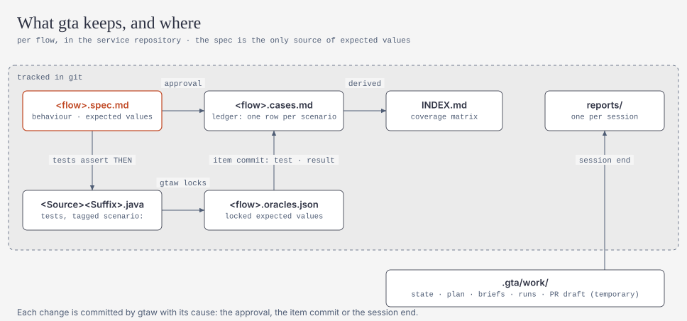

# Quick start

**English** | [简体中文](quickstart.zh-CN.md)

Who does what:

- **Tech lead, once per service:** steps 1–3.
- **Every developer:** step 4.

## 1. Publish gta to Nexus (platform team, once per release)

```bash
mvn -B deploy -DaltDeploymentRepository=nexus::https://nexus.example.com/repository/maven-releases
```

This publishes `com.gta:gta-cli:<version>` (the shaded jar) and `com.gta:gta-junit:<version>` (a test-scope dependency
of services), plus the supporting artifacts. The full release procedure, with the checksum and tag, is in
[releasing.md](releasing.md).

All downloads, for the wrapper and for Maven, go through the company Nexus proxy.

Optional: upload the Pub/Sub emulator archive to a Nexus raw repository and set `distribution.toolsUrl` (see `.gta/skills/gta-using-embedded-dependencies/references/pubsub-emulator.md`). Without it, Pub/Sub flows use in-memory fakes.

## 2. Install the harness into a service

Pick the folder your team uses: `copilot` (VS Code or IntelliJ Copilot) or `opencode`.

```bash
java -jar gta-cli-<version>.jar --root path/to/service init --platform copilot \
  --distribution-url https://nexus.example.com/repository/maven-releases/com/gta/gta-cli/<version>/gta-cli-<version>.jar \
  --distribution-sha256 <sha256 of that jar>
```

`init` writes:

| File | Purpose |
|---|---|
| `.github/agents/gta-*.agent.md`, `.github/prompts/gta.prompt.md` | Copilot agents and the `/gta` command (OpenCode: `.opencode/agents`, `.opencode/commands`) |
| `.gta/skills/**` | testing skills, loaded by path from briefs |
| `AGENTS.md` | a gta block between `<!-- gta:begin -->` and `<!-- gta:end -->`; the rest of the file is kept. A damaged block (a missing, reversed or duplicated marker) makes `init` refuse and write nothing |
| `.vscode/settings.json`, `.vscode/extensions.json` / `opencode.json` | merged, never overwritten: auto-approve for `./gtaw next|check|submit|answer|status`, the Mermaid preview. A file with comments is left untouched and `init` prints the keys to add (`mergeManually`) |
| `gtaw`, `gtaw.cmd`, `.gta/wrapper/*` | the wrapper: it downloads the pinned jar from Nexus, verifies its sha256 and runs it |
| `.gitignore` | adds `.gta/work/` (rebuildable working state) |

Add `--ci` to also install the CI gate workflow `.github/workflows/gta-gate.yml` ([ci-integration.md](ci-integration.md)).

`gtaw` refuses to run until `distributionUrl` and `distributionSha256Sum` are set: an unpinned jar is never downloaded or executed. For local development, `GTA_CLI_JAR=<path to gta-cli.jar>` overrides the download.

Add the test dependency. If you skip this, the first foundation item adds it.

```xml
<dependency>
  <groupId>com.gta</groupId>
  <artifactId>gta-junit</artifactId>
  <version><!-- gta version --></version>
  <scope>test</scope>
</dependency>
```

Commit everything.

## 3. Check the machine

```bash
./gtaw doctor        # Windows: .\gtaw.cmd doctor
```

`doctor` checks:

- the JDK, Maven (or `mvnw`), git and the Spring Boot/JUnit versions;
- gta-junit and the harness files;
- for a multi-module repository, that `build.module` names one of its modules;
- the Oracle test schema and the emulators;
- IDE auto-approve.

Warnings are fine to start with. On IntelliJ, add the auto-approve rules by hand: Settings > GitHub Copilot > Chat > Auto Approve. Add `./gtaw` and `.\gtaw.cmd` with the subcommands `next`, `check`, `submit`, `answer` and `status`.

## 4. Use it

Open Copilot Chat (agent mode) or OpenCode in the service and type:

| You type | What happens |
|---|---|
| `/gta` | continue, or list the flows; `OK` works on all of them (`service`) |
| `/gta service` | every flow of the service, riskiest first; while one flow waits for your answer, gta goes on with the others and asks you once it cannot go on without you |
| `/gta explain order.create` | write the behaviour spec and questions only, no tests |
| `/gta order.create` | spec → questions → approval → tests for that flow |
| `/gta pr <PR description>` | re-check and test the flows your branch changes, with the PR description as the intended behaviour |
| `/gta incident order.create <report>` | turn a bug report into a test that fails on today's code, then confirm the defect |
| `/gta note <text>` | tell gta something it cannot read from the code (a business rule, a known quirk); kept in `.gta/notes.md` |
| `/gta status` | flows, items and what is waiting for you |

Whenever gta stops for you or finishes, it shows one status block with five parts, always in this order: the state and
progress, what happened, what was checked, what needs you, and what comes next. If "Needs you" says nothing, gta is
still working.

gta stops and waits for you at these points.

**Questions.** Every question shows one recommended answer, marked `← recommended`, with the reason. Reply:

```
OK
```

to take every recommendation. To choose another option, add its number and letter (`OK, 2B`); to answer in your own words, write it on its own line (`2: only for loyalty customers`). `rest default` still picks the "= current code" option for the remaining normal-impact questions; those scenarios become *characterization* tests, which lock today's behaviour and do not prove it is correct. Taking a recommendation is a real answer: your reply is recorded word for word.

**Approval.** The prompt names the revision it shows. Reply `OK` to approve exactly that revision (`approve order.create@R2` works too). "don't approve …" or "approve … after q2 is fixed" is treated as a change request, never as an approval. Approval is committed with your words as the record.

**Replying in Chinese.** Set `"output": { "language": "zh-CN" }` in `.gta/config.json` and gta asks its questions and shows its prompts in Chinese. Replies work in either language: `好` / `确认` for OK, `批准 order.create@R2` for approve, `其余默认` (or `其他默认`) for rest default, and the option marker `= 代码现状` for `= current code`.

**Defects and escalations.** Reply `OK` for the recommended option, or another letter (A, B, C). A confirmed defect is pinned with `@KnownDefect`:

- the build stays green while the defect exists;
- the test turns red once the defect is fixed, which tells you to remove the pin.

**The test author's questions.** When the spec and the code do not settle how to write a test (which clock, which fixture), the test author asks instead of guessing, usually with a recommended answer. Reply `OK` to take it, or answer in your own words; the author continues with your answer.

Only a bare `OK` takes a recommendation. `OK, but …` asks for a change on an approval and counts as your own answer to an author's question.

If your terminal mangles Chinese characters, gta says so. Use the ASCII forms above, or put the reply in a UTF-8 file and run `./gtaw answer --file reply.txt`.

## What gta keeps in the repository

<picture>
  <source media="(prefers-color-scheme: dark)" srcset="../diagrams/artifacts-dark.svg">
  
</picture>

| File | What it is |
|---|---|
| `.gta/specs/<domain>/<flow>.spec.md` | the behaviour spec you approved: the only source of expected values |
| `.gta/specs/<domain>/<flow>.cases.md` | the test case ledger: one row per scenario with its test, priority, latest result and status. Set a Status to `Retired` to retire a case; add exploratory cases to its `## Manual cases` table |
| `.gta/specs/INDEX.md` | the overview of every ledger |
| `.gta/reports/<date>-<session>.md` | one report per session: gate, changed ledger rows, retired cases waiting for you |
| `.gta/lessons.md` | lessons gtaw recorded from earlier runs (a reviewer's reject, a test that could not fail, a confirmed defect); briefs show the latest ones. Edit or delete lines freely |

After a code change, `./gtaw impact --base origin/main` marks the cases whose code changed and prints the regression
scope (those cases plus every P0). A case counts as changed when a class its spec cites changed, when a class that
class injects changed (directly or further down), or when a config key it cites has a new value; `reasons` says which. Retired cases keep their tests until you run
`./gtaw cases confirm-retired <ids>` (or `--all`). `./gtaw cases --rebuild` creates the ledgers for a service that
already has approved specs. Test names follow [test-naming.md](test-naming.md).

**Selecting tests by tag.** Every gta test carries tags from its spec: `gta`, the layer, `flow:<id>`, `scenario:<id>`,
its intent (`characterization`, `hardening`, `reproducing`, `catching`) and its priority (`p0`, `p1`, `p2`); a pinned
defect also carries `known-defect`. gtaw sets them, and they work without gta:

```
./gtaw run --tags "p0 & component"     # through gtaw
mvn verify -Dgroups=p0                  # the must-pass set, e.g. before packaging
mvn verify -Dgroups=known-defect        # after a fix: which pins to remove
```

`./gtaw impact` prints its regression scope as `groups`, ready for `-Dgroups="…"`.

## Configuration (optional)

`.gta/config.json` overrides the defaults. Only the keys you set are used.

```json
{
  "build": { "basePackage": "auto", "maven": "auto" },
  "dispatch": "subagent",
  "environments": { "oracle": { "testUrl": "jdbc:oracle:thin:@//test-db:1521/TESTPDB", "userEnv": "GTA_ORACLE_USER", "passwordEnv": "GTA_ORACLE_PASSWORD" } },
  "distribution": { "toolsUrl": "https://nexus.example.com/repository/raw-tools/gta" },
  "budgets": { "maxItemsPerSession": 5, "maxAttemptsPerItem": 2, "nodeTimeoutMinutes": 15 },
  "qualityGates": { "stabilityRepeat": 3 }
}
```

- `dispatch: "inline"`: use this if your Copilot build cannot run subagents; the orchestrator then does each node itself.
- Oracle credentials are read from the named environment variables and never stored.
- `phase`: a later roadmap phase (`"P5"`) to use its capabilities before they are on by default; for pilot services. Everything up to P4 (WebFlux, gRPC, GraphQL, workflows, Beam, WebSocket/STOMP/SSE) is on by default.
- `spec.source`: `openspec` or `speckit` when the repository keeps its own specs (`openspec/specs/`, `specs/`). The analyst cites them as documented sources and never edits them.
- `build.module`: in a multi-module repository, the module that holds the service, such as `"order-api"`. `.gta/` stays at
  the repository root; tests are written into that module and Maven runs with `-pl <module> -am`. `gtaw doctor` fails
  until it is set.
- `build.tool`: `auto` (default) builds with Gradle when the service has `build.gradle(.kts)` and no `pom.xml`, otherwise
  with Maven; `maven` or `gradle` forces one. `build.gradle` names the Gradle executable (default: `./gradlew` when present).
  gta-junit writes its results to `target/gta-results/` in a Gradle build too: add it to `.gitignore`.
- `safety.protectedHosts`: your SIT, UAT and production host names, for example `["orders-uat.acme.com", "db-prod.acme.com"]`.
  gta tests run locally only: gtaw refuses any test or fixture it writes that names one of these hosts, and an Oracle
  `testUrl` on one. It also drops your shell's Spring profile (`SPRING_PROFILES_ACTIVE`) and Spring config variables for
  its runs. `gtaw doctor` warns until the list is set.
- `build.javaHomeEnv`: for a service whose build needs an older JDK (for example Java 8 with Spring Boot 2), the name of an
  environment variable holding that JDK, such as `"JAVA8_HOME"`. Maven or Gradle then runs with that `JAVA_HOME`; gtaw itself still
  needs JDK 17 or newer.

## When something goes wrong

| Situation | Do this |
|---|---|
| Chat closed or crashed mid-run | `/gta` again. State lives in `.gta/work/`, and a session idle for 10 minutes can be taken over with `./gtaw next --takeover`. |
| Want to start over | `./gtaw abort` (or `--flow <flowId>`). Specs, oracle shards and committed tests are kept. |
| An item needs you | `./gtaw status --format human`; details are in `.gta/escalations/<item>.md`. |
| A test changed on purpose | `./gtaw relock --item <itemId> --reason "..."` (human only; the gate shows it). |
