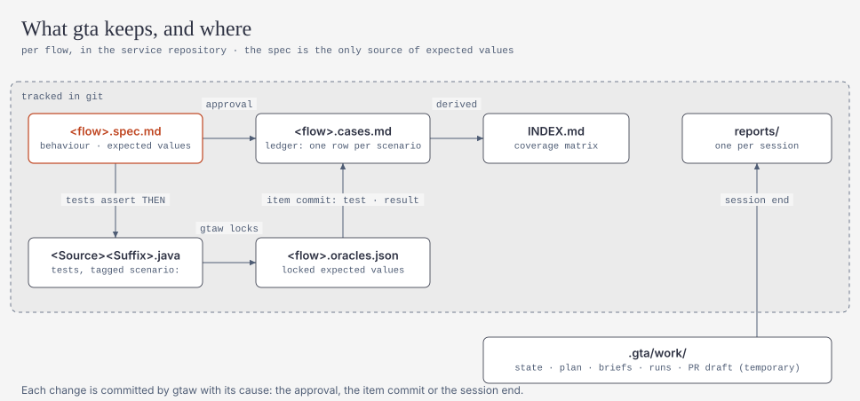

# 快速开始

[English](quickstart.md) | **简体中文**

> 这是 [quickstart.md](quickstart.md) 的中文副本，两份内容需要一起修改。命令、路径、回复格式（如 `approve order.create@R2`）保持原样。

谁做什么：

- **技术负责人，每个服务一次：** 第 1–3 步。
- **每位开发者：** 第 4 步。

## 1. 把 gta 发布到 Nexus（平台团队，每个版本一次）

```bash
mvn -B deploy -DaltDeploymentRepository=nexus::https://nexus.example.com/repository/maven-releases
```

这会发布 `com.gta:gta-cli:<version>`（shaded jar）和 `com.gta:gta-junit:<version>`（服务以 test 范围依赖它），以及配套的几个 artifact。完整的发布流程（校验和、tag）见 [releasing.md](releasing.md)。

wrapper 和 Maven 的所有下载都经过公司的 Nexus 代理。

可选：把 Pub/Sub 模拟器压缩包上传到 Nexus raw 仓库，并设置 `distribution.toolsUrl`（见 `.gta/skills/gta-using-embedded-dependencies/references/pubsub-emulator.md`）。不设置时，Pub/Sub 流程使用内存中的 fake。

## 2. 把 harness 安装进服务

选择团队使用的目录：`copilot`（VS Code 或 IntelliJ Copilot）或 `opencode`。

```bash
java -jar gta-cli-<version>.jar --root path/to/service init --platform copilot \
  --distribution-url https://nexus.example.com/repository/maven-releases/com/gta/gta-cli/<version>/gta-cli-<version>.jar \
  --distribution-sha256 <该 jar 的 sha256>
```

`init` 会写入：

| 文件 | 用途 |
|---|---|
| `.github/agents/gta-*.agent.md`、`.github/prompts/gta.prompt.md` | Copilot 的 agent 和 `/gta` 命令（OpenCode：`.opencode/agents`、`.opencode/commands`） |
| `.gta/skills/**` | 测试 skill，由 brief 按路径加载 |
| `AGENTS.md` | 位于 `<!-- gta:begin -->` 和 `<!-- gta:end -->` 之间的 gta 块；文件其余内容保持不变。标记损坏（缺失、顺序颠倒或重复）时，`init` 拒绝写入并给出提示 |
| `.vscode/settings.json`、`.vscode/extensions.json` / `opencode.json` | 合并写入，从不覆盖：`./gtaw next|check|submit|answer|status` 的自动批准（其他 gtaw 命令都会先问你）、Mermaid 预览。带注释的文件不会被改动，`init` 会打印需要手工添加的键（`mergeManually`） |
| `gtaw`、`gtaw.cmd`、`.gta/wrapper/*` | wrapper：从 Nexus 下载固定版本的 jar，校验 sha256 后运行 |
| `.gitignore` | 增加 `.gta/work/`（可重建的工作状态） |

加上 `--ci` 会同时安装 CI gate 工作流 `.github/workflows/gta-gate.yml`（见 [ci-integration.md](ci-integration.md)）。

在设置 `distributionUrl` 和 `distributionSha256Sum` 之前，`gtaw` 拒绝运行：未固定版本的 jar 永远不会被下载或执行。本地开发时，可用 `GTA_CLI_JAR=<gta-cli.jar 的路径>` 跳过下载。

添加测试依赖。如果跳过，第一个 foundation 项会帮你加上。

```xml
<dependency>
  <groupId>com.gta</groupId>
  <artifactId>gta-junit</artifactId>
  <version><!-- gta 版本 --></version>
  <scope>test</scope>
</dependency>
```

然后全部提交。

## 3. 检查机器环境

```bash
./gtaw doctor        # Windows：.\gtaw.cmd doctor
```

`doctor` 检查：

- JDK、Maven（或 `mvnw`）、git，以及 Spring Boot / JUnit 版本；
- gta-junit 和 harness 文件；
- 多模块仓库是否已用 `build.module` 指定其中一个模块；
- Oracle 测试 schema 和模拟器；
- IDE 自动批准。

一开始有警告也没关系。在 IntelliJ 上，请手工添加自动批准规则：Settings > GitHub Copilot > Chat > Auto Approve。为 `./gtaw` 和 `.\gtaw.cmd` 添加子命令 `next`、`check`、`submit`、`answer`、`status`。

## 4. 开始使用

在服务中打开 Copilot Chat（agent 模式）或 OpenCode，输入：

| 输入 | 效果 |
|---|---|
| `/gta` | 继续，或列出流程；回复 `OK` 就处理全部流程（`service`） |
| `/gta service` | 处理服务的全部流程，风险高的先做；某个流程等你回答时，gta 先做其他流程，等到没有你就无法继续时再问你 |
| `/gta explain order.create` | 只写行为 spec 和问题，不写测试 |
| `/gta order.create` | spec → 提问 → 批准 → 为该流程写测试 |
| `/gta pr <PR 描述>` | 以 PR 描述为预期行为，重新检查并测试本分支改动到的流程 |
| `/gta incident order.create <报告>` | 把缺陷报告变成一个在当前代码上失败的测试，然后由你确认缺陷 |
| `/gta note <文字>` | 告诉 gta 代码里读不出来的信息（业务规则、已知的特殊情况）；保存在 `.gta/notes.md` |
| `/gta status` | 流程、事项，以及等待你处理的内容 |

gta 每次停下来等你或完成工作时，都会显示一个状态区块，固定五部分，顺序不变：状态和进度、刚才发生了什么、已确认、需要你、下一步。
"需要你"那一栏写着"无"时，gta 还在继续工作。

gta 会在以下几处停下来等你。

**提问。** 每个问题都会给出一个推荐答案，标为 `← 推荐`，并附理由。回复：

```
OK
```

表示接受全部推荐。要改选其他选项，写题号加字母（`OK, 2B`）；要用自己的话回答，单独一行写（`2: 只对会员客户`）。`其余默认` 仍会为其余普通影响的问题选择“= 代码现状”选项；这些场景会变成*特征化*测试：锁定当前行为，但不证明它是正确的。接受推荐也是正式的回答：你的回复会被逐字记录。

**批准。** 提示会写明它展示的修订号。回复 `OK` 就批准这个修订号（`批准 order.create@R2` 同样有效）。“不批准 …”或“批准 … 但要先改 q2”会被当作修改请求，绝不当作批准。批准会连同你的原话一起提交，作为记录。

**用中文。** 在 `.gta/config.json` 中设置 `"output": { "language": "zh-CN" }`，gta 就会用中文提问和显示提示。回复用哪种语言都可以：`好` / `确认` 等同 OK，`批准 order.create@R2` 表示批准，`其余默认`（或 `其他默认`）表示 rest default，选项标记 `= 代码现状` 对应 `= current code`。

**缺陷与升级。** 回复 `OK` 选择推荐的选项，或回复其他字母（A、B、C）。确认的缺陷会用 `@KnownDefect` 固定：

- 缺陷存在期间，构建保持绿色；
- 缺陷被修复后，该测试会变红，提醒你去掉固定标记。

**测试作者的提问。** 规格和代码说不清测试该怎么写时（用哪个时钟、哪个 fixture），测试作者会提问而不是猜，通常附一个推荐答案。回复 `OK` 接受推荐，或者用自己的话回答；测试作者会按你的回答继续。

只有单独的 `OK` 才接受推荐。在批准时，`OK，但是……` 算修改要求；回答测试作者的提问时，算你自己的回答。

如果终端把中文显示成乱码，gta 会提示。请改用上面的 ASCII 形式，或把回复写进 UTF-8 文件，再运行 `./gtaw answer --file reply.txt`。

## gta 在仓库里保留什么

<picture>
  <source media="(prefers-color-scheme: dark)" srcset="../diagrams/artifacts-dark.svg">
  
</picture>

| 文件 | 说明 |
|---|---|
| `.gta/specs/<domain>/<flow>.spec.md` | 你批准的行为 spec：预期值的唯一来源 |
| `.gta/specs/<domain>/<flow>.cases.md` | 测试用例台账：每个场景一行，含测试、优先级、最近结果和状态。把某行 Status 设为 `Retired` 即退役该用例；探索性用例加到 `## Manual cases` 表中 |
| `.gta/specs/INDEX.md` | 所有台账的总览 |
| `.gta/reports/<date>-<session>.md` | 每个会话一份报告：gate、变化的台账行、等待你确认的退役用例 |
| `.gta/lessons.md` | gtaw 从之前的运行中记录的教训（审查者的驳回、无法失败的测试、确认的缺陷）；brief 会展示最新的几条。可以自由修改或删除 |

代码变更后，`./gtaw impact --base origin/main` 会标出代码已变化的用例，并打印回归范围（这些用例加上全部 P0）。以下情况都算变化：spec 引用的类变了；该类注入的类（直接或更深层）变了；spec 引用的配置项取值变了。`reasons` 会说明原因。退役的用例会保留其测试，直到你运行 `./gtaw cases confirm-retired <ids>`（或 `--all`）。`./gtaw cases --rebuild` 为已有已批准 spec 的服务创建台账。测试命名遵循 [test-naming.md](test-naming.md)。

**按 tag 选择测试。** 每个 gta 测试都带有来自规格的 tag：`gta`、层级、`flow:<id>`、`scenario:<id>`、意图（`characterization`、
`hardening`、`reproducing`、`catching`）和优先级（`p0`、`p1`、`p2`）；已标注的缺陷还带有 `known-defect`。这些 tag 由 gtaw 设置，
不装 gta 也能用：

```
./gtaw run --tags "p0 & component"     # 通过 gtaw
mvn verify -Dgroups=p0                  # 必须通过的测试，例如打包前
mvn verify -Dgroups=known-defect        # 修复后：找出该删除的标注
```

`./gtaw impact` 会把回归范围输出为 `groups`，可直接用于 `-Dgroups="…"`。

## 配置（可选）

`.gta/config.json` 覆盖默认值，只使用你设置的键。

```json
{
  "build": { "basePackage": "auto", "maven": "auto" },
  "dispatch": "subagent",
  "environments": { "oracle": { "testUrl": "jdbc:oracle:thin:@//test-db:1521/TESTPDB", "userEnv": "GTA_ORACLE_USER", "passwordEnv": "GTA_ORACLE_PASSWORD" } },
  "distribution": { "toolsUrl": "https://nexus.example.com/repository/raw-tools/gta" },
  "budgets": { "maxItemsPerSession": 5, "maxAttemptsPerItem": 2, "nodeTimeoutMinutes": 15 },
  "qualityGates": { "stabilityRepeat": 3 }
}
```

- `dispatch: "inline"`：如果你的 Copilot 版本无法运行子 agent，使用它；此时由 orchestrator 自己执行每个节点。
- Oracle 的凭据从指定的环境变量读取，不会被保存。
- `phase`：设为更晚的阶段（`"P5"`）可在默认开放前使用该阶段的能力；用于试点服务。P4 及之前的能力（WebFlux、gRPC、GraphQL、工作流、Beam、WebSocket/STOMP/SSE）默认已开启。
- `spec.source`：仓库自己维护规格时设为 `openspec` 或 `speckit`（`openspec/specs/`、`specs/`）。analyst 会把它们当作 documented 来源引用，绝不修改。
- `build.module`：多模块仓库中服务所在的模块，例如 `"order-api"`。`.gta/` 留在仓库根目录；测试写进该模块，Maven 以 `-pl <module> -am` 运行。未设置时 `gtaw doctor` 报失败。
- `build.tool`：`auto`（默认）在服务有 `build.gradle(.kts)` 而没有 `pom.xml` 时用 Gradle 构建，否则用 Maven；设为 `maven` 或 `gradle` 可强制指定。`build.gradle` 指定 Gradle 可执行文件（默认：存在时用 `./gradlew`）。在 Gradle 构建中 gta-junit 也把结果写到 `target/gta-results/`：请把它加入 `.gitignore`。
- `build.javaHomeEnv`：如果服务的构建需要更旧的 JDK（例如 Java 8 加 Spring Boot 2），填写存放该 JDK 路径的环境变量名，例如 `"JAVA8_HOME"`。Maven 或 Gradle 会以该 `JAVA_HOME` 运行；gtaw 本身仍需要 JDK 17 或更新版本。

## 出问题时

| 情况 | 处理 |
|---|---|
| 运行中聊天窗口关闭或崩溃 | 再次输入 `/gta`。状态在 `.gta/work/` 中，空闲 10 分钟的会话可用 `./gtaw next --takeover` 接管。 |
| 想重新开始 | `./gtaw abort`（或 `--flow <flowId>`）。spec、oracle 分片和已提交的测试都会保留。 |
| 某个事项需要你处理 | `./gtaw status --format human`；详情在 `.gta/escalations/<item>.md`。 |
| 有意修改了某个测试 | `./gtaw relock --item <itemId> --reason "..."`（仅限人工；gate 会显示）。 |
