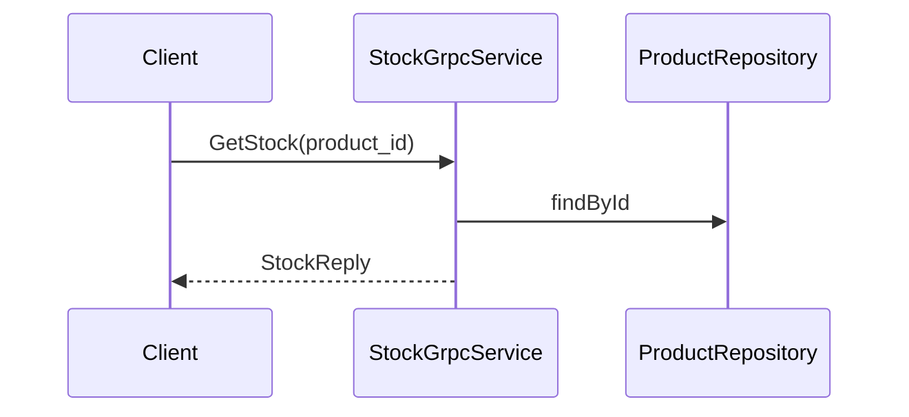

# stock.get-stock — Report the stock of a product over gRPC
<!-- gta: flowId=stock.get-stock capability=grpc-api risk=6 status=draft -->

## Boundary
- In scope: the gRPC call StockService.GetStock
- Out of scope: product.reserve
- External: none (in-memory repository)

## Access
| Role | Operation | Ownership constraint | Source |
|---|---|---|---|
| any client | read stock | none | observed |

## Requirements

### Requirement: Stock and availability
<!-- gta: id=stock.get-stock/r01 ref=method:com.example.catalog.grpc.StockGrpcService#getStock -->
WHEN a client asks for the stock of a product, THE catalog SHALL reply with the stock and whether the product is available.

#### Scenario: a product in stock is available
<!-- gta: id=stock.get-stock/s01 source=observed hint.layer=component hint.oracle=response priority=P1 -->
- **WHEN** a client asks for the stock of a product with 5 in stock
- **THEN** the reply has stock `5` and available `true`

#### Scenario: a product without stock is not available
<!-- gta: id=stock.get-stock/s02 source=documented doc=__P__docs/business-rules.md quote="a product is available only when its stock is above zero" hint.layer=component hint.oracle=response priority=P1 -->
- **WHEN** a client asks for the stock of a product with 0 in stock
- **THEN** the reply has available `false`

## Invariants

## Open questions

## Findings
