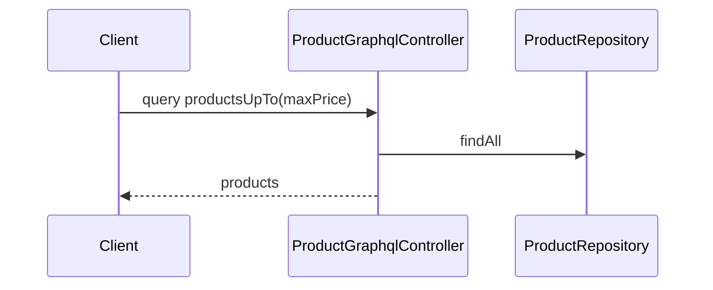

# product-graphql.products-up-to — List products up to a price
<!-- gta: flowId=product-graphql.products-up-to capability=graphql-api risk=3 status=draft -->

## Boundary
- In scope: the GraphQL query productsUpTo(maxPrice)
- Out of scope: the product query
- External: none (in-memory repository)

## Access
| Role | Operation | Ownership constraint | Source |
|---|---|---|---|
| anonymous | query products | none | observed |

## Requirements

### Requirement: Products up to a price
<!-- gta: id=product-graphql.products-up-to/r01 ref=method:com.example.catalog.graphql.ProductGraphqlController#productsUpTo -->
WHEN a client queries productsUpTo with a maximum price, THE catalog SHALL return the products that cost at most that price.

#### Scenario: cheap products are listed
<!-- gta: id=product-graphql.products-up-to/s01 source=observed hint.layer=component hint.oracle=response priority=P1 -->
- **WHEN** a client queries products up to 40.00
- **THEN** the names are `Kettle`

#### Scenario: a product at exactly the maximum is listed
<!-- gta: id=product-graphql.products-up-to/s02 source=documented doc=__P__docs/business-rules.md quote="a price filter includes products that cost exactly the maximum" hint.layer=component hint.oracle=response priority=P1 -->
- **WHEN** a client queries products up to 45.00
- **THEN** the names are `Kettle` and `Toaster`

## Invariants

## Open questions

## Findings
