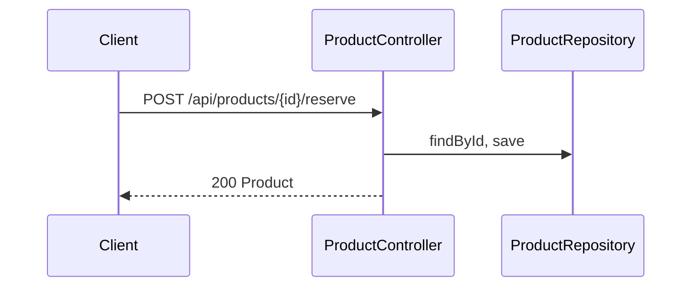

# product.reserve — Reserve stock of a product
<!-- gta: flowId=product.reserve capability=webflux risk=6 status=draft -->

## Boundary
- In scope: POST /api/products/{id}/reserve?quantity=n (WebFlux, returns Mono<Product>)
- Out of scope: product.get-product
- External: none (in-memory repository)

## Access
| Role | Operation | Ownership constraint | Source |
|---|---|---|---|
| anonymous | reserve stock | none (no security configured) | observed |

## Requirements

### Requirement: Reserve stock
<!-- gta: id=product.reserve/r01 ref=method:com.example.catalog.api.ProductController#reserve -->
WHEN a client reserves a quantity of a product, THE catalog SHALL lower the stock by that quantity; IF the quantity is larger than the stock, THEN THE catalog SHALL refuse with 409.

#### Scenario: a reservation within the stock lowers it
<!-- gta: id=product.reserve/s01 source=observed hint.layer=component hint.oracle=response priority=P0 -->
- **WHEN** a client reserves 2 of product `p-1`, which has 5 in stock
- **THEN** the response status is `200` and the stock is `3`

#### Scenario: a reservation larger than the stock is refused
<!-- gta: id=product.reserve/s02 source=documented doc=__P__docs/business-rules.md quote="a reservation larger than the stock is refused with 409" hint.layer=component hint.oracle=response priority=P0 -->
- **WHEN** a client reserves 3 of product `p-2`, which has 2 in stock
- **THEN** the response status is `409`

## Invariants

## Open questions

## Findings
