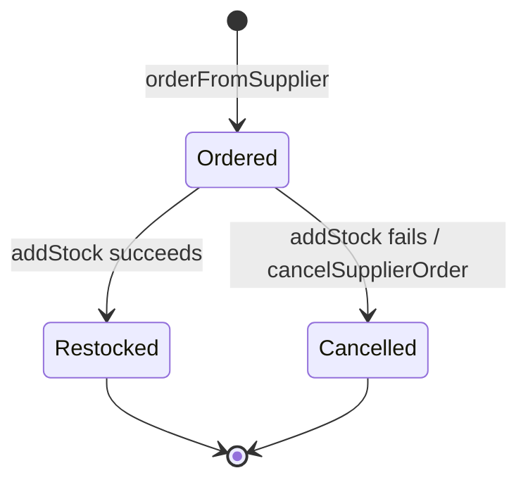

# restock.restock — Restock a product from its supplier
<!-- gta: flowId=restock.restock capability=workflow risk=6 status=draft -->

## Boundary
- In scope: the Temporal workflow RestockWorkflow.restock and its activities
- Out of scope: product.reserve
- External: the supplier and the stock store, behind RestockActivities (faked)

## Access
| Role | Operation | Ownership constraint | Source |
|---|---|---|---|
| workflow client | start a restock | none | observed |

## Requirements

### Requirement: Restock or cancel
<!-- gta: id=restock.restock/r01 ref=method:com.example.catalog.restock.RestockWorkflowImpl#restock -->
WHEN a restock runs, THE catalog SHALL book the supplier's stock, or cancel the supplier order when the stock update fails.

#### Scenario: a restock books the supplier's stock
<!-- gta: id=restock.restock/s01 source=observed hint.layer=unit hint.oracle=state priority=P1 -->
- **WHEN** a restock of 5 units of product p-1 runs and the stock update succeeds
- **THEN** the workflow returns `restocked`

#### Scenario: a failed stock update cancels the supplier order
<!-- gta: id=restock.restock/s02 source=documented doc=__P__docs/business-rules.md quote="a restock whose stock update fails cancels its supplier order" hint.layer=unit hint.oracle=state priority=P1 -->
- **WHEN** a restock of 5 units of product p-1 runs and the stock update fails
- **THEN** the supplier order `po-1` is cancelled

## Invariants

## Open questions

## Findings
