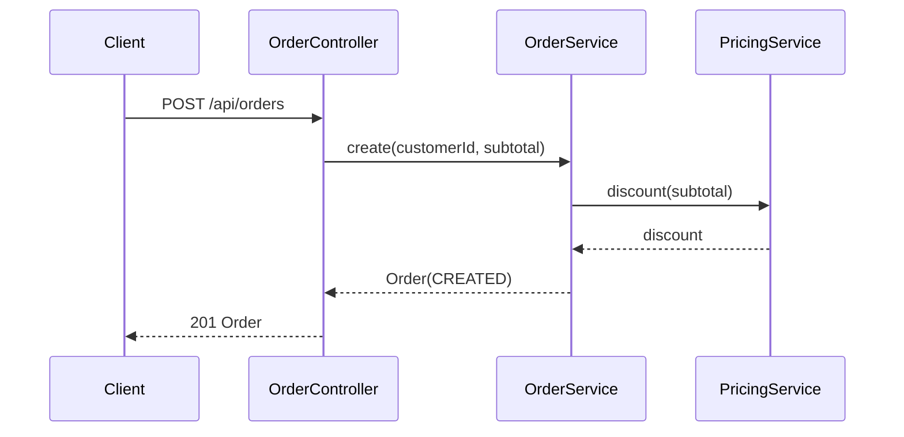

# order.create-order — Create an order with a volume discount
<!-- gta: flowId=order.create-order capability=rest-api risk=6 status=draft -->

## Boundary
- In scope: POST /api/orders → price the order, store it in status CREATED, return it
- Out of scope: order.cancel-order, order.ship-order, order.get-order
- External: none (in-memory repository)

## Access
| Role | Operation | Ownership constraint | Source |
|---|---|---|---|
| anonymous | create order | none (no security configured) | observed |

## Requirements

### Requirement: Create an order
<!-- gta: id=order.create-order/r01 ref=method:com.example.order.api.OrderController#createOrder ref=method:com.example.order.service.OrderService#create -->
WHEN a client posts a valid order, THE order service SHALL store it in status CREATED and respond 201 with the priced order.

#### Scenario: small order has no discount
<!-- gta: id=order.create-order/s01 source=observed hint.layer=component hint.oracle=response -->
- **WHEN** customer `c-1` posts an order with subtotal `50.00`
- **THEN** the response status is `201`
- **AND** the body has discount `0.00`, total `50.00` and status `CREATED`

### Requirement: Volume discount
<!-- gta: id=order.create-order/r02 ref=method:com.example.order.service.PricingService#discount ref=config:order.discount.threshold ref=config:order.discount.rate -->
WHEN the subtotal reaches the discount threshold, THE order service SHALL subtract the discount rate from the total.

#### Scenario: large order gets the discount
<!-- gta: id=order.create-order/s02 source=observed hint.layer=component hint.oracle=response -->
- **WHEN** customer `c-1` posts an order with subtotal `150.00`
- **THEN** the response status is `201`
- **AND** the body has discount `15.00` and total `135.00`

#### Scenario: order exactly at the threshold
<!-- gta: id=order.create-order/s03 source=assumed hint.layer=component hint.oracle=response -->
- **WHEN** customer `c-1` posts an order with subtotal `100.00`
- **THEN** the response status is `201`
- **AND** the body has discount `0.00` and total `100.00`

### Requirement: Reject invalid orders
<!-- gta: id=order.create-order/r03 ref=method:com.example.order.api.OrderController#createOrder -->
IF the customer id is blank, THEN THE order service SHALL respond 400 and store nothing.

#### Scenario: blank customer id
<!-- gta: id=order.create-order/s04 source=observed hint.layer=component hint.oracle=response -->
- **WHEN** a client posts an order with customer id `""` and subtotal `50.00`
- **THEN** the response status is `400`

## Invariants

## Open questions
<!-- gta: id=order.create-order/q01 impact=high affects=order.create-order/s03 -->
1. [high impact] PricingService documents "Orders of at least the threshold get the discount" but compares with `>`. Should an order of exactly 100.00 get the discount?
   - [ ] A) No discount at exactly 100.00 (= current code)
   - [ ] B) Discount applies at 100.00 → s03 THEN discount `10.00` and total `90.00` (recommended: the Javadoc says "at least the threshold")

## Findings
<!-- gta: id=order.create-order/f01 kind=behavior-suspect ref=method:com.example.order.service.PricingService#discount -->
- The Javadoc says "at least the threshold" but the code uses `compareTo(threshold) > 0`.
