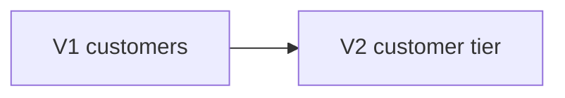

# db.customer-tier — Customer tier migration
<!-- gta: flowId=db.customer-tier capability=db-migration risk=6 status=draft -->

## Boundary
- In scope: Flyway V2__customer_tier.sql on a database at V1 with existing customers
- Out of scope: the other order flows
- External: none

## Access
| Role | Operation | Ownership constraint | Source |
|---|---|---|---|
| any | Customer tier migration | none | observed |

## Requirements

### Requirement: Customer tier migration
<!-- gta: id=db.customer-tier/r01 ref=file:src/main/resources/db/migration/V2__customer_tier.sql -->
WHEN the database migrates to V2, THE migration SHALL give every existing customer a tier from their points.

#### Scenario: a customer with few points stays BASIC
<!-- gta: id=db.customer-tier/s01 source=observed hint.layer=component hint.oracle=state priority=P1 -->
- **WHEN** a customer with 50 points exists at V1 and the database migrates
- **THEN** that customer's tier is `BASIC`

#### Scenario: 100 points make a customer GOLD
<!-- gta: id=db.customer-tier/s02 source=documented doc=__P__docs/business-rules.md quote="a customer with at least 100 points is GOLD" hint.layer=component hint.oracle=state priority=P1 -->
- **WHEN** a customer with 100 points exists at V1 and the database migrates
- **THEN** that customer's tier is `GOLD`

## Invariants

## Open questions

## Findings
