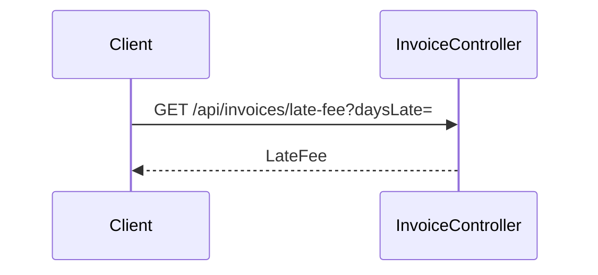

# invoice.late-fee — The late fee of an invoice
<!-- gta: flowId=invoice.late-fee capability=rest-api risk=6 status=draft -->

## Boundary
- In scope: GET /api/invoices/late-fee
- Out of scope: invoice.quote
- External: none

## Access
| Role | Operation | Ownership constraint | Source |
|---|---|---|---|
| any | read a late fee | none | observed |

## Requirements

### Requirement: Late fee
<!-- gta: id=invoice.late-fee/r01 ref=method:com.example.invoice.api.InvoiceController#lateFee -->
WHEN an invoice is paid after its due day, THE invoice service SHALL charge a late fee of 5.00.

#### Scenario: a late invoice pays the fee
<!-- gta: id=invoice.late-fee/s01 source=observed hint.layer=component hint.oracle=response priority=P1 -->
- **WHEN** a client asks for the late fee of an invoice paid 3 days late
- **THEN** the response status is `200` with fee `5.00`

#### Scenario: an invoice paid on its due day has no fee
<!-- gta: id=invoice.late-fee/s02 source=documented doc=docs/business-rules.md quote="an invoice paid on or before its due day has no late fee" hint.layer=component hint.oracle=response hint.intent=catching priority=P1 -->
- **WHEN** a client asks for the late fee of an invoice paid on its due day
- **THEN** the response status is `200` with fee `0.00`

## Invariants

## Open questions

## Findings
