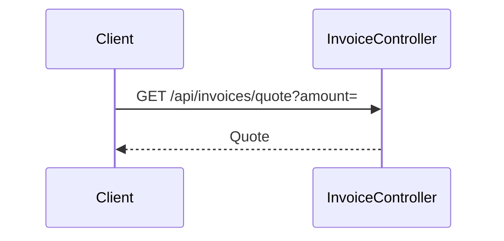

# invoice.quote — Quote the total of an invoice
<!-- gta: flowId=invoice.quote capability=rest-api risk=6 status=draft -->

## Boundary
- In scope: GET /api/invoices/quote
- Out of scope: none
- External: none

## Access
| Role | Operation | Ownership constraint | Source |
|---|---|---|---|
| any | quote an invoice | none | observed |

## Requirements

### Requirement: Invoice total
<!-- gta: id=invoice.quote/r01 ref=method:com.example.invoice.api.InvoiceController#quote -->
WHEN a client asks for the total of an invoice, THE invoice service SHALL return the amount, discounted by 10 % from 100 on.

#### Scenario: a small invoice pays the full amount
<!-- gta: id=invoice.quote/s01 source=observed hint.layer=component hint.oracle=response priority=P1 -->
- **WHEN** a client quotes an amount of 40
- **THEN** the response status is `200` with total `40.00`

#### Scenario: an invoice of exactly 100 gets the discount
<!-- gta: id=invoice.quote/s02 source=documented doc=__P__docs/business-rules.md quote="invoices of 100 or more get a 10 % discount" hint.layer=component hint.oracle=response priority=P1 -->
- **WHEN** a client quotes an amount of 100
- **THEN** the response status is `200` with total `90.00`

## Invariants

## Open questions

## Findings
