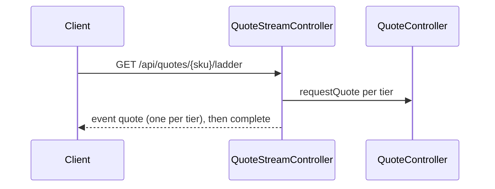

# quote-stream.ladder — Stream the quote ladder

<!-- gta: flowId=quote-stream.ladder capability=websocket risk=2 status=draft -->

## Boundary
- In scope: GET /api/quotes/{sku}/ladder as a text/event-stream
- Out of scope: the other order flows
- External: none

## Access
| Role | Operation | Ownership constraint | Source |
|---|---|---|---|
| any | Stream the quote ladder | none | observed |

## Requirements

### Requirement: Stream the ladder
<!-- gta: id=quote-stream.ladder/r01 ref=method:com.example.order.quote.QuoteStreamController#ladder -->
WHEN a client opens the ladder of a sku, THE order service SHALL stream one quote event per quantity tier and then end the stream.

#### Scenario: the ladder starts with a single item
<!-- gta: id=quote-stream.ladder/s01 source=observed hint.layer=component hint.oracle=response priority=P1 -->
- **WHEN** a client opens the ladder of `sku-1` at unit price `9.90`
- **THEN** the first quote event is for `1` item

#### Scenario: the ladder ends with twenty items
<!-- gta: id=quote-stream.ladder/s02 source=documented doc=__P__docs/business-rules.md quote="the ladder streams one quote for each of 1, 5, 10 and 20 items, then ends" hint.layer=component hint.oracle=response priority=P1 -->
- **WHEN** a client reads the whole ladder of `sku-1` at unit price `9.90`
- **THEN** the stream has `4` quote events and the last is for `20` items

## Invariants

## Open questions

## Findings
