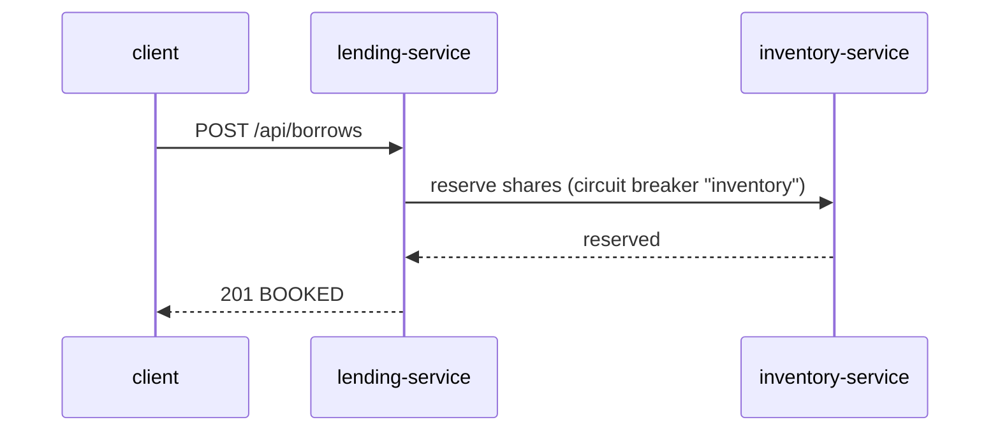

# borrow.book — Book a stock borrow
<!-- gta: flowId=borrow.book capability=rest-api risk=6 status=draft -->

## Boundary
- In scope: POST /api/borrows → reserve inventory → persist the borrow
- Out of scope: returns and recalls (see `recall.recall`)
- External: inventory-service (HTTP, behind the `inventory` circuit breaker)

## Access
| Role | Operation | Ownership constraint | Source |
|---|---|---|---|
| client | book a borrow | none | observed |

## Requirements

### Requirement: Valid quantities
<!-- gta: id=borrow.book/r01 ref=method:com.example.lending.borrow.BorrowController#book -->
IF a client books a borrow of no shares, THEN THE lending service SHALL respond 400.

#### Scenario: a borrow of no shares is refused
<!-- gta: id=borrow.book/s01 source=observed hint.oracle=state priority=P1 -->
- **WHEN** client c-1 books a borrow of 0 shares of ACME
- **THEN** the response status is `400`

### Requirement: Inventory outages
<!-- gta: id=borrow.book/r02 ref=method:com.example.lending.borrow.InventoryClient#reserve -->
IF inventory-service cannot be reached, THEN THE lending service SHALL respond 503 and keep the borrow pending a locate.

#### Scenario: an unreachable inventory leaves the borrow pending a locate
<!-- gta: id=borrow.book/s02 source=documented doc=__P__docs/business-rules.md quote="while inventory-service cannot be reached, a booking stays pending a locate and the API answers 503" hint.oracle=state priority=P0 -->
- **WHEN** inventory-service is unreachable and client c-1 books a borrow of 10000 shares of ACME
- **THEN** the response status is `503` and the borrow status is `PENDING_LOCATE`

## Invariants

## Open questions

## Findings
