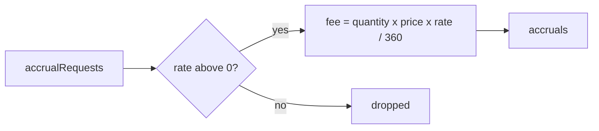

# fee-accrual.flow — Accrue the daily lending fee
<!-- gta: flowId=fee-accrual.flow capability=integration risk=6 status=draft -->

## Boundary
- In scope: the Spring Integration flow feeAccrualFlow (accrualRequests → accruals)
- Out of scope: billing the accrued fees
- External: none

## Access
| Role | Operation | Ownership constraint | Source |
|---|---|---|---|
| nightly accrual | accrue a day | none | observed |

## Requirements

### Requirement: Daily fee on Act/360
<!-- gta: id=fee-accrual.flow/r01 ref=method:com.example.lending.accrual.FeeAccrualIntegrationConfig#feeAccrualFlow -->
WHEN a day accrues on an open borrow, THE lending service SHALL publish the daily fee, quantity x price x annual rate / 360, rounded half-even to cents; a borrow at a zero rate accrues nothing.

#### Scenario: a borrow at a zero rate accrues nothing
<!-- gta: id=fee-accrual.flow/s01 source=observed hint.oracle=state priority=P2 -->
- **WHEN** a day accrues on 10000 shares at 50.00 with a rate of 0 bps
- **THEN** `0` daily fees are published

#### Scenario: the daily fee uses Act/360
<!-- gta: id=fee-accrual.flow/s02 source=documented doc=__P__docs/business-rules.md quote="The daily lending fee is quantity x price x annual rate / 360 (Act/360), rounded half-even to cents" hint.oracle=state priority=P0 -->
- **WHEN** a day accrues on 10000 shares at 50.00 with a rate of 25 bps
- **THEN** the daily fee of borrow `b-1` is `3.47`

## Invariants

## Open questions

## Findings
