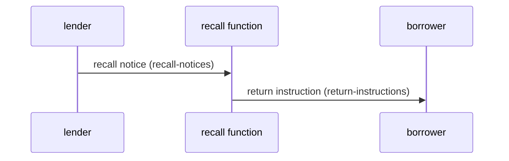

# recall.recall — Turn a recall into a return instruction
<!-- gta: flowId=recall.recall capability=messaging risk=6 status=draft -->

## Boundary
- In scope: the Cloud Stream function recall (recall-notices → return-instructions)
- Out of scope: settling the returned shares
- External: Pub/Sub (Cloud Stream binder; the test binder in tests)

## Access
| Role | Operation | Ownership constraint | Source |
|---|---|---|---|
| lender | recall shares | none | observed |

## Requirements

### Requirement: Return what is recalled, never more than was borrowed
<!-- gta: id=recall.recall/r01 ref=method:com.example.lending.recall.RecallFunctions#recall -->
WHEN a lender recalls shares of a borrow, THE lending service SHALL instruct the borrower to return the recalled shares, at most the borrowed quantity.

#### Scenario: a partial recall returns the recalled shares
<!-- gta: id=recall.recall/s01 source=observed hint.oracle=state priority=P1 -->
- **WHEN** a recall of 400 of the 1000 shares of borrow b-1 arrives
- **THEN** a return instruction for `400` shares of borrow `b-1` is sent

#### Scenario: a recall larger than the borrow returns the borrowed shares
<!-- gta: id=recall.recall/s02 source=documented doc=__P__docs/business-rules.md quote="A recall never makes a borrower return more shares than were borrowed" hint.oracle=state priority=P0 -->
- **WHEN** a recall of 1500 of the 1000 shares of borrow b-1 arrives
- **THEN** a return instruction for `1000` shares of borrow `b-1` is sent

## Invariants

## Open questions

## Findings
