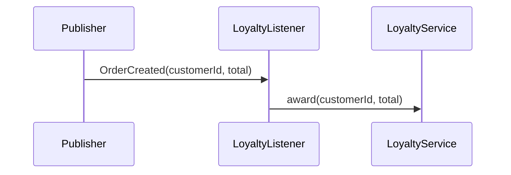

# loyalty.on-order-created — Award loyalty points for a new order
<!-- gta: flowId=loyalty.on-order-created capability=messaging risk=6 status=draft -->

## Boundary
- In scope: LoyaltyListener#onOrderCreated on an OrderCreated application event, LoyaltyService#award
- Out of scope: order.create-order (the test publishes the event)
- External: none (in-process application event)

## Access
| Role | Operation | Ownership constraint | Source |
|---|---|---|---|
| system | award points | none | observed |

## Requirements

### Requirement: Points per order
<!-- gta: id=loyalty.on-order-created/r01 ref=method:com.example.order.loyalty.LoyaltyListener#onOrderCreated ref=method:com.example.order.loyalty.LoyaltyService#award -->
WHEN an OrderCreated event arrives, THE loyalty service SHALL add one point per full 10.00 of the order total to the customer.

#### Scenario: a round total
<!-- gta: id=loyalty.on-order-created/s01 source=observed hint.layer=component hint.oracle=state priority=P1 -->
- **WHEN** an OrderCreated event for customer `c-7` with total `30.00` arrives
- **THEN** customer `c-7` has `3` points

#### Scenario: only full 10.00 count
<!-- gta: id=loyalty.on-order-created/s02 source=documented doc=__P__docs/business-rules.md quote="a customer earns one point per full 10.00 of the order total" hint.layer=component hint.oracle=state priority=P1 -->
- **WHEN** an OrderCreated event for customer `c-8` with total `25.00` arrives
- **THEN** customer `c-8` has `2` points

## Invariants

## Open questions

## Findings
