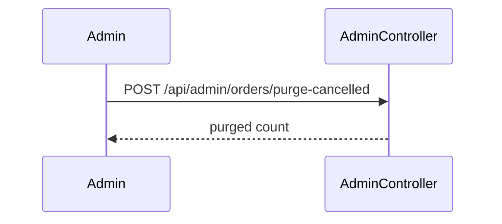

# admin.purge-cancelled — Purge cancelled orders
<!-- gta: flowId=admin.purge-cancelled capability=rest-api risk=6 status=draft -->

## Boundary
- In scope: POST /api/admin/orders/purge-cancelled, behind the security filter chain
- Out of scope: the other order flows
- External: none

## Access
| Role | Operation | Ownership constraint | Source |
|---|---|---|---|
| any | Purge cancelled orders | none | observed |

## Requirements

### Requirement: Purge cancelled orders
<!-- gta: id=admin.purge-cancelled/r01 ref=method:com.example.order.admin.AdminController#purgeCancelled -->
WHEN an administrator purges, THE order service SHALL delete the cancelled orders; IF the caller is not an administrator, THEN THE order service SHALL refuse with 403.

#### Scenario: an admin purges cancelled orders
<!-- gta: id=admin.purge-cancelled/s01 source=observed hint.layer=component hint.oracle=state priority=P1 -->
- **WHEN** user `ops-1` with role ADMIN posts the purge and no order is cancelled
- **THEN** the response status is `200` with purged `0`

#### Scenario: a customer may not purge
<!-- gta: id=admin.purge-cancelled/s02 source=documented doc=__P__docs/business-rules.md quote="only users with role ADMIN may call the admin API" hint.layer=component hint.oracle=state priority=P1 -->
- **WHEN** user `c-1` with role CUSTOMER posts the purge
- **THEN** the response status is `403`

## Invariants

## Open questions

## Findings
