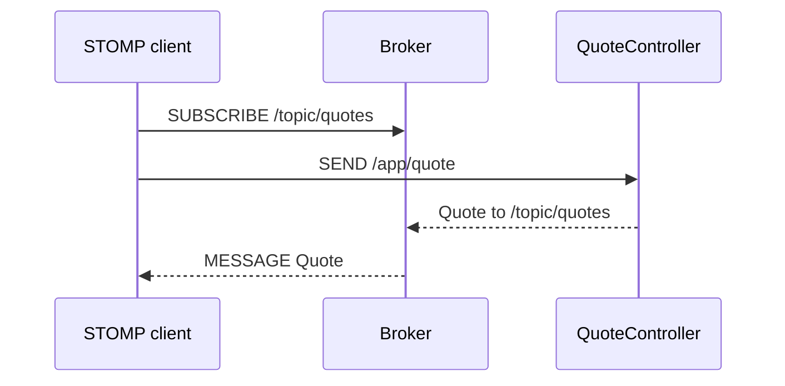

# quote.request-quote — Request a live quote

<!-- gta: flowId=quote.request-quote capability=websocket risk=6 status=draft -->

## Boundary
- In scope: STOMP send to /app/quote over the /ws endpoint, answered on /topic/quotes
- Out of scope: the other order flows
- External: none

## Access
| Role | Operation | Ownership constraint | Source |
|---|---|---|---|
| any | Request a quote | none | observed |

## Requirements

### Requirement: Quote an order
<!-- gta: id=quote.request-quote/r01 ref=method:com.example.order.quote.QuoteController#requestQuote -->
WHEN a client sends a quote request, THE order service SHALL publish the total to every subscriber of /topic/quotes.

#### Scenario: a small order is quoted at full price
<!-- gta: id=quote.request-quote/s01 source=observed hint.layer=component hint.oracle=response priority=P1 -->
- **WHEN** a client asks for 2 items at unit price `9.90`
- **THEN** the published quote has total `19.80`

#### Scenario: ten items get the bulk discount
<!-- gta: id=quote.request-quote/s02 source=documented doc=__P__docs/business-rules.md quote="an order of 10 or more items gets 10 % off" hint.layer=component hint.oracle=response priority=P0 -->
- **WHEN** a client asks for 10 items at unit price `5.00`
- **THEN** the published quote has total `45.00`

## Invariants

## Open questions

## Findings
