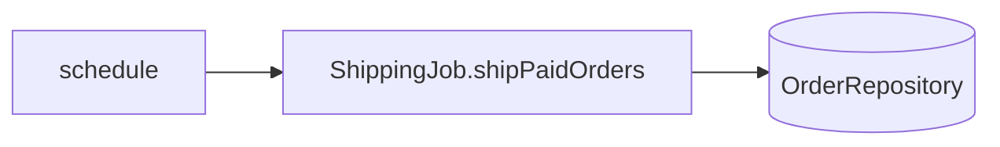

# shipping.ship-paid-orders — Ship paid orders on a schedule
<!-- gta: flowId=shipping.ship-paid-orders capability=scheduler risk=6 status=draft -->

## Boundary
- In scope: ShippingJob#shipPaidOrders, run by @Scheduled every `shipping.interval-ms`
- Out of scope: order.create-order, the schedule itself (tests call the job method directly)
- External: none (in-memory repository)

## Access
| Role | Operation | Ownership constraint | Source |
|---|---|---|---|
| scheduler | ship orders | none | observed |

## Requirements

### Requirement: Ship paid orders
<!-- gta: id=shipping.ship-paid-orders/r01 ref=method:com.example.order.shipping.ShippingJob#shipPaidOrders -->
WHEN the shipping job runs, THE order service SHALL move every PAID order to SHIPPED and leave unpaid orders as they are.

#### Scenario: a paid order is shipped
<!-- gta: id=shipping.ship-paid-orders/s01 source=observed hint.layer=component hint.oracle=state priority=P0 -->
- **WHEN** the job runs while an order is PAID
- **THEN** that order has status `SHIPPED`

#### Scenario: an unpaid order is not shipped
<!-- gta: id=shipping.ship-paid-orders/s02 source=documented doc=__P__docs/business-rules.md quote="only orders in status PAID are shipped" hint.layer=component hint.oracle=state priority=P0 -->
- **WHEN** the job runs while an order is CREATED
- **THEN** that order has status `CREATED`

## Invariants

## Open questions

## Findings
