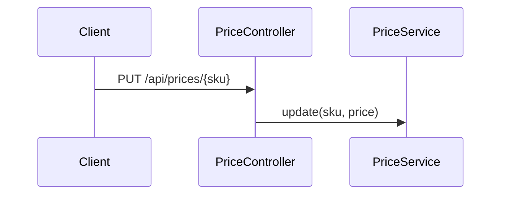

# price.update-price — Update a price
<!-- gta: flowId=price.update-price capability=rest-api risk=6 status=draft -->

## Boundary
- In scope: PUT /api/prices/{sku}, served from the prices cache by GET /api/prices/{sku}
- Out of scope: the other order flows
- External: none

## Access
| Role | Operation | Ownership constraint | Source |
|---|---|---|---|
| any | Update a price | none | observed |

## Requirements

### Requirement: Update a price
<!-- gta: id=price.update-price/r01 ref=method:com.example.order.price.PriceController#updatePrice ref=method:com.example.order.price.PriceService#update ref=method:com.example.order.price.PriceService#price -->
WHEN a client updates a price, THE order service SHALL return it and serve it on every later read.

#### Scenario: an update returns the new price
<!-- gta: id=price.update-price/s01 source=observed hint.layer=component hint.oracle=state priority=P1 -->
- **WHEN** a client puts price `7.25` for a new sku
- **THEN** the response status is `200` with price `7.25`

#### Scenario: the next read sees the update
<!-- gta: id=price.update-price/s02 source=documented doc=__P__docs/business-rules.md quote="a price change is visible on the next read" hint.layer=component hint.oracle=state priority=P1 -->
- **WHEN** a client reads a cached price, then puts `12.50`, then reads it again
- **THEN** the last read returns price `12.50`

## Invariants

## Open questions

## Findings
