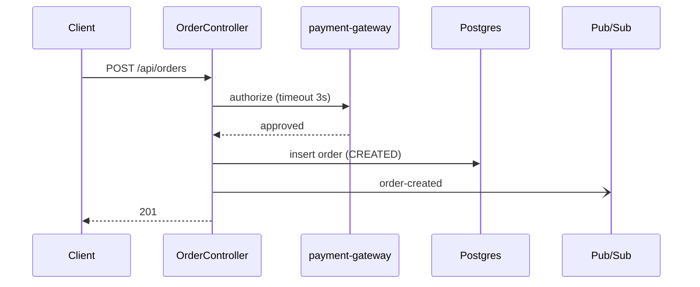
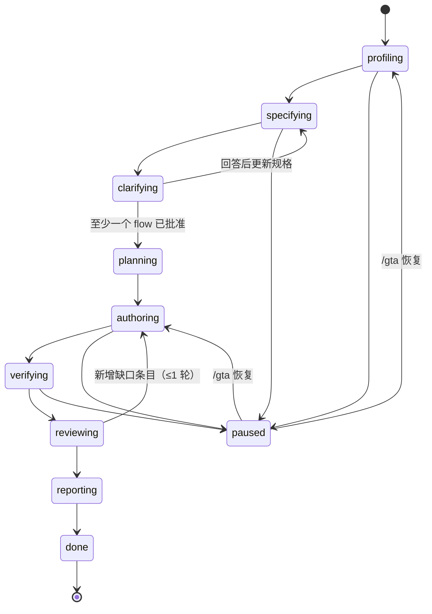
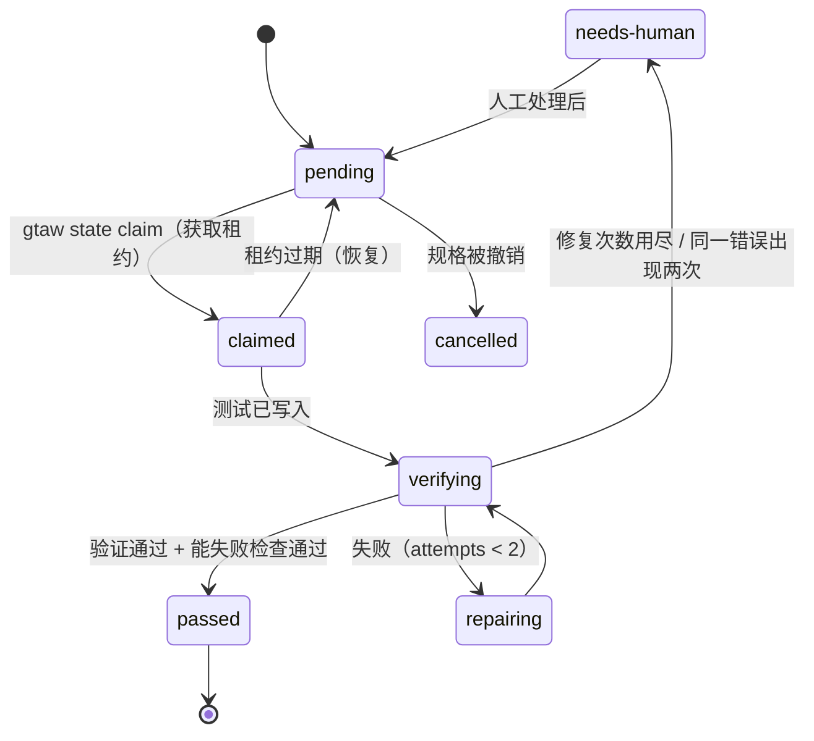

# Generic Testing Agent (GTA) — 设计方案

> 状态：设计阶段（未实现） · 版本：plan v3 · 日期：2026-11
> 范围：面向 Java（Spring 为主）服务的通用测试 harness
> 使用面：**VS Code Copilot、IntelliJ IDEA Copilot**（主），OpenCode（次）
> 命名空间：所有对外资产统一使用前缀 `gta`

---

## 0. TL;DR

1. **目标**：衡量测试的标准是"能不能发现错误"，不是 coverage。质量信号见 §1。
2. **先规格，后测试（Spec-first）**：
   - agent 先读代码，生成**行为规格**（behavior spec）：格式兼容 OpenSpec，配 Mermaid 图，并标注每一条结论的来源。
   - 再用结构化问题和用户确认边界与不确定点；用户按 flow 逐个批准后，才开始写测试。
   - 这样做是为了解决 LLM 写测试最大的问题：只会把代码"现状"写成期望值。人工确认过的规格提供了独立的 oracle（判定期望结果的依据）（§3）。
3. **Blueprint 架构**：
   - 流程推进、状态、构建执行、解析、门禁全部交给确定性 CLI `gta`（Java 实现，通过 `gtaw` wrapper 运行）。
   - LLM 只负责需要判断的环节：分析、写规格、写测试、评审（§4）。
4. **工程机制完整**：显式状态机、单写者原子持久化加事件日志、租约（lease）与崩溃恢复、错误分类与退出码、有界循环与熔断、结构化的人工检查点（checkpoint）（§5）。
5. **Agent 少，Skill 多**：手写 4 个 agent 加 1 个 specialist 模板，由模板生成 5 个按服务类型划分的 specialist；技术知识写成 `gta-*` skills，按需加载。
6. **上手简单**：每个仓库由 tech lead 执行一次 `./gtaw init`；开发者只需在 Copilot Chat 里输入 `/gta`；零配置；第一次运行只读；每个问题都带推荐默认值（§12）。
7. **工程化**：统一命名规范（§9）、JSON Schema 契约（§10）、单一制品版本管理、lint 加 build 同步校验、hooks 加 CI 双层护栏，并用 evals 回归 harness 本身。

---

## 1. 问题定义与质量信号

**现状**：服务都是 Java。部署在 GCP（GKE、Dataflow、Cloud Run）以及非 GCP 环境。flow 包括 API、Scheduler、Batch、Workflow、事件驱动等。目标是做自动化 regression test 和 integration test。

**只看 coverage 不够的原因**：没有断言的测试也能贡献 coverage；coverage 不感知业务语义（边界、幂等、时间、并发、最终一致性），也不感知跨服务契约。Meta ACH 被采纳的 571 个测试中，有 277 个按 line coverage 标准会被丢弃，但它们能抓到真实故障。

| 信号 | 定义 | 计算方式 |
|---|---|---|
| Scenario 覆盖 | 已批准规格中的每个 scenario 是否都有通过验证的测试 | spec ↔ JUnit/Karate tag |
| Spec findings | 代码现状与文档或人工确认的期望不一致的地方（写测试之前就能发现的候选缺陷） | `gta-analyst` + 人工确认 |
| Mutation score（变更代码） | 对改动代码注入缺陷后，被测试发现的比例 | `gtaw mutate`（PIT，只针对 diff） |
| Catching 命中 | 针对本次变更生成的测试中，失败且经确认为真实缺陷的数量 | PR 模式 |
| Oracle 强度 | 断言是否验证业务结果 | `gtaw lint-tests` + `gta-reviewer` |
| 契约覆盖 | OpenAPI operation × status code、消息 schema 是否覆盖 | Schemathesis / Pact / SCC |
| Flaky 率 | 新测试连续 k 次运行全部通过的比例（pass^k） | `gtaw run --repeat k` |
| Coverage | 仅作参考，不作为门禁 | JaCoCo |

---

## 2. 业界做法与设计原则

### 2.1 大公司的做法

| 来源 | 做法 | 本设计采纳的点 |
|---|---|---|
| **Meta ACH**（FSE'25） | 针对具体风险生成少量 mutant，再让 LLM 写能杀死它的测试；用 LLM 判定等价 mutant | Mutation 驱动补测 |
| **Meta JiTTests**（2026） | 每个 diff 推断意图并列出风险，据此生成 catching test。失败的测试只算 "weak catch"，经规则和 LLM 双层 assessor 过滤后才交给工程师 | PR 模式的 `catching` 意图；reviewer 作为 assessor |
| **Uber AutoCover**（ICSE-SEIP'26） | prepare / generate / execute / validate-repair 四个子图；门禁看 coverage 增量和 mutation；多次运行防 flaky | Blueprint 节点划分、pass^k |
| **Stripe Minions** | Blueprint 中确定性节点与 agentic 节点交替；CI 修复最多约 2 轮，之后转人工 | `gtaw` 负责确定性节点；每个条目最多修复 2 次 |
| **Spotify Honk** | 按组件内容自动激活独立 verifier，在开 PR 前强制运行；LLM judge 对比 diff 与原始意图 | verifier 按 registry 激活；reviewer 充当 judge |
| **Airbnb 测试迁移** | 分步校验；把错误回传后重试；上下文中加入同级测试和示例 | 结构化错误回传；specialist 上下文包含同级测试 |
| **Microsoft code-testing-generator**（2026-07） | 以 plugin 形式提供 agent + skills：研究 → 计划 → 编写 → 验证；不改生产代码；同模型下比原生 Copilot 高约 13 个百分点 | 专用 agent + skills；禁止改生产代码 |
| **Diffblue Testing Agent** | 只交付编译通过且运行通过的 "verified tests" | 只有通过确定性验证的测试才会被提交 |

### 2.2 指南、平台与规格化开发

| 来源 | 要点 |
|---|---|
| [Building effective agents](https://www.anthropic.com/engineering/building-effective-agents) | 能用 workflow 就不用 agent；常用模式有 routing、orchestrator-workers、evaluator-optimizer |
| [Effective harnesses](https://www.anthropic.com/engineering/effective-harnesses-for-long-running-agents) | JSON 功能清单只允许改状态字段；有进度日志；每个 session 做一个条目并 commit；固定启动流程（读进度和 git log → 选条目 → 先跑基线检查）；JSON 比 Markdown 更不容易被模型误改 |
| [Multi-agent research](https://www.anthropic.com/engineering/multi-agent-research-system) | token 消耗约为对话的 15 倍，只用于可并行的任务；委派时必须写清目标、输出格式和边界；有断点续跑 |
| [Context engineering](https://www.anthropic.com/engineering/effective-context-engineering-for-ai-agents) | 按需加载上下文；子 agent 只返回 1–2k token 的摘要；结构化笔记落盘 |
| [Writing tools for agents](https://www.anthropic.com/engineering/writing-tools-for-agents) | 少量高价值工具；工具名带命名空间；提供 concise/detailed 两种输出；错误信息要可执行 |
| [Skill best practices](https://platform.claude.com/docs/en/agents-and-tools/agent-skills/best-practices) | `name` ≤64 字符，推荐动名词；`description` 用第三人称，写明"做什么 + 何时用"，≤1024 字符；正文 <500 行；引用只深一层；每个 skill 至少 3 个 eval |
| [Demystifying evals](https://www.anthropic.com/engineering/demystifying-evals-for-ai-agents) | task / trial / grader / outcome；pass@k 与 pass^k；capability eval 与 regression eval 分开 |
| [OpenSpec](https://github.com/Fission-AI/OpenSpec) | 规格放在仓库中：`### Requirement:`（SHALL/MUST）+ `#### Scenario:`（WHEN/THEN）；变更用 delta 表达（ADDED / MODIFIED / REMOVED）；需要 Node ≥22.12；**遥测默认开启** |
| [GitHub Spec Kit](https://github.com/github/spec-kit) | specify → **clarify**（结构化地追问规格中不明确的地方，答案回写进 spec）→ plan → tasks |
| Example Mapping（BDD 实践） | Rule（规则）→ Examples（例子）→ Questions（问题）。用很轻量的方式和业务方确认边界 |
| Copilot（[VS Code hooks](https://code.visualstudio.com/docs/copilot/customization/hooks)、[JetBrains 2026-03](https://github.blog/changelog/2026-03-11-major-agentic-capabilities-improvements-in-github-copilot-for-jetbrains-ides/)、[JetBrains 2026-06](https://github.blog/changelog/2026-06-02-introducing-copilot-cli-and-agentic-capabilities-enhancements-in-jetbrains-ides/)） | 见 §11.4 平台能力矩阵 |

### 2.3 设计原则

| # | 原则 |
|---|---|
| P1 | **确定性优先**：凡是能写成代码的步骤都交给 `gtaw` |
| P2 | **Oracle 独立于实现**：期望行为来自人工确认的规格，而不是代码现状 |
| P3 | **验证独立于作者**：写测试的 agent 不能判定"通过" |
| P4 | **质量不等于覆盖率**：门禁看 scenario 覆盖、mutation、catching、pass^k |
| P5 | **Agent 少，Skill 多**：专业化通过 skills 实现；新增服务类型 = 新增 registry 条目 + skills |
| P6 | **上下文隔离**：子 agent 只返回结构化摘要；orchestrator 只持有 ID 和路径 |
| P7 | **状态只由 `gtaw` 写**：显式状态机、原子写入、事件日志、可恢复 |
| P8 | **循环有界、人工可介入**：每个条目最多修复 2 次；熔断；结构化 checkpoint |
| P9 | **双层护栏**：hooks 快速拦截，CI 中的 `gtaw gate` 做权威裁决 |
| P10 | **CI 不依赖 LLM**：regression 和门禁全部是确定性的 |
| P11 | **Eval 驱动**：harness 本身的每次改动都要跑 evals |

### 2.4 v1 明确不做的事

- 不自建编排运行时，也不做 MCP server。Copilot / OpenCode 本身就是运行时；`gtaw` 通过 shell 调用。
- 不用 Gliffy。理由：格式私有，无法在 git 中 diff，LLM 难以可靠生成，而且只能在 Confluence 中渲染。统一使用 Mermaid（§3.4）。
- 不强制依赖 OpenSpec CLI（Node 依赖、遥测默认开启）。只采用它的**文件格式**；如果仓库已经在用 OpenSpec，就直接读取（§3.6）。
- 不做 Copilot 插件分发（JetBrains 尚未确认支持），v1 统一采用仓库内嵌安装。
- 不做向量库 / RAG 或独立 dashboard。Cucumber 默认关闭。Record-replay 和性能测试放到 P5。

---

## 3. Spec-first：先确认行为规格，再写测试

### 3.1 对"先分析出 spec 和图，再以 OpenSpec 形式确认，然后写测试"的评判

**结论：方向正确，而且应该作为整个系统的入口。** 但原始想法需要做 6 处调整。

| 维度 | 评价 |
|---|---|
| ✅ 解决 oracle 问题 | 只从代码推出来的测试是同义反复：代码有 bug，测试就把 bug 当成期望值。只有人工确认的期望行为才能让测试真正验证正确性。这是本方案最关键的一环 |
| ✅ 前置澄清 | 不确定的地方在写测试之前就问清楚，比事后返工便宜得多（Spec Kit 的 clarify 也是同样的思路） |
| ✅ 图帮助快速 review | 一张时序图或状态图比几百行代码更快让人确认边界 |
| ✅ 规格成为长期资产 | 规格提交进仓库，作为 regression 基线；PR 中规格的 diff 就是"本次行为变更"，对 code review 很有价值 |
| ⚠️ 调整 1 | 写的是**行为规格**，不是完整的 develop/design 文档。文档太大没人看，而且会与代码漂移。只写测试需要的内容：边界、行为、状态、不变量、问题 |
| ⚠️ 调整 2 | **用 Mermaid，不用 Gliffy**（理由见 §2.4），并且按 flow 类型限定图的种类和大小（§3.4） |
| ⚠️ 调整 3 | **每一条结论都要标来源**（`observed` / `documented` / `confirmed` / `assumed`），并附带代码位置，方便在 IDE 中点击核对。代码现状与文档或人工确认不一致时，直接记为 **spec finding**（候选缺陷），这在写任何测试之前就有价值 |
| ⚠️ 调整 4 | **问题必须结构化**：每轮最多 5 个问题，按影响排序，每个问题都给出选项、推荐默认值和受影响的 scenario。用户可以回答 "1A 2B 其余默认"。最多 2 轮，未解决的记为 `assumed` 并在报告中标出 |
| ⚠️ 调整 5 | **按 flow 增量批准，并且流水线推进**：不要求一次审完整份文档。按风险每批处理 3 个 flow，批准一个就开始写这个 flow 的测试 |
| ⚠️ 调整 6 | **工作量随模式伸缩**：bootstrap 做完整规格；PR 只做受影响 flow 的规格 diff，意图清楚时不提问；regression 不需要规格；incident 只写缺陷相关的小规格 |

**更好的组合**：把 Example Mapping 的思路（规则 → 例子 → 问题）和 OpenSpec 的格式结合起来。每个 Requirement 是一条规则，每个 Scenario 是一个例子，同时也就是一个测试契约，Open questions 就是待澄清的问题。从 scenario 到测试由此形成一一追踪关系：scenario 覆盖率可以自动算出，flow 覆盖也就有了精确的定义。

### 3.2 规格的内容与来源

| 来源 | 说明 |
|---|---|
| 代码（主） | 入口、分支、异常处理、事务、副作用（`observed`，附 `file#Lline`） |
| 仓库内文档 | OpenAPI、README、ADR、已有的 OpenSpec / Spec Kit 规格（`documented`） |
| 已有测试 | 已经被断言的行为（`observed`） |
| 人工确认 | checkpoint 中的回答（`confirmed`，事件日志记录谁、在什么时间确认） |
| agent 推断 | 没有依据的推断（`assumed`，必须作为问题提出，或在报告中标出） |

**来源与测试意图的映射**
- `confirmed` 或 `documented` → 正确性测试（`hardening`）。
- 只有 `observed`（未确认）→ characterization 测试，即锁定当前行为。这类测试打上 `characterization` 标记，在报告中单独统计。
- `observed` 与 `confirmed` 冲突 → spec finding。写一个 `reproducing` 测试，交给开发确认。

### 3.3 规格文件格式（与 OpenSpec 格式兼容）

文件路径：`.gta/specs/<domain>/<flow-name>.spec.md`。元数据放在 HTML 注释中，这样既不影响渲染，又能被机器解析。

````markdown
# order.create — 创建订单
<!-- gta: flowId=order.create capability=rest-api risk=high status=in-review
     sources=src/main/java/com/acme/order/api/OrderController.java,src/main/resources/openapi.yaml -->

## Boundary
- In scope：POST /api/orders → 持久化订单 → 发布 order-created
- Out of scope：支付回调（见 `payment.callback`）
- External：payment-gateway（HTTP，非 GCP）、Postgres、Pub/Sub `order-created`



## Requirements

### Requirement: 支付网关超时
<!-- gta: id=order.create/r02 source=observed ref=src/main/java/com/acme/order/OrderService.java#L88 -->
The service SHALL respond 503 and keep the order in PENDING_PAYMENT when the payment gateway times out.

#### Scenario: 网关 3 秒未响应
<!-- gta: id=order.create/s03 -->
- **WHEN** the gateway does not respond within 3s
- **THEN** the response is 503 with a ProblemDetail body
- **AND** orders.status is PENDING_PAYMENT
- **AND** no message is published to order-created

## Invariants
- 同一 `Idempotency-Key` 重复提交，只会产生一个订单 <!-- gta: id=order.create/i01 source=assumed -->

## Open questions
<!-- gta: id=order.create/q01 impact=high affects=order.create/s03 status=open -->
1. 网关超时后是否应该自动重试？
   A) 不重试（代码现状，**推荐**）　B) 重试 1 次　C) 其他（请说明）
````

**规格状态**：`draft` → `in-review` → `approved`。当规格的 `sources` 在后续 diff 中被改动时，状态变为 `stale`，由 PR 模式重新确认。

### 3.4 图的选择规则（`gta-drawing-mermaid-diagrams`）

| 场景 | 图 | 约束 |
|---|---|---|
| 服务全景（`service-overview.md`） | `flowchart LR`：服务、外部依赖、触发源 | 每个服务 1 张 |
| API / 事件 flow | `sequenceDiagram`（异步消息用 `-)`） | 每个 flow 1 张，≤15 条消息 |
| Scheduler / Batch | `flowchart TD`（步骤）+ `stateDiagram-v2`（job 状态或实体状态） | 只画与测试相关的部分 |
| Workflow / 状态机 | `stateDiagram-v2` | 所有迁移和错误分支都要画出 |
| Pipeline | `flowchart LR`（transform 链，标出窗口和 DLQ） | — |
| 数据 | `erDiagram` | **只画本 flow 涉及的实体** |

渲染支持：GitHub 原生渲染；IntelliJ 的 Markdown 插件支持 Mermaid（需在设置中开启）；VS Code 推荐安装 Mermaid 预览扩展（`gtaw init` 会写入 `.vscode/extensions.json`）。`gtaw spec lint` 会对图做基础的语法和规模检查。

### 3.5 澄清与批准的交互（checkpoint）

1. `gta-analyst` 产出一批规格（默认 3 个 flow）和问题，`gtaw checkpoint open` 记录检查点。
2. Orchestrator 在 Chat 中列出：每个 flow 的一句话摘要、图的位置、问题清单（带选项和推荐值）、spec findings。
3. 用户有两种回答方式：
   - 在 Chat 中回答，例如 "1A 2B 其余默认"；
   - 直接编辑规格文件，然后再次输入 `/gta`。
4. `gta-analyst` 根据回答更新规格，相应的来源变为 `confirmed`。最多进行 2 轮。
5. 用户对每个 flow 选择"批准 / 修改"。批准后进入测试计划，其余 flow 不受影响，继续澄清。

### 3.6 与 OpenSpec / Spec Kit 共存

- 仓库中已有 `openspec/specs/**`（或 Spec Kit 的 `specs/**`）时，`config.spec.source=openspec`：直接把已有规格当作 `documented` 来源读取。GTA 只在 `.gta/specs/` 中补充测试需要的内容（边界、scenario、问题），**不改写开发团队的规格**。
- PR 报告中的"行为变更摘要"使用 OpenSpec 的 delta 格式（ADDED / MODIFIED / REMOVED Requirements），由规格文件的 git diff 渲染生成。

---

## 4. Harness 架构

### 4.1 分层

```
┌─────────────────────────────────────────────────────────────────────┐
│ Entry      /gta（唯一入口，带模式参数） · /gta-status                  │
├─────────────────────────────────────────────────────────────────────┤
│ Rules      AGENTS.md 中的 gta 段落：常驻护栏（短）                     │
├─────────────────────────────────────────────────────────────────────┤
│ Agents     orchestrator · analyst · planner · <type>-tester ×5 ·    │
│            reviewer                                                 │
├─────────────────────────────────────────────────────────────────────┤
│ Skills     gta-*（渐进式加载）                                         │
├─────────────────────────────────────────────────────────────────────┤
│ Toolkit    gtaw → gta-cli.jar：状态机、持久化、恢复、执行、解析、门禁     │
├─────────────────────────────────────────────────────────────────────┤
│ Hooks      preToolUse 护栏（VS Code / IntelliJ / OpenCode）             │
├─────────────────────────────────────────────────────────────────────┤
│ State      .gta/state.json + events.jsonl + specs + git commits         │
├─────────────────────────────────────────────────────────────────────┤
│ CI         gtaw run/gate/report（确定性，不依赖 LLM）                   │
└─────────────────────────────────────────────────────────────────────┘
```

### 4.2 核心机制：`gtaw next` 负责推进，agent 负责执行

Orchestrator 的 prompt 很短，流程顺序由确定性状态机决定：

```json
{ "node": "author", "itemId": "order.create/s03#component",
  "specialist": "gta-api-tester",
  "skills": ["gta-testing-spring-components", "gta-stubbing-with-wiremock"],
  "context": [".gta/specs/order/create.spec.md", ".gta/test-plan.json"] }
```

`node` 的取值为：`profile` | `specify` | `checkpoint` | `plan` | `author` | `verify` | `review` | `report` | `done` | `paused`。Orchestrator 的工作循环是：`gtaw next` → 执行节点 → 用 `gtaw state` 回写结果 → 再次调用 `gtaw next`。

### 4.3 Agent 清单

| Agent | 来源 | 职责 | 用户可直接调用 | 模型档位 | 权限档案 |
|---|---|---|---|---|---|
| `gta-orchestrator` | 手写 | 入口；循环执行 `gtaw next`；派发子 agent；在 Chat 中呈现 checkpoint | 是 | reasoning | `orchestrator` |
| `gta-analyst` | 手写 | 代码 → flow catalog → 行为规格 + 图 + 问题；根据回答更新规格；PR 模式生成规格 diff | 否 | reasoning | `spec-writer` |
| `gta-planner` | 手写 | 已批准的 scenarios → 测试计划（层级、工具、oracle、意图、文件归属） | 否 | reasoning | `read-only` |
| `gta-api-tester` | 模板生成 | REST / gRPC / GraphQL | 是 | standard | `test-writer` |
| `gta-job-tester` | 模板生成 | Scheduler / Quartz / ShedLock / Cloud Scheduler / Spring Batch | 是 | standard | `test-writer` |
| `gta-event-tester` | 模板生成 | Pub/Sub / Kafka / 应用事件 / Workflow / 状态机 | 是 | standard | `test-writer` |
| `gta-pipeline-tester` | 模板生成 | Beam / Dataflow | 是 | standard | `test-writer` |
| `gta-system-tester` | 模板生成 | 部署态 system 测试 | 是 | standard | `env-operator` |
| `gta-reviewer` | 手写 | 只读裁决：失败分类、oracle 审查、catching 判定、对照规格 judge、把 mutation 缺口转成新条目 | 否 | reasoning | `read-only` |

- Specialist 由 `core/agents/gta-specialist.md.tmpl` 和 registry 生成，工作流相同，只在默认 skills、可写路径和权限档案上有差异。
- 只有计划中存在文件归属互不相交的独立条目时才并行派发，并发上限为 `budgets.maxParallelSpecialists`（默认 3）。

### 4.4 Capability registry（动态派发）

文件位于 `core/registry/capabilities.yaml`，构建时编译为 JSON 打进 jar。

```yaml
schemaVersion: "1.0"
specialists:
  gta-api-tester:      { permissionProfile: test-writer }
  gta-job-tester:      { permissionProfile: test-writer }
  gta-event-tester:    { permissionProfile: test-writer }
  gta-pipeline-tester: { permissionProfile: test-writer }
  gta-system-tester:   { permissionProfile: env-operator }

capabilities:
  - id: rest-api
    detect:
      buildDeps: [spring-boot-starter-web, spring-boot-starter-webflux]
      annotations: ["@RestController", "@RequestMapping"]
      files: ["**/openapi*.y*ml", "**/openapi*.json"]
    specialist: gta-api-tester
    layers: [unit, slice, component, contract]
    diagrams: [sequence]
    skills: [gta-testing-spring-web-slices, gta-testing-spring-components,
             gta-stubbing-with-wiremock, gta-testing-api-contracts]
  - id: scheduler
    detect:
      annotations: ["@Scheduled", "@EnableScheduling", "@SchedulerLock"]
      buildDeps: [spring-boot-starter-quartz, shedlock-spring]
    specialist: gta-job-tester
    layers: [unit, component]
    diagrams: [flowchart, state]
    skills: [gta-testing-scheduled-jobs, gta-using-testcontainers]
  - id: spring-batch
    detect: { buildDeps: [spring-boot-starter-batch, spring-batch-core] }
    specialist: gta-job-tester
    layers: [unit, component]
    diagrams: [flowchart, state]
    skills: [gta-testing-spring-batch-jobs, gta-using-testcontainers]
  - id: messaging
    detect:
      buildDeps: [spring-kafka, spring-cloud-gcp-starter-pubsub, spring-cloud-stream]
      annotations: ["@KafkaListener", "@EventListener", "@ApplicationModuleListener"]
    specialist: gta-event-tester
    layers: [unit, component, contract]
    diagrams: [sequence]
    skills: [gta-testing-event-flows, gta-using-testcontainers]
  - id: workflow
    detect:
      files: ["**/workflows/*.y*ml"]
      buildDeps: [spring-statemachine-core, temporal-sdk, camunda-bpm-spring-boot-starter]
    specialist: gta-event-tester
    layers: [unit, component, system]
    diagrams: [state]
    skills: [gta-testing-workflows]
  - id: beam-pipeline
    detect: { buildDeps: [beam-sdks-java-core, beam-runners-google-cloud-dataflow-java] }
    specialist: gta-pipeline-tester
    layers: [unit, component, system]
    diagrams: [flowchart]
    skills: [gta-testing-beam-pipelines, gta-using-testcontainers]
  - id: deployed-runtime
    detect: { files: ["**/service.yaml", "**/helm/**/Chart.yaml", "**/k8s/**/*.yaml", "**/*.tf"] }
    specialist: gta-system-tester
    layers: [system]
    skills: [gta-testing-deployed-systems, gta-writing-karate-features]
  - id: gcp-managed-deps            # 不单独派发，只追加 skill reference
    detect: { buildDeps: [google-cloud-spanner, google-cloud-firestore, google-cloud-bigquery,
                          google-cloud-storage, google-cloud-bigtable] }
    attachSkills: [gta-using-testcontainers]

always:
  skills: [gta-designing-test-oracles, gta-writing-junit5-tests, gta-managing-test-data]
```

### 4.5 Hooks（第一层护栏）

| 平台 | 配置 | 使用的事件 |
|---|---|---|
| VS Code Copilot（hooks 为 Preview） | `.github/hooks/gta-guardrails.json` | `preToolUse`，同时提供 `bash` 和 `powershell` 两种命令 |
| IntelliJ Copilot | 同一个文件（JetBrains 读取 `.github/hooks/*.json`） | `preToolUse` |
| OpenCode | `.opencode/plugins/gta-guardrails.ts` | `tool.execute.before`（抛错即阻断） |

- 所有平台都只调用 `./gtaw hook pre-tool`，**规则只在一处实现**。
- 拦截规则：
  - 写入 `src/main/**`（incident 修复经人工批准时除外）；
  - 直接编辑 `.gta/state.json`、`events.jsonl`、`test-plan.json`；
  - 修改受管 harness 文件；
  - 读取密钥文件；
  - 对非 `gta-` 前缀的云资源执行 delete；
  - `git push --force`。
- 不依赖 `agentStop` hook（JetBrains 尚未确认支持）。验证是 blueprint 中的显式节点，CI 中的 `gtaw gate` 做最终裁决。hook 超时会 fail-open，所以它只是第一道防线。

---

## 5. Harness 工程机制

### 5.1 对 plan v2 的工程 review 结论

| 维度 | v2 现状 | 缺口 | v3 的补齐方式 |
|---|---|---|---|
| 状态管理 | 条目状态 + `gta next` | 没有正式的状态机，状态迁移不受约束 | §5.2：phase 和 item 两套状态机，非法迁移被拒绝 |
| 持久化 | JSON 文件 | 没有原子写入；并行时可能多方同时写；进度日志与状态重复；没有区分产物的生命周期 | §5.3：单写者 + 原子写 + 文件锁 + 事件日志；按长期、工作、运行三类划分产物 |
| 错误处理 | 只有测试失败的分类 | 没有 harness 自身的错误分类、退出码和瞬时错误重试 | §5.4：错误类别、错误码、退出码、处理策略 |
| 异常处理 | 无 | agent 输出不合法、超时、用户中断、hook 拒绝时怎么办 | §5.4：schema 校验后重问一次、节点超时、拒绝原因回传 |
| 状态恢复 | 启动流程 | 崩溃后条目卡在 `in-progress`、工作区有未提交改动、云资源残留 | §5.5：租约、`gtaw recover`、stash 而不删除、从事件日志重建状态 |
| Agent 循环 | 重试 2 次、评审 1 轮 | 无法识别重复出现的同一错误、没有"无进展"熔断、没有单个 session 的条目上限 | §5.6：错误指纹、熔断、会话批量上限 |
| Human in the loop | 计划审批 | 没有问题协议，回答后如何恢复不明确，没有升级资料包，非交互模式没有定义 | §5.7：四类 checkpoint、回答方式、恢复、升级资料包、CI 模式 |
| 并发 | 最多并行 3 个 | 多个 agent 可能修改同一个文件 | §5.8：条目声明 `ownsFiles`；共享基础设施先由 foundation 条目完成 |
| 可复现 | 无 | 工具版本和随机性不可控 | wrapper 锁定版本；`run.json` 记录版本和模型；property 测试记录 seed；时间相关测试用固定时钟 |

### 5.2 状态机

**Phase**（run 级，保存在 `state.json.phase`）



实际上每个 phase 都可以进入 `paused`，`paused` 也会恢复到暂停前的 phase，图中只画了部分边。

**Item**（计划条目，保存在 `state.json.items[]`）



所有迁移都由 `gtaw state` 校验，非法迁移返回错误 `STATE_ILLEGAL_TRANSITION`（退出码 60）。

### 5.3 持久化

- **单写者**：只有 `gtaw` 写 `.gta/` 下的状态文件；agent 只能读，或通过 `gtaw` 命令修改。
- **原子写入**：先写临时文件，fsync 后 rename；所有写操作都先持有 `.gta/.lock` 文件锁。
- **事件日志**：`events.jsonl` 只追加，记录每一次迁移、checkpoint 的问答、备注（`gtaw note`）和错误。`state.json` 是它的快照，损坏时可以用 `gtaw state rebuild` 重建。
- **计划不可变**：`test-plan.json` 批准后不可修改；要修订必须执行 `gtaw plan revise`，生成新的 `revision` 并记录事件。
- **产物生命周期**：

| 类别 | 文件 | 存放位置 |
|---|---|---|
| 长期 | `config.json`、`lock.json`、`wrapper/`、`specs/**`、`service-profile.json`、`flow-catalog.json` | 合入 main |
| 工作 | `test-plan.json`、`state.json`、`events.jsonl` | 只提交在工作分支（便于换机器或交接给他人续跑）；`gtaw report --finalize` 会把它们归档到 CI artifact 后从分支移除，保持 main 干净（参考 OpenSpec 的 archive 做法） |
| 运行 | `runs/<runId>/` | 不提交（gitignore），上传为 CI artifact |

- **Schema 版本**：每个文件都带有 `schemaVersion`；`gtaw doctor` 检查兼容性，`gtaw migrate` 负责升级。

### 5.4 错误处理与异常处理

**统一错误对象**（所有命令在失败时都输出）：
```json
{ "error": { "code": "ENV_DOCKER_UNAVAILABLE", "category": "environment",
  "message": "Docker daemon not reachable", "hint": "启动 Docker 后执行 ./gtaw doctor", "retryable": false } }
```

| 退出码 | 类别 | 示例错误码 | 处理者 | 策略 |
|---|---|---|---|---|
| 0 | ok | — | — | — |
| 10 | test-failure | `TEST_ASSERTION_FAILED` | specialist / reviewer | 修复循环或失败分类 |
| 11 | gate-failed | `GATE_MUTATION_BELOW_MIN` | 人 / CI | 阻断合入 |
| 20 | usage / config | `CONFIG_INVALID` | 人 | 不重试，按 hint 修复 |
| 30 | environment | `ENV_DOCKER_UNAVAILABLE` | 人 | 进入 `paused`，给出 hint |
| 31 | transient-exhausted | `NET_REGISTRY_TIMEOUT` | toolkit | 内部已用指数退避重试 3 次，仍失败则 `paused` |
| 40 | build | `BUILD_COMPILE_ERROR` | specialist | 计入修复次数 |
| 50 | policy-denied | `POLICY_PROTECTED_PATH` | agent | 必须换方案；同一操作被拒两次则 `needs-human` |
| 60 | state-conflict | `STATE_ILLEGAL_TRANSITION`、`STATE_LOCKED` | orchestrator | 重新读取状态后再调用 `gtaw next` |
| 70 | internal | `INTERNAL_ERROR` | 平台团队 | 中止，保留现场，提示上报 |

**Agent 侧的异常**
- 子 agent 的返回摘要必须符合 schema；不合法时重问一次，仍不合法则条目进入 `needs-human`。
- hook 拒绝的原因会回传给 agent，agent 必须换一种做法。
- 节点超时（`budgets.nodeTimeoutMinutes`，构建默认 15 分钟）：超时后终止进程，按 transient 处理。
- 用户中断：因为写入是原子的，状态始终一致；条目的租约会过期，下次执行 `/gta` 时自动恢复。

### 5.5 状态恢复（`gtaw recover`，启动流程中自动执行）

1. 校验 `state.json`，损坏时从 `events.jsonl` 重建。
2. 对租约过期的条目：如果其 `ownsFiles` 中有未提交的改动，执行 `git stash push -m gta-recover/<itemId>` 保存（**不删除**），然后把条目重置为 `pending`，保留已用的修复次数，并写入事件。
3. 未回答的 checkpoint 重新在 Chat 中呈现。
4. 上次运行残留的云资源用 `gtaw env gc --run <runId>` 清理（依据 label）。
5. 最后由 `gtaw next` 从正确的 phase 继续。

**租约**：`gtaw state claim` 会写入 `{ sessionId, acquiredAt, heartbeatAt }`。之后每次带 `--session` 参数调用 `gtaw` 都会刷新 heartbeat；30 分钟没有刷新即视为过期。

**幂等**：所有确定性节点都可以重复执行，`env up` 按资源名幂等；agentic 节点的产出以 itemId 为键，重做会覆盖旧产出。

### 5.6 Agent 循环控制

| 控制项 | 默认值 | 行为 |
|---|---|---|
| `maxAttemptsPerItem` | 2 | 修复次数超出即进入 `needs-human` |
| 错误指纹 | — | 同一条目连续两次出现相同的错误指纹（错误码 + 归一化后的消息哈希）时立即停止，不再浪费修复次数 |
| `maxConsecutiveFailures` | 3 | 连续 3 个条目进入 `needs-human` 时，run 进入 `paused` 并升级给人 |
| `maxItemsPerSession` | 10 | 达到上限后 orchestrator 输出摘要并结束，下一次 `/gta` 继续，保持上下文干净 |
| `maxClarifyRounds` | 2 | 未解决的问题记为 `assumed` |
| `maxReviewRounds` | 1 | reviewer 最多追加一轮缺口条目 |
| `maxParallelSpecialists` | 3 | 只并行文件归属互不相交的条目 |
| `maxCloudCostUsd` | 20 | 超出则拒绝 `env up` |

OpenCode 的 `doom_loop` 权限设置为 `ask`。

### 5.7 Human in the loop

| Checkpoint 类型 | 触发时机 | 呈现方式 | 未回答时 |
|---|---|---|---|
| `clarify` | 规格中有未决问题 | 每轮最多 5 个问题，每个都带选项和推荐默认值 | IDE 中一直等待；CI 中不会出现这种 checkpoint |
| `approve` | 某个 flow 的规格已就绪 | 一句话摘要 + 图 + spec findings | 只阻塞该 flow，其他 flow 继续 |
| `escalate` | 条目进入 `needs-human`，或 run 进入 `paused` | **升级资料包**：做过的尝试、错误、假设、建议的下一步 | 状态保留，可以交接给他人 |
| `confirm` | 风险操作（修改生产代码、操作云资源、修订计划） | 列出具体操作和影响 | 默认视为拒绝 |

- Checkpoint 由 `gtaw checkpoint open|answer|list` 管理，问答写入事件日志（记录谁、在什么时间、回答了什么），可审计。
- 用户回答后，下一次 `gtaw next` 会自动从该 checkpoint 之后继续。
- **非交互模式**（CI）：只运行确定性命令，不打开任何 checkpoint，也不依赖 LLM。

### 5.8 并发与文件归属

- 计划条目声明 `ownsFiles`（glob），`gtaw next --parallel` 只会同时派发 `ownsFiles` 互不相交的条目。
- 共享的测试基础设施（基类、Testcontainers 配置、WireMock 公共 stub）由 `kind=foundation` 的条目负责，排在最前并串行执行。
- **越界改动检查**：执行 `gtaw state set` 时，会用 `git status` 比对本节点允许改动的路径（specify 节点只能改 `.gta/specs/**`，author 节点只能改条目的 `ownsFiles`），越界时拒绝并返回 `POLICY_OUT_OF_SCOPE_CHANGE`。这一检查不依赖平台：hook 拿不到调用者是哪个 agent，所以按 agent 限制路径只能放在这里做。

### 5.9 配置优先级

优先级从低到高：内置默认值 < 组织默认值（通过 `GTA_ORG_CONFIG` 指定路径或 URL）< 仓库 `.gta/config.json` < 环境变量 `GTA_*` < 命令行参数。`config.json` 可以不存在，此时所有值都由自动检测和默认值决定。

---

## 6. 运行模式与 Blueprint

节点类型：**D** = 确定性（`gtaw`），**A** = agentic，**H** = 人工。用法：`/gta [bootstrap|pr|regression|incident] [补充说明]`。不带参数时，有进行中的 run 就恢复，否则进入 bootstrap。

### 6.1 `bootstrap`

| # | 类型 | 节点 |
|---|---|---|
| 1 | D | `gtaw doctor --quick` → `gtaw recover` → `gtaw session start` |
| 2 | D | `gtaw profile` → `service-profile.json` |
| 3 | A | `gta-analyst`：生成 `flow-catalog.json`（按风险排序）和 `service-overview.md`；为前 3 个 flow 写规格、画图、列问题 |
| 4 | D | `gtaw spec lint`：校验格式、ID、`ref` 是否存在、图的语法与规模 |
| 5 | H | `clarify` → A：analyst 更新规格（≤2 轮）→ H：`approve`（按 flow） |
| 6 | A | `gta-planner`：已批准的 scenario → 计划条目（foundation 条目排在最前）→ D `gtaw plan validate` |
| 7 | D/A | 循环：`gtaw next` → `claim` → A specialist 写测试 → D `gtaw run --item`（编译、执行、能失败检查）→ 失败时 A 修复（≤2 次）→ D commit + `gtaw state set` |
| 8 | D | `gtaw run --repeat 3 --new` + `gtaw mutate --changed` + `gtaw lint-tests` |
| 9 | A | `gta-reviewer`：oracle 审查、对照规格 judge、缺口转成新条目（≤1 轮） |
| 10 | D | `gtaw gate` + `gtaw report`，报告包含 scenario 覆盖和 spec findings |

如果还有未处理的 flow，下一批从第 3 步继续，形成流水线。

### 6.2 `pr`

1. **D** `gtaw impact`：diff → 受影响的 flows，对应规格标记为 `stale`。
2. **A** `gta-analyst`：以 PR 描述为意图来源，更新受影响 flow 的规格（git diff 即为 delta）。只在意图不明确时提问。
3. **H** `approve`：可配置。默认没有高影响问题时自动通过。
4. **A** `gta-planner`：
   - 新增或修改的已确认行为 → `hardening` 条目；
   - 推断出的风险 → `catching` 条目。
5. 之后同 bootstrap 的第 7–10 步，区别是：**catching 测试失败时不会被修绿**，而是交给 reviewer 作为 assessor 判定。只有判定为 `product-defect` 的才写进报告；PIT 只对 diff 跑。
6. 报告输出 "行为变更摘要"（OpenSpec delta 格式），供 PR reviewer 阅读。

### 6.3 `regression`（CI，确定性）

`gtaw env up`（按需）→ `gtaw run --suite all` → `gtaw env down` → `gtaw gate` → `gtaw report`。失败的分类可以选择交给 `/gta` 中的 reviewer 完成。

### 6.4 `incident`

1. **A** `gta-analyst`：根据缺陷描述写一个最小规格，期望行为标记为 `assumed`。
2. **H** `clarify`：确认期望行为。
3. **A** specialist：写出 `reproducing` 测试。
4. **D**：验证该测试在当前代码上失败，并且失败原因正确。
5. **A** `gta-reviewer`：确认。
6. 交给开发修复。修复后测试转为 hardening。

### 6.5 失败分类（reviewer 输出的枚举）

`product-defect` | `test-defect` | `environment` | `flaky` | `expected-change` | `spec-gap`

---

## 7. 各类服务的测试方法

> 测试层级：`unit` → `slice` → `component`（单服务 + 真实依赖容器）→ `contract` → `system`（部署态黑盒）。
> 通用原则：每个 scenario 的入口和副作用决定它落在哪一层、用什么工具、用什么 oracle。

### 7.1 API（Spring MVC / WebFlux / gRPC）

| 层 | 工具 | 重点 |
|---|---|---|
| unit | JUnit 5 + AssertJ + Mockito；jqwik | 业务规则、边界值、金额与时间计算 |
| slice | `@WebMvcTest` + `MockMvcTester`（Boot 3.4+）/ `@WebFluxTest`；`@JsonTest` | 参数校验、ProblemDetail、安全、序列化 |
| component | `@SpringBootTest(RANDOM_PORT)` + Testcontainers（`@ServiceConnection`）+ WireMock + REST Assured | 真实依赖；下游超时、5xx、重试、熔断；事务 |
| contract | Pact（多语言消费者）或 Spring Cloud Contract（纯 Spring）；oasdiff；Schemathesis（conformance、fuzz、stateful） | 每个 operation × status code |
| system | Karate（Cloud Run tagged revision / GKE PR namespace） | 业务链路、鉴权、幂等、并发 |

- system 层默认用 Karate：一个 feature 文件自包含；内置 fuzzy match 适合忽略动态字段的回归比对；内置 mock、并行、数据驱动，还能复用为 Gatling 性能测试；与语言无关。
- 当前为 Karate 2.x，JUnit 集成模块是 `karate-junit6`；从 2.1 起 mock server 默认关闭 Java interop。
- Cucumber 只在业务方必须维护 Gherkin 时启用，默认关闭。

### 7.2 Scheduler（`@Scheduled` / Quartz / ShedLock / Cloud Scheduler）

**原则：触发与逻辑分开测，测试里永远不等 cron。**

| 测试点 | 方法 |
|---|---|
| 业务逻辑 | 直接调用 job bean 或底层 service |
| Cron | 用 `CronExpression.parse(expr).next(t)` 做表驱动测试，覆盖时区、DST、月末、闰年 |
| 调度接线 | `@MockitoSpyBean` + Awaitility；其他测试通过 property 关闭调度 |
| 时间 | 注入 `java.time.Clock` |
| 分布式锁 | ShedLock + 容器化 DB，并发触发时断言只执行一次 |
| 幂等与重跑 | 执行两次终态一致；中途失败后重跑，无重复、无遗漏 |
| Quartz | JDBC JobStore；misfire 策略；集群模式 |
| Cloud Scheduler → Cloud Run | 端点按 API 方式测试（包括 OIDC）；system 层用 `gcloud scheduler jobs run` 强制触发，再轮询副作用 |
| 可观测性 | 用 `SimpleMeterRegistry` 断言指标被记录 |

### 7.3 Spring Batch

| 测试点 | 方法 |
|---|---|
| Reader / Processor / Writer | 分别单测；step-scoped bean 用 `StepScopeTestUtils` + `MetaDataInstanceFactory` |
| Step | Batch 6 用 `JobOperatorTestUtils.startStep(...)`（`JobLauncherTestUtils` 已废弃）；Batch 5 用 `launchStep(...)` |
| Job | `@SpringBatchTest` + Testcontainers + fixtures → 断言 `ExitStatus`、各类计数、golden 输出 |
| 重启 | 第 N 条失败 → FAILED → restart → COMPLETED，且没有重复写入 |
| Skip / Retry | 用 poison records 验证被跳过的数量和去向 |
| 对账 | `read = written + skipped + filtered`；checksum |
| 隔离 | `JobRepositoryTestUtils`；Batch 6 起不再支持 JUnit 4 |

### 7.4 Dataflow / Beam

| 测试点 | 方法 |
|---|---|
| 业务逻辑 | 从 `DoFn` 中抽离，用纯 JUnit 测试 |
| Transform | `TestPipeline` + `PAssert`（DirectRunner） |
| Streaming | `TestStream` 覆盖 watermark、迟到数据、窗口、trigger |
| Coder | `CoderProperties` |
| IO | Pub/Sub / BigQuery emulator（goccy 镜像，功能有限）、fake-gcs-server；emulator 不支持的部分放到临时 dataset / bucket 中测 |
| system | 每条 pipeline 只做 1–2 个真实 Dataflow 运行，资源名带 runId，运行后清理 |
| 数据质量 | 行数、schema、去重、DLQ；与独立计算结果做 differential 比对 |

### 7.5 事件驱动

- broker 用容器运行；异步断言只用 Awaitility，**禁止 `Thread.sleep`**。
- 必测场景：重复投递、乱序、毒消息进 DLQ、重试退避、消费者重启后的 ack/offset 行为。
- Schema 兼容性检查（Avro / Protobuf）；AsyncAPI 用 Microcks。
- Outbox：事务提交后才发消息；模块间事件用 Spring Modulith `Scenario`。

### 7.6 Workflow / 编排

| 类型 | 方法 |
|---|---|
| GCP Workflows | 下游用 WireMock 替身，部署到临时环境后通过 Executions API 执行，断言结果和步骤历史 |
| Spring State Machine | `StateMachineTestPlan` 覆盖所有迁移 |
| Temporal / Camunda | 官方 test environment |
| 通用方法 | 根据规格中的 `stateDiagram-v2` 生成覆盖所有边、错误分支和补偿路径的测试 |

### 7.7 部署态（Cloud Run / GKE / 非 GCP）

- **临时环境**：
  - Cloud Run：`gcloud run deploy --no-traffic --tag gta-<shortRunId>`；
  - GKE：namespace `gta-<shortRunId>`；
  - 配置断言用 `terraform test`。
- **跨服务**：Karate 驱动入口，轮询等待最终一致性；断言可以落在 API、DB、BigQuery 或 trace 上。
- **非 GCP 外部服务**：低层测试用 WireMock stub（从 sandbox 录制，定期检测漂移）+ 契约测试；E2E 只在 sandbox 中做少量冒烟。
- **测试数据**：资源名带 runId 前缀，运行后 teardown，再由 `gtaw env gc` 兜底清理；禁止使用生产 PII。

### 7.8 选择矩阵（`gta-planner` 使用）

| Scenario 特征 | 层 | 工具 | Oracle |
|---|---|---|---|
| 同步 HTTP、单服务 | slice + component | MockMvcTester / REST Assured + Testcontainers + WireMock | 响应 + DB 状态 |
| 对外暴露或有多个消费者 | contract + system | Pact/SCC + Schemathesis + Karate | 契约 + golden 响应 |
| 定时触发 | unit + component | 直接调用 + Clock + Awaitility + ShedLock | 副作用 + 幂等 |
| 批处理 | component | `@SpringBatchTest` + Testcontainers | 对账 + golden 输出 + 重启 |
| 数据管道 | unit + component | TestPipeline + PAssert + TestStream | 期望数据 / differential |
| 异步消息 | component | 容器化 broker + Awaitility | 终态 + DLQ + 重复投递 |
| 编排 | component + system | 状态机路径测试 + 临时环境执行 | 执行历史 + 终态 |
| 跨服务链路 | system | Karate + 临时环境 | 业务终态 |

---

## 8. Skills 目录

命名遵循 §9.2。Skill 中**不包含可执行脚本**，确定性逻辑统一放在 toolkit 中；skill 里只引用 `./gtaw <cmd>`。每个 skill 的正文写"默认路径 + 例外出口"，深入资料放在 `references/`（只深一层）。

| Skill | 使用者 | 内容（references/ 中的文件） |
|---|---|---|
| `gta-profiling-services` | analyst | 如何解读 `gtaw profile` 的输出、识别自研入口 |
| `gta-mapping-flows` | analyst | 从入口追踪到副作用；风险评级 |
| `gta-writing-behavior-specs` | analyst | §3.2–3.3 的格式、来源标注、ID 规则、问题写法（`example-mapping.md`、`openspec-compat.md`） |
| `gta-drawing-mermaid-diagrams` | analyst | §3.4 的选图规则与语法约束（`sequence.md`、`state.md`、`er.md`） |
| `gta-analyzing-change-impact` | analyst、planner | diff → 意图 → 风险 → hardening/catching |
| `gta-planning-tests` | planner | §7.8 选择矩阵、条目写法、`ownsFiles`、foundation 条目 |
| `gta-designing-test-oracles` | 所有 specialist、reviewer | 状态断言、golden/approval（`golden-files.md`）、differential、metamorphic、invariant、property |
| `gta-writing-junit5-tests` | 所有 specialist | §9.3 测试代码规范、AssertJ、参数化、Surefire 与 Failsafe 的划分 |
| `gta-managing-test-data` | 所有 specialist | builders / Instancio、fixtures、唯一前缀、清理、PII |
| `gta-testing-spring-web-slices` | api | MockMvcTester、WebFlux、JsonTest、安全测试 |
| `gta-testing-spring-components` | api | SpringBootTest + REST Assured（`grpc.md`） |
| `gta-stubbing-with-wiremock` | api、system | stub、故障注入、录制、漂移检测（`external-services.md`） |
| `gta-testing-api-contracts` | api | `pact.md`、`spring-cloud-contract.md`、`oasdiff.md`、`schemathesis.md` |
| `gta-using-testcontainers` | 多个 | `gcp-emulators.md`、`kafka.md`、`databases.md` |
| `gta-testing-scheduled-jobs` | job | §7.2 |
| `gta-testing-spring-batch-jobs` | job | §7.3（`batch5-vs-batch6.md`） |
| `gta-testing-beam-pipelines` | pipeline | §7.4（`test-stream.md`、`dataflow-runs.md`） |
| `gta-testing-event-flows` | event | §7.5（`awaitility.md`、`modulith-scenario.md`） |
| `gta-testing-workflows` | event | §7.6（`gcp-workflows.md`、`state-machines.md`） |
| `gta-writing-karate-features` | system | 项目结构、match、数据驱动、鉴权、并行（`karate-v2-notes.md`） |
| `gta-testing-deployed-systems` | system | §7.7（`cloud-run.md`、`gke.md`、`cost-control.md`） |
| `gta-reviewing-test-quality` | reviewer | oracle 审查清单、反模式、catching 判定、失败分类 |
| `gta-running-mutation-tests` | reviewer、planner | 解读 PIT 结果、存活 mutant 转新条目、判定等价 mutant |
| `gta-writing-cucumber-features` | api、system（可选） | 仅当 `features.cucumber=true` 时加载 |

---

## 9. 命名与工程规范

### 9.1 大小写与格式总则

| 对象 | 规范 | 示例 |
|---|---|---|
| 目录名、Markdown 文件名、agent / skill / command 名 | kebab-case | `gta-testing-spring-batch-jobs` |
| Java（toolkit） | 遵循标准 Java 约定；包名 `<org>.gta.<module>` | `com.acme.gta.state` |
| JSON / YAML 字段 | camelCase | `schemaVersion`、`ownsFiles` |
| 枚举值 | kebab-case | `product-defect`、`needs-human` |
| 错误码 | `<CATEGORY>_<DETAIL>`，UPPER_SNAKE | `ENV_DOCKER_UNAVAILABLE` |
| 事件类型 | kebab-case，名词加过去分词 | `item-claimed`、`checkpoint-answered` |
| CLI 子命令和参数 | kebab-case | `gtaw lint-tests --changed` |
| 路径 | 一律使用 `/` | — |

### 9.2 Harness 资产命名

| 资产 | 规则 | 约束 | 示例 |
|---|---|---|---|
| Agent | `gta-<role>`，role 用名词 | `^gta-[a-z]+(-[a-z]+)*$` | `gta-analyst` |
| Specialist | `gta-<type>-tester` | 同上 | `gta-pipeline-tester` |
| Skill | `gta-<gerund>-<object>` | `^gta-[a-z0-9]+(-[a-z0-9]+)*$`，≤64 字符，与所在目录同名 | `gta-writing-behavior-specs` |
| Command | `gta`、`gta-status` | 只有这两个 | `/gta pr` |
| Hook / plugin | `gta-guardrails` | — | `gta-guardrails.json`、`gta-guardrails.ts` |
| Capability id | 名词 kebab | — | `rest-api` |
| 权限档案 | `orchestrator`、`read-only`、`spec-writer`、`test-writer`、`env-operator` | — | — |
| Schema | `<artifact>.v<major>.schema.json`，`$id` 为 `urn:gta:schema:<artifact>:v<major>` | — | `state.v1.schema.json` |
| 模板 | `<target-name>.tmpl` | — | `gta-specialist.md.tmpl` |
| ADR | `docs/adr/NNNN-<slug>.md` | — | `0002-spec-first.md` |

**Frontmatter（core 源文件）**
- Skill：只包含 `name` 和 `description`。`description` 用第三人称，格式为"做什么 + Use when …"，包含触发词，长度 ≤1024。
- Agent（中立格式）：`name`、`description`、`permissionProfile`、`modelTier`（`reasoning` | `standard`）、`userInvocable`、`subagents`。平台字段由生成器映射（§11.4）。

**正文结构**
- Skill：`# 标题` → `## Quick start` → `## Workflow` → `## Rules` → `## References`。正文 ≤500 行，目标 ≤300 行。
- Agent：`## Role` → `## Inputs` → `## Startup routine` → `## Workflow` → `## Output contract` → `## Rules`。正文 ≤30,000 字符。

### 9.3 被测仓库中的规范

| 对象 | 规则 |
|---|---|
| 规格文件 | `.gta/specs/<domain>/<flow-name>.spec.md`；服务全景为 `.gta/specs/service-overview.md` |
| unit / slice 测试类 | `<Subject>Test`（Surefire） |
| component / contract 测试类 | `<Subject>IT`（Failsafe） |
| 包结构 | 与被测类同包；共享支撑代码放在 `<basePackage>.support` |
| 测试方法 | `should<Outcome>When<Condition>()`，配合 `@DisplayName("[<scenarioId>] …")` |
| JUnit tag | 层级（`unit` / `slice` / `component` / `contract` / `system`）+ `flow:<flowId>` + `scenario:<scenarioId>` + `gta`；characterization 测试额外加 `characterization` |
| Karate | 路径 `src/test/resources/karate/<domain>/<flow-name>.feature`；tag 为 `@system @flow=<flowId> @scenario=<scenarioId>`；runner 为 `<basePackage>.system.KarateSystemIT` |
| Fixtures / Golden | `src/test/resources/fixtures/<flowId>/<case>.json`；`src/test/resources/golden/<flowId>/<case>.approved.json` |

### 9.4 ID、Git 与云资源

| 对象 | 格式 | 示例 |
|---|---|---|
| flowId | `<domain>.<flow-name>`，正则 `^[a-z][a-z0-9-]*(\.[a-z][a-z0-9-]*)+$` | `order.create` |
| requirementId / scenarioId / questionId / invariantId | `<flowId>/r<nn>`、`/s<nn>`、`/q<nn>`、`/i<nn>` | `order.create/s03` |
| planItemId | `<scenarioId>#<layer>`；foundation 条目为 `<domain>.foundation#<nn>` | `order.create/s03#component` |
| sessionId | `s<yyyymmddhhmmss>-<rand4>` | `s20261103120000-k3f9` |
| runId | `r<yyyymmddhhmmss>-<sha7>` | `r20261103120000-a1b2c3d` |
| shortRunId | runId 的末 14 位 | `120000-a1b2c3d` |
| checkpointId | `<sessionId>/c<nn>` | `s20261103120000-k3f9/c02` |
| 分支 | `gta/<mode>/<slug>` | `gta/pr/order-discount` |
| Commit | `test(<domain>): <summary>`，带 trailer `Gta-Plan-Item` 和 `Gta-Run-Id` | `test(order): cover gateway timeout on create` |
| 云资源名 | `gta-<shortRunId>-<purpose>`，≤63 字符 | `gta-120000-a1b2c3d-orders` |
| 云资源 label | `gta-run-id=<runId>`、`gta-ttl-hours=<n>` | — |

---

## 10. 文件契约与 Schema

### 10.1 被测仓库中的文件

```
<repo>/
├── gtaw · gtaw.cmd                 # wrapper（提交，类似 mvnw）
├── AGENTS.md                       # 含 <!-- gta:begin --> … <!-- gta:end --> 受管段落
└── .gta/
    ├── config.json                 # 可选（缺省时自动检测）              [长期]
    ├── lock.json                   # 已安装版本与受管文件校验和           [长期]
    ├── wrapper/gta-wrapper.properties  # 锁定的 gta-cli 版本与制品库地址  [长期]
    ├── specs/
    │   ├── service-overview.md                                          [长期]
    │   └── <domain>/<flow-name>.spec.md                                 [长期]
    ├── service-profile.json                                             [长期]
    ├── flow-catalog.json                                                [长期]
    ├── test-plan.json              # 批准后不可变                         [工作]
    ├── state.json                  # 只由 gtaw 写                        [工作]
    ├── events.jsonl                # 只追加                              [工作]
    └── runs/<runId>/{run.json, results.json, report.md}                 [运行，gitignore]
```

统一信封（每个 JSON 产物都有）：
```json
{ "$schema": "urn:gta:schema:state:v1", "schemaVersion": "1.0",
  "generatedBy": { "tool": "gta", "version": "1.0.0", "agent": "gta-orchestrator", "sessionId": "s20261103120000-k3f9" },
  "generatedAt": "2026-11-03T12:00:00Z" }
```

### 10.2 计划条目（`test-plan.json` → `items[]`，内容不可变）

```json
{
  "id": "order.create/s03#component",
  "kind": "test",
  "scenarioId": "order.create/s03",
  "capability": "rest-api",
  "layer": "component",
  "intent": "hardening",
  "specialist": "gta-api-tester",
  "skills": ["gta-testing-spring-components", "gta-stubbing-with-wiremock"],
  "oracle": { "type": "state", "assertions": ["status=503 ProblemDetail", "orders.status=PENDING_PAYMENT", "no message on order-created"] },
  "target": { "testClass": "com.acme.order.api.OrderCreateIT" },
  "ownsFiles": ["src/test/java/com/acme/order/api/OrderCreateIT.java"],
  "dependsOn": ["order.foundation#01"],
  "priority": "p1"
}
```

### 10.3 条目状态（`state.json` → `items[]`，只能由 `gtaw` 修改）

```json
{ "id": "order.create/s03#component", "status": "verifying", "attempts": 1,
  "lease": { "sessionId": "s20261103120000-k3f9", "acquiredAt": "…", "heartbeatAt": "…" },
  "lastError": { "code": "TEST_ASSERTION_FAILED", "fingerprint": "9c1e…" },
  "evidence": { "runId": "r20261103121500-a1b2c3d", "commit": "a1b2c3d" } }
```

各枚举的取值：
- `kind`：`foundation` | `test`
- `intent`：`hardening` | `catching` | `reproducing` | `characterization`
- `status`：`pending` | `claimed` | `verifying` | `repairing` | `passed` | `needs-human` | `cancelled`
- `phase`：见 §5.2

### 10.4 `config.json`（全部可选）

```json
{
  "$schema": "urn:gta:schema:config:v1", "schemaVersion": "1.0",
  "build": { "tool": "auto", "modules": "auto" },
  "spec": { "source": "gta", "batchSize": 3, "maxQuestionsPerRound": 5, "maxClarifyRounds": 2 },
  "features": { "cucumber": false, "systemLayer": false },
  "environments": { "gcpProject": null, "region": "asia-east1", "allowCloud": false },
  "budgets": { "maxAttemptsPerItem": 2, "maxConsecutiveFailures": 3, "maxItemsPerSession": 10,
               "maxReviewRounds": 1, "maxParallelSpecialists": 3, "nodeTimeoutMinutes": 15, "maxCloudCostUsd": 20 },
  "humanGates": { "prSpecApproval": "auto-unless-high-impact", "planApproval": false, "productionCodeChange": true },
  "qualityGates": { "newTestsPassRepeat": 3, "changedCodeMutationScoreMin": 0.7, "requireOracleReview": true }
}
```

---

## 11. Toolkit 与分发

### 11.1 语言选型：Java 17+（picocli，可执行 fat jar）

| 候选 | 优点 | 缺点 | 结论 |
|---|---|---|---|
| **Java 17+** | 用户都是 Java 开发者，机器上本来就有 JDK；可以直接用 Gradle Tooling API 和 Maven 模型解析构建；JSON Schema 和 XML 解析库成熟；可以发布到内部 Maven 仓库；团队能自己维护；跨 Windows / macOS / Linux | JVM 启动需要几百毫秒（对 hook 可以接受，后续可以用 AppCDS 或 GraalVM native-image 优化） | **选用** |
| Go | 单个二进制，启动快 | 团队不熟；解析 Gradle 需要外部调用；需要为多个平台分别构建 | 不选 |
| Python | 写脚本快 | Windows 上的 Java 开发机常常没装 Python；版本碎片化 | 不选 |
| Node / TS | 与 OpenCode plugin 同语言 | 需要 Node；与 Java 生态割裂 | 只用于 OpenCode plugin 的薄壳 |

**分发**：`gta-cli-<version>.jar` 发布到内部 Maven 仓库（Artifactory / Nexus）。被测仓库通过 `gtaw` / `gtaw.cmd` 加 `.gta/wrapper/gta-wrapper.properties` 锁定版本，首次运行时下载并缓存到 `~/.gta/wrapper/`，做法与 Maven Wrapper 相同。**harness 文件（agents、skills、prompts、hooks）以资源形式打包在同一个 jar 中**，一个制品对应一个版本号。

### 11.2 命令

| 命令 | 作用 |
|---|---|
| `gtaw init [--platform copilot,opencode]` / `gtaw upgrade` | 自动检测项目；写入 harness 文件、AGENTS.md 段落、`.vscode/extensions.json`、`.gitignore`、`lock.json` |
| `gtaw doctor [--quick]` | 检查 JDK、Docker、构建工具、配置、受管文件漂移和 schema 版本 |
| `gtaw session start` · `gtaw recover` | 会话开始与崩溃恢复（§5.5） |
| `gtaw profile` · `gtaw impact --base <ref>` | 确定性检测与变更影响分析 |
| `gtaw spec lint` | 校验规格格式、ID、引用和 Mermaid 图 |
| `gtaw checkpoint open | answer | list` | 人工检查点（§5.7） |
| `gtaw plan validate | revise` | 校验与修订计划 |
| `gtaw next [--parallel n]` | 返回下一个节点（§4.2） |
| `gtaw state claim | set | heartbeat | rebuild` | 唯一的状态修改入口 |
| `gtaw note "<text>"` | 写入备注事件（代替手写进度日志） |
| `gtaw migrate` | 升级 `.gta/` 中文件的 schema 版本 |
| `gtaw run [--item | --changed | --new | --suite] [--repeat k] [--smoke]` | 构建、执行、解析，并做能失败检查 |
| `gtaw mutate --changed` · `gtaw lint-tests` | PIT 增量 mutation；反模式检测 |
| `gtaw gate` · `gtaw report [--finalize]` | 质量门禁（CI 权威裁决）与报告 |
| `gtaw status` | 用人能读懂的方式显示当前 phase、进度、等待我处理的事项 |
| `gtaw env up | down | gc` | 临时环境的创建、销毁与清理 |
| `gtaw hook pre-tool` | 供平台 hook 调用 |

所有命令默认输出简洁 JSON（`--format concise|detailed|human`），退出码与错误对象遵循 §5.4。

### 11.3 本仓库结构

```
generic-testing-agent/
├── README.md · plan.md · AGENTS.md · CHANGELOG.md · LICENSE
├── pom.xml                              # Maven 多模块根；版本号的唯一来源
├── core/                                # ★ 内容的单一事实源（手写）
│   ├── agents/      gta-orchestrator.md · gta-analyst.md · gta-planner.md · gta-reviewer.md · gta-specialist.md.tmpl
│   ├── commands/    gta.md · gta-status.md
│   ├── rules/       gta-guardrails.md
│   ├── skills/      gta-<gerund>-<object>/{SKILL.md, references/, assets/}
│   ├── templates/   spec.md.tmpl · service-overview.md.tmpl · report.md.tmpl
│   ├── registry/    capabilities.yaml
│   └── schemas/     <artifact>.v1.schema.json
├── platforms/
│   ├── copilot/     mapping.yaml · hooks.json.tmpl · prompt.md.tmpl
│   └── opencode/    mapping.yaml · opencode.json.tmpl · gta-guardrails.ts.tmpl
├── toolkit/
│   ├── gta-core/            # 状态机、持久化、事件、锁、错误、schema、解析器、registry
│   ├── gta-cli/             # picocli 命令；打包 harness 资源；fat jar
│   └── gta-harness-gen/     # core + platforms → dist；lint
├── wrapper/                 # gtaw · gtaw.cmd 模板
├── dist/                    # ★ 生成物（提交；CI 校验与 core 同步）
│   ├── copilot/   .github/{agents,skills,prompts,hooks}/…
│   └── opencode/  .opencode/{agents,commands,skills,plugins}/… · opencode.json.snippet
├── evals/   fixtures/<fixture-id>/ · tasks/<task-id>.task.json · graders/
├── docs/    quickstart.md · adding-a-capability.md · ci-integration.md · adr/
└── .github/workflows/ci.yml   # lint → 单元测试 → dist 同步检查 → evals 冒烟
```

### 11.4 平台能力矩阵与映射

| 能力 | VS Code Copilot | IntelliJ Copilot | OpenCode | GTA 的用法 |
|---|---|---|---|---|
| Custom agents | `.github/agents/*.agent.md` ✅ | ✅ GA（2026-03） | `.opencode/agents/*.md` | 全部使用 |
| Subagents | ✅（可用 `agents` 白名单） | ✅ GA | `permission.task` | orchestrator 派发 |
| Skills | `.github/skills/` ✅ | ✅ GA（2026-06） | `.opencode/skills/` | 全部使用 |
| Prompt / commands | `.github/prompts/*.prompt.md` ✅ | ✅ GA（2026-06） | `.opencode/commands/*.md` | `/gta`、`/gta-status` |
| AGENTS.md | ✅ | ✅ | ✅ | 常驻护栏段落（所有平台共用一份） |
| Hooks `preToolUse` | ✅ Preview | ✅（`.github/hooks/*.json`） | plugin `tool.execute.before` | 第一层护栏 |
| `agentStop` hook | ✅ | 未确认 | `session.idle` | **不依赖** |
| Handoffs | ✅ | 未确认 | ❌ | **不使用**，checkpoint 统一在 Chat 中进行 |
| Plugins | ✅ | 未确认 | npm / 本地 | v1 不用 |
| 企业策略 | Business/Enterprise 的 preview 功能需要管理员开启 "Editor preview features" policy | 同左 | — | `gtaw doctor` 中提示 |

| 中立字段 | Copilot（`.agent.md`） | OpenCode（`.md`） |
|---|---|---|
| `userInvocable: false` | `user-invocable: false` | `mode: subagent` + `hidden: true` |
| `userInvocable: true`（specialist） | `user-invocable: true` | `mode: all` |
| orchestrator | 默认值 | `mode: primary` |
| `subagents` | `tools` 含 `agent`；VS Code 中再加 `agents: [...]` | `permission.task`：先 `"*": deny`，再逐个 allow |
| `read-only` | `tools: [read, search, execute]`（execute 只用于 `gtaw`，由 hook 限制） | `edit: deny`；`bash` 只允许 `./gtaw *` |
| `spec-writer` | `tools: [read, search, edit, execute]`；路径范围由越界改动检查保证（§5.8） | `edit`：先 `"*": deny`，再 `".gta/specs/**": allow`；`bash` 只允许 `./gtaw *` |
| `test-writer` | `tools: [read, search, edit, execute]` | `edit: allow`；`bash`：`./gtaw *` 和构建命令 allow，其余 ask |
| `env-operator` | 同 test-writer；云命令由 hook 限制只能操作 `gta-` 资源 | 同 test-writer，`gcloud *` 和 `kubectl *` 设为 ask |
| `modelTier` | `model`（部分使用面会忽略） | `model: provider/model-id` |

> 两个平台都安装时，skills 会同时生成到 `.github/skills` 和 `.opencode/skills`（受管、校验和锁定）。如果确认 IntelliJ 也读取 `.agents/skills/`，就改为三方共享这一个目录。

### 11.5 Lint、版本与升级

- **Lint（CI 必过）**：
  - 名称符合 §9.2；skill 名与目录名一致；名称全局唯一。
  - `description` 用第三人称、包含 "Use when"、≤1024 字符。
  - `SKILL.md` ≤500 行；引用只深一层；超过 100 行的引用文件有目录。
  - Agent 正文 ≤30,000 字符，并包含规定的章节。
  - Registry 引用的 skill 和 specialist 都存在；schema 合法。
  - `dist/` 与 `core/` 完全同步。
- **版本**：采用 SemVer，版本号的唯一来源是 `pom.xml`。schema 升级 major，或 agent 输出契约出现破坏性变更时，升级 MAJOR。
- **升级**：执行 `gtaw upgrade`，内部依次完成：更新 wrapper 中的版本 → 重写受管文件（被本地修改过的不覆盖，而是报告冲突）→ `gtaw migrate`。

---

## 12. 上手体验（让所有人都能简单使用）

| 角色 | 一次性动作 | 日常动作 |
|---|---|---|
| 平台团队 | 维护本仓库，把 jar 发布到内部 Maven 仓库 | 处理反馈、跑 evals、发版 |
| Tech lead（每个服务仓库一次，约 5 分钟） | 复制 `gtaw` 脚本 → `./gtaw init` → 提交 | 审批规格中的 flow |
| 开发者 | **无**（拉取仓库即可） | 在 Copilot Chat 中选择 `gta-orchestrator`，输入 `/gta` |
| Code reviewer | 无 | 在 PR 中阅读"行为变更摘要"和 spec findings |

**开发者的第一次使用**
```
你：/gta
GTA：检测到 rest-api、scheduler、spring-batch，共 12 条 flow。先处理风险最高的 3 条：
     order.create、order.reconcile-nightly、payment.callback。
     规格已生成：.gta/specs/order/create.spec.md（含时序图）……
     有 4 个问题需要确认（括号内为推荐值）：
       1. 网关超时后是否自动重试？ A) 不重试（推荐） B) 重试 1 次
       …
     另外发现 1 处不一致：README 写的是"超时返回 504"，代码实际返回 503。
你：1A 2B 其余默认；order.create 批准
GTA：order.create 生成 5 个测试条目，开始编写……（之后进度在 Chat 中持续更新）
```

**易用性设计**
- 只有 2 个命令：`/gta`（做任何事、恢复任何事）和 `/gta-status`（查看进度和等待我处理的事项）。
- 零配置：`config.json` 可以不存在，所有值都自动检测。
- 第一次运行只读：只生成规格和问题，批准之前不会写任何代码，降低使用门槛。
- 每个问题都有推荐默认值，可以一句话回答完；也可以直接改规格文件。
- 中断不丢进度：关闭 IDE 后再次输入 `/gta` 即可自动恢复。
- 每个错误都带修复提示；遇到环境问题时执行 `./gtaw doctor` 逐项检查。
- 文档：`docs/quickstart.md` 只有一页；附带一个可以 5 分钟跑通的示例仓库（复用 eval fixture）。

**前置条件（由 `gtaw doctor` 检查）**：JDK 17+、Docker（Testcontainers 需要）、已启用 Copilot agent 模式（Business/Enterprise 可能需要管理员开启 preview policy）、IDE 的 Mermaid 预览。

---

## 13. 安全与治理

| 主题 | 措施 |
|---|---|
| 最小权限 | 按 §11.4 的权限档案授权；planner 和 reviewer 只读，analyst 只能写规格；只有 `gta-system-tester` 能接触云 |
| 双层护栏 | hooks 快速拦截，CI 中的 `gtaw gate` 做权威裁决，再加分支保护 |
| 生产代码 | 默认禁止修改；incident 修复必须经过 `confirm` checkpoint |
| 测试完整性 | 禁止削弱断言、删除测试、加 `@Disabled`、把期望值改成实际值；`expected-change` 必须由 reviewer 判定并写进报告 |
| 规格可信度 | 每条结论都标注来源；只有人工批准后才进入 `confirmed`；`assumed` 在报告中单独列出 |
| 云成本 | `allowCloud` 默认为 false；有预算上限；资源带 TTL label；`gtaw env gc` 兜底清理 |
| 密钥与数据 | 凭证只从环境注入；hook 拦截读取密钥文件；禁止使用生产 PII |
| Prompt 注入 | 仓库内容、测试输出、外部响应一律当作数据，不当作指令（写入 `gta-guardrails.md`） |
| 审计 | `events.jsonl`（包括 checkpoint 问答）在 finalize 时归档；每个条目一次 commit 并带 trailer |
| 归属 | 用 CODEOWNERS 按目录划分（toolkit、skills/各领域、platforms）；重大决策写 ADR |

---

## 14. Evals 与可观测性

- **Task**（`evals/tasks/<task-id>.task.json`）：包含 fixture、模式、输入、植入的缺陷、植入的**规格不一致**、期望提出的问题、grader 配置和参考解。
- **Fixtures**：3 个服务（API、Scheduler + Batch、Beam），每个植入 10–20 个缺陷和 3–5 处文档与代码的不一致。
- **Grader**：
  - code（主要）：缺陷被抓到（fail-to-pass）；`gtaw gate` 的结果；没有违反护栏；`gtaw recover` 恢复正确。恢复正确性通过注入故障来测：在条目执行中途终止进程，然后检查恢复结果。
  - model：用评分 rubric 评价规格质量、问题是否相关、oracle 质量。
  - human：抽检。
- **指标**：
  - 缺陷检出率与 spec finding 检出率；
  - 误报率；
  - 平均提问数与提问有效率；
  - 新测试的 pass^3；
  - 每个条目的 token 和耗时成本。
  - 每个 task 跑 k=3 次 trial，同时报告 pass@3 和 pass^3。
- **两类 eval**：capability eval 用于推动改进；regression eval 的通过率应接近 100%，每次修改 skill、agent 或 toolkit 后都必须跑。
- **Skill 触发 eval**：每个 skill 至少准备 3 个"应该触发"和 3 个"不应该触发"的输入。
- **起步**：先从真实事故中提炼 20–50 个 task。
- **运行期可观测性**：`run.json` 记录节点序列和耗时、重试次数、平台与 IDE、模型和 token（如果宿主提供）、gate 结果。IDE 自带的 agent debug panel 用于排查子 agent 的问题。

---

## 15. 路线图

| 阶段 | 范围 | 退出标准 |
|---|---|---|
| **P0 骨架** | `gta-core`（状态机、持久化、事件、锁、恢复、错误）；wrapper、`init`、`doctor`、`profile`、`spec lint`、`checkpoint`、`next`、`state`、`run`、`report`、`hook`；schemas；生成器与 lint；5 个手写 agent 与 specialist 模板；API fixture 与 10 个 eval task | 在 API fixture 上，VS Code 和 IntelliJ 都能完成：`/gta` → 规格和问题 → 批准 → 至少 1 个 verified 测试；故障注入恢复测试通过 |
| **P1 API** | `gta-api-tester` 的全部 skills；OpenCode 端到端验证 | 在 1 个真实 API 服务上试点；缺陷和 spec finding 的检出率达标 |
| **P2 Job + 质量** | `gta-job-tester`；`mutate`、`lint-tests`、`gate`；完善 reviewer | mutation 补测循环跑通；CI 门禁上线 |
| **P3 数据与事件** | `gta-pipeline-tester`、`gta-event-tester` | 各试点 1 个服务 |
| **P4 PR + 部署态** | `impact`、规格 diff、catching 流程；`gta-system-tester`、`env`；incident 模式 | PR 中自动输出行为变更摘要和确认的 catch；夜间 regression |
| **P5 进阶** | Copilot 插件分发、record-replay、Karate-Gatling、native-image | 按需推进 |

---

## 16. 待确认问题

1. **服务构建**：被测服务用 Maven 还是 Gradle？Java、Spring Boot、Spring Batch、Beam 分别是什么版本？开发机上最低的 JDK 版本是多少（toolkit 需要 17+）？
2. **制品库**：是否有内部 Artifactory / Nexus 可以发布 `gta-cli` jar？
3. **Copilot 订阅**：是 Business 还是 Enterprise？管理员能否开启 "Editor preview features" policy（VS Code hooks 目前仍是 Preview）？
4. **OpenCode**：是否仍然需要，优先级如何？（目前计划：P0 生成，P1 验证）
5. **已有规格**：仓库里是否已经在用 OpenSpec 或 Spec Kit？是否有 Confluence 文档需要作为 `documented` 来源？
6. **云权限**：是否有测试专用的 GCP project？是否允许创建临时资源？
7. **归属与 CI**：system 层套件放在服务仓库还是集中仓库？CI 用 GitHub Actions、Cloud Build 还是 Jenkins？
8. **契约现状**：是否已有 OpenAPI 文档、Pact broker？
9. **模型**：企业内可用的模型有哪些？用于 `reasoning` 和 `standard` 两档的映射。

---

## 附录 A：参考资料

| 类别 | 链接 |
|---|---|
| 业界案例 | [Meta ACH](https://arxiv.org/abs/2501.12862) · [Meta JiTTests](https://engineering.fb.com/2026/02/11/developer-tools/the-death-of-traditional-testing-agentic-development-jit-testing-revival/) · [JiTTests 规模化](https://engineering.fb.com/2026/10/29/security/catching-bugs-before-they-land-jittestings-human-on-the-loop-approach-at-full-scale/) · [Uber AutoCover](https://homes.cs.washington.edu/~rjust/publ/auto_cover_icse_2026.pdf) · [Spotify Honk](https://engineering.atspotify.com/2025/12/feedback-loops-background-coding-agents-part-3) · [Stripe Minions（解读）](https://blog.bytebytego.com/p/how-stripes-minions-ship-1300-prs) · [Airbnb 测试迁移](https://www.infoq.com/news/2025/03/airbnb-llm-test-migration/) · [Microsoft code-testing-generator](https://devblogs.microsoft.com/dotnet/polyglot-unit-testing-agent/) · [Diffblue](https://diffblue.com) |
| 规格化开发 | [OpenSpec](https://github.com/Fission-AI/OpenSpec) · [GitHub Spec Kit](https://github.com/github/spec-kit) |
| Agent / 平台 | [Agent Skills 规范](https://agentskills.io/specification) · [Copilot custom agents](https://docs.github.com/en/copilot/reference/custom-agents-configuration) · [Copilot hooks](https://docs.github.com/en/copilot/reference/hooks-reference) · [VS Code hooks](https://code.visualstudio.com/docs/copilot/customization/hooks) · [VS Code subagents](https://code.visualstudio.com/docs/copilot/agents/subagents) · [JetBrains Copilot 2026-03](https://github.blog/changelog/2026-03-11-major-agentic-capabilities-improvements-in-github-copilot-for-jetbrains-ides/) · [JetBrains Copilot 2026-06](https://github.blog/changelog/2026-06-02-introducing-copilot-cli-and-agentic-capabilities-enhancements-in-jetbrains-ides/) · [OpenCode agents](https://opencode.ai/docs/agents) · [OpenCode plugins](https://opencode.ai/docs/plugins) |
| 测试工具 | [Karate](https://github.com/karatelabs/karate) · [Testcontainers GCloud](https://java.testcontainers.org/modules/gcloud) · [WireMock](https://wiremock.org/) · [Pact 对比 SCC](https://docs.pact.io/getting_started/comparisons) · [Schemathesis](https://schemathesis.readthedocs.io/) · [Microcks](https://microcks.io/) · [oasdiff](https://github.com/oasdiff/oasdiff) · [PIT](https://pitest.org/) · [Awaitility](https://github.com/awaitility/awaitility) · [ShedLock](https://github.com/lukas-krecan/ShedLock) · [jqwik](https://jqwik.net/) · [ApprovalTests.Java](https://github.com/approvals/ApprovalTests.Java) · [Instancio](https://github.com/instancio/instancio) · [fake-gcs-server](https://github.com/fsouza/fake-gcs-server) · [Keploy](https://github.com/keploy/keploy) · [picocli](https://picocli.info/) |
| Spring / Beam | [Spring Batch testing](https://docs.spring.io/spring-batch/reference/testing.html) · [JobOperatorTestUtils](https://docs.spring.io/spring-batch/docs/6.0.x/api/org/springframework/batch/test/JobOperatorTestUtils.html) · [Spring Modulith testing](https://docs.spring.io/spring-modulith/reference/testing.html) · [Beam PAssert](https://beam.apache.org/releases/javadoc/current/org/apache/beam/sdk/testing/PAssert.html) |
