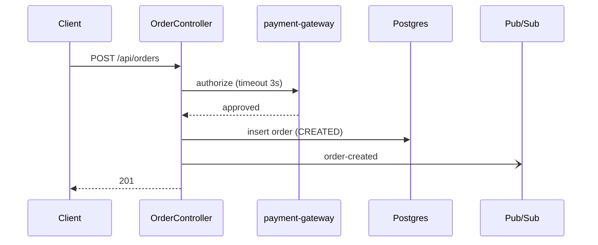
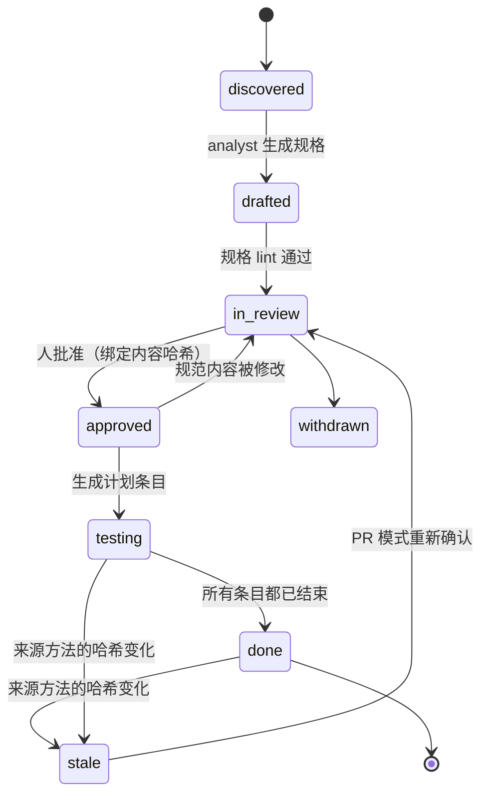

# Generic Testing Agent (GTA) — 设计方案

> 状态：设计阶段（未实现） · 版本：plan v5 · 日期：2026-11
> 范围：面向 Java（Spring 为主）服务的通用测试 harness
> 使用面：**VS Code Copilot、IntelliJ IDEA Copilot**（主），OpenCode（次）
> 命名空间：所有对外资产统一使用前缀 `gta`。修订记录见附录 B

---

## 0. TL;DR

1. **目标**：测试的价值在于能发现错误。门禁看 scenario 覆盖、测试强度和稳定性；coverage 只做参考（§1）。
2. **Spec-first**：
   - agent 先把代码整理成**行为规格**：格式兼容 OpenSpec，需求用 EARS 句式，配 Mermaid 图，每条结论都标注来源。
   - **只有人明确回答或勾选过的结论才算 `confirmed`**，才会被当作期望值。
   - 用默认值答复的、或者只是从代码里看出来的结论，只生成 characterization 测试（锁定现状），在报告中单独统计（§3）。
3. **期望值保护**：
   - 断言失败不进入修复，先由 `gtaw` 确定性分流，再由 reviewer 对照规格判定。
   - **oracle lock** 锁定断言、期望值和测试输入。
   - `passed` 只能由 `gtaw` 的运行结果设置。
   - 已确认的缺陷用 `@KnownDefect`（strict xfail 语义）固定在测试里（§5.3）。
4. **架构**：
   - 确定性 Java CLI `gtaw` 负责状态、调度、执行、分流和门禁；LLM 只做分析、写规格、写测试和评审。
   - 协议只有三步：`next` → 派发 → `submit`。所有确定性步骤都在 `gtaw` 内部完成，不交给 LLM 执行（§4）。
5. **Agent**：共 4 个（orchestrator、analyst、test-author、reviewer），P4 再加 system-tester。
   - "按服务类型动态加载"由 registry + skills 实现：`gtaw next` 为每个条目生成一份 brief，写明要加载哪些 skills。
   - **只有权限不同时才拆成不同的 agent**（§4.3）。
6. **状态可推导**：
   - 长期真相只放在 git 里：规格、`oracles.json`、测试代码本身。
   - 工作状态放在 gitignored 的 `.gta/work/`，丢失后可以重建。
   - 换人续做只需要 push 分支（§5.2）。
7. **人工确认可证明**：
   - 确认只能来自两条渠道：人在 Chat 中的输入（由 `userPromptSubmitted` hook 捕获），或人在编辑器中的勾选。
   - agent 的编辑如果引入了确认标记，会被 hook 拒绝。
   - 合入时，以 CODEOWNERS 对规格的审批为准（§5.5）。
8. **上手**：
   - tech lead 每个仓库执行一次 `./gtaw init`。
   - 开发者只用两个命令：`/gta`（包括 `/gta explain`）和 `/gta-status`。
   - v1 先交付三件事：explain、按 flow 写测试、PR 模式（§12、§15）。

---

## 1. 问题定义与质量信号

**现状**：服务以 Java 为主，部署在 GCP（GKE、Dataflow、Cloud Run）以及若干非 GCP 环境。flow 类型包括 API、Scheduler、Batch、Workflow、事件驱动等。目标是做自动化的 regression test 和 integration test。

**为什么不能只看 coverage**：
- 没有断言的测试也能贡献 coverage。
- coverage 不感知业务语义，例如边界值、幂等、时间、并发、权限、最终一致性。
- coverage 不感知跨服务契约。
- 研究证据：Meta ACH 被采纳的 571 个测试中，有 277 个按 line coverage 标准会被丢弃，但它们能抓到真实故障。

| 信号 | 定义 | 计算方式 |
|---|---|---|
| Scenario 覆盖（按来源分开） | 已批准的 scenario 中，有 verified 测试的比例；`confirmed`/`documented` 与 `observed`/`defaulted` 分开统计 | 规格 ↔ JUnit/Karate tag |
| Spec findings | 不同来源之间的不一致，分为两类：`behavior-suspect`（代码可疑）和 `doc-drift`（文档过时） | `gta-analyst`，再经人确认 |
| 测试强度（变更代码） | 被覆盖的 mutant 中被杀死的比例（killed / covered） | `gtaw mutate`（PIT，结果只保留 diff 涉及的行） |
| 能失败证据 | 每个 scenario 的测试，至少能杀死一个针对其实现方法注入的 mutant | `gtaw submit` |
| Catching 命中 | 针对本次变更生成的测试中，失败且经确认为真实缺陷的数量 | PR 模式（P3） |
| Oracle 强度 | 断言是否验证了业务结果，而不只是"不为空" | `gtaw run` 的反模式检查 + `gta-reviewer` |
| 契约覆盖 | OpenAPI 的 operation × status code、消息 schema 是否都覆盖到 | Schemathesis / Pact / SCC |
| 稳定性 | 新测试在随机顺序、非 UTC 时区、非英文 locale 下连续 k 次都通过（pass^k） | `gtaw run --repeat k` |
| Coverage | 只做参考，不进门禁 | JaCoCo |

---

## 2. 业界做法与设计原则

### 2.1 大公司的做法

| 来源 | 做法 | 本设计采纳的点 |
|---|---|---|
| **Meta ACH**（FSE'25） | 针对具体风险生成少量 mutant，再让 LLM 写能杀死它的测试 | 能失败检查；mutation 驱动补测 |
| **Meta JiTTests**（2026） | 每个 diff 推断意图并列出风险，生成 catching test；失败的测试先经过规则和 LLM 两层 assessor 过滤，才交给工程师 | PR 模式的 catching 测试；reviewer 充当 assessor |
| **Uber AutoCover**（ICSE-SEIP'26） | 分为 prepare / generate / execute / validate-repair 四个子图；用 mutation 做门禁；多次运行防 flaky | 节点划分；pass^k |
| **Stripe Minions** | blueprint 中确定性节点与 agentic 节点交替出现；修 CI 最多约 2 轮，之后转人工 | `gtaw` 内联确定性节点；每个条目最多修复 2 次 |
| **Spotify Honk** | verifier 独立运行，agent 看不到其内部；在开 PR 前强制执行；LLM judge 对照原始意图检查 | 验证与写测试的 agent 分离；reviewer 充当 judge |
| **Airbnb 测试迁移** | 每一步都校验，把错误信息回传后重试，并提供同级测试作为上下文 | 结构化错误回传；brief 中附上同级测试 |
| **Microsoft code-testing-generator** | 以 plugin 形式提供 agent + skills，不修改生产代码；比原生 Copilot 高约 13 个百分点 | 专用 agent + skills；不改生产代码 |
| **Diffblue Testing Agent** | 只交付编译通过、运行通过的 verified 测试 | 只提交通过确定性验证的测试 |

### 2.2 开源 repo 的做法

| Repo | 做法 | 借鉴 | 不借鉴 |
|---|---|---|---|
| [Playwright Test Agents](https://playwright.dev/docs/test-agents) | planner → generator → healer 三个 agent；healer 认为功能本身坏了时，把测试标成 `test.fixme`，而不是改期望值 | 修复只修机械问题；用 seed 测试做启动基线 | 让 healer 自动修到通过 |
| [github/spec-kit](https://github.com/github/spec-kit) | specify → clarify（追问的答案回写进 spec）→ plan → tasks → analyze（跨产物一致性检查） | 答案回写规格；追踪矩阵与孤儿检查 | 完整的开发流程 |
| [Fission-AI/OpenSpec](https://github.com/Fission-AI/OpenSpec) | Requirement + Scenario 格式；变更用 delta 描述 | 规格格式；PR 行为变更摘要 | 依赖它的 CLI（需要 Node，遥测默认开启） |
| [Kiro](https://kiro.dev/docs/specs/correctness/) | 需求用 EARS 句式；从需求中抽取性质（property），找反例 | EARS；`For any …` 形式的不变量 → 性质测试 | — |
| [BMAD TEA](https://github.com/bmad-code-org/bmad-method-test-architecture-enterprise) | 风险 = 概率 × 影响；requirement → test 追踪；gate 分 PASS / CONCERNS / FAIL / WAIVED；实现者不能批准自己的工作 | 风险评分；四值 gate；waiver | 拟人化的 persona |
| [obra/superpowers](https://github.com/obra/superpowers) | 没有运行证据不得宣称完成；每个任务派一个新的子 agent | `passed` 只能由 `gtaw` 设置；一个条目一个新上下文 | — |
| [ChatUniTest](https://github.com/ZJU-ACES-ISE/ChatUniTest) / [TestART](https://github.com/sikygu/TestART) | 生成 → 验证 → 修复；先用规则修简单的编译错误 | 先规则后 LLM（P2） | 以 coverage 为目标 |
| [Probity](https://github.com/nizos/probity) | 跨 agent 的声明式策略引擎，以确定性规则为主 | hook 规则的设计方式 | 直接依赖（Node；IDE 支持尚未确认） |
| [Specmatic](https://specmatic.io/) | 把 OpenAPI 当作可执行契约（JVM） | contract 层的可选方案 | — |
| [EvoMaster](https://github.com/WebFuzzing/EvoMaster) | 基于搜索生成 JVM REST 测试 | — | v1 不用：它的 oracle 反映的是代码的实际行为 |
| [Keploy](https://github.com/keploy/keploy) | 录制流量后回放 | P5 的 characterization 基线 | — |

**研究佐证**：[Konstantinou 等（2024）](https://arxiv.org/abs/2410.21136) 发现，LLM 生成的 oracle 主要反映代码的**实际**行为，而不是**期望**行为。这正是 Spec-first 和 oracle lock 要解决的问题。

### 2.3 指南与平台

| 来源 | 要点 |
|---|---|
| [Building effective agents](https://www.anthropic.com/engineering/building-effective-agents) | 能用 workflow 就不用 agent；常用模式有 orchestrator-workers 和 evaluator-optimizer |
| [Effective harnesses](https://www.anthropic.com/engineering/effective-harnesses-for-long-running-agents) | 状态用 JSON 保存，只允许修改状态字段；每个 session 处理一个条目；固定的启动流程；JSON 比 Markdown 更不容易被误改 |
| [Multi-agent research](https://www.anthropic.com/engineering/multi-agent-research-system) | token 消耗约为普通对话的 15 倍；委派任务时必须写清目标、输出格式和边界 |
| [Context engineering](https://www.anthropic.com/engineering/effective-context-engineering-for-ai-agents) | 上下文按需加载；子 agent 只返回摘要；笔记写到文件里 |
| [Writing tools for agents](https://www.anthropic.com/engineering/writing-tools-for-agents) | 工具少而有用；名字带命名空间；错误信息要能直接照着做 |
| [Skill best practices](https://platform.claude.com/docs/en/agents-and-tools/agent-skills/best-practices) | `name` ≤64 字符，用动名词；`description` 用第三人称，写明"做什么 + 何时用"；正文 <500 行；引用只深一层 |
| [Demystifying evals](https://www.anthropic.com/engineering/demystifying-evals-for-ai-agents) | task / trial / grader / outcome 四个概念；区分 pass@k 与 pass^k；区分 capability eval 与 regression eval |
| Copilot：[hooks](https://docs.github.com/en/copilot/reference/hooks-reference)、[VS Code hooks](https://code.visualstudio.com/docs/copilot/customization/hooks)、[VS Code approvals](https://code.visualstudio.com/docs/agents/run/approvals.md)、[JetBrains 2026-03](https://github.blog/changelog/2026-03-11-major-agentic-capabilities-improvements-in-github-copilot-for-jetbrains-ides/) / [2026-04](https://github.blog/changelog/2026-04-24-inline-agent-mode-in-preview-and-more-in-github-copilot-for-jetbrains-ides) / [2026-06](https://github.blog/changelog/2026-06-02-introducing-copilot-cli-and-agentic-capabilities-enhancements-in-jetbrains-ides/) | 见 §11.4 |

### 2.4 设计原则

| # | 原则 |
|---|---|
| P1 | **确定性优先**：凡是能写成代码的步骤，都在 `gtaw` 内部完成 |
| P2 | **Oracle 独立于实现**：期望值来自人确认过的规格，而且在修复阶段不能被改 |
| P3 | **验证独立于作者**：写测试的 agent 不能判定自己"通过" |
| P4 | **质量不等于覆盖率** |
| P5 | **Agent 按权限划分，专业化靠 skills** |
| P6 | **上下文隔离**：每个节点都用新的上下文，子 agent 只返回一行结果 |
| P7 | **长期真相放在 git，工作状态可以重建**；所有状态只由 `gtaw` 写入 |
| P8 | **循环有界**，并且有熔断 |
| P9 | **人工确认必须可证明** |
| P10 | **双层护栏**：hooks 快速拦截，CI 门禁做权威裁决 |
| P11 | **CI 不依赖 LLM** |
| P12 | **Eval 驱动**：harness 的每次改动都要跑 evals |

### 2.5 v1 明确不做的事

- **不自建编排运行时，也不做 MCP server**：IDE 里的 Copilot 本身就是运行时，`gtaw` 通过 shell 调用。
- **不修改生产代码**，incident 模式也一样：只写复现测试，修复交给开发者。
- **不提供用户可以直接调用的测试 agent**：直接调用会绕过规格和 oracle lock。
- **一个 worktree 同一时间只允许一个 session 驱动**；条目之间不并行编写。
- **不用 Gliffy**：格式私有、无法 diff、LLM 很难可靠生成。统一用 Mermaid。
- **不依赖 OpenSpec CLI**；**不用 EvoMaster**；**jqwik 不作为默认**（原因见 §7.9）。
- **不做 Copilot 插件分发、向量库或 dashboard**；Cucumber、record-replay、性能测试都推迟。

---

## 3. Spec-first：先确认行为规格，再写测试

### 3.1 评判：先分析出 spec 和图，以 OpenSpec 形式确认，再写测试

**结论：方向正确，而且应该作为整个系统的入口。** 但原始想法需要以下调整：

| 维度 | 评价 |
|---|---|
| ✅ 解决 oracle 问题 | 只从代码推出来的测试是同义反复：代码有 bug，测试就把 bug 当成期望值（[Konstantinou 等 2024](https://arxiv.org/abs/2410.21136)）。只有人确认过的期望，才能让测试真正验证正确性 |
| ✅ 前置澄清 | 写测试之前就问清楚，比事后返工便宜 |
| ✅ 图帮助快速 review | 一张时序图或状态图，比几百行代码更快让人确认边界 |
| ✅ 规格成为长期资产 | 规格就是 regression 的基线；PR 里规格的 diff 就是"这次改了什么行为" |
| ⚠️ 调整 1 | 写**行为规格**，不写完整的设计文档：只写边界、权限、行为、状态、不变量和问题 |
| ⚠️ 调整 2 | **用 Mermaid，不用 Gliffy**；图的种类和大小按 flow 类型限定（§3.4） |
| ⚠️ 调整 3 | **每条结论都标注来源**，并附上方法级引用；来源之间不一致时，记为 spec finding |
| ⚠️ 调整 4 | **问题必须结构化**：每轮最多 5 个，带选项；**高影响的问题必须明确回答**；用默认值回答的结论只生成 characterization 测试（§3.2） |
| ⚠️ 调整 5 | **按 flow 逐个批准**：批准一个 flow，就开始写这个 flow 的测试 |
| ⚠️ 调整 6 | **工作量随模式伸缩**：explain 只生成草稿；flow 模式生成完整规格；PR 模式只更新受影响的部分；regression 不需要规格 |

**更进一步**：结合 Example Mapping 的思路（规则 → 例子 → 问题）。每个 Requirement 是一条规则，每个 Scenario 是一个例子，同时也是一份测试契约；scenario 与测试一一对应，可以追踪。

### 3.2 来源、意图与判定规则

| 来源（`source`） | 含义 | 对应的测试意图 |
|---|---|---|
| `observed` | 从代码中看到的行为（附方法级引用） | `characterization` |
| `documented` | 来自 OpenAPI、README、ADR、人工编写的已有测试、PR 描述、工单验收标准、已有的 OpenSpec/Spec Kit 规格 | `hardening` |
| `confirmed` | 人在 Chat 中明确回答，或在编辑器中勾选（§5.5） | `hardening` |
| `defaulted` | 用户用"其余默认"批量接受了推荐选项 | `characterization` |
| `assumed` | agent 的推断，没有依据 | 必须作为问题提出，回答前不生成测试 |

**判定规则**（由 `gtaw` 强制执行）
1. 只有 `confirmed` 或 `documented` 的 oracle 失败时，才可能判定为 `product-defect`。基于 `observed` 的 oracle 失败，只能判定为 `spec-error` 或 `test-defect`。这样可以防止 agent 幻觉出的结论被当成产品缺陷上报。
2. `documented` 与 `observed` 冲突时，转成问题，并标注是 `doc-drift` 还是 `behavior-suspect`，因为文档也常常是过时的一方。
3. `confirmed` 与 `observed` 冲突时，记为 spec finding，并写一个 `reproducing` 测试。
4. **可疑的现状要转成问题，而不是直接写进规格**，例如：异常被吞掉、状态码前后不一致、缺少所有权或租户检查。

**Scenario 的完整性不靠 LLM 自由发挥**：对每个 Requirement，系统地使用等价类、边界值、决策表、状态迁移等方法，再按风险推测可能出错的地方。

### 3.3 规格文件格式（兼容 OpenSpec）

文件路径为 `.gta/specs/<domain>/<flow-name>.spec.md`。元数据放在 HTML 注释里，渲染时不可见，但机器可以解析。引用写到**方法级**并带上方法体的哈希（`ref=Class#method`、`refHash`），不写行号，这样代码改了无关的行也不会使引用失效。

````markdown
# order.create — 创建订单
<!-- gta: flowId=order.create capability=rest-api risk=6 status=in-review
     sources=com.acme.order.api.OrderController#create,com.acme.order.OrderService#create -->

## Boundary
- In scope：POST /api/orders → 持久化订单 → 发布 order-created
- Out of scope：支付回调（见 `payment.callback`）
- External：payment-gateway（HTTP，非 GCP）、Postgres、Pub/Sub `order-created`



## Access
| 角色 | 操作 | 所有权约束 | 来源 |
|---|---|---|---|
| customer | create | 只能为自己下单 | observed |
| customer | read | 只能读自己的订单 | assumed → 见 q02 |

## Requirements

### Requirement: 支付网关超时
<!-- gta: id=order.create/r02 source=observed ref=com.acme.order.OrderService#authorize refHash=7c1a… hint.layer=component hint.oracle=state -->
IF the payment gateway does not respond within 3s, THEN THE order service SHALL respond 503 and keep the order in PENDING_PAYMENT.

#### Scenario: 网关 3 秒未响应
<!-- gta: id=order.create/s03 -->
- **WHEN** the gateway does not respond within 3s
- **THEN** the response is 503 with a ProblemDetail body
- **AND** orders.status is PENDING_PAYMENT
- **AND** no message is published to order-created

## Invariants
- For any 两次使用相同 `Idempotency-Key` 的提交，THE order service SHALL 只创建一个订单 <!-- gta: id=order.create/i01 source=assumed hint.oracle=property -->

## Open questions
<!-- gta: id=order.create/q01 impact=high affects=order.create/s03 -->
1. [高影响] 网关超时后是否应该自动重试？
   - [ ] A) 不重试（= 代码现状）
   - [ ] B) 重试 1 次
<!-- gta: id=order.create/q02 impact=high affects=order.create/r05 -->
2. [高影响] 非订单所有者能否读取订单？代码中没有看到所有权检查。
   - [ ] A) 不能
   - [ ] B) 管理员可以

## Findings
<!-- gta: id=order.create/f01 kind=doc-drift -->
- README 写的是"超时返回 504"，代码实际返回 503。
````

**规格状态**（`status`）有 5 个取值：`draft` → `in-review` → `approved`，另有 `stale`（来源方法的哈希变了）和 `withdrawn`。`status` 和批准记录只能由 `gtaw` 写入。

**规格 lint**：由 `gtaw next` 和 `gtaw submit` 内部执行，检查以下几点：
- Requirement 使用 EARS 句式，包括 ubiquitous、`WHEN`、`IF…THEN`、`WHILE`、`WHERE` 五种；每个 Requirement 至少有一个 Scenario。
- 每个 `THEN` 都指向可观察的结果。
- 每个 `ref` 都能解析到存在的方法，并且哈希一致。
- 有外部入口的 flow 必须有 `## Access` 段。
- 风险 `risk` = 概率（1–3）× 影响（1–3）。9 对应 p0，6 对应 p1，3–4 对应 p2，1–2 对应 p3。
- 标为 `confirmed` 的结论必须带有 `by=` 字段（§5.5）。
- Mermaid 图要通过基础的语法和规模检查。

### 3.4 图的选择规则

| 场景 | 图 | 约束 |
|---|---|---|
| 服务全景（`service-overview.md`） | `flowchart LR`：服务、外部依赖、触发源 | 每个服务 1 张 |
| API / 事件 flow | `sequenceDiagram`（异步消息用 `-)`） | 每个 flow 1 张，不超过 15 条消息 |
| Scheduler / Batch | `flowchart TD`（步骤）+ `stateDiagram-v2`（状态） | 只画和测试相关的部分 |
| Workflow / 状态机 | `stateDiagram-v2` | 所有迁移和错误分支都要画出来 |
| Pipeline | `flowchart LR`（transform 链，包括窗口和 DLQ） | — |
| 数据 | `erDiagram` | 只画本 flow 涉及的实体 |

**渲染**：GitHub 原生支持；IntelliJ 需要在 Markdown 设置中开启 Mermaid；VS Code 需要装扩展，`gtaw init` 会把它写进 `.vscode/extensions.json` 的推荐列表。

### 3.5 澄清与批准

1. **回答**有两种方式，任选其一：
   - 在 Chat 中回复，例如 "1A 2A 其余默认"。`userPromptSubmitted` hook 会捕获这条人类输入，再由 `gtaw` 写回规格（勾选选项，并记录 `by=prompt:<hash>`）。
   - 直接在编辑器里勾选，然后再次执行 `/gta`。
2. **默认值规则**：
   - 高影响的问题不能用默认值回答。
   - 被"其余默认"覆盖的结论记为 `defaulted`，只生成 characterization 测试。
   - 和代码现状一致的选项会标注"= 代码现状"，不会伪装成推荐答案。
3. **批准**：用户说"批准 `<flowId>`"后，`gtaw` 会记录批准人以及规格规范内容的哈希。之后规范内容只要有任何改动，规格都会自动退回 `in-review`。**批准只会把被明确回答过的结论提升为 `confirmed`。**
4. **权威审批**：本地的确认都是临时的。合入时，由分支保护要求 CODEOWNERS 审批 `.gta/specs/**`。问题也可以通过 PR 异步交给产品负责人回答。

### 3.6 与 OpenSpec / Spec Kit 共存

配置项 `spec.source` 有三个取值：`gta` | `openspec` | `speckit`。设为后两者时，仓库里已有的规格会作为 `documented` 来源被读取，GTA 不会改写它们。PR 报告中的"行为变更摘要"使用 OpenSpec 的 delta 格式（ADDED / MODIFIED / REMOVED）。

---

## 4. Harness 架构

### 4.1 分层

```
┌─────────────────────────────────────────────────────────────────────┐
│ Entry      /gta [explain|pr|incident] … · /gta-status                │
├─────────────────────────────────────────────────────────────────────┤
│ Agents     gta-orchestrator · gta-analyst · gta-test-author ·        │
│            gta-reviewer · (P4) gta-system-tester                     │
├─────────────────────────────────────────────────────────────────────┤
│ Skills     gta-*（由 brief 指定路径加载，不依赖自动触发）                │
├─────────────────────────────────────────────────────────────────────┤
│ Toolkit    gtaw → gta-cli.jar：调度、规格 lint、计划、执行、分流、      │
│            oracle lock、门禁、报告    ·   gta-junit（测试期依赖）       │
├─────────────────────────────────────────────────────────────────────┤
│ Hooks      preToolUse（护栏）· userPromptSubmitted（捕获人工确认）      │
├─────────────────────────────────────────────────────────────────────┤
│ State      git：specs · oracles.json · tests   |  .gta/work/（可重建） │
├─────────────────────────────────────────────────────────────────────┤
│ CI         gtaw run --report-only → gtaw gate → gtaw report（无 LLM）  │
└─────────────────────────────────────────────────────────────────────┘
```

### 4.2 协议：`next` → 派发 → `submit`

Orchestrator 的工作循环只有三步：
1. 调用 `./gtaw next`。
2. 把返回的节点交给对应的子 agent，或者呈现给人。
3. 子 agent 完成后调用 `./gtaw submit`，返回一行结果；orchestrator 再调用 `./gtaw next`。

**确定性步骤全部在 `gtaw next` 和 `gtaw submit` 内部完成**，包括：session 接管、恢复、profile、规格 lint、生成计划、impact 分析、构建运行、分流、指纹、提交。LLM 没有机会跳过或伪造这些步骤。

`gtaw next` 返回的节点示例：

```json
{ "node": "author", "itemId": "order.create/s03#component-01", "agent": "gta-test-author",
  "brief": ".gta/work/briefs/0007.md" }
```

| 字段 | 取值 |
|---|---|
| `node` | `analyze`（analyst 处理一个 flow）· `answer`（等待人回答或批准）· `author` · `review` · `escalate` · `done` |

**brief** 是一份确定性生成的文件，内容包括：
- 目标；
- 规格摘录：Requirement、Scenario、Access；
- oracle，即 THEN 中的期望值；
- `ownsFiles`；
- 要加载的 skill 路径；
- 代码切片：入口方法、被调用的方法、相关配置（由 JavaParser 收集）；
- 同级测试；
- 返回契约：`./gtaw submit --item <id>`，最后输出一行结果。

### 4.3 Agent 清单

| Agent | 职责 | 用户可直接调用 | 模型档位 | 权限档案 |
|---|---|---|---|---|
| `gta-orchestrator` | 入口；循环执行 next、派发、submit；在 Chat 中呈现问题和结果；**不能编辑文件** | 是 | reasoning | `orchestrator` |
| `gta-analyst` | 一次只处理一个 flow：写规格、画图、列问题；在 PR 模式下更新受影响的规格 | 否 | reasoning | `spec-writer` |
| `gta-test-author` | 一次只处理一个条目：按 brief 写测试，修复机械问题 | 否 | standard | `test-writer` |
| `gta-reviewer` | 只读裁决：oracle review、失败分类、catching 判定、补测缺口 | 否 | reasoning | `read-only` |
| `gta-system-tester`（P4） | 部署态 system 测试；所有 `layer=system` 的条目都派给它 | 否 | standard | `env-operator` |

- 测试计划由 `gtaw` 根据已批准的规格**确定性生成**：scenario 加上 `hint.layer`、`hint.oracle`，再结合 registry，就得到条目、层级、工具和 `ownsFiles`，不需要 planner agent。
- 新增一种服务类型，只需要新增一个 registry 条目和对应的 skills。

### 4.4 Capability registry

文件位于 `core/registry/capabilities.yaml`，构建时编译进 jar。

```yaml
schemaVersion: "1.0"
capabilities:
  - id: rest-api
    detect:
      buildDeps: [spring-boot-starter-web, spring-boot-starter-webflux]
      annotations: ["@RestController", "@RequestMapping"]
    layers: [unit, slice, component, contract, system]
    diagrams: [sequence]
    skills: [gta-testing-spring-apis, gta-stubbing-with-wiremock, gta-testing-api-contracts]
  - id: grpc-api
    detect: { buildDeps: [grpc-stub, spring-grpc-spring-boot-starter], files: ["**/*.proto"] }
    layers: [unit, component, contract]
    diagrams: [sequence]
    skills: [gta-testing-spring-apis, gta-testing-api-contracts]
  - id: graphql-api
    detect: { buildDeps: [spring-boot-starter-graphql] }
    layers: [unit, slice, component]
    diagrams: [sequence]
    skills: [gta-testing-spring-apis]
  - id: scheduler
    detect:
      annotations: ["@Scheduled", "@EnableScheduling", "@SchedulerLock"]
      buildDeps: [spring-boot-starter-quartz, shedlock-spring]
    layers: [unit, component, system]
    diagrams: [flowchart, state]
    skills: [gta-testing-scheduled-jobs, gta-using-testcontainers]
  - id: spring-batch
    detect: { buildDeps: [spring-boot-starter-batch, spring-batch-core] }
    layers: [unit, component]
    diagrams: [flowchart, state]
    skills: [gta-testing-spring-batch-jobs, gta-using-testcontainers]
  - id: messaging
    detect:
      buildDeps: [spring-kafka, spring-cloud-gcp-starter-pubsub, spring-cloud-stream]
      annotations: ["@KafkaListener", "@EventListener", "@ApplicationModuleListener"]
    layers: [unit, component, contract]
    diagrams: [sequence]
    skills: [gta-testing-event-flows, gta-using-testcontainers]
  - id: workflow
    detect:
      files: ["**/workflows/*.y*ml"]
      buildDeps: [spring-statemachine-core, temporal-sdk, camunda-bpm-spring-boot-starter]
    layers: [unit, component, system]
    diagrams: [state]
    skills: [gta-testing-workflows]
  - id: beam-pipeline
    detect: { buildDeps: [beam-sdks-java-core, beam-runners-google-cloud-dataflow-java] }
    layers: [unit, component, system]
    diagrams: [flowchart]
    skills: [gta-testing-beam-pipelines, gta-using-testcontainers]
  - id: db-migration
    detect: { buildDeps: [flyway-core, liquibase-core], files: ["**/db/migration/**", "**/db/changelog/**"] }
    layers: [component]
    diagrams: [er]
    skills: [gta-testing-db-migrations, gta-using-testcontainers]
  - id: deployed-runtime
    detect: { files: ["**/service.yaml", "**/helm/**/Chart.yaml", "**/k8s/**/*.yaml", "**/*.tf"] }
    layers: [system]
    skills: [gta-testing-deployed-systems]
  - id: gcp-managed-deps            # 不产生 flow，只为命中的条目追加 skill
    dispatch: false
    detect: { buildDeps: [google-cloud-spanner, google-cloud-firestore, google-cloud-bigquery,
                          google-cloud-storage, google-cloud-bigtable] }
    skills: [gta-using-testcontainers]

always:
  skills: [gta-designing-test-oracles, gta-writing-tests]
routing:
  - when: { layer: system }
    agent: gta-system-tester          # P4；在此之前 system 条目不生成
  - default:
    agent: gta-test-author
```

`gtaw next` 在 profile 阶段会生成确定性的**入口清单**，列出 controller、`@Scheduled`、listener、job、pipeline，并附方法引用，作为 flow catalog 的骨架。LLM 只负责补充判断，例如识别自研框架的入口。

### 4.5 Hooks

**使用的事件**

| 事件 | VS Code（Preview） | IntelliJ | OpenCode | 用途 |
|---|---|---|---|---|
| `preToolUse` | `.github/hooks/gta-guardrails.json` | 同一文件 | plugin `tool.execute.before` | 护栏 |
| `userPromptSubmitted` | 同上 | 同上 | plugin `chat.message` | 捕获人在 Chat 中的回答和批准（§3.5） |

**作用范围**：hook 配置对仓库里的所有 Copilot 会话都生效，所以规则分成两层，避免干扰日常开发。
- **始终生效**：
  - agent 不能写 `.gta/work/**`、`oracles.json`、`waivers.json`、`config.json`；
  - 不能读取密钥文件；
  - 不能 `git push --force`。
- **仅在 gta 会话中生效**（存在 `.gta/work/.session`，且距上次活动不超过 2 小时）：
  - 不能写 `**/src/main/**`；
  - 不能直接执行构建或测试命令（`mvn`、`gradle` 等），只能通过 `./gtaw`；
  - 不能执行 `git commit`、`reset`、`checkout`、`stash`；
  - 不能执行云命令（`gcloud`、`kubectl`、`bq`、`terraform`）；
  - 不能执行 `gtaw gate waive`；
  - 在规格中引入勾选、`confirmed` 或 `approved` 的编辑会被拒绝。

**实现**：
- hook 入口是一段很短的 sh/pwsh 预过滤脚本。不是 edit 或 execute 类工具、或者没有 gta 会话时，50ms 内直接放行。只有需要判断时才启动 `gtaw hook`。
- `gtaw hook` 按各平台自己的协议应答：Copilot 返回 `permissionDecision: "deny"` 加原因；OpenCode 用抛错来阻断。
- `gtaw hook` 不使用 §5.6 的退出码。
- `gtaw doctor` 包含 hook 自检；`gtaw next` 会预热 jar。

> Hook 超时会 fail-open，VS Code 的 hook 也可能被企业策略关闭，所以 **hook 只是第一道防线**。`gtaw submit` 中的范围检查、指纹检查，以及 CI 中的 `gtaw gate`，才是权威裁决。

---

## 5. Harness 工程机制

### 5.1 总览

| 关注点 | 机制 | 章节 |
|---|---|---|
| 状态管理 | flow phase + 条目状态迁移表；非法迁移被拒绝 | §5.4 |
| 状态持久化 | 长期真相放在 git；工作状态放在 `.gta/work/`；单写者、原子写、文件锁 | §5.2 |
| 状态恢复 | 每个 worktree 只有一个驱动者；接管时备份文件并重置条目；`.gta/work/` 丢失后可重建 | §5.2 |
| 错误处理 | 统一错误对象、分类前缀、退出码 | §5.6 |
| 异常处理 | 按原因链分类、重跑、超时、返回契约校验 | §5.3、§5.6 |
| Agent 循环 | 修复次数上限、错误指纹、熔断、会话预算 | §5.7 |
| Human in the loop | 三类交互：问题、批准、升级；人工确认可证明 | §5.5 |
| 期望值保护 | 分流、oracle review、能失败检查、oracle lock、`@KnownDefect` | §5.3 |
| 并发与范围 | 运行和提交串行化；基线范围检查；构建文件策略 | §5.8 |

### 5.2 状态与持久化

| 位置 | 内容 | 是否提交 |
|---|---|---|
| `.gta/specs/**` | 规格、答案、批准记录 | 提交（CODEOWNERS） |
| `.gta/flow-catalog.json` | flow 清单与风险 | 提交 |
| `.gta/oracles.json` | 每个条目的 oracle 指纹，加上规格修订哈希 | 提交 |
| `.gta/config.json` · `.gta/waivers.json` · `.gta/wrapper/` · `.gta/lock.json` | 配置、豁免、wrapper、受管文件校验和 | 提交（CODEOWNERS） |
| `.gta/lessons.md`（P2） | 本仓库积累的约定 | 提交 |
| `.gta/work/` | `state.json`、`events.jsonl`、`briefs/`、`runs/<runId>/`、`recover/`、`.session`、`.lock` | **不提交**（gitignore） |

- **状态可推导**：
  - `.gta/work/` 丢失时，`gtaw next` 能重建状态：flow phase 从规格的 `status` 推出；条目由已批准的规格重新生成。
  - 已有的 gta 测试如果与 `oracles.json` 的指纹一致，先标为 `verifying`，经过一次 `gtaw run` 后才能变为 `passed`。
  - 换人续做时，只需要 push 分支。
- **单写者**：
  - `gtaw` 独占写入 `.gta/work/**`、`oracles.json`，以及规格中的 `status`、批准记录和答案。
  - 每次写入都是原子的：先写临时文件，再 rename。修改时需要持有 `.gta/work/.lock`。
  - 每次修改先追加事件，再写快照。
- **会话**：
  - 每个 worktree 同时只有一个驱动者。`gtaw next` 会立即接管旧 session，不等待租约过期。
  - `gtaw` 的每次调用都会刷新 `.session` 的活动时间，不需要 LLM 主动发送心跳。
- **恢复**：
  - 接管时，旧 session 中所有未结束的条目都要恢复：先把它们 `ownsFiles` 中的文件（包括未跟踪的新文件）复制到 `.gta/work/recover/<seq>/`。
  - 然后把条目重置为 `pending`，保留已用的修复次数。
  - **不使用 `git stash`**，以免误收开发者自己的改动。
- **中止**：`gtaw abort [--flow <flowId>]` 丢弃工作状态，保留规格和已提交的测试。

### 5.3 期望值保护（防止把 bug 写成期望值）

1. **按原因链分类失败**：由 `gtaw run` 判定。

   | 错误码 | 判定条件 | 去向 |
   |---|---|---|
   | `BUILD_COMPILE_ERROR` | 编译失败 | `repairing` |
   | `TEST_SETUP_ERROR` | **被测代码从未被调用到**，例如上下文无法启动、容器起不来、fixture 缺失 | `repairing` |
   | `TEST_SUT_ERROR` | 异常栈顶帧位于生产代码的包中 | 重跑 2 次后进入 `triaging` |
   | `TEST_ASSERTION_FAILED` | 断言失败，包括包装在 `PipelineExecutionException` 中的 `AssertionError` | 重跑 2 次后进入 `triaging` |
   | `TEST_TIMEOUT` | Awaitility `ConditionTimeoutException`、`@Timeout` | 重跑 2 次后进入 `triaging` |

   - 后三类在重跑时结果不一致，直接预判为 `flaky`。
   - 被跳过或中止的测试（例如 assumption 不满足）不算通过。
2. **Oracle review**：测试第一次运行之前，reviewer 先把测试中的期望值和规格 THEN 中的期望值逐项比对。这一步是只读的，成本很低，由 `qualityGates.oracleReview` 开关控制。
3. **能失败检查**：测试通过后，针对该 scenario 引用的方法，注入 1–3 个 PIT mutant。如果一个都没杀死，说明 oracle 太弱，条目回到 `repairing`，并计入修复次数。system 层不做这项检查。
4. **Oracle lock**：
   - **何时上锁**：第一次运行到被测代码时上锁。编译错误阶段不上锁，因为修编译错误本来就会改动断言代码。
   - **指纹包含**：
     - 规范化后的断言 AST（AssertJ、Hamcrest、JUnit、REST Assured、MockMvcTester 都转成统一形式）；
     - 测试方法和参数源（`@CsvSource`、`@MethodSource`）中的所有字面量；
     - 测试方法直接调用的一层 helper；
     - 被引用的 fixture、golden、WireMock stub 文件的哈希；
     - Karate 的 `match` 语句和 `read(...)` 读取的文件。
   - **之后的改动**：期望值、输入或 fixture 一旦变化，直接拒绝，返回 `POLICY_ORACLE_MODIFIED`。只有结构变化（字面量不变）时，交给 reviewer 确认。
   - **解锁**：reviewer 判定为 `oracle-defect` 后，还**必须由人确认**。`gtaw` 会检测"新的期望值是否恰好等于上次的实际值"，如果是，会明确提示风险。
   - **持久化**：指纹存放在 `.gta/oracles.json`，按 itemId 记录，并附带对应规格修订的哈希。规格重新批准后，会自动按新版本重新上锁。
5. **`passed` 只能由 `gtaw` 设置**，并且必须有对应的 runId 作为证据。
6. **已确认缺陷**：
   - 测试照常提交，加上测试期依赖 `gta-junit` 提供的 `@KnownDefect(id = "<findingId>", failure = "<失败指纹>")`。
   - 运行时的三种情况：
     - 以相同指纹失败：记为 aborted，构建保持绿色；
     - 测试通过了：构建失败，提示"缺陷已修复，请移除注解"；
     - 以不同的原因失败：构建失败。
   - Karate 测试用 `@known-defect` tag 实现，由 `gtaw` 单独运行这些测试，并套用同样的规则。
7. **语言适配**：
   - v1 只支持 Java 测试代码。
   - 其他语言（例如 Kotlin）通过 `LanguageAdapter` 扩展，需要实现入口识别、构建运行和断言指纹三部分。
   - 没有适配器的语言，测试永远不会被标为 `passed`（fail closed）。

### 5.4 状态机

**Flow phase**（由规格 `status` 加上各条目的状态推导得出）



图中 `in_review` 是 `in-review` 的状态名写法，因为 Mermaid 的状态名中不能含有连字符。

**条目状态迁移表**（权威定义；示意图由代码生成）

| 当前状态 | 事件 | 下一个状态 |
|---|---|---|
| `pending` | `next` 派发 | `authoring` |
| `authoring` / `repairing` | `submit` | `verifying` |
| `verifying` | 编译失败或 setup 失败（attempts < 2） | `repairing` |
| `verifying` | 编译失败或 setup 失败（attempts 已用尽），或同一错误指纹连续出现两次 | `needs-human` |
| `verifying` | SUT 异常、断言失败或超时（已重跑 2 次） | `triaging` |
| `verifying` | 通过，且 oracle review 和能失败检查都通过 | `passed` |
| `verifying` | 通过，但能失败检查没有杀死任何 mutant | `repairing` |
| `triaging` | `test-defect` | `repairing`（oracle 保持锁定） |
| `triaging` | `oracle-defect` | `needs-human`（解锁需要人确认） |
| `triaging` | `product-defect`（仅限 `confirmed` 或 `documented` 的 oracle） | `defect-found` |
| `triaging` | `spec-error` 或 `spec-gap` | `needs-human`，规格退回 `in-review` |
| `triaging` | `flaky` | `repairing`（只允许改同步和等待逻辑） |
| `triaging` | `environment` | `needs-human`（或者改到其他层） |
| `triaging` | `expected-change` | `cancelled`（规格更新后重新生成条目） |
| `passed` | pass^k 失败，或 reviewer 驳回 | `triaging` |
| `defect-found` | 缺陷修复后测试通过 | `passed`（intent 改为 `hardening`） |
| `needs-human` | 人处理完毕后再次执行 `/gta` | `pending` |
| 任意未结束状态 | 规格被撤销或修订 | `cancelled` |
| `authoring` / `verifying` / `repairing` / `triaging` | session 被接管 | `pending`（先备份文件） |

非法迁移会返回 `STATE_ILLEGAL_TRANSITION`。`test-defect` 的修复同样计入 `attempts`。

### 5.5 Human in the loop

| 类型 | 何时出现 | 呈现方式 | 未处理时 |
|---|---|---|---|
| 问题 | 规格中有未决问题 | 每轮最多 5 个，带选项；标注"= 代码现状"；高影响问题必须明确回答 | 只阻塞这一个 flow |
| 批准 | flow 规格已就绪 | 一句话摘要、图、findings | 只阻塞这一个 flow |
| 升级 | 条目进入 `needs-human`，或者触发了熔断 | 升级资料包：做过的尝试、错误、假设、建议的下一步 | 状态保留，可以交给其他人处理 |

**可证明性**：
- `confirmed` 和批准只能来自两条渠道：
  - 被 hook 捕获的人类 Chat 输入，记录为 `by=prompt:<hash>`；
  - 人在编辑器中的勾选。
- agent 的编辑如果引入了确认标记，会被 preToolUse 拒绝。
- 如果 hook 被企业策略关闭，报告中会注明"确认渠道未经 hook 验证"，最终以 CODEOWNERS 的 PR 审批为准。

**非交互模式**：CI 只执行确定性命令，不出现以上任何交互。

### 5.6 错误处理

所有命令失败时都输出统一的错误对象：

```json
{ "error": { "code": "ENV_DOCKER_UNAVAILABLE", "category": "environment",
  "message": "Docker daemon not reachable",
  "hint": "启动 Docker（或 Podman / Rancher Desktop）后执行 ./gtaw doctor", "retryable": false } }
```

| 退出码 | 类别 | 错误码前缀 | 示例 | 策略 |
|---|---|---|---|---|
| 0 | ok | — | — | — |
| 10 | test-failure | `TEST_` | `TEST_ASSERTION_FAILED`、`TEST_SUT_ERROR`、`TEST_TIMEOUT`、`TEST_SETUP_ERROR` | 按 §5.3 分流 |
| 11 | gate-failed | `GATE_` | `GATE_SCENARIO_UNVERIFIED`、`GATE_UNSTABLE_TEST` | 阻断合入 |
| 20 | usage | `USAGE_` | `USAGE_UNKNOWN_ITEM` | 不重试 |
| 21 | config | `CONFIG_` | `CONFIG_INVALID` | 按 hint 修复 |
| 30 | environment | `ENV_` | `ENV_DOCKER_UNAVAILABLE`、`ENV_WRAPPER_CHECKSUM_MISMATCH` | 暂停并给出 hint |
| 31 | transient | `TRANSIENT_` | `TRANSIENT_REGISTRY_TIMEOUT` | 内部已按指数退避重试 3 次，仍失败则暂停 |
| 40 | build | `BUILD_` | `BUILD_COMPILE_ERROR` | 计入修复次数 |
| 50 | policy | `POLICY_` | `POLICY_PROTECTED_PATH`、`POLICY_ORACLE_MODIFIED`、`POLICY_OUT_OF_SCOPE_CHANGE` | agent 必须换一种做法 |
| 60 | state | `STATE_` | `STATE_ILLEGAL_TRANSITION`、`STATE_LOCKED` | 重新执行 `next` |
| 70 | internal | `INTERNAL_` | `INTERNAL_ERROR` | 中止，保留现场 |

- 警告沿用同一套前缀，例如 `GATE_KNOWN_DEFECT_RESOLVED`。
- picocli 的默认退出码会被覆盖。
- `gtaw hook` 不遵守本表，按 §4.5 中各平台的协议应答。
- 子 agent 返回的结果不符合契约时，重问一次；仍不符合，条目进入 `needs-human`。
- 每个节点都有超时限制（构建默认 15 分钟），超时按 transient 处理。

### 5.7 循环控制

| 控制项 | 默认值 | 行为 |
|---|---|---|
| `maxAttemptsPerItem` | 2 | 超出后进入 `needs-human` |
| 错误指纹 | — | 同一条目连续两次出现相同的错误指纹，立即停止 |
| `maxConsecutiveFailures` | 3 | 连续 3 个条目进入 `needs-human`，就暂停整个流程并升级 |
| `maxItemsPerSession` | 5 | 达到后输出摘要并结束本次会话；下一次 `/gta` 继续。这样可以避开 Copilot 的单轮请求上限，也保持上下文干净 |
| `maxClarifyRounds` | 2 | 仍未解决的问题记为 `assumed` |
| `maxReviewRounds` | 1 | 补测缺口最多补一轮 |

OpenCode 中，子 agent 设置 `steps` 上限，`doom_loop` 设为 `ask`。

### 5.8 并发与范围

- **串行**：`run` 和提交都在 `.gta/work/.lock` 下串行执行；v1 中条目也逐个编写。
- **范围检查**：派发条目时记录一个基线，包括当时的 HEAD 和已经被修改的文件。`submit` 时，本次新增的改动必须全部落在该条目的 `ownsFiles` 内，否则返回 `POLICY_OUT_OF_SCOPE_CHANGE`。提交只暂存 `ownsFiles` 中的文件，提交由 `gtaw` 完成。
- **Foundation 条目**：
  - 每个 domain 的第一个条目是 **seed 测试**，只验证应用上下文和依赖容器能正常启动，同时作为 `--smoke` 的基线。
  - foundation 条目还负责测试基础设施（基类、容器配置、公共 stub），以及**唯一允许的构建文件改动**：只能添加 test scope 的依赖和插件白名单中的插件（Failsafe、gta-junit、Testcontainers、WireMock、REST Assured、Karate、PIT）。这些改动由 `submit` 检查，并写进报告。
- **建议**：在独立的 git worktree 中运行 gta，以免和开发者手头的改动互相干扰。

### 5.9 配置

- **优先级**（从低到高）：内置默认值（包括组织底线值，编译进组织自己构建的 `gta-cli`）< `.gta/config.json` < 命令行参数。不通过环境变量覆盖门槛值。
- CI 中，`gtaw gate --base <ref>` 从**目标分支**读取配置和豁免，组织底线值不能被调低。
- `config.json` 可以不存在。

---

## 6. 运行模式

用法：`/gta [explain|pr|incident] [补充说明]`。不带参数时，如果有进行中的工作就继续；否则列出风险最高的几个 flow，让用户选择。

| 模式 | 流程（D = gtaw，A = agent，H = 人） | 产出 |
|---|---|---|
| `explain <flow\|file>` | D profile → A analyst（一个 flow） | 全景图、时序图、规格草稿、问题。只读，**不写测试**。适合入职了解、code review、事故排查 |
| 默认（flow） | D profile 和 lint → A analyst → H 回答与批准 → D 生成计划 → 循环（A test-author → D submit → 必要时 A reviewer 判定）→ A reviewer 补缺口 → D 报告 | 测试、`oracles.json`、报告 |
| `pr` | D impact（diff → 受影响的方法 → flow，规格标为 `stale`）→ A analyst（PR 描述作为 `documented` 意图；只在意图不清时提问）→ H 批准（可通过 PR 进行）→ 同上；P3 起加入 catching 条目 | 测试、PR comment（行为变更摘要、findings、已知缺陷、假设）、注解 |
| `regression`（CI） | D `run --suite all --report-only` → D `gate` → D `report` | 报告；失败可以之后在 `/gta` 中交给 reviewer 判定 |
| `incident <描述>` | A analyst 写最小规格 → H 确认期望 → A test-author 写 `reproducing` 测试 → D 验证它在当前代码上以正确的原因失败 → A reviewer 确认 | 复现测试，交给开发者修复（**不修改生产代码**） |

**分流结论**（`triageVerdict`）：`test-defect` | `oracle-defect` | `product-defect` | `spec-error` | `spec-gap` | `flaky` | `environment` | `expected-change`

---

## 7. 各类服务的测试方法

> 测试层级：`unit` → `slice` → `component`（单个服务 + 真实依赖容器）→ `contract` → `system`（部署态黑盒）。
> 版本基线：Spring Boot 3.4+/4、JUnit 5/6、Testcontainers 2、Spring Batch 5/6、Karate 2.x。版本差异写在各 skill 的 references 中。

### 7.1 API（Spring MVC / WebFlux / gRPC / GraphQL）

| 层 | 工具 | 重点 |
|---|---|---|
| unit | JUnit + AssertJ + Mockito | 业务规则、边界值、金额与时间计算 |
| slice | `@WebMvcTest` + `MockMvcTester` / `@WebFluxTest`；`@JsonTest` | 参数校验、ProblemDetail、序列化；**权限矩阵**（角色 × 操作 × 所有权，包括越权访问和跨租户访问的负例） |
| component | `@SpringBootTest(RANDOM_PORT)` + Testcontainers + WireMock + REST Assured | 真实依赖；下游超时、5xx、重试、熔断；**不使用测试管理的 `@Transactional`**，因为回滚会掩盖 AFTER_COMMIT 监听器、outbox、flush 时的约束错误和懒加载错误 |
| contract | Pact（消费者是多语言的）或 Spring Cloud Contract（纯 Spring）；oasdiff；Schemathesis | 覆盖每个 operation × status code |
| system | Karate（P4） | 业务链路、鉴权、幂等；至少 1 个跨租户测试 |

- **Boot 4 注意事项**：
  - `@MockBean` 已被移除，改用 `@MockitoBean`。
  - `@SpringBootTest` 需要显式加 `@AutoConfigureMockMvc`。
  - 测试切片拆分成了按技术划分的测试模块。
- **Testcontainers 2**：GCP 模块的 artifact 是 `testcontainers-gcloud`。GCP emulator 没有 `@ServiceConnection` 支持，需要用 `@DynamicPropertySource` 注入连接信息。
- **Karate**：`karate-junit6`；从 2.1 起，mock server 默认关闭 Java interop。

### 7.2 Scheduler

**原则：触发与逻辑分开测，测试中永远不等 cron。**

| 测试点 | 方法 |
|---|---|
| 业务逻辑 | 直接调用 job bean 或底层 service |
| Cron | 用 `CronExpression.parse(expr).next(t)` 做表驱动测试，覆盖时区、DST、月末、闰年 |
| 调度接线 | `@MockitoSpyBean` + Awaitility；其他测试通过 property 关闭调度 |
| 时间 | 注入 `java.time.Clock` |
| ShedLock | 断言**不会重叠执行**（ShedLock 只保证同一时刻最多一个执行，不保证每个周期恰好执行一次）；单元测试中用 `LockAssert.TestHelper` |
| 幂等与重跑 | 执行两次终态一致；中途失败后重跑，没有重复也没有遗漏 |
| Cloud Scheduler | 投递语义是 **at-least-once**，所以要断言按 job 名称 + `X-CloudScheduler-ScheduleTime` 去重；端点要测 OIDC 校验 |

### 7.3 Spring Batch

| 测试点 | 方法 |
|---|---|
| Reader / Processor / Writer | 分别做单元测试；step-scoped bean 用 `StepScopeTestUtils` |
| Step | Batch 6 用 `JobOperatorTestUtils.startStep(...)`（`JobLauncherTestUtils` 已废弃）；Batch 5 用 `launchStep(...)` |
| Job | `@SpringBatchTest` + Testcontainers + fixtures；断言 `ExitStatus`、各项计数和 golden 输出 |
| 重启 | **Batch 6 默认使用 `ResourcelessJobRepository`**，所以重启和去重测试必须启用 JDBC job repository（`@EnableJdbcJobRepository`；Boot 4 中用 `spring-boot-starter-batch-jdbc`）；第 N 条失败 → FAILED → restart → COMPLETED，并且没有重复写入 |
| 对账 | `read = written + skipped + filtered`；checksum |

### 7.4 Dataflow / Beam

| 测试点 | 方法 |
|---|---|
| 业务逻辑 | 从 `DoFn` 中抽离出来，用纯 JUnit 测试 |
| Transform | `TestPipeline` + `PAssert`。JUnit 5 及以上用 `beam-sdks-java-testing-junit` 中的 `TestPipelineExtension`，JUnit 4 用 `@Rule` |
| Streaming | `TestStream`：watermark、迟到数据、窗口、trigger |
| 重试语义 | bundle 重试会重复执行 DoFn 的副作用，需要测试副作用的幂等性 |
| IO | Pub/Sub / BigQuery emulator（goccy，功能有限）、fake-gcs-server |
| system（P4） | 每条 pipeline 只做 1–2 个真实的 Dataflow 运行 |
| 数据质量 | 行数、schema、去重、DLQ；与独立计算的结果做 differential 比对 |

### 7.5 事件驱动

- broker 用容器跑；异步断言只用 Awaitility，**禁止使用 `Thread.sleep`**。
- 必测场景：重复投递、乱序、毒消息进入 DLQ、重试退避、消费者重启后的 ack/offset 行为。
- Pub/Sub emulator 支持 dead-letter、过滤和顺序投递，但**不支持** IAM、protobuf schema、SMT，BigQuery 订阅也不会投递。这些部分只能放到 system 层测试。
- 做 schema 兼容性检查（Avro / Protobuf）；AsyncAPI 用 Microcks；outbox 与事务提交的关系要验证。

### 7.6 Workflow / 编排

| 类型 | 方法 |
|---|---|
| GCP Workflows | **没有本地 emulator**。下游用 WireMock 替身，并且要部署在 Google 能访问到的地方；部署到临时环境后通过 Executions API 执行，断言结果和步骤历史 |
| Spring State Machine | `StateMachineTestPlan` 覆盖所有迁移 |
| Temporal / Camunda | 使用官方的 test environment |
| 通用方法 | 根据规格中的 `stateDiagram-v2`，生成覆盖所有边、错误分支和补偿路径的测试 |

### 7.7 部署态（P4）

- **Cloud Run tagged revision** 只能通过 tag URL 访问。Pub/Sub push、Eventarc、Cloud Scheduler 仍然会打到主 revision，而且 tag 与主 revision 共用同一个数据库。所以涉及推送的测试，要用独立的 `gta-<shortRunId>` 服务或临时订阅。
- **Cloud Run Jobs**：任务重试、`CLOUD_RUN_TASK_INDEX` 分片，都需要在重试下验证幂等。
- **GKE**：每个 PR 一个 namespace，运行结束后清理。
- **外部服务**：WireMock stub 从 sandbox 录制，并检测漂移；配合契约测试；只做少量冒烟测试。
- **数据**：资源名带 runId；运行后 teardown，再由 `gtaw env gc` 兜底清理；禁止使用生产 PII。

### 7.8 数据库迁移

- 用 Flyway 或 Liquibase，**从上一个已发布的 schema 加上有代表性的数据开始迁移**，而不是从空库开始。
- **N-1 兼容**：Cloud Run 或 GKE 滚动发布期间，旧版本应用必须还能在新 schema 上正常工作（expand/contract）。
- 如果有回滚脚本，也要测试回滚。

### 7.9 选择矩阵

| Scenario 特征 | 层 | 工具 | Oracle |
|---|---|---|---|
| 同步 HTTP、单个服务 | slice + component | MockMvcTester / REST Assured + Testcontainers + WireMock | 响应 + DB 状态 |
| 权限 / 所有权 | slice（矩阵）+ system（跨租户） | MockMvcTester + 安全测试支持 | 拒绝码，且不产生副作用 |
| 对外暴露、有多个消费者 | contract | Pact / SCC + Schemathesis | 契约 |
| 定时触发 | unit + component | 直接调用 + Clock + Awaitility + ShedLock | 副作用 + 幂等 + 不重叠 |
| 批处理 | component | `@SpringBatchTest` + JDBC job repository | 对账 + golden 输出 + 重启 |
| 数据管道 | unit + component | TestPipeline + PAssert + TestStream | 期望数据 / differential |
| 异步消息 | component | 容器化 broker + Awaitility | 终态 + DLQ + 重复投递 |
| 编排 | component + system | 状态机路径测试 | 执行历史 + 终态 |
| 数据库迁移 | component | Flyway / Liquibase + 容器化 DB | N-1 兼容 + 数据保持 |
| 不变量（`For any …`） | unit | `@ParameterizedTest` + Instancio 生成输入 + 记录 seed | 不变量成立 |
| 跨服务链路 | system（P4） | Karate | 业务终态 |

**为什么 jqwik 不作默认**：jqwik 已经进入维护模式，而且新版本对 coding agent 的使用附加了限制性声明（见其 [release notes](https://jqwik.net/release-notes.html)）。仓库已经在用 jqwik 时，沿用并锁定版本；`gtaw` 只解析 Surefire XML，不解析 stdout。

---

## 8. Skills 目录

**规则**：
- skill 中**不放可执行脚本**，确定性逻辑都在 toolkit 里。
- 每个 skill 的正文写"默认路径 + 例外出口"，详细资料放在 `references/` 中，只深一层。
- 条目所需的 skill 路径由 brief 指定，不依赖 description 自动触发。
- 平台支持的话，skill 不在 `/` 菜单中显示。

| Skill | 使用者 | references/ 中的文件 |
|---|---|---|
| `gta-mapping-flows` | analyst | `entrypoints.md`、`risk-scoring.md` |
| `gta-writing-behavior-specs` | analyst | `ears.md`、`test-design-techniques.md`、`access-matrix.md`、`diagrams.md`、`suspicious-behavior.md`、`openspec-compat.md` |
| `gta-analyzing-change-impact` | analyst | `intent-and-risk.md` |
| `gta-designing-test-oracles` | test-author、reviewer | `golden-files.md`、`property-inputs.md`、`anti-patterns.md` |
| `gta-writing-tests` | test-author | `junit.md`（JUnit 5/6、tag、命名）、`test-data.md`、`gta-junit.md`、`boot3-vs-boot4.md`、`build-files.md` |
| `gta-testing-spring-apis` | test-author | `slices.md`、`components.md`、`authz.md`、`grpc.md`、`graphql.md` |
| `gta-stubbing-with-wiremock` | test-author | `fault-injection.md`、`external-services.md` |
| `gta-testing-api-contracts` | test-author | `pact.md`、`spring-cloud-contract.md`、`oasdiff.md`、`schemathesis.md`、`specmatic.md` |
| `gta-using-testcontainers` | test-author | `gcp-emulators.md`、`kafka.md`、`databases.md`、`container-runtimes.md` |
| `gta-testing-scheduled-jobs` | test-author | `cron.md`、`shedlock.md`、`cloud-scheduler.md` |
| `gta-testing-spring-batch-jobs` | test-author | `batch5-vs-batch6.md`、`restart.md` |
| `gta-testing-beam-pipelines` | test-author | `test-stream.md`、`dataflow-runs.md` |
| `gta-testing-event-flows` | test-author | `awaitility.md`、`pubsub-emulator-limits.md`、`modulith-scenario.md` |
| `gta-testing-workflows` | test-author | `gcp-workflows.md`、`state-machines.md` |
| `gta-testing-db-migrations` | test-author | `flyway.md`、`liquibase.md`、`n-minus-1.md` |
| `gta-testing-deployed-systems`（P4） | system-tester | `karate.md`、`cloud-run.md`、`gke.md`、`cost-control.md` |
| `gta-reviewing-test-quality` | reviewer | `oracle-review.md`、`triage.md`、`catching-assessment.md`、`mutation.md` |

---

## 9. 命名与工程规范

### 9.1 总则

| 对象 | 规范 | 示例 |
|---|---|---|
| 目录名、Markdown 文件名、agent / skill / command 名 | kebab-case | `gta-testing-spring-batch-jobs` |
| Java | 标准 Java 约定，包名为 `<org>.gta.<module>` | `com.acme.gta.state` |
| JSON / YAML 字段 | camelCase | `schemaVersion`、`ownsFiles` |
| 枚举值 | kebab-case | `product-defect`、`needs-human` |
| 错误码 | `<PREFIX>_<DETAIL>`，前缀见 §5.6 | `ENV_DOCKER_UNAVAILABLE` |
| 事件类型 | kebab-case，名词 + 过去分词 | `item-submitted` |
| CLI 子命令和参数 | kebab-case | `gtaw run --report-only` |
| 时间戳 | UTC，ISO 8601 | `2026-11-03T12:00:00Z` |
| 路径 | 一律使用 `/` | — |

### 9.2 Harness 资产命名

| 资产 | 规则 | 示例 |
|---|---|---|
| 制品 | `gta-cli`（CLI fat jar）、`gta-junit`（测试期依赖）；wrapper 为 `gtaw` / `gtaw.cmd` | `gta-cli-1.0.0.jar` |
| Agent | `gta-<role>`，role 用名词；正则 `^gta-[a-z]+(-[a-z]+)*$` | `gta-test-author` |
| Skill | `gta-<gerund>-<object>`；正则 `^gta-[a-z0-9]+(-[a-z0-9]+)*$`；≤64 字符；与目录同名 | `gta-writing-behavior-specs` |
| Command | 只有 `gta`、`gta-status` 两个 | `/gta pr` |
| Hook / plugin | `gta-guardrails` | `gta-guardrails.json`、`gta-guardrails.ts` |
| Capability id | 名词，kebab-case | `db-migration` |
| 权限档案 | `orchestrator`、`spec-writer`、`test-writer`、`read-only`、`env-operator` | — |
| Schema | `<artifact>.v<major>.schema.json`，`$id` 为 `urn:gta:schema:<artifact>:v<major>` | `oracles.v1.schema.json` |
| 模板 | `<输出文件名>.tmpl` | `gta-guardrails.json.tmpl` |
| ADR | `docs/adr/NNNN-<slug>.md` | `0002-spec-first.md` |

**Frontmatter**：
- Skill 只写 `name` 和 `description`。`description` 用第三人称，写"做什么 + Use when …"，≤1024 字符。
- Agent 使用中立格式：`name`、`description`、`permissionProfile`、`modelTier`、`userInvocable`。权限档案**只在这里定义一次**。

**正文结构**：
- Skill：`Quick start` → `Workflow` → `Rules` → `References`，≤500 行。
- Agent：`Role` → `Inputs` → `Workflow` → `Output contract` → `Rules`，≤30,000 字符。

### 9.3 被测仓库中的规范

| 对象 | 规则 |
|---|---|
| 规格 | `.gta/specs/<domain>/<flow-name>.spec.md`；服务全景为 `.gta/specs/service-overview.md` |
| unit / slice 测试类 | `<Subject>Test`（Surefire） |
| component / contract 测试类 | `<Subject>IT`（Failsafe） |
| 测试方法 | `should<Outcome>When<Condition>()`，加上 `@DisplayName("[<scenarioId>] …")` |
| JUnit tag | 层级 tag + `flow:<flowId>` + `scenario:<scenarioId>` + `gta`；按情况再加 `characterization` |
| 已知缺陷 | `@KnownDefect(id = "<findingId>", failure = "<指纹>")` |
| Karate | 文件为 `src/test/resources/karate/<domain>/<flow-name>.feature`；tag 为 `@gta @system @flow=<flowId> @scenario=<scenarioId>`，按情况加 `@characterization` 和 `@known-defect`；runner 为 `<basePackage>.system.KarateSystemSuite`（名字不以 `IT` 结尾，不会被 Failsafe 选中），只由 `gtaw run --layer system` 执行 |
| Fixtures / Golden | `src/test/resources/fixtures/<domain>/<flow-name>/<case>.json`；`src/test/resources/golden/<domain>/<flow-name>/<case>.approved.json` |

### 9.4 ID、Git 与云资源

| 对象 | 格式 | 示例 |
|---|---|---|
| flowId | `<domain>.<flow-name>`，**恰好两段**，正则 `^[a-z][a-z0-9-]*\.[a-z][a-z0-9-]*$`；`foundation` 是保留名 | `order.create` |
| requirementId / scenarioId / invariantId / questionId / findingId | `<flowId>/r<nn>`、`/s<nn>`、`/i<nn>`、`/q<nn>`、`/f<nn>` | `order.create/s03` |
| itemId | `<ref>#<kind>-<nn>`。`<ref>` 是 scenarioId、invariantId 或 domain；`<kind>` 是层级名或 `foundation` | `order.create/s03#component-01`、`order#foundation-01` |
| sessionId / runId | `s<yyyymmddhhmmss>-<rand4>`、`r<yyyymmddhhmmss>-<sha7>`（UTC） | `r20261103120000-a1b2c3d` |
| shortRunId | runId 的最后 14 位 | `120000-a1b2c3d` |
| Commit | `test(<domain>): <summary>`，并带 trailer `Gta-Item: <itemId>`、`Gta-Run: <runId>` | `test(order): cover gateway timeout` |
| 云资源 | `gta-<shortRunId>-<purpose>`，并按资源类型转换格式（例如 BigQuery dataset 用 `gta_<shortRunId>_<purpose>`，连字符换成下划线）；label 为 `gta-run-id`、`gta-ttl-hours` | `gta-120000-a1b2c3d-orders` |

---

## 10. 文件契约与 Schema

### 10.1 被测仓库中的文件

```
<repo>/
├── gtaw · gtaw.cmd                          # wrapper（CODEOWNERS）
├── AGENTS.md                                # gta 段落：3 行指引
├── .github/
│   ├── agents/gta-*.agent.md                # 受管
│   ├── skills/gta-*/…                       # 受管
│   ├── prompts/gta.prompt.md · gta-status.prompt.md
│   └── hooks/gta-guardrails.json            # CODEOWNERS
├── .vscode/settings.json · extensions.json  # 合并写入：终端自动批准 ./gtaw、Mermaid 预览
├── .opencode/…                              # 仅在选择 OpenCode 平台时生成
└── .gta/                                    # 结构见 §5.2
```

**统一信封**：只有 `gtaw` 生成的 JSON 才带统一信封，即 `$schema`、`schemaVersion`、`generatedBy: {tool: "gta-cli", version}`。提交到仓库的长期文件**不写**易变字段（例如时间戳、sessionId），以免产生无意义的 diff。

### 10.2 条目（由 `gtaw` 根据已批准的规格生成）

```json
{
  "id": "order.create/s03#component-01",
  "kind": "test",
  "ref": "order.create/s03",
  "capability": "rest-api",
  "layer": "component",
  "intent": "hardening",
  "agent": "gta-test-author",
  "skills": ["gta-testing-spring-apis", "gta-stubbing-with-wiremock"],
  "oracle": { "type": "state", "source": "confirmed", "then": ["503 ProblemDetail", "orders.status=PENDING_PAYMENT", "no message on order-created"] },
  "ownsFiles": ["src/test/java/com/acme/order/api/OrderCreateIT.java"],
  "dependsOn": ["order#foundation-01"],
  "priority": "p1",
  "specRevision": "3f9c…"
}
```

### 10.3 状态与枚举

`.gta/work/state.json` 中每个条目的状态示例：

```json
{ "id": "order.create/s03#component-01", "status": "verifying", "attempts": 1,
  "baseline": { "head": "a1b2c3d", "dirty": [] },
  "lastError": { "code": "TEST_ASSERTION_FAILED", "fingerprint": "9c1e…" },
  "evidence": { "runId": "r20261103121500-a1b2c3d", "ownsFilesHash": "e41f…" } }
```

`.gta/oracles.json` 中的一条记录：

```json
{ "order.create/s03#component-01": { "specRevision": "3f9c…", "fingerprint": "5be2…" } }
```

| 枚举 | 取值 |
|---|---|
| `source` | `observed` · `documented` · `confirmed` · `defaulted` · `assumed` |
| 规格 `status` | `draft` · `in-review` · `approved` · `stale` · `withdrawn` |
| flow `phase` | `discovered` · `drafted` · `in-review` · `approved` · `testing` · `done` · `stale` · `withdrawn` |
| 条目 `kind` | `foundation` · `test` |
| 条目 `intent` | `hardening` · `characterization` · `catching` · `reproducing` |
| 条目 `status` | `pending` · `authoring` · `verifying` · `repairing` · `triaging` · `passed` · `defect-found` · `needs-human` · `cancelled` |
| `layer` | `unit` · `slice` · `component` · `contract` · `system` |
| `node` | `analyze` · `answer` · `author` · `review` · `escalate` · `done` |
| `triageVerdict` | 见 §6 |
| `finding.kind` | `behavior-suspect` · `doc-drift` |
| `gateDecision` | `pass` · `concerns` · `fail` · `waived` |

### 10.4 `config.json`（全部可选）

```json
{
  "$schema": "urn:gta:schema:config:v1", "schemaVersion": "1.0",
  "build": { "tool": "auto", "modules": "auto" },
  "spec": { "source": "gta", "maxQuestionsPerRound": 5, "maxClarifyRounds": 2 },
  "environments": { "allowCloud": false, "gcpProject": null, "region": "asia-east1" },
  "budgets": { "maxAttemptsPerItem": 2, "maxConsecutiveFailures": 3, "maxItemsPerSession": 5,
               "maxReviewRounds": 1, "nodeTimeoutMinutes": 15 },
  "qualityGates": { "stabilityRepeat": 3, "oracleReview": true,
                    "mutation": { "mode": "advisory", "minStrength": 0.7 },
                    "concernsCharacterizationRatio": 0.5 }
}
```

### 10.5 质量门禁（`gtaw gate`）

**范围**：PR 中只检查**受影响的 flow**，同时有一条全局"只增不减"的棘轮规则。

| 结果 | 条件 |
|---|---|
| `fail` | 存在未被豁免的硬性条件不满足：受影响 flow 中已批准的 p0/p1 scenario 缺少 verified 测试；新测试在 pass^k 下不稳定；本 PR 中 agent 写的测试违反 oracle lock；`@KnownDefect` 以不同的原因失败；`mutation.mode=enforced` 时测试强度低于阈值 |
| `waived` | 所有不满足的硬性条件都有有效豁免。豁免从目标分支读取，未过期，由 CODEOWNERS 审批 |
| `concerns` | 硬性条件都满足，但存在以下任一情况：有 `assumed` 或 `defaulted` 的结论；characterization 占比超过阈值；mutation 为 advisory 模式且低于阈值；规格与测试不一致（gta 测试的断言变了，但规格没有对应修改）；有 `stale` 规格；出现 `GATE_KNOWN_DEFECT_RESOLVED` |
| `pass` | 其余情况 |

- **优先级**：`fail` > `waived` > `concerns` > `pass`。
- CI 中 `fail` 会阻断合入；`waived` 和 `concerns` 放行，但会写进 PR 评论。
- mutation 默认是 advisory 模式。在试点仓库完成校准后，再按仓库逐个切换为 enforced。

---

## 11. Toolkit 与分发

### 11.1 语言选型：Java 17+（picocli）

| 候选 | 结论与理由 |
|---|---|
| **Java 17+** | **选用**。用户都是 Java 开发者，机器上都有 JDK；可以用 Gradle Tooling API 和 Maven 模型解析构建；可以用 JavaParser 实现代码切片和指纹；发布到内部 Maven 仓库；团队能自己维护。JVM 启动慢的问题，通过 hook 预过滤脚本加上预热来缓解，后续可以用 native-image |
| Go / Python / Node | 不选。团队不熟、依赖缺失，或者与 Java 生态割裂。Node 只用于 OpenCode plugin 的薄壳 |

**分发**：
- `gta-cli` 和 `gta-junit` 发布到内部 Maven 仓库。
- `gtaw` 通过 `.gta/wrapper/gta-wrapper.properties` 中的 `distributionUrl` 和 `distributionSha256Sum` 锁定版本；运行前**先校验校验和**。
- harness 文件作为资源打包在 `gta-cli` 中，所以只有一个版本号。

### 11.2 命令

| 命令 | 作用 |
|---|---|
| `gtaw init [--platform copilot,opencode]` · `gtaw upgrade` | 写入 harness 文件、AGENTS.md 段落、`.vscode` 设置、`.gitignore`、`lock.json`；并打印建议的 CODEOWNERS 片段 |
| `gtaw doctor` | 检查 JDK、容器运行时（Docker / Podman / Rancher / Testcontainers Cloud）、构建工具、受管文件校验和、hook 自检、IDE 设置；IntelliJ 的自动批准规则会给出配置步骤 |
| `gtaw next [--mode explain\|flow\|pr\|incident] [--flow <flowId>]` | 内联执行所有确定性步骤，返回下一个节点（§4.2） |
| `gtaw submit --item <itemId> \| --spec <flowId> \| --review <itemId> --verdict <v> --reason "<text>"` | 提交条目（范围检查 → 运行 → 分流 → 指纹 → 提交）、提交规格（lint 后进入 `in-review`）、提交评审结论 |
| `gtaw status` | 用人能读懂的方式显示：每个 flow 的阶段、待回答的问题、待处理的升级 |
| `gtaw abort [--flow <flowId>]` | 丢弃工作状态 |
| `gtaw run [--item <itemId> \| --changed \| --layer <layer> \| --suite all] [--repeat <k>] [--report-only]` | 构建、执行、解析；`--report-only` 只要执行完成就以 0 退出，结论交给 `gate` |
| `gtaw mutate --changed` | 对变更类运行 PIT，结果只保留 diff 涉及的行，只使用 unit 和 slice 测试 |
| `gtaw gate [--base <ref>]` · `gtaw gate waive <condition> --reason "<text>" --expires <date>` | 质量门禁；登记豁免（仅限人操作） |
| `gtaw report [--format md\|pr-comment\|sarif]` | 报告，包含追踪矩阵（requirement → scenario → test → 状态）和孤儿检查 |
| `gtaw env up\|down\|gc`（P4） | 临时环境 |
| `gtaw hook pre-tool\|prompt --platform <copilot\|opencode>` | 供平台 hook 调用 |

### 11.3 本仓库结构

```
generic-testing-agent/
├── README.md · plan.md · AGENTS.md · CHANGELOG.md · LICENSE
├── pom.xml                              # Maven 多模块根；版本号的唯一来源
├── core/                                # ★ 内容的单一事实源
│   ├── agents/      gta-orchestrator.md · gta-analyst.md · gta-test-author.md · gta-reviewer.md · gta-system-tester.md
│   ├── commands/    gta.md · gta-status.md
│   ├── rules/       gta-guardrails.md
│   ├── skills/      gta-<gerund>-<object>/{SKILL.md, references/, assets/}
│   ├── templates/   spec.md.tmpl · service-overview.md.tmpl · brief.md.tmpl · report.md.tmpl · pr-comment.md.tmpl
│   ├── registry/    capabilities.yaml
│   └── schemas/     <artifact>.v1.schema.json
├── platforms/
│   ├── copilot/     mapping.yaml · gta-guardrails.json.tmpl · gta.prompt.md.tmpl · gta-status.prompt.md.tmpl · settings.json.tmpl
│   └── opencode/    mapping.yaml · opencode.json.tmpl · gta-guardrails.ts.tmpl
├── toolkit/
│   ├── gta-core/            # 状态、规格解析、计划、分流、指纹、门禁、错误
│   ├── gta-cli/             # picocli 命令；打包 harness 资源
│   ├── gta-junit/           # @KnownDefect 扩展、场景结果 listener
│   └── gta-harness-gen/     # core + platforms → dist；lint
├── wrapper/                 # gtaw · gtaw.cmd · hook 预过滤脚本
├── dist/
│   ├── copilot/   .github/…  ·  .vscode/…
│   └── opencode/  .opencode/…  ·  opencode.json
├── evals/   fixtures/ · tasks/<task-id>.task.json · graders/
├── docs/    quickstart.md · adding-a-capability.md · ci-integration.md · adr/
└── .github/workflows/ci.yml   # lint → 单元测试 → dist 同步检查 → evals 冒烟
```

### 11.4 平台能力矩阵与映射

| 能力 | VS Code Copilot | IntelliJ Copilot | OpenCode | GTA 的用法 |
|---|---|---|---|---|
| Custom agents | `.github/agents/*.agent.md` | GA（2026-03） | `.opencode/agents/*.md` | 4 个 agent |
| Subagents | 支持，可用 `agents` 白名单 | GA | `permission.task` | orchestrator 派发 |
| Skills | `.github/skills/` | GA（2026-06） | `.opencode/skills/` | 由 brief 指定路径 |
| Prompt / commands | `.github/prompts/*.prompt.md`，可用 `agent:` 指定 custom agent | GA（2026-06） | `.opencode/commands/*.md`，可用 `agent:` | `/gta`、`/gta-status`，自动选中 orchestrator |
| Hooks：`preToolUse` / `userPromptSubmitted` | Preview | 支持（`.github/hooks/*.json`） | plugin | §4.5 |
| 终端自动批准 | 工作区设置 `chat.tools.terminal.autoApprove` | Settings > GitHub Copilot > Chat > Auto Approve（用户级） | `permission.bash` | 只对 `./gtaw` 自动批准 |
| 单轮请求上限 | `chat.agent.maxRequests` | 有类似限制 | `steps` | `maxItemsPerSession` = 5 |
| Handoffs / Plugins | 支持 | 未确认 | — | 不使用 |
| 企业策略 | preview 功能可能需要管理员开启 "Editor preview features" policy | 同左 | — | `gtaw doctor` 中提示 |

| 中立字段 | Copilot（`.agent.md`） | OpenCode（`.md`） |
|---|---|---|
| `orchestrator` | `tools: [read, search, execute, agent]`（**不含 edit**）；VS Code 中再加 `agents: [gta-analyst, gta-test-author, gta-reviewer]` | `mode: primary`；`edit: deny`；`bash`：先 `"*": deny`，再 `"./gtaw *": allow`；`task`：先 `"*": deny`，再 `"gta-*": allow` |
| `spec-writer` | `tools: [read, search, edit, execute]` | `mode: subagent`，`hidden: true`；`edit`：先 `"*": deny`，再 `".gta/specs/**": allow`；`bash` 只允许 `./gtaw *`；`task: deny` |
| `test-writer` | `tools: [read, search, edit, execute]` | `mode: subagent`，`hidden: true`；`edit: allow`（范围由 submit 检查）；`bash` 只允许 `./gtaw *`；`task: deny`；`steps: 40` |
| `read-only` | `tools: [read, search, execute]` | `edit: deny`；`bash` 只允许 `./gtaw *` |
| `env-operator`（P4） | 同 `test-writer`；云操作只能通过 `gtaw env` | 同左 |
| `userInvocable: false` | `user-invocable: false`（VS Code 文档中的拼写是 `user-invokable`，按目标版本输出，并用 eval 验证可见性） | `hidden: true` |
| `modelTier` | `model`（部分使用面会忽略） | `model: provider/model-id` |

> 平台字段变化很快（例如 `infer` 已被 `disable-model-invocation` / `user-invocable` 取代，OpenCode 的 `tools` 已被 `permission` 取代）。所有差异都只放在 `mapping.yaml` 中，按平台版本锁定，并由 eval 验证。

### 11.5 Lint、版本与升级

- **Lint（CI 必须通过）**：
  - 命名符合 §9；
  - skill 的 description 用第三人称并包含 "Use when"；
  - 正文长度符合要求，引用只深一层；
  - registry 引用的 skill 和 agent 都存在；
  - schema 合法；
  - `dist/` 与 `core/` 同步。
- **版本**：SemVer，版本号的唯一来源是 `pom.xml`；锁定版本只记录在 wrapper 配置中，`lock.json` 只记录校验和。
- **升级**：`gtaw upgrade`。被本地修改过的受管文件不会被覆盖，而是报告冲突。schema 迁移推迟到出现 v2 schema 时再做。

---

## 12. 上手体验

| 角色 | 一次性动作 | 日常动作 |
|---|---|---|
| 平台团队 | 维护本仓库；向内部 Maven 仓库发布 `gta-cli` 和 `gta-junit` | 处理反馈、跑 evals、发布版本 |
| Tech lead（每个仓库一次，约 5 分钟） | 复制 `gtaw` 脚本 → 执行 `./gtaw init` → 添加 CODEOWNERS 和分支保护 → 提交 | 在 PR 中审批规格 |
| 开发者 | **无** | 在 Copilot Chat 中输入 `/gta …` |
| Code reviewer | 无 | 阅读 PR 评论中的行为变更摘要和 findings |

**开发者第一次使用**

```
你：/gta explain order.create
GTA：规格草稿：.gta/specs/order/create.spec.md（含时序图和权限表）
     有 4 个问题（其中 2 个高影响问题必须明确回答）：
       1.[高] 网关超时后是否自动重试？ A) 不重试（= 代码现状）  B) 重试 1 次
       2.[高] 非订单所有者能否读取订单？代码中没有看到所有权检查。 A) 不能  B) 管理员可以
       3. …  4. …
     另外发现 1 处 doc-drift：README 写的是"超时返回 504"，代码实际返回 503。
你：1A 2A 其余默认，批准 order.create
GTA：已记录：1、2 为 confirmed；3、4 为 defaulted（只生成 characterization 测试）。
     共 6 个测试条目，本次会话先处理 5 个……
     ⚠ order.create/s07（非所有者读取）与已确认的期望不符，判定为 product-defect，
       已用 @KnownDefect 固定，并生成了 issue 草稿。
```

**易用性设计**
- 只有两个命令。第一次运行只读。中断后输入 `/gta` 就能继续。
- 在 Chat 中一句话就能回答问题，也可以在编辑器里勾选。
- `gtaw init` 会为 `./gtaw` 写入 VS Code 终端自动批准规则；IntelliJ 由 `gtaw doctor` 给出配置步骤。这样开发者不会被反复弹窗。
- 如果 Docker Desktop 因许可问题不能用，`gtaw doctor` 会检测 Podman、Rancher Desktop 或 Testcontainers Cloud。
- 每个错误都附带修复提示；`docs/quickstart.md` 只有一页。

**前置条件**：JDK 17+、一个容器运行时、已启用的 Copilot agent 模式（企业版可能需要开启 preview policy）、Mermaid 预览。

---

## 13. 安全与治理

| 主题 | 措施 |
|---|---|
| 最小权限 | 使用 §11.4 中的权限档案：orchestrator 不能编辑；analyst 只能写规格；reviewer 只读；只有 `gtaw env` 能操作云资源 |
| 双层护栏 | hooks 快速拦截；`submit` 检查范围和指纹；CI `gate` 做权威裁决；再加分支保护 |
| 生产代码 | v1 中任何模式都不修改 |
| 人工确认 | 确认来源可证明（§5.5）；以 CODEOWNERS 审批 `.gta/specs/**` 为准 |
| 测试完整性 | 禁止削弱断言、删除测试、加 `@Disabled`、把期望值改成实际值。这些规则由分流和 oracle lock 强制执行 |
| 治理文件 | `gtaw`、`.gta/wrapper/**`、`config.json`、`waivers.json`、`.github/hooks/**`、`gta-*` agent 和 skill 文件都由 CODEOWNERS 管辖；agent 不能修改这些文件，也不能登记豁免；门槛值和豁免都从目标分支读取 |
| 供应链 | wrapper 运行前校验 sha256；`doctor` 校验受管文件的校验和 |
| 云与凭证 | `allowCloud` 默认为 false；agent 不能直接执行云命令；非 system 层的运行会移除 `GOOGLE_APPLICATION_CREDENTIALS` 和 `CLOUDSDK_CONFIG`；结果中的密钥会被脱敏；资源带 TTL label |
| Prompt 注入 | 仓库内容、测试输出和外部响应一律当作数据，不当作指令 |
| 审计 | 通过 git 追溯：规格（含答案和批准）、`oracles.json`、带 trailer 的 commit、PR 审批；CI artifact 保存运行结果 |

---

## 14. Evals 与可观测性

| 类别 | 内容 |
|---|---|
| **Revert-the-fix 回放（最有效）** | 从内部仓库中挑选模型训练截止日之后的 bug 修复 commit，把修复回退掉，看 gta 能否抓到这个 bug |
| GitBug-Java | 199 个 2023 年的可复现 Java bug，用于 incident 模式的 fail-to-pass 评测 |
| Defects4J | 只用作冒烟集：时间较早，很可能已进入训练数据，而且以类库为主 |
| 语义植入 | 在 fixture 中植入语义类缺陷，例如权限、时区、幂等、事务边界；同时加入**诱饵**：文档过时但代码正确的情况，用来测量误报 |
| 平台 eval | 在两个 IDE 中分别验证：agent 是否可见、子 agent 能否派发、hook 的 payload、终端自动批准是否生效 |

**指标**（按优先级排列）：
1. 确认的 fail-to-pass 率；
2. 误报的 `product-defect` 比例；
3. 绕过 oracle lock 的篡改次数（必须为 0）；
4. agent 无法伪造人工确认（必须为 0）；
5. `observed` 结论的准确率，用 characterization 测试首次运行的通过率衡量；
6. 每个 flow 需要的人工时间，以及默认值的接受率；
7. 每个条目的工具调用次数，以及中途放弃的循环次数；
8. 每个条目的 token 和耗时成本。

**评测方法**：
- 每个 task 跑 k=3 次 trial，同时报告 pass@3 和 pass^3。
- capability eval 和 regression eval 分开：每次修改 skill、agent 或 toolkit，都要跑 regression eval。
- 故障注入：在条目执行中途杀掉进程，然后检查恢复是否正确。
- 学习回路（P2）：被判定为 `defect-found` 的条目自动转成 eval task；reviewer 的结论和人工修改提炼进 `.gta/lessons.md`。

**运行期**：`.gta/work/runs/<runId>/run.json` 记录节点、耗时、重试、平台、IDE、模型（如果宿主提供），以及 gate 结果。

---

## 15. 路线图

| 阶段 | 范围 | 退出标准 |
|---|---|---|
| **P0a 平台验证（1 周）** | 在 VS Code 和 IntelliJ 中分别验证：custom agent 是否可见；子 agent 能否派发；prompt 文件的 `agent:` 字段；`preToolUse` 和 `userPromptSubmitted` 的 payload；终端自动批准；单轮请求上限 | 得到一份实测的 §11.4 能力矩阵 |
| **P0 核心** | `gtaw` 的 `init`、`doctor`、`next`、`submit`、`status`、`abort`、`run`、`report`、`hook`；`gta-junit`；schemas；生成器和 lint；4 个 agent；7 个 skill（mapping-flows、writing-behavior-specs、designing-test-oracles、writing-tests、testing-spring-apis、stubbing-with-wiremock、using-testcontainers），再加上 reviewing-test-quality；`/gta explain` 和单 flow 流程；1 个 REST fixture 和 20 个 eval task | 在 1 个真实 REST 服务上跑通：explain → 回答 → 批准 → 至少 5 个 verified 测试；植入的缺陷被判为 `defect-found` 而不是被修绿；人工确认无法被伪造；故障注入后能正确恢复 |
| **P1 PR 模式** | impact、规格 diff、PR 评论和注解、`gate`（PR 范围）、`testing-api-contracts`、`analyzing-change-impact`；OpenCode 端到端验证 | 在真实 PR 上输出行为变更摘要；gate 上线（mutation 为 advisory） |
| **P2 Job + 质量** | scheduler、batch、db-migration 的 skills；`mutate`；学习回路；先用规则修复 | mutation 校准后，在试点仓库切换为 enforced |
| **P3 数据、事件与 catching** | beam、event-flows、workflows 的 skills；catching 测试与 assessor | 各试点 1 个服务 |
| **P4 部署态** | `gta-system-tester`、`gtaw env`、Karate system 测试、云隔离 | 夜间 regression |
| **P5** | 插件分发、record-replay、性能测试、native-image、`postToolUse` 和 agent 级 hooks、并行编写、其他语言的适配器 | 按需 |

---

## 16. 待确认问题

1. **服务构建**：Maven 还是 Gradle？Spring Boot 3 还是 4？Spring Batch 5 还是 6？JUnit 5 还是 6？开发机上最低的 JDK 版本是多少？
2. **制品库**：是否有内部 Artifactory 或 Nexus 可以用来发布 `gta-cli` 和 `gta-junit`？
3. **Copilot**：是 Business 还是 Enterprise？管理员能否开启 preview policy 和 hooks？
4. **仓库治理**：能否启用 CODEOWNERS 和分支保护（这是规格审批的权威来源）？
5. **容器运行时**：开发机上能否使用 Docker Desktop，还是需要 Podman、Rancher 或 Testcontainers Cloud？
6. **OpenCode**：优先级如何？目前计划在 P1 验证。
7. **已有资产**：是否已有 OpenSpec 或 Spec Kit 规格、OpenAPI、Jira 验收标准？这些可以作为 `documented` 来源。
8. **云权限**：是否有测试专用的 GCP project（P4 需要）？
9. **模型**：企业内可用的模型有哪些？需要映射到 `reasoning` 和 `standard` 两档。

---

## 附录 A：参考资料

| 类别 | 链接 |
|---|---|
| 业界案例 | [Meta ACH](https://arxiv.org/abs/2501.12862) · [Meta JiTTests](https://engineering.fb.com/2026/10/29/security/catching-bugs-before-they-land-jittestings-human-on-the-loop-approach-at-full-scale/) · [Uber AutoCover](https://homes.cs.washington.edu/~rjust/publ/auto_cover_icse_2026.pdf) · [Spotify Honk](https://engineering.atspotify.com/2025/12/feedback-loops-background-coding-agents-part-3) · [Stripe Minions（解读）](https://blog.bytebytego.com/p/how-stripes-minions-ship-1300-prs) · [Airbnb](https://www.infoq.com/news/2025/03/airbnb-llm-test-migration/) · [Microsoft](https://devblogs.microsoft.com/dotnet/polyglot-unit-testing-agent/) · [Diffblue](https://diffblue.com) |
| 开源 | [Playwright Test Agents](https://playwright.dev/docs/test-agents) · [Spec Kit](https://github.com/github/spec-kit) · [OpenSpec](https://github.com/Fission-AI/OpenSpec) · [Kiro](https://kiro.dev/docs/specs/correctness/) · [BMAD TEA](https://github.com/bmad-code-org/bmad-method-test-architecture-enterprise) · [superpowers](https://github.com/obra/superpowers) · [ChatUniTest](https://github.com/ZJU-ACES-ISE/ChatUniTest) · [TestART](https://github.com/sikygu/TestART) · [Probity](https://github.com/nizos/probity) · [Specmatic](https://specmatic.io/) · [EvoMaster](https://github.com/WebFuzzing/EvoMaster) · [Keploy](https://github.com/keploy/keploy) |
| 研究与 eval | [Konstantinou 等 2024](https://arxiv.org/abs/2410.21136) · [GitBug-Java](https://github.com/gitbugactions/gitbug-java) · [Defects4J](https://github.com/rjust/defects4j) |
| 平台 | [Agent Skills 规范](https://agentskills.io/specification) · [Copilot custom agents](https://docs.github.com/en/copilot/reference/custom-agents-configuration) · [Copilot hooks](https://docs.github.com/en/copilot/reference/hooks-reference) · [VS Code hooks](https://code.visualstudio.com/docs/copilot/customization/hooks) · [VS Code subagents](https://code.visualstudio.com/docs/copilot/agents/subagents) · [VS Code approvals](https://code.visualstudio.com/docs/agents/run/approvals.md) · [OpenCode agents](https://opencode.ai/docs/agents) · [OpenCode plugins](https://opencode.ai/docs/plugins) |
| 测试工具 | [Karate](https://github.com/karatelabs/karate) · [Testcontainers GCloud](https://java.testcontainers.org/modules/gcloud) · [WireMock](https://wiremock.org/) · [Pact 对比 SCC](https://docs.pact.io/getting_started/comparisons) · [Schemathesis](https://schemathesis.readthedocs.io/) · [Microcks](https://microcks.io/) · [oasdiff](https://github.com/oasdiff/oasdiff) · [PIT](https://pitest.org/) · [Awaitility](https://github.com/awaitility/awaitility) · [ShedLock](https://github.com/lukas-krecan/ShedLock) · [Instancio](https://github.com/instancio/instancio) · [ApprovalTests.Java](https://github.com/approvals/ApprovalTests.Java) · [fake-gcs-server](https://github.com/fsouza/fake-gcs-server) · [picocli](https://picocli.info/) · [JavaParser](https://javaparser.org/) |
| Spring / Beam | [Spring Batch what's new](https://docs.spring.io/spring-batch/reference/whatsnew.html) · [Spring Batch testing](https://docs.spring.io/spring-batch/reference/testing.html) · [Pub/Sub emulator](https://docs.cloud.google.com/pubsub/docs/emulator) · [Beam PAssert](https://beam.apache.org/releases/javadoc/current/org/apache/beam/sdk/testing/PAssert.html) · [jqwik release notes](https://jqwik.net/release-notes.html) |

## 附录 B：修订记录

| 版本 | 主要变化 |
|---|---|
| v1 | 初版：服务类型分析、多 agent 设计 |
| v2 | 参考业界和官方指南：blueprint、命名规范、双平台发行 |
| v3 | Spec-first；工程机制；Java toolkit；目标定为 VS Code 和 IntelliJ |
| v4 | 失败分流、oracle lock；借鉴开源 repo |
| v5 | 经过四路 subagent 评审（架构、工程鲁棒性、测试领域、反方）后收敛：<br>- agent 从 9 个减到 4 个，计划改为确定性生成，协议收敛为 next/submit；<br>- 工作状态可推导，不再提交；<br>- 人工确认可证明，增加 `defaulted` 来源；<br>- 按原因链分流，oracle lock 覆盖测试输入；<br>- 用 `gta-junit` 实现 `@KnownDefect`；<br>- PR 范围门禁加豁免；<br>- 修正多项技术事实；<br>- v1 范围收窄，加入 explain 模式，PR 模式提前 |
