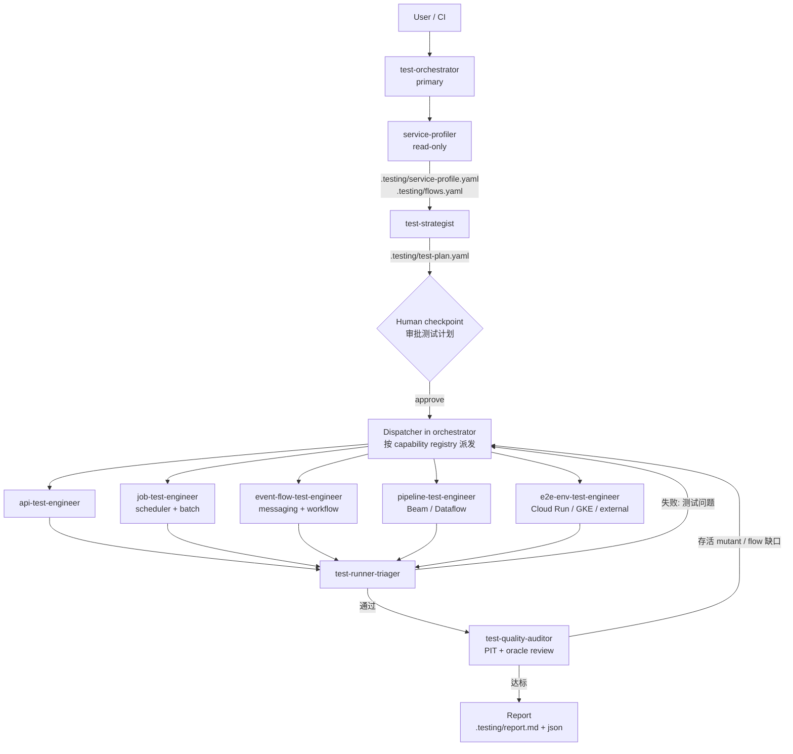

# Generic Testing Agent — 设计方案 (plan.md)

> 状态：**设计 / 分析阶段**（尚未实现）
> 目标读者：本仓库维护者、要接入的 Java 服务团队
> 日期：2026-11

---

## 0. TL;DR

1. **核心判断**：coverage 只说明"代码被执行过"，不说明"行为被验证过"。本 agent 体系把 **"测试是否能发现错误"** 作为一等目标，通过 *mutation score、业务 flow 覆盖、oracle 强度、contract 覆盖、回归 diff* 这些指标来衡量测试质量，而不是只看 line coverage。
2. **架构**：`Orchestrator → Profiler（识别服务类型）→ Strategist（为每条 flow 选择测试方式）→ 按需派发 Specialist agents → Runner/Triager → Quality Auditor（回路）→ Report`。
3. **"Dynamic agent"的实现方式**：**Agent 数量少且稳定（≈9 个），知识全部放在 Skills 里按需加载**。由一个 `capability registry`（检测信号 → agent + skills 映射）驱动：Profiler 识别到服务里有 Spring Batch，就只派发 `job-test-engineer` 并只加载 `spring-batch-testing` 等 skill。
4. **工具选择（结论）**：
   - API 部署态黑盒回归 → **Karate**（默认）；仓库内集成测试 → **MockMvc / REST Assured + Testcontainers + WireMock**；
   - 服务间契约 → **Pact**（多语言消费者）/ **Spring Cloud Contract**（纯 Spring）；OpenAPI 模糊与状态测试 → **Schemathesis**；
   - Scheduler → **把触发与逻辑分离** + `Clock` 注入 + Awaitility + ShedLock 并发测试；
   - Spring Batch → `@SpringBatchTest` + `JobOperatorTestUtils`(Batch 6) + 重启/跳过/对账测试；
   - Dataflow/Beam → `TestPipeline + PAssert + TestStream`(DirectRunner) + 少量真实 Dataflow E2E；
   - 依赖 GCP 托管服务 → **Testcontainers GCloud module**（Pub/Sub、Spanner、Firestore、BigQuery、Bigtable、Datastore emulator）；
   - **Cucumber 只在需要业务方可读 Gherkin 时使用**，否则 Karate 更省维护成本（Karate 本身也是 Gherkin 风格）。
5. **双平台**：skills 遵循开放的 **Agent Skills (SKILL.md)** 规范，Copilot 与 OpenCode 都支持；只有 agent 定义文件的 frontmatter 不同。因此采用 **`core/` 单一事实源 + 生成 `copilot/` 与 `opencode/` 两个发行目录** 的方式，避免两套手工维护出现漂移。
6. **Agent 之间的通信用文件契约**（`.testing/*.yaml`），而不是依赖某个平台的消息机制——这是跨 Copilot / OpenCode 保持 generic 的关键。

---

## 1. 背景与问题定义

### 1.1 现状
| 维度 | 现状 |
|---|---|
| 语言 | Java（Spring Boot 为主） |
| 运行平台 | GCP：GKE、Dataflow、Cloud Run；以及非 GCP 的各种服务 |
| Flow 类型 | API flow、Scheduler flow、Batch/Job、Workflow、事件驱动等 |
| 诉求 | 自动化 regression test、integration test；不止追求 100% coverage，而是**验证 flow 正确性** |
| 使用载体 | GitHub Copilot 与 OpenCode 两套 agents/skills |

### 1.2 为什么 100% coverage 不够
- 一个没有断言（或只断言 `notNull`）的测试也能贡献 100% coverage。
- Coverage 不感知**业务语义**：边界值、错误分支、并发、重复执行、时间、最终一致性。
- Coverage 不感知**跨服务契约**：A 服务改了字段名，A 和 B 各自 coverage 都是 100%，线上照样挂。
- Meta 的 ACH 研究（mutation-guided LLM test generation）里：571 个被采纳的测试中有 277 个**如果只看 line coverage 会被丢弃**——它们没增加 coverage，但能抓到真实故障。

### 1.3 本项目要度量的"测试质量信号"
| 信号 | 含义 | 工具/方法 |
|---|---|---|
| **Mutation score** | 往代码里注入小错误，测试能否发现 | PIT (pitest)，增量模式只对 diff 做 |
| **Flow / scenario 覆盖** | 每条业务 flow 的 happy path / 错误分支 / 边界是否都有测试 | `flows.yaml` 追踪矩阵（flow ID ↔ test ID） |
| **Oracle 强度** | 断言是否真正验证业务结果（状态、副作用、输出数据） | Quality Auditor 静态审查 + 反模式检测 |
| **Contract 覆盖** | OpenAPI 的 operation × status code、消息 schema 是否被覆盖 | Schemathesis / Microcks / Pact |
| **回归 diff** | 相对于 baseline 的行为差异 | Golden/approval files、record-replay、shadow diff |
| **Flakiness 率** | 同一 commit 多次运行结果是否一致 | Runner 重跑统计 |
| **Bug → Test 闭环** | 每个线上事故都有对应的回归测试 | `incident` 模式 |

---

## 2. 业界调研与参考

### 2.1 Agent / Skills 平台规范
| 来源 | 要点 | 对本设计的影响 |
|---|---|---|
| [Agent Skills 规范 (agentskills.io)](https://agentskills.io/specification) | Skill = 目录 + `SKILL.md`（frontmatter `name`/`description`）+ 可选 `scripts/`、`references/`、`assets/`；**渐进式加载**（先元数据 → 激活时正文 → 按需加载附属文件）；正文建议 < 500 行 | Skills 设计成"短正文 + references 深度资料 + scripts 可执行检测/解析脚本" |
| [Copilot skills (Visual Studio 文档)](https://learn.microsoft.com/en-us/visualstudio/ide/copilot-agent-skills) | 工作区 skills 放 `.github/skills/`，也识别 `.claude/skills/`、`.agents/skills/` | Copilot 发行包放 `.github/skills/` |
| [Copilot custom agents 配置参考 (docs.github.com)](https://docs.github.com/en/copilot/reference/custom-agents-configuration) | `.github/agents/*.agent.md`；frontmatter 有 `tools`、`target`(vscode / github-copilot)；`handoffs`、`model` 等在 GitHub.com cloud agent 上暂不支持 | 需要区分 VS Code 与 Copilot coding agent 两种使用面 |
| [VS Code subagents](https://code.visualstudio.com/docs/copilot/agents/subagents) | 主 agent 用 `agents: [...]` 白名单限制可调用的子 agent；需要 `agent`/`runSubagent` tool；`disable-model-invocation`、`user-invokable` 控制可见性（`infer` 已废弃） | Orchestrator 用白名单 + 子 agent 派发 |
| [OpenCode agents](https://opencode.ai/docs/agents) / [v2 docs](https://opencode.ai/v2/docs/agents/) | `.opencode/agents/*.md`，`mode: primary/subagent/all`，`permission`（含 task/subagent 权限白名单）、`steps` | OpenCode 发行包用 `mode` + `permission` 控制派发 |
| [OpenCode skills](https://opencode.ai/docs/skills) | `.opencode/skills/<name>/SKILL.md`，也识别 `.claude/skills/`、`.agents/skills/` | 与 Copilot 共享同一份 skill 内容 |

> ⚠️ 两个平台的 frontmatter 字段仍在快速演进（例如 OpenCode v1→v2 的 `tools`→`permission`、Copilot 的 `infer`→`disable-model-invocation`）。生成器里把平台字段集中在一个映射表中，升级时只改一处。

### 2.2 可参考的 repos / 研究
| 名称 | 价值 |
|---|---|
| [anthropics/skills — webapp-testing](https://github.com/anthropics/skills) | Skill 写法范例（短 SKILL.md + 脚本） |
| [github/awesome-copilot](https://github.com/github/awesome-copilot) | Copilot agents / instructions / skills 社区范例 |
| [fugazi/test-automation-skills-agents](https://sharedcontext.ai/plugins/external/fugazi/test-automation-skills-agents) | 测试类 Copilot agents + skills 的目录组织参考（偏 Playwright/Web） |
| [Mutation-Guided LLM-based Test Generation at Meta (ACH)](https://arxiv.org/abs/2501.12862) | **"先造 mutant，再让 LLM 写能杀死它的测试"**；LLM 判定等价 mutant —— Quality Auditor 的核心思路 |
| [CubeTesterAI (ICST 2025)](https://arxiv.org/abs/2504.15286) / IBM JSAI 2026 Spring Boot test agent | "读代码 → 生成 → 执行 → 看 JaCoCo → 补测"闭环，对 Spring Boot 有效；但仍以 coverage 为目标，我们在此基础上改为 mutation + flow 驱动 |
| [karatelabs/karate](https://github.com/karatelabs/karate) / [karate-examples](https://github.com/karatelabs/karate-examples) | API 测试 DSL、mock server、Karate-Gatling 复用功能测试做性能测试；当前 2.x（含 `karate-junit6`），2.1 起 mock server 默认关闭 Java interop |
| [Testcontainers GCloud module](https://java.testcontainers.org/modules/gcloud) | BigQuery / Bigtable / Datastore / Firestore / Spanner / Pub/Sub emulator（incubating） |
| [Schemathesis](https://schemathesis.readthedocs.io/) | 基于 OpenAPI 的 property-based + **stateful**（用 OpenAPI links 串调用链）测试 |
| [Microcks](https://microcks.io/) | OpenAPI/AsyncAPI/gRPC 契约 → mock + conformance test，有 Testcontainers 集成 |
| [Pact 对比 Spring Cloud Contract](https://docs.pact.io/getting_started/comparisons) | 多语言消费者用 Pact；纯 JVM/Spring 用 SCC |
| [Keploy](https://github.com/keploy/keploy) | eBPF 录制流量 → 回放成回归测试（record-replay），可作为 Phase 4 的回归 baseline 方案 |
| [Spring Batch testing 参考](https://docs.spring.io/spring-batch/reference/testing.html) | `@SpringBatchTest`；Batch 6 中 `JobLauncherTestUtils` 已废弃 → `JobOperatorTestUtils`（`startJob`/`startStep`），且不再支持 JUnit 4 |
| [Spring Modulith Scenario API](https://docs.spring.io/spring-modulith/reference/testing.html) | 异步/事务事件的集成测试（基于 Awaitility） |
| [Beam PAssert / TestPipeline](https://beam.apache.org/releases/javadoc/current/org/apache/beam/sdk/testing/PAssert.html) | Pipeline 单元/集成测试标准做法 |

其他会用到的成熟 Java 库：[PIT](https://pitest.org/)、[WireMock](https://wiremock.org/)、[Awaitility](https://github.com/awaitility/awaitility)、[ShedLock](https://github.com/lukas-krecan/ShedLock)、[jqwik](https://jqwik.net/)（property-based）、[ApprovalTests.Java](https://github.com/approvals/ApprovalTests.Java)、[Instancio](https://github.com/instancio/instancio)（测试数据）、[fake-gcs-server](https://github.com/fsouza/fake-gcs-server)、[oasdiff](https://github.com/oasdiff/oasdiff)（OpenAPI breaking change 检测）。

---

## 3. 各类服务的"最佳测试方法"分析

> 统一原则：**先找到 flow 的入口（trigger）和出口（side effect），再决定在哪一层、用什么工具、用什么 oracle 验证**。
> 测试分层：L1 unit → L2 slice → L3 component（单服务 + 真实依赖容器）→ L4 contract → L5 deployed（部署态黑盒/E2E）。

### 3.1 REST / gRPC / GraphQL API（Spring MVC / WebFlux）

| 层 | 目的 | 推荐工具 | Agent 需要关注的点 |
|---|---|---|---|
| L1 | 领域逻辑 | JUnit 5 + AssertJ + Mockito；jqwik 做性质测试 | 业务规则、边界值、金额/时间计算 |
| L2 | Web 层切片 | `@WebMvcTest` + MockMvc（Boot 3.4+ 可用 `MockMvcTester`）/ `@WebFluxTest` + WebTestClient；`@JsonTest` | 参数校验、错误映射（ProblemDetail）、安全（`@WithMockUser`）、序列化格式 |
| L3 | 单服务组件测试 | `@SpringBootTest(RANDOM_PORT)` + **Testcontainers**（`@ServiceConnection`）+ **WireMock**（下游）+ REST Assured | 真实 DB / 缓存 / 消息；事务；下游超时/5xx/重试/熔断 |
| L4 | 契约 | **Pact**（消费者多语言）/ **Spring Cloud Contract**（纯 Spring）；**oasdiff** 检测 OpenAPI breaking change；**Schemathesis** 做 schema conformance + 模糊 + stateful | 每个 operation × status code 被覆盖；字段兼容性 |
| L5 | 部署态回归 | **Karate** feature（对 Cloud Run tagged revision / GKE PR namespace） | 业务场景链路、鉴权（ID token）、幂等、并发 |

**为什么 L5 默认选 Karate，而不是 Cucumber + REST Assured：**
- Karate 一个 `.feature` 文件自包含（无需 Java step definitions），LLM 生成与人工 review 成本都低；
- 内置 JSON fuzzy match（`#uuid`、`#notnull`、`#regex`、`match contains`），天然适合**忽略动态字段的回归比对**；
- 内置 mock server、并行执行、数据驱动（`Examples`/CSV），可直接复用为 Gatling 性能测试；
- 语言无关，可测非 Java / 非 GCP 的服务。

**何时用 REST Assured / MockMvc**：需要 Spring context、需要白盒（直接查 DB、mock bean、控制 `Clock`）时 —— 也就是 L2/L3 仓库内测试。
**何时用 Cucumber**：只有当业务方/QA 需要用 Gherkin 维护验收规格，并愿意承担 step definition 维护成本时。否则不默认引入。

**回归 baseline 策略（API）**：
1. Golden response（approval testing），由 Karate `match` + 忽略字段配置完成；
2. Phase 4：Keploy 类 record-replay，或 shadow traffic diff（同一请求同时打新旧版本，比较响应）。

### 3.2 Scheduler（`@Scheduled`、Quartz、ShedLock、Cloud Scheduler）

**核心原则：把"何时触发"与"做什么"分离测试，永远不要在测试里真的等 cron。**

| 测试点 | 方法 |
|---|---|
| Job 业务逻辑 | 直接调用 job bean 的方法 / 底层 service（普通集成测试） |
| Cron 表达式正确性 | `CronExpression.parse(expr).next(t)` 表驱动测试：时区、DST 切换、月末、闰年 |
| 调度接线 | 测试 profile 设置短周期或 `@MockitoSpyBean` + **Awaitility** `atMost(...)` 验证被调用；其他测试通过 property 关闭 `@EnableScheduling`（放在可条件开启的配置类上），避免干扰 |
| 时间相关逻辑 | 注入 `java.time.Clock`，测试中用固定/可推进的 Clock |
| 分布式锁 / 多实例 | ShedLock + Testcontainers DB：并发启动两个执行，断言只有一个执行；验证 `lockAtMostFor`/`lockAtLeastFor` |
| 幂等 & 重跑 | 连续运行两次，断言终态一致；中途失败后重跑，断言无重复/无遗漏 |
| Quartz | JDBC JobStore + Testcontainers；misfire 策略；集群模式 |
| Cloud Scheduler → Cloud Run HTTP | 当作 API 测（含 OIDC token 校验）；部署态用 `gcloud scheduler jobs run <job>` 强制触发，再 Awaitility 轮询副作用 |
| 可观测性 | 用 `SimpleMeterRegistry` 断言成功/失败计数、耗时指标被记录 |

### 3.3 Spring Batch Job

| 测试点 | 方法 |
|---|---|
| Reader / Processor / Writer 单测 | 各自独立测试；step-scoped bean 用 `StepScopeTestExecutionListener` / `StepScopeTestUtils` + `MetaDataInstanceFactory` |
| 单个 Step | Batch 6：`JobOperatorTestUtils.startStep(...)`；Batch 5：`JobLauncherTestUtils.launchStep(...)` |
| 整个 Job | `@SpringBatchTest` + Testcontainers（job repository + 业务 DB）+ 输入 fixtures（本地文件或 fake-gcs-server）→ 断言 `ExitStatus`、`StepExecution` 的 read/write/skip/filter 计数、输出数据（golden file 比对） |
| 重启能力 | 在第 N 条注入失败 → 断言 FAILED → restart → 断言 COMPLETED 且**无重复写入** |
| Skip / Retry 策略 | 构造 poison records，断言被 skip 的数量和去向（错误表/DLQ） |
| 数据对账 | `source count = written + skipped + filtered`；关键字段 checksum |
| 参数化 / 增量 | JobParameters 边界（空输入、重复运行同参数、日期窗口） |
| 隔离 | 测试间用 `JobRepositoryTestUtils` 清理元数据 |
| 容量冒烟 | 中等数据量（如 10^5）跑一次，记录耗时作为回归基线 |

### 3.4 Dataflow / Apache Beam Pipeline

| 测试点 | 方法 |
|---|---|
| 纯业务逻辑 | 从 `DoFn` 中抽离为普通类 → 纯 JUnit |
| DoFn / PTransform | `TestPipeline`（JUnit rule / extension）+ **`PAssert`**（DirectRunner）；保持 `enableAbandonedNodeEnforcement` |
| Streaming 语义 | **`TestStream`**：watermark 推进、迟到数据、窗口、trigger、allowed lateness |
| Coder | `CoderProperties` 验证序列化可逆、确定性 |
| IO 集成 | Pub/Sub emulator、BigQuery emulator（goccy，有功能限制）、fake-gcs-server；不支持的 IO 在临时 GCP dataset/bucket 中测 |
| 真实 Dataflow E2E | 少量（每条 pipeline 1～2 个）：Flex Template 跑在 `TestDataflowRunner` / 真实 runner，临时资源以 build ID 命名并清理 |
| 数据质量断言 | 行数、schema、去重、DLQ 内容、聚合结果与独立计算的期望值比对（differential oracle） |
| Pipeline options | 参数校验、默认值、模板参数 |

### 3.5 事件驱动（Pub/Sub、Kafka、Spring Cloud Stream、应用内事件）

- 容器化 broker：Testcontainers Kafka / Pub/Sub emulator；断言用 **Awaitility**，禁止 `Thread.sleep`。
- 必测语义：**重复消息（幂等）**、乱序、毒消息 → DLQ、重试退避、消费者重启后的 offset/ack 行为。
- Schema 演进：Avro/Protobuf 兼容性检查；AsyncAPI 契约可用 Microcks 做 conformance。
- Outbox 模式：事务提交后才发消息、回滚不发消息。
- 应用内模块间事件：Spring Modulith `Scenario` API。

### 3.6 Workflow / 编排类 flow（"各种 flow"）

| 类型 | 方法 |
|---|---|
| GCP Workflows (YAML) | 被调用的 HTTP 端点用 WireMock（部署在临时 Cloud Run）替身；在临时环境部署 workflow → 通过 Executions API 执行 → 断言执行结果与步骤历史；覆盖重试/异常分支 |
| Spring State Machine | `StateMachineTestPlan`，覆盖所有状态迁移 |
| Temporal / Camunda（如有） | 官方 test environment（时间跳跃、activity mock） |
| 通用方法 | 把 flow 抽象为**状态机/有向图** → 由 agent 生成"所有边覆盖 + 每个错误分支 + 补偿路径"的测试用例集合 |

### 3.7 部署态 / 跨服务 E2E（Cloud Run、GKE、非 GCP 服务）

- **临时环境**：
  - Cloud Run：`gcloud run deploy --no-traffic --tag pr-<n>` 得到独立 URL，不影响线上流量；
  - GKE：每个 PR 一个 namespace（Helm/Kustomize），测试结束清理；
  - 基础设施配置：`terraform test` 做配置断言。
- **跨服务业务场景**：维护 `scenario catalog`（如"下单 → 扣库存 → 发消息 → 批处理对账"），Karate 驱动入口，Awaitility 风格轮询最终一致性，断言可以落在 API、DB、BigQuery、日志/trace 上（可选 OpenTelemetry trace-based testing）。
- **非 GCP 外部服务**：
  - 低层用 WireMock stub（通过 WireMock record 模式从沙箱录制，定期刷新并检测漂移）；
  - 契约测试锁定我们对其行为的假设；
  - E2E 只在 vendor sandbox 中做少量冒烟。
- **测试数据**：每次运行唯一前缀（build ID），显式 teardown + 定期清理兜底；禁止使用生产 PII。
- **部署后**：同一 Karate 子集作为 synthetic smoke。

### 3.8 选择矩阵（Strategist 使用）

| Flow 特征 | 首选层 | 首选工具 | Oracle |
|---|---|---|---|
| 同步 HTTP、单服务 | L2+L3 | MockMvc / REST Assured + Testcontainers + WireMock | 响应 + DB 状态 |
| 同步 HTTP、对外暴露/多消费者 | L4+L5 | Pact/SCC + Schemathesis + Karate | 契约 + golden response |
| 定时触发 | L1+L3 | 直接调用 + Clock + Awaitility + ShedLock | 副作用 + 幂等 |
| 批处理 | L3 | `@SpringBatchTest` + Testcontainers | 计数对账 + golden output + 重启 |
| 流/批数据管道 | L1+L3 | TestPipeline + PAssert + TestStream | 数据期望 / differential |
| 异步消息 | L3 | Testcontainers broker + Awaitility | 最终状态 + DLQ + 重复投递 |
| 编排 workflow | L3+L5 | 状态机路径测试 + 临时环境执行 | 执行历史 + 终态 |
| 跨服务业务链路 | L5 | Karate + 临时环境 | 业务终态 |

---

## 4. Agent 体系架构

### 4.1 总体流程



### 4.2 设计原则

1. **Agent = 角色 + 权限 + 工作流；Skill = 某项技术的知识与脚本。** Agent 少而稳定，Skill 多而可插拔。新增一种服务类型 ≈ 新增 skills + registry 条目，通常不需要新增 agent。
2. **Dynamic loading 由数据驱动**：`capability registry` 声明"检测信号 → specialist agent → skills"。Profiler 只产出事实，Orchestrator 只按 registry 派发，Specialist 只加载 test-plan 中列出的 skills。
3. **文件即契约**：所有 agent 间交接物写入目标仓库的 `.testing/` 目录，有 JSON Schema 校验。好处：跨平台、可审计、可断点续跑、可在 PR 里 review。
4. **有界循环**：generate → run → fix 每条 flow 最多 N 次（默认 3），超出则标记为"需要人工"，防止 token 失控。
5. **Human-in-the-loop 检查点**：测试计划审批（Copilot 用 handoff 按钮，OpenCode 用 orchestrator 提问）；任何生产代码修改需要单独确认。
6. **测试必须"能失败"**：新测试在提交前需通过"故障注入验证"（对被测代码做一个相关 mutation，测试必须变红），否则视为无效 oracle。

### 4.3 Agent 清单（≈9 个）

| Agent | 模式 | 职责 | 关键权限 |
|---|---|---|---|
| `test-orchestrator` | primary（用户入口） | 解析模式（bootstrap / pr / regression / incident），调度全流程，维护 `.testing/state.yaml` 断点 | 可派发白名单内子 agent；写 `.testing/` |
| `service-profiler` | subagent | 扫描构建文件、注解、配置、部署清单 → 识别 capabilities 与 flows | **只读** + 运行检测脚本 |
| `test-strategist` | subagent | 按 §3.8 矩阵为每条 flow 选择层/工具/oracle/数据/环境；风险排序 | 只写 `.testing/test-plan.yaml` |
| `api-test-engineer` | subagent | REST/gRPC/GraphQL：MockMvc、REST Assured、Karate、Pact/SCC、Schemathesis、WireMock | 写 `src/test/**`、`karate/**`；跑 mvn/gradle |
| `job-test-engineer` | subagent | `@Scheduled`、Quartz、ShedLock、Cloud Scheduler、Spring Batch | 同上 |
| `event-flow-test-engineer` | subagent | Pub/Sub、Kafka、Spring Cloud Stream、Modulith 事件、GCP Workflows、状态机 | 同上 |
| `pipeline-test-engineer` | subagent | Beam/Dataflow：TestPipeline、PAssert、TestStream、IO emulator | 同上 |
| `e2e-env-test-engineer` | subagent | 临时环境（Cloud Run tag / GKE namespace）、跨服务场景、外部服务 stub | 跑 gcloud/kubectl **需确认**；有成本预算 |
| `test-runner-triager` | subagent | 执行测试，解析 Surefire/Failsafe/Karate/PIT 报告为统一格式；失败分类（产品 bug / 测试 bug / 环境 / flaky），flaky 重跑统计 | 只读源码 + 运行命令 |
| `test-quality-auditor` | subagent | PIT 增量 mutation、oracle 强度审查、反模式（sleep、无断言、过度 mock）、flow 覆盖矩阵；把缺口回写 test-plan | 只读 + 运行 PIT |

> 是否进一步合并：如果平台对子 agent 支持不佳（例如 Copilot coding agent 在 GitHub.com 上），可退化为 **"单 agent + skills"** 模式：orchestrator 自己按阶段加载 skills 执行。生成器需要支持这种降级输出（见 §6.4）。

### 4.4 Capability Registry（动态派发的核心）

`core/registry/capabilities.yaml` 示例：

```yaml
capabilities:
  rest-api:
    detect:
      build_deps: [spring-boot-starter-web, spring-boot-starter-webflux]
      annotations: ["@RestController", "@Controller", "@RequestMapping"]
      files: ["**/openapi*.y*ml", "**/swagger*.json"]
    agent: api-test-engineer
    skills: [spring-web-slice-testing, rest-assured-component-testing, karate-api-testing,
             wiremock-stubbing, testcontainers-java, contract-testing, openapi-fuzz-schemathesis]

  grpc-api:
    detect: { build_deps: [grpc-*, spring-grpc*], files: ["**/*.proto"] }
    agent: api-test-engineer
    skills: [grpc-testing, testcontainers-java, contract-testing]

  scheduler:
    detect:
      annotations: ["@Scheduled", "@EnableScheduling", "@SchedulerLock"]
      build_deps: [spring-boot-starter-quartz, shedlock-*]
      gcp: [cloud-scheduler]         # 来自 terraform / gcloud 配置
    agent: job-test-engineer
    skills: [spring-scheduler-testing, async-awaitility, testcontainers-java]

  spring-batch:
    detect: { build_deps: [spring-boot-starter-batch, spring-batch-core], annotations: ["@EnableBatchProcessing"] }
    agent: job-test-engineer
    skills: [spring-batch-testing, testcontainers-java, gcp-emulators, golden-file-testing]

  beam-pipeline:
    detect: { build_deps: [beam-sdks-java-core, beam-runners-google-cloud-dataflow-java] }
    agent: pipeline-test-engineer
    skills: [beam-dataflow-testing, gcp-emulators, data-quality-assertions]

  messaging:
    detect:
      build_deps: [spring-kafka, spring-cloud-gcp-starter-pubsub, spring-cloud-stream*]
      annotations: ["@KafkaListener", "@ServiceActivator", "@EventListener", "@ApplicationModuleListener"]
    agent: event-flow-test-engineer
    skills: [event-driven-testing, async-awaitility, testcontainers-java, gcp-emulators]

  workflow:
    detect: { files: ["**/workflows/*.y*ml"], build_deps: [spring-statemachine-*, temporal-*, camunda-*] }
    agent: event-flow-test-engineer
    skills: [workflow-testing]

  deployed-runtime:
    detect: { files: ["**/service.yaml", "**/helm/**", "**/k8s/**", "**/*.tf", "cloudbuild.yaml"] }
    agent: e2e-env-test-engineer
    skills: [cloud-run-testing, gke-ephemeral-env, karate-api-testing, external-service-stubbing]

  gcp-managed-deps:   # 不单独派发 agent，只作为 skill 附加给上面的 agent
    detect: { build_deps: [google-cloud-spanner, google-cloud-firestore, google-cloud-bigquery, google-cloud-storage, google-cloud-bigtable] }
    attach_skills: [gcp-emulators]

always:   # 所有服务都会加载
  skills: [flow-mapping, test-oracle-design, junit5-conventions, test-data-management,
           pitest-mutation, flaky-test-triage, test-report-format]
```

- 一个服务可以命中多个 capability（例如 API + Scheduler + Batch 的 Spring Boot 单体），Orchestrator 会**并行派发**多个 specialist，各自负责自己的 flows。
- 检测由 `service-discovery` skill 中的确定性脚本完成（解析 `pom.xml`/`build.gradle`、grep 注解、扫描部署清单），LLM 只负责补充判断，降低误判和成本。

### 4.5 文件契约（`.testing/` 目录，写在被测仓库中）

| 文件 | 生产者 | 消费者 | 内容 |
|---|---|---|---|
| `service-profile.yaml` | profiler | 全部 | 构建工具、Java/Spring 版本、capabilities、依赖（DB/MQ/GCP/外部）、部署目标 |
| `flows.yaml` | profiler | strategist / auditor | 每条 flow：id、类型、入口（endpoint / cron / listener / job / pipeline）、副作用、外部依赖、风险等级 |
| `test-plan.yaml` | strategist（auditor 追加缺口） | specialists | 每条 flow：层级、工具、skills、oracle、数据、环境、优先级、验收标准 |
| `state.yaml` | orchestrator | orchestrator | 阶段进度、循环次数、预算，支持断点续跑 |
| `results/*.json` | runner-triager | auditor / report | 统一格式的执行结果、失败分类、flaky 统计 |
| `quality.json` | auditor | report / CI gate | mutation score、flow 覆盖、oracle 问题清单 |
| `report.md` | orchestrator | 人 / PR | 汇总报告 |

所有 schema 放在 `core/schemas/*.schema.json`，由 skill 里的脚本校验。

`flows.yaml` 示例：

```yaml
flows:
  - id: order.create
    type: rest-api
    entry: { kind: http, method: POST, path: /api/orders }
    side_effects: [db:orders, pubsub:order-created]
    depends_on: [external:payment-gateway, db:postgres]
    risk: high
  - id: order.reconcile.nightly
    type: scheduler+spring-batch
    entry: { kind: cron, expr: "0 0 2 * * *", zone: Asia/Shanghai, lock: shedlock }
    side_effects: [bq:finance.reconciliation]
    risk: high
```

### 4.6 运行模式

| 模式 | 触发 | 行为 |
|---|---|---|
| `bootstrap` | 首次接入某服务 | 全量 profile → 全量 plan → 按风险优先级生成测试骨架与关键场景 |
| `pr` | PR / diff | **变更影响分析**：git diff → 映射到受影响 flows → 只为这些 flows 补测/更新；PIT 只对 diff 跑 |
| `regression` | 夜间 / 发布前 | 运行全套测试（含 L5 部署态），triage 失败，输出回归报告 |
| `incident` | 线上 bug | 根据 bug 描述先写**能复现的失败测试**，再交给开发修复，保证 bug→test 闭环 |

---

## 5. Skills 清单

> 每个 skill：`SKILL.md`（< 300～500 行，含何时使用、步骤、规则、反模式）+ `references/`（深度资料、版本差异）+ `scripts/`（检测/解析/模板渲染）+ `assets/templates/`（测试代码模板）。

### 5.1 编排与分析类
| Skill | 内容 |
|---|---|
| `service-discovery` | 检测脚本（解析 Maven/Gradle、注解扫描、部署清单）→ 产出 service-profile |
| `flow-mapping` | 如何从入口追踪到副作用，生成 flows.yaml；flow 风险评估规则 |
| `test-strategy-selection` | §3.8 选择矩阵、测试分层原则、成本/收益权衡 |
| `test-oracle-design` | 各类 oracle：状态断言、golden/approval、differential、metamorphic、invariant、property-based；"测试必须能失败"验证流程 |
| `change-impact-analysis` | diff → 受影响类 → 受影响 flows → 选择测试 |

### 5.2 技术类（按需加载）
| Skill | 内容 |
|---|---|
| `junit5-conventions` | 命名、结构、AssertJ、参数化、Tag（unit/integration/e2e）、Surefire/Failsafe 划分 |
| `spring-web-slice-testing` | `@WebMvcTest`/`MockMvcTester`/`@WebFluxTest`/`@JsonTest`/安全测试 |
| `rest-assured-component-testing` | `@SpringBootTest(RANDOM_PORT)` + REST Assured 模式 |
| `karate-api-testing` | Karate 2.x 项目结构、`match` 规则、数据驱动、鉴权、并行、mock、Gatling 复用；版本差异（`karate-junit6`、mock 安全默认值） |
| `cucumber-bdd`（可选） | 仅在需要业务可读规格时启用；step 复用规范 |
| `contract-testing` | Pact（consumer/provider、broker、can-i-deploy）与 Spring Cloud Contract；oasdiff |
| `openapi-fuzz-schemathesis` | Schemathesis CLI/stateful、OpenAPI links、CI 集成 |
| `wiremock-stubbing` | stub、故障注入（延迟/5xx/断连）、record 模式、漂移检测 |
| `testcontainers-java` | `@ServiceConnection`、容器复用、常见镜像、CI 中的 Docker 要求 |
| `gcp-emulators` | Testcontainers GCloud module（Pub/Sub、Spanner、Firestore、BigQuery、Bigtable、Datastore）、fake-gcs-server、各 emulator 的已知限制 |
| `spring-scheduler-testing` | §3.2 全部方法 |
| `spring-batch-testing` | §3.3 全部方法，含 Batch 5 / 6 API 差异 |
| `beam-dataflow-testing` | §3.4 全部方法 |
| `event-driven-testing` | §3.5 全部方法 |
| `workflow-testing` | §3.6 全部方法 |
| `async-awaitility` | 异步断言模式、超时策略、禁止 sleep |
| `cloud-run-testing` | tagged revision、ID token、Cloud Run jobs 执行与断言 |
| `gke-ephemeral-env` | PR namespace、Helm values、清理、成本控制 |
| `external-service-stubbing` | 非 GCP 外部依赖的 stub/sandbox/契约策略 |
| `golden-file-testing` | ApprovalTests / JSON golden、动态字段遮蔽、baseline 更新流程 |
| `data-quality-assertions` | 计数对账、schema、去重、checksum、BigQuery 断言 SQL |
| `test-data-management` | Instancio/builders、唯一前缀、清理、PII 规则 |

### 5.3 质量与执行类
| Skill | 内容 |
|---|---|
| `pitest-mutation` | PIT 配置（Maven/Gradle）、增量/基于 SCM 的 mutation、解读存活 mutant、ACH 式"针对 mutant 写测试"流程、等价 mutant 判定 |
| `flaky-test-triage` | 重跑策略、常见 flaky 根因（时间、顺序、共享状态、异步）、隔离方法 |
| `test-report-format` | 解析 Surefire/Failsafe XML、Karate JSON、PIT XML → `results/*.json`；报告模板 |
| `ci-integration` | GitHub Actions / Cloud Build 中的阶段划分、质量门禁 |

---

## 6. 仓库结构与双平台（Copilot / OpenCode）

### 6.1 目录结构（计划）

```
generic-testing-agent/
├── plan.md                          # 本文件
├── README.md
├── core/                            # ★ 单一事实源（平台无关）
│   ├── agents/                      # 平台无关的 agent 定义
│   │   └── <agent>/
│   │       ├── agent.yaml           # 元数据：name, description, role, permissions(抽象), subagents, handoffs
│   │       └── prompt.md            # agent 正文（system prompt / 工作流）
│   ├── skills/                      # 符合 Agent Skills 规范，两平台共用
│   │   └── <skill>/
│   │       ├── SKILL.md
│   │       ├── references/
│   │       ├── scripts/
│   │       └── assets/templates/
│   ├── registry/capabilities.yaml
│   ├── schemas/                     # service-profile / flows / test-plan / results / quality 的 JSON Schema
│   └── instructions/                # 共享的全局规则（guardrails）
├── platforms/
│   ├── copilot.mapping.yaml         # 抽象权限 → Copilot tools / agents / handoffs 字段映射
│   └── opencode.mapping.yaml        # 抽象权限 → OpenCode mode / permission / steps 映射
├── tools/
│   ├── build.py                     # 生成 copilot/ 与 opencode/
│   ├── validate.py                  # 校验 skills frontmatter、schemas、registry 引用完整性
│   └── install.sh                   # 把发行包安装到目标服务仓库
├── copilot/                         # ★ 生成产物（提交到仓库，便于直接拷贝）
│   └── .github/
│       ├── agents/*.agent.md
│       ├── skills/<skill>/SKILL.md ...
│       ├── prompts/*.prompt.md      # /test-bootstrap、/test-pr、/test-regression、/test-incident
│       └── copilot-instructions.md
├── opencode/                        # ★ 生成产物
│   ├── .opencode/
│   │   ├── agents/*.md
│   │   ├── skills/<skill>/SKILL.md ...
│   │   └── commands/*.md            # 同上四个入口命令
│   ├── opencode.json
│   └── AGENTS.md
├── examples/                        # 用于评测的示例服务（含植入的已知 bug）
│   ├── api-service/
│   ├── scheduler-batch-service/
│   └── beam-pipeline/
└── evals/                           # agent 自身的评测用例与评分脚本
```

> 也可以把 `copilot/`、`opencode/` 命名为 `agents-copilot/`、`agents-opencode/`，按团队习惯决定。

### 6.2 为什么"生成"而不是"手写两套"
- Skills 内容在两个平台**完全相同**（同一规范），手写两份必然漂移；
- 差异只在 agent frontmatter（权限、子 agent 白名单、handoff、mode），适合用映射表生成；
- 平台字段变化时（已发生过多次）只需改 `platforms/*.mapping.yaml`。

### 6.3 生成示例（示意，字段以生成时官方文档为准）

**Copilot** `copilot/.github/agents/test-orchestrator.agent.md`：
```markdown
---
name: test-orchestrator
description: Entry point for generic testing. Profiles the service, plans flow-based tests, dispatches specialist test agents, runs and audits tests.
tools: ['search', 'read', 'edit', 'execute', 'agent']
agents: ['service-profiler', 'test-strategist', 'api-test-engineer', 'job-test-engineer',
         'event-flow-test-engineer', 'pipeline-test-engineer', 'e2e-env-test-engineer',
         'test-runner-triager', 'test-quality-auditor']
handoffs:
  - label: Approve test plan & generate tests
    agent: test-orchestrator
    prompt: The test plan in .testing/test-plan.yaml is approved. Proceed to generation.
---
<core/agents/test-orchestrator/prompt.md 的内容>
```
Specialist agents 设置 `user-invokable: false`（只能被 orchestrator 调用）。

**OpenCode** `opencode/.opencode/agents/test-orchestrator.md`：
```markdown
---
description: Entry point for generic testing ...
mode: primary
steps: 80
permission:
  edit: ask
  bash:
    "*": ask
    "mvn *": allow
    "./gradlew *": allow
  task:
    "*": deny
    "service-profiler": allow
    "test-strategist": allow
    "api-test-engineer": allow
    # ... 其余 specialists
---
<同一份 prompt.md>
```
Specialist agents 设置 `mode: subagent`。

### 6.4 平台能力差异与降级
| 能力 | Copilot (VS Code) | Copilot coding agent (GitHub.com) | OpenCode |
|---|---|---|---|
| Skills 按需加载 | ✅ | ✅ | ✅ |
| 子 agent 派发 | ✅ `agents` + `agent` tool | ⚠️ 需验证 | ✅ `task`/subagent 权限 |
| Handoff 按钮 | ✅ | ❌（被忽略） | ❌ → 用 orchestrator 显式提问代替 |
| 命令入口 | `.github/prompts/*.prompt.md` | issue / PR 指派 | `.opencode/commands/*.md` |

生成器提供 `--single-agent` 选项：输出一个合并了所有阶段的 agent，依赖 skills 完成各阶段，用于子 agent 不可用的环境。

### 6.5 安装到目标服务仓库
```
tools/install.sh --platform copilot  --target ../order-service
tools/install.sh --platform opencode --target ../order-service
```
安装后在目标仓库：`/test-bootstrap`（Copilot prompt）或 `/test-bootstrap`（OpenCode command）即可启动。

---

## 7. Guardrails（所有 agent 共享规则）

1. **不得为了让测试通过而削弱断言**、删除测试、加 `@Disabled`，或把期望值改成实际值（除非 triage 明确判定为预期内的行为变更，并在报告中列出）。
2. **不得修改生产代码**，除非用户在 incident/修复模式下明确同意。发现产品 bug → 写失败测试 + 报告，而不是"修"测试。
3. 禁止 `Thread.sleep` 做异步等待；必须 Awaitility 或等价轮询。
4. 每个新测试必须通过"能失败"验证（相关 mutation 下变红）。
5. 不在测试中硬编码密钥；GCP 凭证只来自环境；L5 测试资源使用唯一前缀并清理；云资源操作需确认且有预算上限。
6. 生成-运行-修复循环有界（默认每 flow 3 次），超出则交给人。
7. 测试代码遵循目标仓库已有约定（构建工具、包结构、命名、已有基类/fixtures），先读再写。

---

## 8. Agent 自身的评测（Evals）

只有能证明"它比人工/基线更能抓 bug"，这个 agent 才有价值。

- **基准仓库**：`examples/` 下 3 个代表性服务（API、Scheduler+Batch、Beam），各植入 10～20 个**已知 bug**（边界错误、幂等缺失、时区错误、重启重复写、窗口错误、契约字段改名等）。
- **指标**：
  - 发现的已知 bug 数 / 总数（最重要）；
  - mutation score（同一代码上 agent 生成测试 vs. 现有测试）；
  - 误报率（对正确代码报失败）；
  - flaky 率；
  - 每个 flow 的 token / 时间成本；
  - 人工 review 接受率。
- **对比维度**：Copilot vs OpenCode、单 agent 降级模式 vs 多 agent 模式、不同模型。
- 每次修改 skills/agents 后跑 evals，防止退化。

---

## 9. 实施路线图

| 阶段 | 范围 | 退出标准 |
|---|---|---|
| **P0 骨架** | `core/` 结构、schemas、registry、`build.py`/`validate.py`、orchestrator + profiler + strategist + runner-triager；`service-discovery`、`flow-mapping`、`test-strategy-selection`、`junit5-conventions`、`test-report-format` | 两个平台都能对示例 API 服务产出正确的 profile / flows / plan |
| **P1 API** | `api-test-engineer` + Web slice、REST Assured、Karate、WireMock、Testcontainers、contract、Schemathesis skills | 在一个真实 API 服务试点；植入 bug 发现率达标 |
| **P2 Job 与质量** | `job-test-engineer`（scheduler + batch）、`test-quality-auditor`（PIT 增量 + oracle 审查） | 质量循环跑通：存活 mutant → 新测试 → 杀死 |
| **P3 数据与事件** | `pipeline-test-engineer`、`event-flow-test-engineer`、`gcp-emulators`、`workflow-testing` | Beam 与消息服务试点 |
| **P4 部署态与 PR 模式** | `e2e-env-test-engineer`、Cloud Run tag / GKE namespace、`change-impact-analysis`、CI 集成（质量门禁） | PR 中自动补测 + 夜间 regression 报告 |
| **P5 进阶** | record-replay / shadow diff 回归 baseline、Karate-Gatling 性能、`incident` 模式 | 按需 |

---

## 10. 需要你确认的问题

1. **构建工具与版本**：Maven 还是 Gradle？Java / Spring Boot / Spring Batch / Beam 版本？（影响 Batch 5 vs 6 API、JUnit 版本、`MockMvcTester` 可用性）
2. **Copilot 使用面**：主要在 VS Code、Copilot CLI，还是 GitHub.com coding agent？（决定是否需要 `--single-agent` 降级、handoff 是否可用）
3. **测试放在哪里**：L5 Karate 回归套件放在各服务仓库，还是集中一个测试仓库？
4. **临时环境权限**：CI / agent 是否允许创建 Cloud Run tagged revision、GKE namespace、临时 BigQuery dataset？是否有测试专用 GCP project？
5. **CI 系统**：GitHub Actions、Cloud Build 还是 Jenkins？
6. **非 GCP 服务**：主要是哪些（自建 VM、其他云、第三方 SaaS）？是否有 sandbox？
7. **契约测试现状**：是否已有 OpenAPI 文档、Pact broker？消费者是否多语言？
8. **业务方是否需要 Gherkin 可读规格**？（决定 Cucumber 是否进入默认路径）
9. **发行目录命名**：`copilot/` + `opencode/`，还是 `agents-copilot/` + `agents-opencode/`？是否同意"core 生成两套"的方式？
