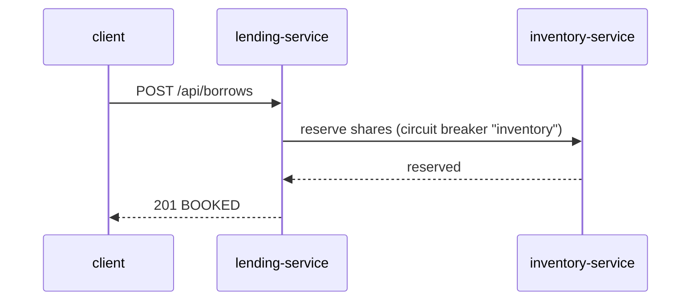

# borrow.book — Book a stock borrow
<!-- gta: flowId=borrow.book capability=rest-api risk=6 status=draft -->

## Boundary
- In scope: POST /api/borrows → reserve inventory → persist the borrow
- Out of scope: returns and recalls (see `recall.recall`)
- External: inventory-service (HTTP, behind the `inventory` circuit breaker)

## Access
| Role | Operation | Ownership constraint | Source |
|---|---|---|---|
| client | book a borrow | none | observed |

## Requirements

### Requirement: Valid quantities
<!-- gta: id=borrow.book/r01 ref=method:com.example.lending.borrow.BorrowController#book -->
IF a client books a borrow of no shares, THEN THE lending service SHALL respond 400.

#### Scenario: a borrow of no shares is refused
<!-- gta: id=borrow.book/s01 source=observed hint.layer=component hint.oracle=response priority=P1 -->
- **WHEN** client `c-1` books a borrow of `0` shares of `ACME`
- **THEN** the response status is `400`

### Requirement: Inventory outages
<!-- gta: id=borrow.book/r02 ref=method:com.example.lending.borrow.InventoryClient#reserve ref=method:com.example.lending.borrow.InventoryClient#inventoryDown -->
IF inventory-service cannot be reached, THEN THE lending service SHALL answer the booking from the fallback of the `inventory` circuit breaker.

#### Scenario: inventory-service cannot be reached
<!-- gta: id=borrow.book/s02 source=assumed hint.layer=component hint.oracle=response priority=P0 -->
- **WHEN** inventory-service cannot be reached and client `c-1` books a borrow of `10000` shares of `ACME`
- **THEN** the response status is `201` and the borrow status is `BOOKED`

## Invariants

## Open questions
<!-- gta: id=borrow.book/q01 impact=high affects=borrow.book/s02 -->
1. [high impact] When inventory-service cannot be reached, the fallback of InventoryClient reports the shares as reserved, so the borrow is booked. docs/business-rules.md says such a booking stays pending a locate. What should a booking do while inventory-service is down?
   - [ ] A) Book the borrow and answer 201 (= current code)
   - [ ] B) Keep it pending a locate and answer 503 → s02 THEN the response status is `503` and the borrow status is `PENDING_LOCATE` (recommended: docs/business-rules.md says the booking stays pending and the API answers 503)

## Findings
<!-- gta: id=borrow.book/f01 kind=behavior-suspect ref=method:com.example.lending.borrow.InventoryClient#inventoryDown -->
- The fallback returns a reservation although inventory-service did not answer.
