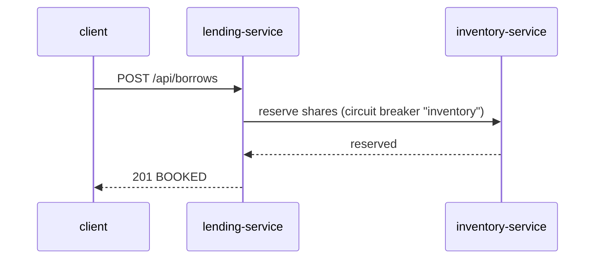

# borrow.book — 预订一笔证券借入
<!-- gta: flowId=borrow.book capability=rest-api risk=6 status=draft -->

## Boundary
- 范围内：POST /api/borrows → 预留库存 → 保存这笔借入
- 范围外：归还和召回（见 `recall.recall`）
- 外部依赖：inventory-service（HTTP，经过断路器 `inventory`）

## Access
| Role | Operation | Ownership constraint | Source |
|---|---|---|---|
| client | 预订一笔借入 | 无 | observed |

## Requirements

### Requirement: 借入数量有效
<!-- gta: id=borrow.book/r01 ref=method:com.example.lending.borrow.BorrowController#book -->
IF 客户预订的借入数量为零，THEN THE 借贷服务 SHALL 返回 400。

#### Scenario: 数量为零的借入被拒绝
<!-- gta: id=borrow.book/s01 source=observed hint.layer=component hint.oracle=response priority=P1 -->
- **WHEN** 客户 `c-1` 预订 `0` 股 `ACME` 的借入
- **THEN** 响应状态是 `400`

### Requirement: 库存服务不可用
<!-- gta: id=borrow.book/r02 ref=method:com.example.lending.borrow.InventoryClient#reserve ref=method:com.example.lending.borrow.InventoryClient#inventoryDown -->
IF 无法连接 inventory-service，THEN THE 借贷服务 SHALL 由断路器 `inventory` 的降级方法处理这笔预订。

#### Scenario: 无法连接 inventory-service
<!-- gta: id=borrow.book/s02 source=assumed hint.layer=component hint.oracle=response priority=P0 -->
- **WHEN** 无法连接 inventory-service，客户 `c-1` 预订 `10000` 股 `ACME` 的借入
- **THEN** 响应状态是 `201`，借入状态是 `BOOKED`

## Invariants

## Open questions
<!-- gta: id=borrow.book/q01 impact=high affects=borrow.book/s02 -->
1. [high impact] 无法连接 inventory-service 时，InventoryClient 的降级方法报告股票已预留，于是这笔借入被预订。docs/business-rules.md 说这样的预订应保持“待寻券”。inventory-service 不可用时，预订应该怎样？
   - [ ] A) 预订这笔借入，返回 201（= 代码现状）
   - [ ] B) 保持待寻券，返回 503 → s02 THEN 响应状态是 `503`，借入状态是 `PENDING_LOCATE`（推荐：docs/business-rules.md 说预订保持待寻券，接口返回 503）

## Findings
<!-- gta: id=borrow.book/f01 kind=behavior-suspect ref=method:com.example.lending.borrow.InventoryClient#inventoryDown -->
- inventory-service 没有应答，降级方法却返回了一个预留。
